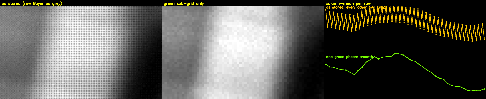
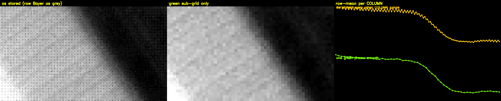
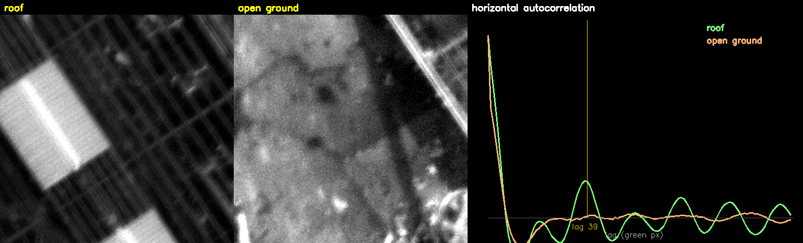
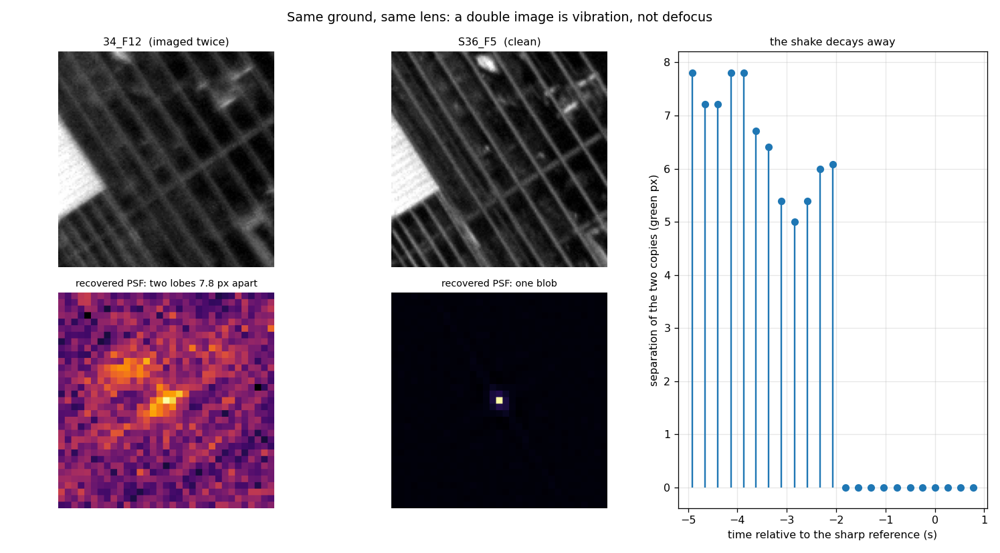
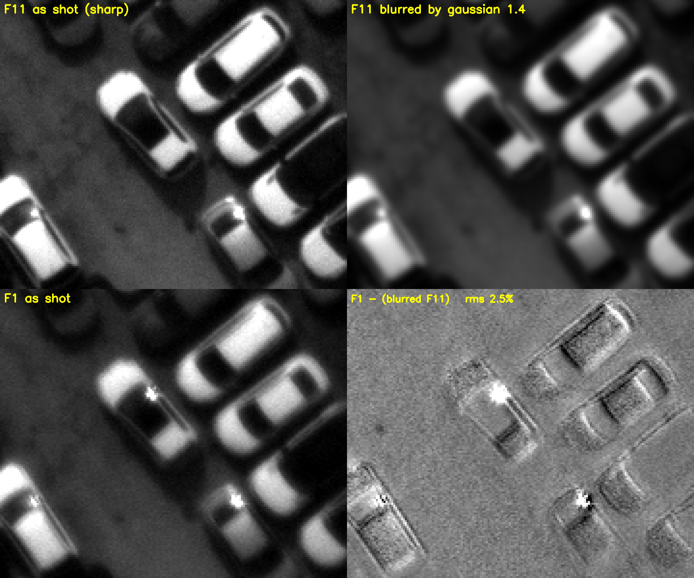

# Iron 661 Capture — Handoff Notes

> **CRITICAL — M4 vs M5 (do not get this backwards):**
> - **M4 is the FLIGHT focus mode** — the real, deployed autofocus. Its scene is
>   **moving** (the aircraft flies over ground). On the **bench** it is exercised with a
>   **static** scene only because we can't fly; that static bench case is a degenerate
>   test, NOT what M4 is for.
> - **M5 is a BENCH simulation of flight** — it moves the mirrors to fake the scene
>   changing, so the flight tracking behaviour can be validated on the bench without
>   flying. M5 is a proxy for M4-in-flight.
> - **Consequence:** both M4 and M5 run the SAME flight AF algorithm (continuous
>   tracking servo). The fast/slow servo profile must follow **detected scene motion**,
>   never the mode label — keying "M4 = static" is WRONG (M4 in flight is moving).

_Last updated: 2026-08-09 — **OrthoSim GT: the altitude readout was never a measurement**
(§29): the bench had been reporting **10,000 ft while actually simulating ~2,985 ft**, and
nothing in the decode could have noticed — speed/distance/GSD are *authored by the display*
and read back out of the optical bar, and the magnification `M` (camera-px per display-px)
is a hand-set `--M` defaulting to **1.0** that altitude scales as `1/M`. With stock settings
the chain lands on 3.505 cm/px = **9,999.8 ft by construction**. New `measure_scale()`
(`orthosim_decode.py`) measures `M` off the corner fiducials — they sit at *known display-pixel*
positions (3652 px apart), so panel pitch and focal length cancel — averaging opposite edges
so tilt cancels; logged once per session as the `--M` the display should have used. Measured
**M = 3.3553**, independently corroborated by tracker-flow-vs-encoded-speed (3.16–3.36) and
the geometric ceiling `13400/3840 = 3.49`. Relaunching with `--M 3.3553 --zoom 0.4251` gives a
**true 10,000 ft @ 100 kn**. Separately fixed the optical bar, which was failing CRC on
**100 %** of frames: `_sample_bits` used one global `(max+min)/2` while the imaged white level
**ramps >5:1 across the bar** (~205 → ~43, black flat at ~15), so the dim end's whites read as
black; now thresholded against a **local min/max envelope** (`_cell_thresholds`) — verified on
a real saved frame decoding across 38 parameter combinations with identical payload, and
**~75 %** of live frames now decode. Also: the no-decode diagnostic printed a *tautological*
`u8 min/max=0/255` (post-normalise) and only dumped debug when fiducials were **found** — the
opposite of the real failure — both fixed. **Velocity was never wrong** (`M` cancels out of
ground speed). Object lifetime at the new altitude **2.53 s → 4.26 s (10.1 → 20.4 frames)**,
and each 5 cm source pixel now spans 1.4 camera px instead of 4.5. Launch traps recorded:
`OPENCV_IO_MAX_IMAGE_PIXELS` (the ortho is 1.17 gigapixels) and **`--screen 1`** (Qt puts the
Dell 1920×1080 at index 0). New self-checks in `tools/test_orthosim.py` (19 pass).
**2026-08-09 addendum (§29.9): the bench models neither flight case.** In flight the 300 mm
shoots **long edge forward** (objects traverse 13400 px) and the 400 mm **short edge forward**
(9528 px); the bench scrolls vertically, so it traverses the short axis. At 10,000 ft / 100 kn
that makes it **1.41× pessimistic for the 300 mm** (flight = 28.6 frames) and **1.33× optimistic
for the 400 mm** (flight = 15.3 frames). The 400 mm loses twice over — short axis (0.711) **and**
faster ground flow from the longer focal length, since `GSD = h·p/f` (0.750) — for **0.533, i.e.
half the 300 mm's object lifetime**. So a dive-then-climb must fit **~15 frames**, not 20, and
the cross-object handover is **mandatory** for the 400 mm rather than an optimisation. Bench the
worst case by scaling ground speed by 400/300: **`--speed 68.59`** (133.33 kn) → 15.3 frames.
Orientation needs no code change (`leading_edge_from_motion` resolves the edge from measured
`dx`/`dy`).
Previous: 2026-08-02 — **AF climb SNR — lucky imaging + curve-fit peak (log-domain)**
(§27): the dive-then-climb peak search is now hardened against the noisier outdoor/in-flight
focus signal. Each climb position now **dwells `climb_lucky_frames=3` frames and keeps the
MAX** (lucky imaging — turbulence/vibration only ever *blur*, so the sharpest frame in a short
burst is the truest read of focus there); the peak is refined by a local **parabola fit**
(`_fit_peak`, vertex `-b/2a`) instead of a single noisy argmax; and that fit is done in the
**log domain** (`peak_fit_log`) because the variance-based metric's noise is **multiplicative**
(SD ∝ score) — `log` is the variance-stabilising transform and `log(Gaussian)==parabola`. All
three are flag-gated in `app.py` (revert: `climb_lucky_frames=1`, `peak_curve_fit=False`,
`peak_fit_log=False`). Also added a **"2-obj track"** preview button (green boxes on the coarse
preview, no AF) to eyeball leading-edge object flow, and **reverted** the M5 sweep-reversal
reset in `DualObjectTracker` (a bench-only artifact). New self-check `tools/test_af_peak.py`
(4/4). Previous: 2026-07-30 — **M6 "Timelapse" mode** (§26): a new recording mode for a
**side-by-side comparison against the Phase One camera** — mirrors held in the mid
(Focus/M4) position firing **one trigger per second**, with full-res frames written to
disk exactly like M0/M1. Added to firmware (`$M6*` → `setMode(6)`, `picsInPlaceDelay =
1000`) and the Iron661 app (`Mode.M6`, "Timelapse" button, added to `_RECORDING_MODES`).
Previous: 2026-07-30 — **encoder closed-loop autofocus (AF v2) + servo-BSOD root cause**
(§25): the AMT203S motor-shaft encoder is integrated (`EncoderTracker`/`EncoderAxis` in
`focus_axis.py`, `$ENC` parsed in `serial_client.py`; polarity is **negative** —
`encoder_counts_per_pulse=-24` — because a `-` pulse raises the count) and the M4/M5
autofocus was **rewritten** from the §24 dither servo into a paced open-loop
**dive-then-climb** engine (`autofocus_v2.py`) that only *reads* the encoder: dive below
focus (str3), climb up in fine str0 steps taking one settled `(encoder, score)` sample per
frame, peak-detect, then park by descending to the dive bottom and creeping back up onto the
peak **at the climb's own pace**. Making the climb score only the **settled** frame per step
(`climb_settle_frames`) removed the motion-lag that parked the lens a few counts below focus →
**focuses consistently** on the bench. **STOP now halts in place** (the old `park_upward`
re-park burst yanked the lens off focus and corrupted the next run). The repeated **BSODs were
the OLD flooding servo, not the hardware** — bisection: old build fine overnight, new code fine
idle, serial stress wedged the PCB but didn't BSOD, full AF cycle on the new engine completed
clean; the cure was the paced engine + **non-blocking serial TX thread** + **frame conflation**
(no GUI-thread serial blocking / 8 MB frame pileup). Still watch: BSODs were sporadic, and a
separate **firmware bug wedges the PCB after ~676 pulses** (power-cycle to recover). Committed
as "Add encoder closed-loop autofocus (AF v2)"; self-checks `tools/test_autofocus_v2.py` (9).
Previous: 2026-07-27 — **manual backlash telemetry (scrapped the automatic test)**:
the automatic on-rig backlash probe was removed after it kept mis-measuring lash (per-frame
sharpness noise + a 30 ms exposure faked an early "lens responded", giving implausible ~19-count
readings). Deleted `host/capture/focus_probe.py` + `tools/test_backlash_measure.py` and stripped
all backlash-test code from `app.py`/`focus_panel.py`/`focus_axis.py` + the `$SV`/`$FT` host
wrappers (`serial_comm.py`, `serial_client.py`); the shared AF/Lock-tile/full-res-crop infra
stays. Replaced it with a **manual workflow**: firmware `$S0*` now means the shortest reliable
move — **duty 7000 at a 3 ms pulse** (str0=7000, and `$S0*` also sets `focusTimeIncrement=3`;
`$S1*`–`$S3*` restore 10 ms) — so the operator locks a Fine tile, creeps focus with the Up/Down
hotkeys, and reads the backlash straight off an **always-on bottom-left scatter** of focus score
(Y) vs encoder count (X): the forward/back arms' horizontal gap IS the lash. A **"Log CSV"**
toggle writes `timestamp, frame, encoder, focus_score` per locked-tile frame to a
`Iron661_focus_<stamp>.csv` in the **Session logs** folder (`host/capture/focus_csv_log.py`).
Per-frame telemetry is emitted from both focus-frame handlers via `MainWindow._emit_focus_telemetry`
(Fine: `meta["best_score"]` when a tile is locked; Coarse: the pinned full-res crop score when AF
isn't running). New check `tools/test_focus_csv_log.py` (3/3). **Requires a ClearCore reflash**
for the new `$S0`/`focusTimeIncrement` behaviour. Previous: 2026-07-22 — **non-blocking focus pulses (timers, not delays) + AF servo/tile
overhaul for M4-flight & M5-bench** (§24): the ClearCore now fires focus-motor pulses off a
`millis()` timer serviced in `loop()` and inside the sweep busy-waits, so a `+`/`-` pulse no
longer **blocks** the trigger cadence — this is what made the camera frame rate collapse (2.9 Hz
vs the 4.8 Hz cap) and starved M5 during capture. Host AF was reworked to a **continuous dither
servo** with motion-adaptive fast/slow profiles, coarse sweep-to-max escalation, a servo leash,
a snap-back anchor, strong-peak lock and RProp adaptive step; tile ranking is now
saturation-aware (scores unclipped detail only); and AF now **seeds its target from the Fine
preview's held ROI** so it focuses the building/gantry you were looking at instead of re-picking
bushes on a blurry frame. Timing instrumentation (`af-time` lag/`frame_dt`) and a selection-frame
dump were added. `tools/test_autofocus.py` **27/27**. Previous: 2026-07-19 — **focus-encoder decision: motor-shaft AMT203S** (§23):
decided to add an AMT203S-V absolute encoder on the DC-motor shaft to assist AF. It
fixes the §22.1 no-move/stiction failure (verified motion + closed-loop motor
positioning + a power-persistent absolute datum for focus presets), does **not** need
to capture gear/spur lash (the contrast loop already compensates it via same-direction
dither + direction-matched landing), and is chosen over the month-long gear-output
remount and the draw-wire encoder. §23 also records the **flat-score disambiguation**
(peak vs lash vs stiction vs defocus floor). Previous: 2026-07-12 — **autofocus metric/landing fixes + bench-box BSOD analysis**
(§22): AF now uses a brightness-invariant, pre-blurred full-res metric (clean repeatable
focus peak, no more static-scene score swings) and a **direction-matched landing** that
approaches `best_pos` from the same side the search found it (closes the 13–35 %
final-vs-best gap from open-loop gear lash). SHM pool auto-scales to RAM (24 @ 64 GB
operational — unchanged; 8 @ 32 GB bench). **Three BSODs on the bench box (32 GB) are
hardware/driver, not the app** — three different stop codes in one afternoon plus a
year-long WDF_VIOLATION history predating all this work; run MemTest86. Operational 64 GB
machine unaffected. Previous: 2026-07-12 — **oblique-motor "bonkers" homing root-caused** (§21): the
capture-app-only homing failure was a **marginal 24 V supply** — under two-camera load
the oblique couldn't reach its hard-stop torque threshold so HLFB never asserted (8 s
timeout). Raising to nominal **28 V** fixed it (5/5 homing success, ~4.6 s). ClearCore
firmware reflashed with kept **safe-abort** (a motor that fails to home / a sweep that
keeps faulting now disables + drops to mode 0 instead of hunting forever) and the
`home wait N ms` diagnostic. Previous: 2026-07-09 — **OrthoSim ground-distance ruler +
fast-load** (§20):
new human-readable scale (toggle **G** / `--scale`) locked to the imagery for reading
distance/speed and effective GSD from the Iron661 image; new `--reduce {1,2,4,8}`
decodes the gigapixel ortho at 1/N res (GSD auto-scaled) so it loads in seconds; window
now fits the screen. Launch caveat: agent-spawned Qt apps inherit
`QT_QPA_PLATFORM=offscreen` (invisible) — override with `windows` when launching for
display. Previous: 2026-07-09 — first **autofocus ground-test session** (§18): ran the
hardware-free simulator path (§14.7 layer 1); new `tools/af_ground_test.py` metrics
sweep reports **54/54 runs converged** — the software baseline for the real rig.
ClearCore reflashed 2026-07-09 (unblocks on-hardware M5); exposure/gain left unlocked
in M5 by operator choice (§16.3 decision closed). Previous: 2026-06-30 — project is
now under Git (§13); Iron661Capture,
Parallax Export Studio, shared source, build specs, docs, ClearCore sketch, and the
KAYA runtime dependency copy are intended to be committed so the apps can be run
from the repository going forward. Previous: 2026-06-29 — GPS correlator
**latest-fix fallback** (§12), Parallax Export Studio GUI tweaks (§12), and both
apps rebuilt + redeployed to `C:\Parallax Apps`. Use this to pick up work on
another machine._

> **TL;DR of current state:** The GPS correlation pipeline is **fixed and validated
> end-to-end** (TOW-based sweep segmentation — see §9). A 1820-frame / 140-sweep /
> ~7-min live capture matched **100% on all 3 cameras with 0 stale / 0 misses** and
> passed every on-disk integrity check. GPS-parser log spam was reduced to
> errors-only (§10); GPS auto-detect now prefers "Septentrio Virtual USB COM Port 1"
> (§11). The app is **rebuilt (on local NTFS — see §4 PKG warning) and deployed** to
> the default folder `C:\Parallax Apps\Iron661 Capture`; the deployed EXE **launches
> cleanly** (smoke-tested, no PKG popup, window title shown).

This document summarizes the current state of the **Iron661Capture** app and the
work done in the most recent session, so you can continue seamlessly elsewhere.

---

## 1. What the app is

`Iron661Capture` is a PySide6 desktop app that runs a 3-camera Iron 661 rig:

- Live preview (one camera at a time), M0/M1 sweep capture to per-camera U.2
  drives, M3 manual line capture, and M4 tile-based focus mode.
- Talks to a **ClearCore PCB** over serial (mode/camera/focus/trigger control).
- Reads **GPS** (Septentrio SBF) off a COM port and correlates fixes to frames.
- Uses the **KAYA GenTL** SDK (`.cti`) for the frame grabbers.

### Entry point & layout

- Entry script: `host/main_capture.py` (keeps heavy imports inside
  `if __name__ == "__main__"` for the multiprocessing-spawn writer subprocesses).
- Main GUI window: `host/capture/app.py` → `class MainWindow(QMainWindow)`.
- Capture pipeline: `host/capture/pipeline.py`
  (`AcquisitionThread`, `CameraPipeline`).
- GPS: `host/capture/gps_receiver.py`, `gps_correlator.py`, `gps_fix.py`,
  `sbf_parser.py`.
- Session logging (added this session): `host/capture/session_log.py`.
- PyInstaller spec: `host/Iron661Capture.spec`.

> The project is now a **Git repository** on branch `main`. Use Git commits for
> restore points instead of manual `_backups/` snapshots where possible. The project
> still lives on Google Drive (`My Drive/...`), so avoid building PyInstaller output
> directly into the repo folder; see §4.

---

## 2. Environment / prerequisites

- **Windows**, Python **3.14** (`py -3` → 3.14.3 on the rig; the build interpreter
  is `C:\Users\USER\AppData\Local\Python\pythoncore-3.14-64`). Earlier sessions used
  3.12; all runtime + build deps now resolve cleanly under 3.14.
- Install deps from `host/`:
  ```
  py -3 -m pip install -r requirements.txt -r requirements-build.txt
  ```
- KAYA Instruments drivers + GenTL producer (`.cti`) for real hardware. The repo
  bundles a copy under `KAYA Instruments/Common/bin` and the app auto-detects via
  `GENICAM_GENTL64_PATH`. On a dev machine **without** a frame grabber you will
  see `KY_DeviceScan found no frame grabbers` and a "Camera open failed" dialog —
  this is expected; the GUI still launches.

---

## 3. How to run (from source)

From the repo root:

```
py -3 host/main_capture.py
py -3 host/main_capture.py --cti "C:\Program Files\KAYA Instruments\Common\bin\KYFGLibGenTL_vc141.cti"
py -3 host/main_capture.py --port COM7        # ClearCore PCB (else auto-detect)
py -3 host/main_capture.py --gps-port COM4    # Septentrio SBF (else auto-detect)
```

## 4. How to build & deploy the EXE

PyInstaller **onedir** build.

> ⛔ **CRITICAL — never build onto Google Drive.** The repo lives on `G:\My Drive\…`
> (a virtual/streamed filesystem). If PyInstaller's `COLLECT` writes the EXE there,
> the embedded PKG tail is corrupted and the EXE dies at launch with
> *"Could not load PyInstaller's embedded PKG archive"* (full write-up:
> `docs/pkg_issue.md`). The smoking gun is COLLECT taking ~160 s on `G:` vs <30 s on
> `C:`. **Always redirect `--distpath`/`--workpath` to real local NTFS.** Only the
> output bytes must be local; the `.spec` can stay on Drive.

Canonical flow, run from `host/`:

```
py -3 tools\make_exe_icon.py                                   # (re)build the .ico (data file; Drive OK)
$r = Join-Path $env:LOCALAPPDATA 'Iron661Build'
py -3 -m PyInstaller --noconfirm --clean --distpath "$r\dist" --workpath "$r\build" Iron661Capture.spec
.\install_parallax_desktop.ps1                                 # deploy + desktop shortcut
```

- The bundle lands at `%LOCALAPPDATA%\Iron661Build\dist\Iron661Capture\` (local NTFS).
- **Default deploy folder is `C:\Parallax Apps\Iron661 Capture`** (note the spaces;
  matches the sibling tools `C:\Parallax Apps\Bay14Reader` / `…\GPS Correlator`),
  hard-coded as `$dst` in `host/install_parallax_desktop.ps1`. The installer
  **prefers the local build output** above, mirrors it with `robocopy /MIR`, and
  refreshes the desktop shortcut `Parallax Iron661 Capture.lnk`. It only falls back
  to the on-Drive `host\dist\` (and warns) if no local build exists.
- PyInstaller: **6.20.0**; bundle ≈ 903 MB, launcher exe ≈ 11 MB.
- **Smoke-test the EXE for real** before declaring success: the PKG popup leaves the
  process alive, so check `(Get-Process -Id <pid>).MainWindowTitle` is non-empty (or
  eyeball the window) — a bare "process didn't exit" check passes even when broken.

> **Gotchas:**
> - `host/build_windows_release.ps1` (the older one-shot script) sets
>   `$ErrorActionPreference='Stop'`, so it **aborts on step 1** when `pip` prints its
>   upgrade notice to *stderr*. Until patched, run the steps above directly (deps are
>   already installed). Build log: `host/build_iron661.log`.
> - The 2026-06-04 ~15:18 deploy was built **onto Drive** and hit the PKG popup; it
>   was rebuilt onto local NTFS afterwards. Don't repeat that mistake.

---

## 5. Changes made in the most recent session

All changes are in `host/capture/` and compile cleanly (`py_compile`, no lint
errors). They were verified by launching from source (no hardware, so camera/
preview/GPS data paths were not exercised live).

### 5.1 Human-readable session log — `session_log.py` (new) + `app.py`
- New `SessionLogger` class writes a plain-text `.txt` log per session.
- **Location:** next to the app's EXE (frozen) / `host/` (dev). Falls back to
  `%LOCALAPPDATA%\Iron661Capture\logs` → home → temp if not writable. Override
  with env var `IRON661_LOG_DIR`.
- **Filename:** `Iron661_session_YYYYMMDD_HHMMSS.txt`.
- **Header** includes **Build date** (EXE mtime, or `main_capture.py` mtime in
  dev) and **Session start** time, then the log file path.
- **Captures:** everything in the on-screen log window (via `_log`), every
  button press (`[BUTTON]`), error/confirmation dialogs (`[ERROR]`/`[DIALOG]`),
  a periodic GPS position line every 10 s (`[GPS]`, `GPS_LOG_INTERVAL_S`), and a
  per-line summary on line close (`[LINE]` acquired/written/dropped). Footer has
  session end + duration.
- Integration points in `app.py`: `MainWindow.__init__` (creates logger +
  `_line_count_baseline`), `_log`, `_install_button_press_logging` /
  `_log_button_press`, `_on_bringup_failed`, the reset-cameras dialog,
  `_log_gps_position`, `_capture_line_baseline` / `_log_ended_line_summary`
  (hooked into `_open_lines_for_active_pipelines`, `_close_all_lines`, and the
  drive-change line roll), and `closeEvent` (calls `_session_log.close()`).

### 5.2 Build date shown in GUI — `app.py` (matches Bay14Reader)
- Window title: `Iron 661 Capture + Focus  (build YYYY-MM-DD)`.
- Permanent gray `Build: YYYY-MM-DD` widget in the status bar.
- Source: `session_log.build_date("%Y-%m-%d")`.

### 5.3 "Reset counters" button — `app.py`
- New button in the Project header row (next to "Test trigger ($T)").
- `_on_reset_counters_clicked`: calls `CameraPipeline.reset_counters()` on every
  camera (zeroes acquired/written/dropped, labels flip to 0). Does **not** touch
  cameras/serial/open line files. Re-pins any open line's summary baseline to 0.
- `CameraRow` now tracks numeric counts (`frame_counts()` →
  `(acq, written, dropped)`), used by the per-line summary too.

### 5.4 Exposure/Gain now affect only the **previewed** camera — `app.py`
- `_on_preview_sensor_apply`: writes to `_active_pipeline()` (the camera whose
  preview radio is on) instead of all cameras. Warns if none is previewed.
- `_sync_preview_sensor_fields`: reads displayed values from the previewed camera
  (falls back to lowest cam number if none selected); auto-refreshes when the
  preview camera changes. Tooltips updated.

### 5.5 100% full-resolution preview zoom toggle — `app.py` + `pipeline.py`
- **Toggle button at the top-left corner of the preview window**
  (`_PreviewDisplayLabel.set_corner_button`). Checkable: "Zoom: Fit" ↔
  "Zoom: 100%". Disabled in M4.
- `app.py`: `_on_preview_zoom_toggled`, `_push_preview_zoom_size`,
  `_preview_zoom_on` state; `_scale_preview_to_label` shows the crop 1:1 in zoom
  mode; crop size re-pushed on resize / splitter move / preview switch.
- `pipeline.py`: `AcquisitionThread.set_preview_zoom` /
  `set_preview_zoom_size` (+ `CameraPipeline` pass-throughs); new
  `_full_res_center_crop_gray8()` builds a native-resolution center crop from the
  **full-res shared-memory slot** (read *before* the slot is submitted to the
  writer — important to avoid racing the writer subprocess). Falls back to the
  decimated whole-frame preview when no full-res payload is available for a frame.
  Full-res emission is only ON in M0/M1, so zoom is meaningful there.

---

## 6. Known state / testing notes

- All edits compile (`py -3 -m py_compile ...`) and pass `ReadLints`.
- Verified the app **launches** from source repeatedly; session log is written
  and contains the header, log lines, button presses, error dialog, periodic GPS
  status, and footer.
- **Hardware-tested on the rig (2026-06-04, 3 cameras + ClearCore + GPS,
  serials 2439006/7/8, drives D:/E:/F:):**
  - **Preview zoom toggle (§5.5) — PASS.** Toggled "Fit" ↔ "100% full-res crop"
    multiple times in M1 with live frames. The crop tracked the window on
    resize, and crucially the writer pipeline was unaffected during zoom-on
    (`dropped=0 failed=0 packed_drops=0`), confirming the full-res crop is read
    from the SHM slot *before* it is submitted to the writer.
  - **Reset counters button (§5.3) — PASS.** `Reset counters: zeroed
    acq/written/dropped on 3 camera(s).` with no per-camera failures. Cameras
    stayed armed, writer packed-totals kept advancing, open lines untouched.
  - **Per-camera exposure/gain (§5.4) — PASS.** Editing the previewed camera
    (e.g. `cam3 ExposureTime=1000 → OK (verified=1000.0)`, `Gain=3 → OK`) wrote
    only to that camera and verified back from the device.
  - **Throughput sanity:** sustained full M1 continuous at ~4.3 Hz/camera × 3
    (~2.7 GB/s aggregate, ~0.9 GB/s per U.2) with **zero backpressure drops**.
    The only drop observed was a single ≤1-frame/camera blip at an M0→M1 line
    roll (`no .bay14line container is open`) — the io_writer container-open
    handshake briefly lagging the host during the transition, which recovers
    on the next frame and does not accumulate in steady state.
  - On first launch the grabber enumerated only 2 of 3 cameras (transient
    CXP/enumeration hiccup); a relaunch cleanly saw all 3.
- **GPS correlation (TOW fix, §9) — PASS (2026-06-04 PM).** A long live capture
  (1820 frames, 140 sweeps, ~7 min, multiple container rolls) reported
  `matched=1820 (100%) stale=0 out_of_future=0 no_event=0` on all 3 cameras.
  On-disk `tools/bay14_gps_check.py` over the 162 GB result: 100% GPS coverage on
  every (camera, line, sweep), 0 cross-camera TOW mismatches, 0 monotonicity
  violations, and visible sweep structure (intra ~225 ms vs inter ~302 ms).
- The deployed EXE at `C:\Parallax Apps\Iron661 Capture` is **current and launches
  cleanly** — built on local NTFS (`%LOCALAPPDATA%\Iron661Build`) and smoke-tested
  2026-06-04 ~16:00 (window title `Iron 661 Capture + Focus (build 2026-06-04)`, no
  PKG popup). An interim build written onto Drive earlier that afternoon hit the PKG
  popup; see §4 for why and the mandatory local-NTFS build.

## 7. Suggested next steps

1. ~~On the rig: verify the zoom toggle in M0/M1, per-camera exposure/gain, and
   the `[LINE]` summary deltas.~~ **Done 2026-06-04 — all passed (see §6).**
2. ~~Rebuild the EXE and confirm the session log lands next to the EXE with the
   correct build date.~~ **Done 2026-06-04 PM — rebuilt & deployed to
   `C:\Parallax Apps\Iron661 Capture` (see §4).**
3. ~~Fix GPS correlation (low fix rate / monotonicity violations).~~ **Done &
   validated 2026-06-04 PM — TOW-based sweep segmentation, 100% on a 1820-frame
   live capture (see §9).**
4. **Watch for a recurrence of the "stale storm."** One earlier run hit 0% matches
   (all frames `stale`); it did **not** reproduce on the longer capture, so it is
   intermittent and currently un-reproduced. The `stale-age` diagnostic (§9) is in
   place to measure the exact frame-vs-event offset if it returns — if you see a
   `stale-age` line in a correlator summary, send it over to pick the targeted fix
   (widen `STALE_AHEAD_MS`, timestamp at true acquisition, or sequence alignment).
5. Patch `host/build_windows_release.ps1` so it survives `pip`'s stderr notice
   (e.g. relax `$ErrorActionPreference` around the pip call or `2>&1` it), so the
   one-shot build script works end-to-end again (see §4 gotcha).
6. Optional polish: surface the session-log path in the on-screen log at startup;
   add a `--log-dir` CLI flag; make the zoom crop demosaiced (currently raw Bayer
   shown as grayscale, so a faint checkerboard is expected at 100%).
7. Optional: suppress/relabel the single `no .bay14line container is open` drop
   at mode-transition line rolls so it isn't conflated with genuine backpressure
   drops (see §6 throughput note).

## 8. Quick file reference

| Area | File |
|------|------|
| Entry point | `host/main_capture.py` |
| Main window / all UI + handlers | `host/capture/app.py` |
| Acquisition + writer pipeline | `host/capture/pipeline.py` |
| Session log file | `host/capture/session_log.py` |
| GPS receive/correlate | `host/capture/gps_receiver.py`, `gps_correlator.py`, `gps_fix.py`, `sbf_parser.py` |
| PyInstaller spec / installer | `host/Iron661Capture.spec`, `host/install_parallax_desktop.ps1` |
| GPS diagnostics (offline) | `tools/bay14_gps_check.py`, `tools/sbf_gap_analysis.py`, `tools/validate_tow_fix.py`, `tools/frame_event_lag.py`, `tools/test_gps_correlator.py` |
| Raw SBF taps (when `GPS_SBF_TAP_DIR` set) | `tools/taps/*.sbf`, `tools/taps/*.timing.jsonl` |
| Manual backups | `_backups/` |

---

## 9. GPS correlation — TOW sweep-segmentation fix (2026-06-04 PM)

**Problem.** The correlator originally split the GPS event stream into "sweeps"
(one container roll = 13 trigger events) using **host-arrival time gaps**. USB
batching of SBF blocks makes those host gaps jittery, so sweeps were mis-segmented
("gen-counter drift"), producing a low GPS fix rate and TOW-monotonicity violations.

**Fix.** Segment sweeps by **SBF Time-of-Week (TOW) gaps** instead — TOW is the
GPS-clock timestamp on each `ExtEventPVTGeodetic` event and is jitter-free.
Implemented in `host/capture/gps_correlator.py`:
- New threshold `SWEEP_TOW_GAP_MS = 280.0` (intra-sweep ~225 ms, inter-sweep
  ~300 ms, so 280 ms cleanly separates them); `__init__` takes `sweep_tow_gap_ms`.
- `add_event` starts a new sweep when `tow_gap_ms > SWEEP_TOW_GAP_MS` or
  `tow_gap_ms <= 0` (week rollover / reset). Falls back to host-arrival gaps only
  when `event.tow_ms` is `DNU_U4` (Do-Not-Use).

**Diagnostics added.**
- `stale-age` instrumentation in `GpsCorrelator` (+ printed by `app.py`'s
  `_log_gps_correlator_stats`): on a `stale` miss it records the signed age
  (min/avg/max ms) of the closest candidate, i.e. the exact `frame_perf_ns` vs
  `event_host_perf_ns` offset. **Only prints when stale misses occur**, so a clean
  run shows no `stale-age` line.
- `tools/bay14_gps_check.py` — line/run-aware on-disk validator (per-camera/line/
  sweep coverage, cross-camera identity, TOW monotonicity, intra/inter-sweep
  deltas). Use `--root` (accepts multiple) and `meta_only` fast path.
- `tools/sbf_gap_analysis.py` — host-gap vs TOW-gap comparison + cumulative drift.
- `tools/validate_tow_fix.py` — time-ordered offline correlator sim against a raw
  SBF tap (de-batched host times); reports matched/wrong/missed.
- `tools/frame_event_lag.py` — wall-clock lag between frame acquire and event
  arrival across a capture.
- Regression unit tests in `tools/test_gps_correlator.py`
  (`TowSegmentationTests`): batched host timestamps must not split a sweep; a TOW
  gap must start a new sweep even at zero host gap.

**Result.** See §6 — 100% match on a 1820-frame live capture, all on-disk checks
pass.

**Optional raw tap.** Set env `GPS_SBF_TAP_DIR` before launch to record the raw SBF
byte stream + per-block arrival timings to `tools/taps/` for offline replay/debug.

---

## 10. GPS-parser log-noise reduction (2026-06-04 PM)

The receiver emits cumulative parser stats every few seconds; previously `app.py`
logged a `GPS parser: good=… events=… bad_crc=…` line **every interval**, flooding
the GUI/session log. `_on_gps_parser_stats` now:
- Stays **silent while healthy**.
- Logs `GPS parser: PROBLEM -- bad_crc +N bad_len +N skipped +N B (cumulative: …)`
  **only when an error counter actually increases** since the last sample (tracks
  deltas; treats a negative delta as a reconnect/reset and counts from 0).
- Emits a **single** `GPS parser: receiving events (good=N)` the first time events
  flow, as a one-time "link alive" confirmation.
- `events_skipped_unknown` is intentionally **not** flagged (it just means other
  SBF block types are on the wire — benign).
- `_on_gps_connection_changed` resets the watcher state on each (dis)connect.

Full cumulative parser/correlator totals are still dumped on disconnect, so nothing
is lost for post-run diagnostics.

---

## 11. GPS auto-detect — preferred SBF port (2026-06-04 PM)

A Septentrio receiver enumerates **several** virtual USB COM ports; only one
carries the SBF stream. `GpsReceiver.auto_detect()` (`host/capture/gps_receiver.py`)
used to return the *first* port matching any Septentrio hint, which could pick the
wrong one. It now:
1. **Prefers** a Septentrio port whose driver label contains
   `SEPTENTRIO_PREFERRED_LABEL = "virtual usb com port 1"` (i.e. "Septentrio
   Virtual USB COM Port 1").
2. Falls back to the previous first-hint match if that exact label isn't present.

The chosen path is logged (`GPS auto-detect (preferred SBF port): …` /
`… (fallback hint …)`). A CLI `--gps-port COMx` still overrides auto-detect.

---

## 12. GPS latest-fix fallback + Parallax Export Studio GUI (2026-06-29)

### 12.1 Why — a whole line lost embedded GPS (L14)

On the 2026-06-23 flight, line 14 had **0% embedded GPS** on all 3 cameras even
though the receiver *was* logging that line's events (they show up in the external
SBF export and were ~0.1 s fresh in the live preview). Root cause: the live
correlator's per-slot lookup (`pop_fix_for`) returned `None` for every L14 frame —
the camera's `frame_in_sweep` had drifted out of phase with the GPS sweep
segmentation (triggered by L14's turbulent start: abnormal 83 s / 16 s sweep pauses),
so no slot entry matched even though a correct, temporally-adjacent fix was sitting
in the table under a different slot key.

### 12.2 Fix — latest-fix fallback in `GpsCorrelator` (`host/capture/gps_correlator.py`)

When the per-slot lookup finds nothing for a frame, `pop_fix_for` now falls back to
the **most recent fix of any slot** if it's still fresh, instead of returning `None`:

- New tunable `LATEST_FALLBACK_AHEAD_MS` (default = `STALE_AHEAD_MS` = 1500 ms) and
  `__init__` arg `latest_fallback_ms`. The fallback accepts `self._latest` when
  `-FUTURE_MS <= (frame_perf_ns - latest_host_perf_ns) <= LATEST_FALLBACK_AHEAD_MS`.
- **A genuine GPS outage leaves `_latest` older than the bound**, so the fallback
  declines and the frame still goes out with no fix — it only rescues the out-of-phase
  case, never fabricates a position from minutes-old data.
- Set `latest_fallback_ms=0` to disable and restore the strict slot-only behaviour.
- `GpsFix` / `to_dict()` are **unchanged** (the schema flows into chunk headers +
  downstream parsers), so a fallback fix looks like any other embedded fix on disk.

**Traceability.** New per-camera `fallback_latest` counter in `_CameraState`,
surfaced in `stats()` and cleared by `reset_stats()`. `app.py`'s
`_log_gps_correlator_stats` now reports `with_fix=N (X%) [matched=… fallback_latest=…]`
so you can see how many frames were rescued vs. matched directly per line.

**Tests.** `tools/test_gps_correlator.py` `MissedEventTests` updated/extended:
missing-slot-with-fresh-latest now returns the fallback fix; missing-slot with a
stale latest still returns `None`; and `latest_fallback_ms=0` restores strict mode.
All 16 tests pass.

> **Related offline finding (Parallax Export Studio).** Lines 9/10 failed to
> correlate against the external SBF file because they contained long *intra-line*
> inter-frame pauses (63.8 s / 74.2 s) that, at the old `cluster_gap_s=60 s`, split a
> single line across multiple SBF clusters (the matcher needs one contiguous
> cluster). Raising the cluster gap to ~80–120 s merges them and they match cleanly —
> hence the new GUI default below.

### 12.3 Parallax Export Studio GUI (`tools/gps_export_studio_gui.py`)

- TIFF-mode radio labels now show the on-disk frame size (uncompressed,
  `13400×9528`, `compression=None`, binary MB as Windows Explorer reports):
  - "Raw Bayer uint16 (14→16 shift)" → **"Grayscale (~243 MB/frame)"** (1×u16)
  - "Demosaiced RGB uint16" → **"RGB (~731 MB/frame)"** (3×u16)
- **RGB is now the default** TIFF mode (was raw/grayscale).
- **Correlation parameters → Cluster gap** default changed `60 s` → **`80 s`**.

### 12.4 Build & deploy (both apps → `C:\Parallax Apps`)

Both apps were rebuilt from source on **Python 3.12.10 / PyInstaller 6.20.0** onto
local NTFS (`%LOCALAPPDATA%`) — never directly onto Google Drive (see §4 PKG
warning) — then mirrored with `robocopy /MIR`:

- `C:\Parallax Apps\Parallax Export Studio\Parallax Export Studio.exe`
  (built via `tools/ParallaxExportStudio.spec`).
- `C:\Parallax Apps\Iron661 Capture\Iron661Capture.exe`
  (built via `host/Iron661Capture.spec`).

> **Gotcha:** the `WScript.Shell` COM call that creates the desktop shortcut hangs
> under headless automation, which stalls `host/install_parallax_desktop.ps1`
> mid-run. The app bundle still copies fine — only the optional
> `Parallax Iron661 Capture.lnk` desktop shortcut may need to be (re)created by hand.
> Neither deployed EXE was smoke-launched this session (Iron661 needs the camera
> hardware; the dev machine self-exits without it).

---

## 13. Git workflow (2026-06-30)

The repository was initialized on branch `main` with a first source-only commit:

```
16c57b7 Initial project setup
```

The current Git baseline should include the runnable/rebuildable app source:

- `host/` — Iron661Capture app, including `host/Iron661Capture.spec`, build/deploy
  scripts, assets, requirements, and `host/capture/`.
- `tools/` — Parallax Export Studio (`tools/gps_export_studio_gui.py`,
  `tools/gps_export_studio_core.py`, `tools/ParallaxExportStudio.spec`) plus shared
  Bay14/GPS/export utilities used by the studio.
- `Parallax_CLRCR_V2_4/` — current ClearCore sketch used by the capture rig.
- `KAYA Instruments/` — local copy of the KAYA runtime/GenTL dependency used for
  hardware bring-up when the system install is unavailable.
- `docs/` and `HANDOFF.md` — operational notes and build/run documentation.

Ignored on purpose: generated `build/` and `dist/` folders, logs, session logs,
Python caches, raw captures, TIFF exports, archives, temporary folders, and manual
backup snapshots. Those can be regenerated or are too large/noisy for normal Git
history.

Useful commands from the repo root:

```
git status
git add <files-or-folders>
git commit -m "Describe the checkpoint"
git log --oneline --max-count=5
```

---

## 14. Autofocus — M4 (2026-06-30)

Contrast-detection autofocus (CDAF) for the M4 focus mode. It copes with the
in-flight scene (which changes rapidly but overlaps frame-to-frame) by tracking a
high-texture patch and hill-climbing the open-loop focus motor. Implemented in
`host/capture/autofocus.py` (`AutoFocusEngine` = hardware-free state machine;
`AutoFocusController(QObject)` = Qt wrapper + multi-camera sequencing), wired into
`host/capture/focus_panel.py` and `host/capture/app.py`, reusing the winning-tile
scorer (`sharpness.find_best_tile` / `score_tile_subsampled`) and `tile_geometry.TileGrid`.

### 14.1 Requirements (as specified)

- The aircraft is **in flight**: the scene changes rapidly, but consecutive frames
  overlap heavily, so it is **not** an independently pollable variable — a focus
  metric measured across focus positions is confounded by content motion unless we
  track the same physical patch.
- **Hardware limits:** brushed DC focus motors, **no encoder**, all **3 motors driven
  by one H-bridge, relay-selectable** (`$Cn*`). Therefore autofocus runs on **one
  camera at a time**. (Per-motor encoders are planned later — see 14.8.)
- Use the **winning-tile** strategy to pick an object to focus on and **keep it in
  the FOV as long as possible** — but pick it from the **leading edge of the frame**
  (the side facing flight direction: top/bottom/left/right) so the object traverses
  the whole frame before exiting (maximum dwell time), rather than from the central
  circle.
- Support an **operator-assisted** workflow: the operator does a coarse focus to get
  close, and AF fine-tunes from there (default). A **full-auto** bracket search is
  also available.
- The focus loop need **not be human-usable**, so the M4 cadence is pushed toward the
  camera's **~209 ms (~4.8 FPS)** trigger limit (faster convergence + smaller per-step
  scene shift). The old **250 ms** figure was **not** a hardware floor — it was an
  arbitrary `if (picsInPlaceDelay<250)` clamp in `Parallax_CLRCR_V2_4`. The firmware now
  (a) treats `picsInPlaceDelay` as the **trigger-to-trigger period**, gated on
  `lastFrameTime` exactly like the sweep path (so the trigger pulse `picDelayCurr` is
  absorbed *within* the period instead of added on top of a trailing delay), and (b)
  floors the `<` command at **`minTimeBetweenFrames` (209 ms)** — the camera's real
  ceiling — so sending `<` drives M4 straight to max FPS. Host `FOCUS_TAP_MIN_INTERVAL_S`
  was lowered 0.25→0.21 (~4.76 Hz) to match, so the focus tap isn't the bottleneck.

### 14.2 Approach

1. **Leading-edge winning tile.** `tile_geometry.TileGrid` gained a selection region
   (`region="circle"` default, or `region="edge"` with `lead_edge` ∈
   {top,bottom,left,right} and `edge_band` band-depth fraction). AF lays candidate
   tiles along the leading-edge band and scores them with the existing sharpness
   metric to pick a high-texture target. The M4 fine preview still uses
   `region="circle"`.
2. **Automatic leading-edge detection.** The leading edge = the edge **opposite the
   image-motion vector**, which the patch tracker measures via phase correlation
   (`cv2.phaseCorrelate`). So the band is derived automatically; an explicit
   `lead_edge` hint (e.g. from GPS track) can seed it. If motion is indeterminate
   (hover / no parallax), AF falls back to the central circle.
3. **Patch tracking.** Each frame the tracker estimates the global shift and moves the
   ROI to follow the same physical content, so the sharpness metric is comparable
   across focus positions. Re-acquire when tracking is lost or the patch reaches the
   trailing edge.
4. **Open-loop hill climb.** No encoder, so "position" = cumulative signed pulse count
   (1 pulse = 10 ms drive). Climb to the sharpness peak, remember the best, and return
   to it (approximate; backlash-compensated).

### 14.3 State machine

`IDLE → ACQUIRE (pick leading-edge target) → MEASURE (median of N frames) → MOVE
(pulse + settle) → … → RETURN_TO_BEST → DONE`, with `FAILED` on persistent low
texture / lost tracking / safety cap. Each focus frame advances the machine; pulses
are clocked by frame arrivals plus a settle count.

### 14.4 Config (`AutoFocusConfig`)

`assisted` (default True), `step_pulses` / `coarse_step_pulses`,
`assisted_bracket_pulses` (max excursion per side in assisted mode),
`max_total_pulses` (hard safety cap), `settle_frames`, `measure_frames`,
`patience` (flat/declining steps before reversing/stopping; `best` advances on any real gain),
`backlash_pulses` (extra pulses sent on every direction reversal — calibratable),
`strength` (`$Sn` level used during a run), `min_texture_score` /
`max_low_texture_frames`, `edge_band`, `drive_cadence_to_min`.

### 14.5 UI (`FocusPanel`)

Adds **Auto-focus** (current camera), **Auto-focus all** (cycles cam1→2→3 via the
`$Cn*` relay), **Stop**, an **assisted / full-auto** selector, and a status/progress
readout. Strength + camera radios are reused. Camera/strength/mode controls are
locked while a run is active.

### 14.6 Failure-mode & non-flight-motion handling

- **Intermittent** low texture (e.g. oblique sky phase) → **pause and resume**: those
  frames are not counted, focus is held, and the climb resumes when texture returns.
  **Persistent** low texture (> `max_low_texture_frames`) → abort.
- **Oscillating / reversing motion** → hysteresis: the same patch is tracked through
  reversals (long dwell); the leading edge is locked at acquisition, not re-picked per
  reversal.
- **Keep exposure/gain fixed during a run** (auto-exposure off) so the metric isn't
  confounded; the M4 sensor controls are already disabled in M4.
- A genuine **GPS/motion outage** never fabricates motion — AF just falls back to the
  central circle.

### 14.7 Ground testing (cameras stationary, mirrors move)

The mirror rig is not aircraft-like: the **vertical (nadir)** camera sees **left↔right**
travel; the **oblique** cameras trace a **circle whose top is sky-only**. The AF is
motion-agnostic (leading edge derived from measured motion; cyclic/oscillating cases
handled above), so the rig is a valid and *repeatable* exerciser. Layered tests:

1. **Hardware-free closed loop (CI):** `tools/test_autofocus.py` runs the full engine
   against a software **focus simulator** in `frame_grabber_sim.py`
   (`FocusSceneSimulator`) — a textured scene whose **blur is a function of a simulated
   focus position**, with selectable motion profiles: flight translation, nadir L-R
   oscillation, and oblique circle-with-sky. AF pulses drive the simulated motor →
   blur changes → loop closes entirely in software. Asserts convergence near the
   optimum, sky-phase pause/resume, and reversal/backlash handling.
2. **Optical bench (rig validation):** fixed textured **resolution target**
   (slanted-edge / Siemens star) at constant distance + moving mirror. Manually find
   true best focus, defocus by a known amount, run AF, and measure **accuracy**
   (vs manual best), **repeatability** (spread over N runs), **convergence time**
   (frames/pulses), and **sky-sector behavior**. Mirror motion is repeatable, so the
   numbers are comparable run-to-run. Keep the target far enough that mirror angle
   doesn't materially change subject distance.
3. **Offline replay (partial):** push recorded frames (captures, `Training pictures/`,
   `exp_123.tif`) through the tracker + leading-edge + sharpness metric to validate
   selection/tracking/metric on real imagery. Focus *actuation* can't be replayed.

### 14.8 Future: per-motor encoders

Encoders (planned) will allow closed-loop positioning, exact and repeatable
return-to-best, and faster convergence. The engine is structured so a future
`FocusAxis` abstraction (reporting real position instead of cumulative pulse counts)
can replace the open-loop pulse bookkeeping without touching the search logic.

## 15. Ground-test mode — M5 (2026-07-02)

`$M5*` is an **on-hardware** ground-test mode: it moves the mirrors like the M0/M1
sweep but drives autofocus **in the background** so the real AF loop can be exercised
against a *physically* moving scene on the bench (stationary cameras, moving mirrors —
see §14.7 for why the rig is a valid exerciser). It complements the hardware-free
simulator loop in `tools/test_autofocus.py`; here the actual focus motor, relay mux,
camera, and host AF engine all run together. **Preview-only — M5 writes no frames to
disk** (a "save during M5" toggle can be added later).

### 15.1 Why a new mode (non-blocking stepped sweep)

The normal `Sweep()` is a single blocking `for` loop over all `Positions`, so serial
(the AF `+`/`-` pulses) is only serviced *between whole sweeps* — useless for a
background focus loop. M5 instead advances **one mirror position + one frame per
`loop()` iteration** (`SweepStepM5()`), then returns so `CheckMessages()` can apply any
pending AF pulses **before the next move**. The mirror sweep (servos) and the focus
motor (H-bridge) are independent actuators, so there is no contention.

### 15.2 Firmware (`Parallax_CLRCR_V2_4.ino`)

- Globals: `basePositions = 13` (normal sweeps), `m5Positions = 40` (ground-test,
  user-adjustable), `m5Index` (current step). `verticalAngles[]` enlarged `20 → 64`.
- `SweepStepM5()`: computes `position0/position1` for `m5Index` exactly like `Sweep()`,
  `MoveAbsolutePosition(...)` (blocks on `StepsComplete()` + `HLFB_ASSERTED` so the
  mirror is *confirmed in place*), `delay(mechDelayCurr)` to settle, then the same
  `minTimeBetweenFrames` cadence gate + trigger block. `m5Index++` and wraps to 0
  (continuous), recomputing `calculateSweepTime()` each wrap.
- `loop()` `case 5: SweepStepM5();`.
- `setMode(5)`: `Positions = m5Positions; calculateMotorAngles(); setupMotorsFast(); m5Index = 0;`.
  The sweep cases 0/1/2/3 now set `Positions = basePositions; calculateMotorAngles();`
  so **leaving M5 restores the 13-position sweep**.
- `+`/`-`/`>`/`<` are gated on `mode==4 || mode==5`. New `$P<n>*` sets `m5Positions`
  (clamped `[2,64]`); if already in M5 it recomputes angles and restarts the step index.
  `>`/`<` in M5 also tune `mechDelayCurr`/cadence for per-frame settle.

### 15.3 Host

- `mode_controller.Mode.M5` ("Ground Test" button); `is_af_mode()` returns
  `mode in (M4, M5)` and now gates AF start, the raw-focus frame feed, focus-tap
  enable, the focus `_view_stack` page, coarse-forcing, and camera-select. M5 is **not**
  in `_RECORDING_MODES`. The AF engine is unchanged — the M5 sweep is just the
  moving-scene case its tracker/leading-edge logic already handles.
- `serial_client.send_mode`/`app._on_mode_clicked` map 5↔`Mode.M5`; a `Mode 5:` USB
  banner also syncs the host UI. `SerialClient.set_m5_positions(n)` →
  `serial_comm` → `$P<n>*`.
- `FocusPanel` adds an **M5 positions** spinbox (default 40, range 2–64) that sends
  `$P<n>*` on edit; the existing Auto-focus buttons work in M5.

### 15.4 Bench validation checklist

1. `$M5*` steps through ~40 positions continuously (watch mirror motion + `Swp`/frame logs).
2. AF `+`/`-` land **between** frames (watch `PicDelay`/focus logs while a run is active).
3. `$P<n>*` changes the number of positions live; leaving M5 restores 13-position sweeps.
4. Host offscreen import-check of `capture.app`; `tools/test_autofocus.py` still passes
   (engine unchanged).

## 16. Session log — M5 ground-test mode (2026-07-02)

This session implemented the **M5 ground-test mode** end-to-end (firmware + host +
docs). Full technical detail is in §15; this is the chronological summary and status.

### 16.1 What was done

- **Firmware (`Parallax_CLRCR_V2_4.ino`)** — added the non-blocking stepped sweep
  `SweepStepM5()` (one mirror position + one frame per `loop()` iteration, continuous
  wrap), enlarged `verticalAngles[] 20→64`, added `basePositions`/`m5Positions`/
  `m5Index`, `loop()` `case 5`, `setMode(5)` (and made sweep modes 0/1/2/3 restore
  `basePositions`), the `$M5*` handler, `$P<n>*` positions parser (clamp `[2,64]`), and
  gated `+`/`-`/`>`/`<` on `mode==4 || mode==5`.
- **Host** — `Mode.M5` ("Ground Test") in `mode_controller` with `is_af_mode()`
  (= M4|M5) driving every AF gate; `serial_comm`/`serial_client.set_m5_positions()` →
  `$P<n>*`; `app` mode button + mapping + `Mode 5:` USB-banner sync + AF gating via
  `is_af_mode()`; `FocusPanel` **M5 positions** spinbox (default 40, range 2–64);
  `autofocus._guard()` allows M4 or M5 (engine unchanged). M5 is **preview-only**
  (not in `_RECORDING_MODES`).
- **Docs** — `docs/clearcore_serial_protocol.md` (`$M5*`, `$P<n>*`, `+`/`-`/`>`/`<`
  now also mode 5) and this HANDOFF §15/§16.

### 16.2 Validation performed (software only)

- All edited host modules byte-compile; `capture.app` imports cleanly (offscreen Qt).
- `tools/test_autofocus.py` — **9/9 pass** (AF engine untouched).
- Firmware was **reviewed by eye only** — no Arduino toolchain on this machine, so it
  has **not been compiled**.

### 16.3 Current status / next actions

- Code is **complete and committed** (first M5 commit `0a56497`; see git log for the
  session-summary commit that also lands this §16).
- **Blocking before any window/bench test:** open the sketch in the Arduino IDE /
  arduino-cli, **Verify** (to catch anything the eyeball review missed) and **Upload**
  to the ClearCore.
- Then run the §15.4 bench checklist.
- **Open decision:** exposure/gain are auto-locked in M4 but currently left *enabled*
  in M5. AF assumes fixed exposure, so either avoid touching them during a run or ask
  to have them locked in M5 too (small change).

### 16.4 Git note (unchanged from §13)

Commit via `git.exe commit` (not `git commit`) from `cmd`: the harness appends a
`Co-authored-by: … <…>` trailer whose `<` breaks PowerShell parsing. `git.exe` avoids
the injected trailer. Stage only intended files — the working tree has pre-existing
untracked junk (`Training pictures/`, `RefDesign/`, etc.) that must not be committed.

## 17. Orthophoto screen bench rig — OrthoSim (2026-07-05)

A second, higher-flexibility ground-test rig: a large screen (driven by a second
PC running the new **OrthoSim** app) shows a scrolling high-resolution orthophoto
in front of the stationary Iron661 camera to simulate flight. It complements the
M5 mirror sweep (§15) and the hardware-free simulator (§14.7) — here the real
camera, focus motor, relay mux and host AF loop all run against realistic,
*calibrated* moving imagery.

### 17.1 Components

- **Display app** (`tools/orthosim_gui.py` + `tools/orthosim_core.py`): full-screen
  PySide6 app (GPU-accelerated `QOpenGLWidget` viewport) that tiles and scrolls the
  ortho, renders four ArUco corner fiducials, and renders a high-contrast optical
  ground-truth **bar**. Writes a `*.groundtruth.csv` cross-check log.
- **Shared codec** (`orthosim_codec.py`, repo root): the optical bar wire format —
  112 cells = 16 sync + 88 payload + 8 CRC, encoding absolute `distance_mm`,
  `tick`, `velocity_mmps`, and flags (seam/paused/calibration). CRC-8 rejects
  smeared reads. Imported by both the display app and the capture decoder so they
  cannot drift.
- **Capture decoder** (`host/capture/orthosim_decode.py`): detects the fiducials,
  homography-rectifies the imaged screen to display coordinates, samples the bar,
  decodes it, and (via `SpeedDistanceTracker`) derives **measured** speed/distance
  to compare against the simulated (CSV) values. `rectify_screen()` also yields a
  bezel-free screen crop. `cv2.aruco` is imported guarded (headless-safe).
- **AF masking** (`tile_geometry.py` + `host/capture/autofocus.py`): new
  `TileGrid(region="interior", interior_inset=…, exclude_edge=…, edge_band=…)`
  keeps focus tiles off the screen bezel/office (challenge 1) and off the optical
  strip band (challenge 2). Enabled per-run via `AutoFocusConfig.restrict_interior`
  (default **off**, so normal M4/M5 flight behaviour is unchanged).

### 17.2 Calibration model (cm/px)

With `ortho_gsd_cm` (cm per ortho pixel, KNOWN), `zoom` Z (screen-px per ortho-px)
and `M` (camera-px per screen-px, from the fiducials):

- screen GSD = `ortho_gsd_cm / Z` (always displayable),
- simulated camera GSD = `ortho_gsd_cm / (Z · M)` (= "flight height"),
- scroll speed (screen-px/s) = `ground_speed_mps · 100 / ortho_gsd_cm · Z`,
- distance integrates `ground_speed_mps` over wall-clock time.

`zoom` maps to simulated height, the Up/Down keys map to simulated ground speed.
The **C** calibration overlay draws a checkerboard + scale bar (labelled in mm if
`--panel-pitch` is given) to measure/verify M.

### 17.3 Running it

Display PC (from source):

```
py -3 tools/orthosim_gui.py PATH\ortho.tif --gsd 5.0
py -3 tools/orthosim_gui.py ortho.png --gsd 4 --panel-pitch 0.181 --M 1.0 --dir up
py -3 tools/orthosim_gui.py ortho.png --gsd 5 --windowed     # bring-up
```

Controls: Up/Down speed, +/- (or PageUp/Down) zoom, Space pause, H HUD, C
calibration, R reset distance, S save config, Esc/Q quit.

**`--free-run`** scrolls on the repaint clock instead of waiting for the capture app
to step the scene, which is what makes `Space` a start/pause again. Without it the
display is a slave: `_advance_scene` runs only on a step datagram, so nothing moves
with no capture app on the same PC (`STEP_HOST` is loopback) and `Space` toggles a
gate with nothing behind it. Free run is for standalone viewing and bring-up only —
the panel is then moving *during* the exposure, the artefact the stepped rig removed
(§36) — so it must not be used for a measurement run. The HUD says which mode is
live, and ground truth stays exact either way (measured 51.421 m/s against 51.44
commanded). Note `tick` becomes a repaint counter rather than a frame index.

Package (never build onto Google Drive — see §4):

```
$r = Join-Path $env:LOCALAPPDATA 'OrthoSimBuild'
py -3 -m PyInstaller --noconfirm --clean --distpath "$r\dist" --workpath "$r\build" tools\OrthoSim.spec
robocopy "$r\dist\OrthoSim" "C:\Parallax Apps\OrthoSim" /MIR
```

Decode a saved camera image offline:

```
py -3 -m capture.orthosim_decode SHOT.png --screen-w 3840 --screen-h 2160
```

### 17.4 The three challenges (how they're handled)

1. **Static bezel/office** → ArUco homography crop (`rectify_screen`) + AF
   `region="interior"` inset. Physically: fill the FOV with the screen, matte
   surround, dark room.
2. **Moving optical strip** → it lives in a known reserved band; AF excludes that
   band via `exclude_edge`; the decoder samples it via the homography, so it is
   used for measurement but kept out of imagery/AF.
3. **Screen pixel structure / moire** → the display is the resolution bottleneck
   (13400 camera px vs ~3840 panel px oversamples the grid). Mitigate: highest-PPI
   panel, light diffuser/anti-glare film, max brightness (avoid PWM flicker vs the
   ~250 µs exposure), exposure ≥ one refresh period if banding. The optical bar is
   deliberately coarse/high-contrast so moire does not defeat the decoder. For a
   true full-sensor sharpness test, a physically translating printed target is the
   higher-fidelity complement.

### 17.5 Status / validation (software only)

- New tests `tools/test_orthosim.py` — **13/13 pass** (codec round-trip + CRC/sync
  rejection, calibration math, config JSON, `TileGrid` interior exclusion, and the
  full decode pipeline both fronto-parallel and perspective-warped).
- `tools/test_autofocus.py` still **9/9** (interior masking is opt-in).
- `capture.app` and `capture.orthosim_decode` import cleanly (offscreen Qt).
- Not yet exercised against the real camera/screen; `--M` must be calibrated from
  the fiducials on the actual bench geometry. All cameras are treated as nadir for
  now (flat scroll); oblique perspective pre-warp is a later option.

## 18. Autofocus ground testing — simulator baseline (2026-07-09)

First autofocus ground-test session (§14). The operator chose the **hardware-free
simulator path** (§14.7 layer 1) for this session — no rig, no camera; the focus
loop closes entirely in software.

- **Firmware:** operator confirmed the ClearCore was **(re)flashed 2026-07-09**
  before the session. This closes the §16.3 "M5 sketch never compiled/uploaded"
  blocker for future on-hardware M5 / OrthoSim tests.
- **Open decision resolved (§16.3):** exposure/gain stay **unlocked in M5**. The
  operator will not touch them during a run, so **no host change was made** — the
  M5-lock idea is dropped, not deferred.

### 18.1 New harness — `tools/af_ground_test.py`

Complements `tools/test_autofocus.py` (a binary pass/fail regression gate) with a
**metrics sweep** — the numbers a bench run would produce, so there is a software
baseline to compare the real rig against:

- Runs the AF engine across the three mirror-rig motion profiles
  (`translate` / `oscillate` / `circle`-with-sky) × assisted/full-auto × a spread of
  starting defocus offsets and scene seeds.
- Reports **accuracy** (pulses off true best focus), **repeatability** (landing-
  position std), **convergence** (frames + commanded pulses), and **sharpening**
  (start→final blur sigma).
- Reuses the existing `FocusSceneSimulator` and the already-tested `run_autofocus`
  driver; **no new dependencies**. `--quick` for a fast single-seed pass. It
  **asserts** every scenario converges (non-zero exit on failure), so it doubles as
  a CI-style gate. Convergence tolerance = 6 pulses (1 pulse = 10 ms open-loop
  drive; no encoder, so a few pulses residual is expected — §14.2/§14.8).

### 18.2 Results (2026-07-09) — 54/54 converged

- `tools/test_autofocus.py`: **9/9 pass**.
- `tools/af_ground_test.py` full sweep: **54/54 runs converged within 6 pulses.**
  - **Assisted** (the default in-flight workflow — operator coarse-focuses first):
    **0.00 pulse error, 0.00 spread** on all three profiles — lands dead-on.
  - **Full-auto:** ~1.33 avg / 2.0 max pulse error, <1 pulse spread; blur sigma
    **5.1 → 0.7** (genuinely sharpened every run).
  - **Convergence** ~18–29 frames (~a few seconds at the ~4.8 FPS M5 cadence). The
    `circle` profile takes a few extra frames, confirming the sky-sector
    **pause/resume** (§14.6) skips low-texture frames instead of chasing them.

### 18.3 Next

- On-hardware **M5 bench run (§15.4 checklist)** is now unblocked (firmware flashed
  today). Keep exposure/gain fixed manually during runs (per §18 decision).
- Re-run `tools/af_ground_test.py` after any AF-engine change to keep the baseline
  honest.

## 19. M5 focus-tap bug fix — first on-hardware M5 run (2026-07-09)

**Symptom.** First live M5 (Ground Test) run: mirrors stepped through the sweep but
**no frames appeared** in the focus preview / AF engine. M0/M1 streamed fine.

**Root cause.** The M5 work (§15/§16) added `ModeController.is_af_mode()` (= M4 **or**
M5) and switched the *app-side* focus gates to it, but the **acquisition thread's
focus-tap emission** in `host/capture/pipeline.py` was left on `is_focus_mode()`
(**M4-only**). So in M5 the app enabled the tap and showed the focus page, the PCB
triggered, and frames reached the backend — but the pipeline's `in_focus_mode` gate
was `False`, so `want_focus_tap` never fired and no `raw_focus_frame` was ever emitted.
The firmware `SweepStepM5()` trigger block was fine all along (byte-identical to
`Sweep()`); this was purely host-side.

**Fix.** `pipeline.py` (~line 785) now gates `in_focus_mode` on `is_af_mode()` (M4|M5).
The focus-crop **disk-writer** gates (`pipeline.py` ~1878/2513) are intentionally left
`is_focus_mode()` (M4-only) — M5 is preview-only (§15.1). The app-side M4-only gates
for exposure/gain lock and fine-focus are also correct as-is (exposure stays *unlocked*
in M5 per §18; M5 forces coarse per §15.3). One-line functional change; no reflash.

**Verified on hardware (2026-07-09).** After relaunch, entering M5 logged
`raw_focus_frame -> focus panel #1 … #16` and `focus-tap emit #N (coarse)` with **no
`no frame in 5s` warnings**; `Swp# 22` shows a full 40-position M5 wrap while streaming.

**Still open.** Camera 3 (`2439007`) failed to enumerate on every launch this session
(only 2/3 cameras) — persistent, not the transient §6 hiccup; needs a physical
CXP/power check on that camera.

## 20. OrthoSim: ground-distance ruler, fast load, launch caveat (2026-07-09)

First real drive of the OrthoSim screen rig with the `Bnei_brak.tif` ortho
(15021×77786 px, **GSD 5 cm/px**, ~1.17 Gpx GeoTIFF on Drive). Three changes plus one
environment gotcha that cost most of the session to diagnose.

### 20.1 Human-readable ground-distance ruler

A labeled scale along the scroll axis (yellow ticks on round distances — `100 m`,
`1 km`, … — with `m`/`km` labels), **locked to the imagery** (ticks scroll at exactly
the imagery velocity/direction). Purpose: from the Iron661 image you can read cumulative
distance / speed and measure camera-px per known ground distance — i.e. the **effective
GSD** that already folds in screen distance + crop, which is what you tune zoom/speed
against (complements the machine-readable coded bar; both can be on at once).

- Toggle live with **G**; start on with `--scale`; config `scale_enabled` /
  `scale_target_px` (desired ~px between ticks, default 200).
- Pure math lives in `tools/orthosim_core.py`: `nice_interval_m()` (1/2/5×10ⁿ interval)
  and `scale_ticks()` (direction-aware `(distance, screen_pos)` list). Rendering is
  `OrthoView._draw_scale()` in `tools/orthosim_gui.py` (left edge vertical scroll,
  bottom edge horizontal).
- Labels are **cumulative simulated distance** (matches the HUD/CSV), not ortho-tile
  position — the ortho loops, so cumulative is the meaningful quantity.
- Self-check: `tools/test_orthosim_scale.py` (Qt-free, no framework, `py -3`) — guards
  round-tick spacing + imagery-locking. **Passes.**

### 20.2 `--reduce {1,2,4,8}` fast load

Full-res decode of the ~1.17 Gpx ortho on the main thread (before the window shows)
took minutes and ~6–7 GB RAM. `--reduce N` decodes at 1/N via `cv2.IMREAD_REDUCED_*`
and **scales `ortho_gsd_cm` by N**, so calibration/scale/HUD are unchanged — only the
source pixels are coarser (a monitor can't show the full res anyway). `--reduce 4` loads
in ~30 s. Also: window now sizes to the available screen and pins top-left (a fixed
1280×800 overflowed small/virtual displays).

### 20.3 Launch caveat — `QT_QPA_PLATFORM=offscreen`

**Symptom.** OrthoSim launched from the agent shell was completely invisible (no window,
no taskbar entry) despite the process being healthy and logging `window shown,
visible=True`. Chased several wrong leads (OOM, off-screen placement, session mismatch).

**Root cause.** The agent/automation shell has **`QT_QPA_PLATFORM=offscreen`** in its
environment, so Qt renders to a virtual offscreen buffer (reports a phantom 800×800
screen, creates no real window). `.NET`/Windows correctly saw the real 1920×1080 desktop
in the same session — only Qt was redirected.

**Fix.** Prepend **`$env:QT_QPA_PLATFORM = "windows"`** when launching for display, e.g.:

```powershell
$env:QT_QPA_PLATFORM = "windows"; $env:OPENCV_IO_MAX_IMAGE_PIXELS = "10000000000"
py -3 tools/orthosim_gui.py "Running TIF\Bnei_brak.tif" --gsd 5.0 --scale --windowed
```

Launching from a **normal interactive terminal needs no override** (it doesn't set
`offscreen`). This affects any Qt GUI started from the agent shell (Iron661 app too).

## 21. Oblique-motor "bonkers" homing — marginal 24 V supply (2026-07-12)

**Symptom.** Commanding a mode from the **Iron661 capture app** made the oblique
(`motor1`) fail to home and "go bonkers" — hunting past its limits, then faulting. The
same `$M0*`/`$M1*` from the Arduino Serial Monitor, from `main.py`, and homing straight
from Teknic **MSP** all worked fine.

**Isolation ladder (what ruled out software).** Same ClearCore, same wire-level
command (`serial_comm.FocusController` sends an identical `$Mn*\n`; the app sends
nothing extra for M0):

| Vehicle | Cameras | Result |
|---|---|---|
| MSP (motor only, no ClearCore) | — | homes fine, repeatable |
| `main.py` sim | none | fine |
| `main.py --real` | **1** streaming | fine |
| Iron661 capture app | **2** streaming | **5/5 fail** |

Firmware diagnostics (temporarily added to `EnableAndHome`) proved the software was
never confusing the motor: on every failure the drive entered homing **clean**
(`alerts=0`), no interrupt activity (`trigISR+=0`, `DI6=0` — the `SweepOnTrig` ISR is
the only interrupt and it never fired), and `EnableAndHome` is a **blocking busy-wait**
that services no serial during homing — so no queued app command can reach the motor
mid-home. HLFB simply **never asserted** and it ran the full `home wait 8000 ms`
timeout.

**Root cause.** **Marginal supply voltage (24 V).** Hard-stop homing needs enough bus
voltage to drive the axis into its stop hard enough to trip the torque threshold. Under
the capture app's heavier electrical load (**two** cameras streaming over PoCXP + the
writer/SHM pipeline), the rail sagged just enough that the oblique couldn't reach that
threshold — so it kept hunting and HLFB never came up. `main.py` (one camera) and MSP
(no extra load) had the headroom, which is why only the full app tripped it.

**Fix (validated).** Raised the supply to **nominal 28 V**. Re-test in the capture app
with both cameras: **5/5 homing success**, oblique completes in a consistent **~4.6 s**
(vs the 8000 ms timeout at 24 V), including a run ~15 min into the session. Lesson:
**check supply-voltage margin under full system load** — a marginal rail shows up as
intermittent, app-correlated motor faults that masquerade as software bugs.

**Firmware changes kept as defense-in-depth** (`Parallax_CLRCR_V2_4.ino`, reflashed
2026-07-12):

- **Homing safe-abort** — any motor that doesn't assert HLFB within `timeout` is now
  **disabled** instead of left enabled (previously it kept running its homing move →
  the endless "bonkers" hunt). Applies to all three homing branches. `$Fault*` is sent
  to the host on a partial homing failure (one motor homes, the other doesn't).
- **Sweep safe-abort** — `maxMoveFaults` (5) consecutive faulted moves in
  `MoveAbsolutePosition` → `abortToSafeMode()` disables both motors and drops to mode 0
  (`sweepAborted` unwinds the in-flight `Sweep`/`SweepStepM5`), instead of the old
  fault → re-home → re-fault loop.
- **`home wait N ms`** diagnostic retained in `EnableAndHome` (cheap, and it's what
  localised this); the noisier `pre-home`/`trigISR`/`DI6` probes were removed once the
  cause was found.

**Operational note (KAYA grabber).** During this session the capture app repeatedly
failed camera bring-up with `KYPY_STATUS_INVALID_FGHANDLE`. Cause: **Vision Point was
open** (holds the frame grabber exclusively); a stale grabber handle can also linger
after a hard kill. Fix: close Vision Point (and any leftover Python), or reboot to
clear a stuck handle, then relaunch.

> **Correction, 2026-08-16 — do not chase Vision Point first.** The same error appeared
> again and Vision Point was the obvious suspect, but it is **not** a reliable cause:
> it **auto-starts at boot**, so it is running during perfectly healthy sessions too. Its
> presence in the process list proves nothing. It also ignored a WM_CLOSE (responsive, no
> window title — likely a tray instance), and force-killing a process that may hold an
> armed grabber is the freeze trigger, so that path is a dead end anyway.
>
> What it actually was, in order: the **Komodo III was disabled in Device Manager**, then
> a **stale grabber session** survived the re-enable. A reboot cleared both. Check in this
> order before touching Vision Point:
>
> ```powershell
> Get-PnpDevice | ? Class -match KAYA | % { "{0,-30} Status={1,-8} Present={2}" -f $_.FriendlyName,$_.Status,$_.Present }
> ```
>
> A healthy board reads `Status=OK Present=True` (Komodo II shows `Present=False` on this
> machine — a ghost entry, not a fault). If the board is healthy and the open still fails,
> **reboot**; the successful launch afterwards logs `Cleaned up stale grabber session
> (idx=0)`, which is the app clearing exactly this.

## 22. Autofocus metric/landing fixes + bench-box BSOD analysis (2026-07-12)

> **Scope note.** All of the crashes below are on the **bench test box** (32 GB RAM),
> not the operational 64 GB machine. The operational machine is unaffected by any of
> this.

### 22.1 Autofocus — two fixes that made the hill-climb usable

Live M4 static-focus runs (vertical camera at a window) with per-position `af-trace`
instrumentation showed the metric, not the search, was the problem, then exposed a
second, actuator problem:

1. **Brightness-invariant metric + light pre-blur** (`focus_measure_full_res` in
   `host/capture/autofocus.py`). The full-res green-subgrid Laplacian variance is now
   (a) normalised by mean² (kills auto-exposure/gain score swings — the earlier
   ~900↔1600 range on a *static* scene) and (b) **pre-blurred with a σ≈1 Gaussian**
   before the Laplacian. The Laplacian is a high-pass and was amplifying sensor noise,
   which put a **10–16 % frame-to-frame spread on the score at a fixed lens position**.
   A gentle smooth costs little real focus signal (defocus blurs over several pixels)
   and roughly doubled the SNR: the focus curve went from a noisy flat line to a
   **clean, repeatable peak** (peak-to-tail ≈ 2×, `best_pos` clustered −2/−1/0 across
   runs instead of the earlier `+2, −13, −2, +0` chaos). `measure_frames=4`,
   `step_pulses=1`.

2. **Direction-matched landing** (`_begin_return`). Even with the clean peak, the
   returned picture was **13–35 % softer than the best AF measured** (`final < best` in
   every run). Cause: open-loop DC gear lash is **direction-dependent** — AF found best
   travelling one way, then returned to `best_pos` from the *other* side, so the optics
   settled a whole lash-band off. The old lash-comp only fixed the *commanded* position,
   not the *approach direction*. Fix: record `best_dir` (travel direction when `best_pos`
   was set) and on return **overshoot to the far side, then approach `best_pos` in
   `best_dir`** — reproducing the exact lash state of the best measurement. Guarded by a
   `final_score ≥ 0.75·best_score` assertion in `test_backlash_does_not_prevent_convergence`
   (large-lash sim). All AF self-checks pass.

Still staged (needs ClearCore reflash before use): **`$S0*` "Strength 0"** (`str0=3500`)
for extra-fine focus increments; host `clearcore_protocol.set_strength(0)` supports it.
AF config stays at strength 1 until it's flashed and confirmed. **Caution:** one live
run read an *identical* score at every position — the focus motor didn't move at all at
strength 1 (stiction / dropped pulse). Sort out reliable single-pulse motion before
going finer, or Strength 0 will just produce more no-move runs.

**RAM-scaled SHM pool** (`pipeline.py`): `SHM_POOL_SLOTS` now scales with physical RAM
(~0.5 slots/GB, clamped [8, 24]) → **24 @ 64 GB (operational, unchanged)**, 8 @ 32 GB
(bench). Bench commit dropped from ~17.7 GB to ~5.7 GB. This does **not** degrade the
operational machine's recording depth.

### 22.2 BSODs on the bench box — hardware/driver, not the app

Three bug-checks on 2026-07-12 while running the capture app, **three different stop
codes**:

| Time | Bugcheck | Notes |
|---|---|---|
| 17:03 | `0x1A` MEMORY_MANAGEMENT | subcode `0x61941` |
| 17:21 | `0x1A` MEMORY_MANAGEMENT | subcode `0x41790` |
| 17:56 | `0x0A` IRQL_NOT_LESS_OR_EQUAL | read of a kernel addr at IRQL 2; hit at app launch / KAYA DMA bring-up |

Plus a **year-long history on this same box**: five `0x10D` WDF_VIOLATION bug-checks
across **July 2025** (7/5, 7/9, 7/11, 7/12/2025) — long before any of the AF/pool work
existed.

**Verdict: this is failing RAM or a buggy kernel driver, not the capture app.**
- A user-mode Python process **cannot** produce `0x0A`/`0x1A`/`0x10D` — those are
  kernel-mode faults. An app can *trigger* a latent fault under memory/DMA load; it
  cannot *be* the fault (you'd get a Python traceback, not a BSOD).
- The instability **predates our work by a year** (2025 WDF_VIOLATIONs).
- **Three different stop codes from one workload** is the textbook bad-RAM signature —
  corruption lands in a different kernel structure each run.
- Reducing the pool to 5.7 GB did **not** stop it → not simply "asking for too much RAM".
- The `0x0A` hit at camera bring-up (KAYA frame-grabber DMA into RAM) — a DMA-heavy
  driver writing a bad region is a plausible trigger for that specific code.

**Next step to close it out.** Run **MemTest86** (bootable USB, multiple passes;
per-DIMM if there are two) — stronger than Windows `mdsched`. Only the *last* crash is
saved (full dump at `C:\Windows\MEMORY.DMP`, overwritten each time; `C:\Windows\Minidump`
is empty). If MemTest is clean, analyse `MEMORY.DMP` to name the faulting driver (likely
KAYA grabber or GPU).

## 23. Focus encoder — motor-shaft AMT203S decision + flat-score logic (2026-07-19)

Evaluated adding an absolute encoder to assist AF (§14.8 "future per-motor encoders").
Candidate: **Same Sky AMT203S-V** — 12-bit (4096 count/rev) absolute, SPI — mounted on
the **DC-motor shaft** (`docs/amt20.pdf`; verify max-RPM spec, see §23.5).

### 23.1 Mechanical chain

NMB SE30R2NTCD brushed DC motor -> **encoder on motor shaft** -> StepperOnline EGS14-G45
planetary gearbox (**45:1**) -> 3D-printed spur gear (70 T) meshing with a spur gear glued
to the lens focus ring (108 T), both module 0.8. Total reduction motor->ring =
45 x (108/70) = **69.4:1**. Focus ring dia. 81 mm.

### 23.2 Why the motor shaft (not the gear output, not a draw-wire)

- **Resolution is a non-issue.** 4096 count/rev x 69.4 ~= 284 k counts per ring rev =
  **~0.0013 deg/count referred to the ring** — three orders of magnitude finer than
  needed. The only real question is backlash.
- **AF closes on the image, not on position.** Focus correctness never depends on knowing
  where the lens is; the encoder's value is in the **actuator**, not the focus criterion.
- **The dominant open-loop failure is actuation reliability, not lash.** Per §22.1 a live
  run "read an identical score at every position — the motor didn't move at all (stiction /
  dropped pulse)." Today `position` = a blind cumulative pulse count where **1 pulse != a
  repeatable amount of motion** (stiction, PWM/supply variation — cf. §21, dropped pulses).
  A motor-shaft encoder fixes exactly this class of bug: **verified motion** (know a pulse
  moved the shaft, or didn't), **closed-loop positioning** (move *to a count* instead of
  timing blind pulses -> faster, monotonic convergence), and an **absolute, power-cycle-
  persistent datum** (focus currently has *no* home reference at all) that enables **focus
  presets** (infinity / hyperfocal / last-good) the current architecture can't do.
- **What it does NOT capture:** gear/spur lash. Referred to the motor, ~1 deg of ring lash
  is ~69 deg of motor rotation, so the encoder sees the lash as its own motion but can't
  tell where in the band the lens sits. **This is acceptable** — the AF already neutralises
  lash *optically* (same-direction dither approach + `backlash_pulses` in `_begin_cycle` /
  `_go_to_arm`, and the direction-matched landing of §22.1). So motor-side buys ~90% of the
  practical benefit for ~10% of the effort and **zero schedule hit**; the gear-output
  remount (>= 1 month) and the SICK draw-wire are both rejected.

### 23.3 Flat-score disambiguation (peak vs lash vs stiction vs floor)

The encoder senses the **motor**, never the lens. "No lens motion" is inferred from the
**image score** staying flat, so *lash* = (encoder counts up) AND (image flat) — it takes
**both** signals; neither alone reveals it.

A naive "gradient == 0 => at peak" rule would false-lock in the lash band. The AF does not
use that rule: `_servo_update` in `host/capture/autofocus.py` samples a **3-point
mini-curve** (-d, centre, +d) and gates lock on **peakedness**, not a flat gradient:

- **True peak** — lash taken up, all arms move the lens: centre HIGH, both arms LOWER ->
  `peak_avg > 0` (concave) -> **lock**.
- **Lash band** — lens moves for no arm: all three read the same -> `peak_avg ~= 0`
  (not concave) -> "defocus floor / plateau, never lock, widen the probe."

So flat-**and**-concave = peak; flat-**and**-not-concave = lash/floor -> keep hunting. Lash
is never mistaken for a peak, and the image alone makes that call (the encoder is not what
prevents the false lock).

What the encoder **uniquely** adds is separating a third flat-score case the image can't:

| Case | Motor encoder | Image score |
|---|---|---|
| Stiction / dropped pulse (§22.1 no-move) | counts = 0 | flat |
| Lash band | counts != 0 | flat |
| Defocus floor (far from focus) | counts != 0 | flat |

Without an encoder all three look identical ("sent pulses, score didn't move"); with it the
**no-move** case is uniquely identified (encoder flat) — the failure the encoder fixes.
Honest limit: the encoder alone still **cannot** separate lash from the defocus floor (both
= motor motion + flat image); only the image peakedness does.

Same pairing **measures the lash band**: drive one way until the image responds, reverse,
count the motor-encoder counts elapsed before the image responds again = lash referred to
motor counts (encoder supplies the count, the image supplies the "lens re-engaged" event).

### 23.4 Optional later: true backlash-free ring position

If absolute presets or **printed-gear slip/wear detection** (a motor encoder can't see it)
ever justify measuring the ring directly, prefer a **magnetic arc/ring scale bonded to the
81 mm focus ring, read by a fixed head** (off-axis rotary magnetic encoder, or an AS5311-
class readhead over a magnetic strip) — you already glue a gear to that ring, so a thin
scale adds ~no mechanical complexity and has **zero coupling backlash**. Not the draw-wire.

### 23.5 Integration caveats

- **Max RPM (the one real risk of motor-shaft mounting).** The motor shaft is the *fastest*
  point (before the 45:1). Verify the AMT203's max operating speed + absolute-update rate
  against the SE30R2NTCD slew RPM under focus drive — the spec to confirm in `docs/amt20.pdf`.
- **SPI wiring on the ClearCore.** AMT203 is SPI absolute (with a "set zero" command); 3
  motors -> 3 encoders -> 3 CS lines or a mux, plus a firmware `FocusAxis` reading counts.
  Document in `docs/clearcore_serial_protocol.md` when implemented.
- **Lash-repeatable presets** only work if a preset is always approached from **one fixed
  direction** (same trick the dither already uses).
- Realises the §14.8 `FocusAxis` abstraction: replace the cumulative-pulse bookkeeping in
  `autofocus.py` (`_drive` / `_RunState.position`) with encoder-count moves + a "did it
  move?" guard, without touching the dither/servo search logic.

### 23.6 Measuring the lash — manual creep + score-vs-encoder scatter (2026-07-27)

The **automatic** backlash probe (the §23.3 drive-until-image-responds pairing, once
`BacklashProbeEngine`) was **removed** — on the real rig it kept mis-tripping: per-frame
Laplacian noise plus the long indoor exposure (30 ms vs a 3 ms pulse) faked an early "lens
responded", giving implausible ~19-count readings. It was replaced by a **manual, operator-
in-the-loop** method that reads the lash straight off a graph. This is now the way to get the
number; the automatic engine and its self-check are gone (see the top-of-file banner).

**Why two peaks = the lash.** The AMT203S sits on the **motor shaft**, *upstream* of the
69.4:1 train (§23.1), so its count leads the lens by the whole gear/spur dead-band. Creep the
focus *through* best-focus and the image-sharpness peak appears at one motor-encoder reading;
reverse and creep back through, and because the motor first has to eat the lash before the
lens turns, the **same optical peak now appears at a different encoder reading**. Plot focus
score (Y) vs encoder (X) and you get **two humps** — one per travel direction. Their
horizontal separation **is the backlash, referred to the motor shaft**.

**Workflow (M4 or M5, encoder streaming):**
1. Lock a well-textured **Fine tile** ("Lock tile") so the score tracks one fixed patch.
2. Optionally tick **"Log CSV"** (writes `timestamp, frame, encoder, focus_score` to
   `Session logs/Iron661_focus_<stamp>.csv`; see `host/capture/focus_csv_log.py`).
3. Creep with the **Up/Down** focus hotkeys (`$S0` = 3 ms @ 7000, or a coarser strength)
   from one side, *past* best focus, then reverse and creep back past it. Do **2-3 full
   passes each way** — the peak is shallow and noisy, so averaging sweeps matters.
4. Watch the always-on **top-right scatter**; the up-arm and down-arm humps show the lash live.

**Analysis (reproducible from the CSV):**
- Segment the rows into **monotonic runs** by encoder direction (ignore <30-count jitter);
  keep only runs whose span crosses the peak (>~1500 counts here).
- Per run, find the focus-peak encoder position two ways: **argmax** of the per-encoder mean
  score, and a **score-weighted centroid** over the sharp region (weight = `score − baseline`,
  baseline ~ the run's floor). They should agree to ~100 counts; disagreement = a lopsided/
  noisy peak.
- Average the up-run peaks and the down-run peaks separately; **backlash = |up_peak −
  down_peak|**.

**Measured (this rig, indoor static target, shallow peak so ±~150 counts):**
- str1 (10 ms @ 7000), 2 passes each way: **~1,210 (argmax) / ~1,295 (centroid)** counts.
- str0 (3 ms @ 7000), 1 pass each way: **~1,412 / ~1,461** counts.
- Backlash is mechanical (independent of drive strength), so take **~1,300 ± 150 motor
  counts** ≈ **~1.6° of focus-ring rotation** (1300 / (4096 × 69.4) rev) — consistent with the
  §23.2 "~1° ring ≈ 69° motor" estimate, and plausible for a 45:1 planetary + 3D-printed
  spur pair. Compensation on a reversal is therefore ~1,300 counts (~54 of the str0 3 ms pulses).

**Counts-per-pulse (same CSV, plateau-to-plateau step, one hotkey press per plateau):**
- str0 (3 ms): **median ~24-25 counts/pulse** (mean ~28, dragged up by bundled taps).
- str1 (10 ms): **~120-225 counts/pulse**.
- So a 3 ms pulse buys only ~**1/6** of a 10 ms pulse, not 3/10 — sub-linear because a fixed
  chunk of each short pulse is spent breaking stiction before the shaft turns. `$S0` = the
  finest reliable step (below 3 ms the motor only buzzes).

**Gotchas:** creep a **high-contrast, well-defocused** patch so the peak is sharp; the first
few frames right after a reversal and the odd single-frame score dropout are noisy — drop
short runs and outliers before peak-finding.

## 24. Non-blocking focus pulses + AF servo/tile overhaul (2026-07-22)

A long session driving live M4 (flight-focus, exercised static on the bench) and M5 (bench
flight-sim, moving mirrors) autofocus. Two families of change: a **firmware fix** that stops
focus pulses from stalling the trigger cadence, and a **host AF rework** so the servo actually
holds/finds focus and picks a sensible target. `tools/test_autofocus.py` is **27/27**.

### 24.1 Firmware — focus pulses now run off a timer, not `delay()` (`Parallax_CLRCR_V2_4.ino`)

**Problem.** A `+`/`-` focus command used to drive the H-bridge and then **busy-block** for the
pulse duration (`focusIncCount × focusTimeIncrement` ms of 10 ms/pulse drive) inside
`CheckMessages()`. That blocking time is stolen from the main `loop()`, so it lands *inside* the
trigger cadence and pushes trigger-to-trigger out — the measured focus frame rate collapsed to
**~2.9 Hz** against the **4.8 Hz** (`minTimeBetweenFrames` 209 ms) ceiling, and M5 "slowed down
very much during capture". Variable cadence also corrupts AF: a stale/late frame makes the servo
read a phantom gradient and drive the **wrong way**.

**Fix (non-blocking `millis()` timer).** The pulse is now *scheduled*, not waited on:
- Globals `bool focusPulseActive` / `uint32_t focusPulseEndTime` (§~119-123).
- The `+` / `-` handlers set `focusMotorPin.State(±focusStrength)`, then
  `focusPulseActive = true; focusPulseEndTime = millis() + focusIncCount·focusTimeIncrement;`
  and **return immediately** (no `delay`, §~423-441).
- `serviceFocusPulse()` (§~314) turns the motor **off** once `millis()` passes
  `focusPulseEndTime`, or immediately if the mode leaves 4/5 (safety). Gated on `focusPulseActive`
  so it's a cheap no-op otherwise.
- Called from `loop()` (§~298) **and** inside the cadence busy-waits of `TakePicsInPlace()`
  (§~748) and the M5 step's frame gate (§~725) — so a pulse that finishes mid-wait is stopped
  promptly instead of drifting to the next `loop()`.

Net: the motor still gets the same drive time, but it overlaps the trigger cadence instead of
blocking it. **The operator has flashed this build.** (Encoderless drive is still open-loop; 1
pulse ≠ a repeatable amount of motion — see §22.1/§23. This fix is about *cadence*, not motion
repeatability.)

### 24.2 Host AF — timing instrumentation to prove the lag (`host/capture/autofocus.py`)

To confirm the cadence story from the host side (and catch stale-frame servo errors):
- `af-time arm=… pos=… lag=…s settle=… frame_dt=…s score=…` logged at each arm measurement —
  wall-clock **lag** from issuing a lens move to scoring it, and **`frame_dt`** (feed_frame
  delivery interval). `_RunState` gained `arm_drive_t` / `last_frame_t` / `frame_dt`.
- `_dump_select_frame()` writes `af_select_frame.png` (+ `_roi.png`) at acquisition — the exact
  decimated frame the picker scored and the ROI it chose — for offline analysis. Guarded to skip
  tiny (<400 px) test frames so the suite doesn't litter the repo.
- Scratch `tools/_af_tile_probe.py` re-scores a dumped frame with the current σ-7 high-pass vs
  Difference-of-Gaussians band-passes (comparison showed the current metric was already the best
  of the candidates on a real hazy frame).

### 24.3 Host AF — continuous dither servo + acquisition robustness

The old hill-climb was replaced by a **continuous dither servo** suited to a moving scene, with:
- **Motion-adaptive profile** (`AutoFocusConfig.apply_scene_profile`, `adaptive_profile=True`):
  starts on the STATIC (averaged + anchored) profile and promotes to the fast per-patch tracking
  profile once sustained motion is measured. **Profile follows detected motion, never the mode
  label** (M4 in flight is *moving* — see the top-of-file M4/M5 warning).
- **Coarse sweep-to-max escalation** — if the dither can't find a slope or snap-back trips, it
  sweeps for the global peak, then hands back to the dither (leashed to the coarse best).
- **Snap-back anchor** — tracks the best absolute centre-arm score/position and refuses to lock
  far below it (kills the "walk away from good focus" and floor-lock failures).
- **Strong-peak lock / anchored lock** — a concave 3-point peak (§23.3) locks immediately on a
  static scene instead of dithering forever; RProp-style **adaptive step** grows while the
  gradient sign holds and shrinks when it flips (fixes the sawtooth crawl).
- **Upward landing** (`_rest_upward`) — the final park always approaches from below to seat gear
  lash the same way the arms measured it.

### 24.4 Host AF — saturation-aware tile ranking

`_unclipped_texture` median-fills clipped pixels before the Gaussian high-pass and **scores only
unclipped detail**, so a genuinely detailed but partly-overexposed tile isn't rejected for a flat
one. Tests `test_saturation_aware_prefers_unclipped_detail` /
`test_partly_clipped_busy_beats_featureless_unclipped`.

### 24.5 Host AF — seed the target from the Fine preview (fixes "AF picks bushes")

**Symptom (operator).** With the scene *somewhat defocused*, manual **Fine** mode shows the
**building/gantry** but **AF's Zoom tile picks bushes**.

**Root cause (not a metric/region/resolution bug).** Fine and AF use the *same* picker, frame,
config and metric. The difference is **when** the pick is made: the Fine tracker locks a tile
while the scene is **sharp** and then *deliberately holds it through blur* (it only re-picks on a
genuine pan-out, never when the image just softens). AF, on start, ran `_force_focus_coarse()`
which calls `_reset_fine_tracker()` — **discarding that held ROI** — then re-picked on the now
**blurry** acquisition frame, where coarse texture (bushes) out-scores fine detail (building).

**Fix.** `_on_autofocus_requested` grabs `self._fine_tracker.roi` **before** forcing coarse and
passes it as `seed_roi` → `AutoFocusController.start_single` → `AutoFocusEngine.start` →
`_RunState.seed_roi`. `_acquire` uses the seed verbatim (clamped + scored, logs
`af-acquire seeded-from-fine …`) instead of re-picking; it's **one-shot** (a later pan-out
reacquire re-picks normally). So: get the target sharp in Fine, then press **Auto-focus while
still on Fine** and AF focuses *that* tile. Starting AF straight from Coarse (or clicking Coarse
first, which resets the Fine tracker) leaves no seed and AF picks as before. Test
`test_seed_roi_is_used_instead_of_repicking`.

### 24.6 Freeze / responsiveness fixes

- **App "NOT RESPONDING" during M5** — PCB pulse-acknowledgement serial spam was flooding the log
  path; it's now filtered. Full-res emission was made **idempotent** so AF reliably has the
  full-res tap on start.

### 24.7 Status / open items

- Firmware non-blocking pulses: **flashed**; expect `frame_dt` to sit near 0.21 s. Re-check the
  `af-time` logs to confirm lag is now ~one frame and steady.
- Seed fix (§24.5): **not yet hardware-verified** — the last on-hardware run predated it (log
  showed `af-acquire target=full-frame`, no `seeded-from-fine`). Relaunch and test via the
  Fine→Auto-focus workflow above.
- Still worth doing (deferred): **SNR-gated lock** — require centre > arms by more than the
  measured cycle-to-cycle noise before counting toward "done", else widen the dither (a run
  declared "in focus" via `locked_cycles` on a noise-dominated hazy tile, not a real peak).
- Two log oddities to keep an eye on: snap-back repeatedly firing at `centre +0` (servo not
  moving off zero before giving up), and a late `no frame in 5s … armed but not streaming` before
  shutdown.

---

## 25. Encoder closed-loop autofocus (AF v2) + servo-BSOD root cause (2026-07-29/30)

The AMT203S encoder (§23) is now integrated and the whole M4/M5 autofocus was
**rewritten** from the continuous dither servo (§24) into a paced, open-loop
**dive-then-climb** engine that only *reads* the encoder. This section records the
encoder wiring, the new engine, the serial/memory hardening, and the BSOD
investigation that turned out to be the **old servo**, not the hardware.

Committed as `Add encoder closed-loop autofocus (AF v2): dive-then-climb engine`
(30 files). The engine sits **beside** the legacy servo (`autofocus.py`) —
`AutoFocusController` can drive either for A/B testing.

### 25.1 Encoder integration (host side)

- **Hardware:** AMT203S-V absolute encoder on the DC-motor shaft (SPI, 12-bit =
  4096 counts/rev). The ClearCore reads it and streams `$ENC=<count>` lines — fast
  (~100 ms) in M4/M5, slow (~2000 ms) elsewhere. `$ENC=-1` = SPI read failed.
- **`EncoderTracker`** (`host/capture/focus_axis.py`): unwraps the wrapping 0–4095
  absolute count into a **monotonic total** (handles the rev roll-over), so the host
  has a continuous position. `serial_client.py` parses `$ENC` off the serial reader
  thread and exposes `encoder_position` / `encoder_present`.
- **`FocusAxis` abstraction:** `OpenLoopAxis` (pulse-count only, legacy/tests) and
  `EncoderAxis` (closed-loop — issues `+`/`-` pulse bursts and reads the encoder back).
  A `raw_count` property gives the live pre-origin/pre-scale count for diagnostics
  ("is the tracker frozen?" vs "did origin/scale math cancel the move?").
- **Polarity (critical):** on this rig a `-` pulse *raises* the raw count, so
  `encoder_counts_per_pulse` is **NEGATIVE (-24.0)**. With that, `position =
  (raw-origin)/cpp` increases on a `+` drive (as the move math assumes). An earlier
  `+24` inverted this and made every "dive down" run *away upward* into the end stop
  ("how the fuck is this in focus?"). Lash ≈ **1290 counts**; one str3 pulse ≈ 34
  position-units (~800 counts), one str0 pulse ≈ ~1 unit.

### 25.2 AF v2 — the dive-then-climb engine (`host/capture/autofocus_v2.py`)

Why not the servo: the settle-and-verify servo re-commanded an **absolute** `move_to`
every frame against ~10 Hz encoder feedback and 15–22 ms discrete pulses. On stale
feedback it overshot (a −120 target ran to −1387) and fired 1000-char correction
bursts — violent oscillation. The fix is to **never** run an absolute-position servo:
take **fixed open-loop steps** and merely read where the encoder landed. A constant
feedback lag then only shifts the whole curve by a constant, which the upward park
cancels.

Phases (`ACQUIRE → DIVE → CLIMB → PARK → HOLD/DONE`):

1. **Dive** — str3, `dive_bursts=4` × 1 pulse down, seating the gear lash from below.
   Separate bursts (encoder re-read between) so a stalled motor / end stop is caught
   early (`dive_min_drop_counts`).
2. **Climb** — str0, `climb_step_pulses=2` up per frame, one **(encoder, score)** sample
   per frame; peak-detect on "score rose then fell" (`peak_fall_frac`,
   `peak_confirm_samples`). One-way, so the lash stays seated and every sample shares
   the same mechanical state → clean curve.
3. **Park** — descend back to the **climb start (dive bottom)** minus a margin, then
   **creep up** onto `best_pos`. Both legs now run at the **climb's pace** (str0, small
   steps, one per frame); descend and creep have **separate time budgets**.
4. **Hold/Done** — one-shot lands and holds (atmospheric lens is static for hours;
   `reverify_interval_s=0`).

Key debugging outcomes this session:

- **Motion lag was the "soft park".** The climb sampled the encoder **while moving**
  (reads a few counts behind), but the park **settled** before its final read (no lag)
  — so it parked a few counts *below* the true peak. `climb_settle_frames` (take N
  frames per step, score only the settled last one) reads an un-lagged position and
  makes focus **consistent**. Confirmed on-rig: the manual pauses (step-gate) were
  doing exactly this by hand.
- **Park pace / aliasing.** An earlier park descended with str3 (~34 counts/pulse) —
  coarse enough to alias the ~10 Hz encoder and seat the lash differently → soft park.
  Doing the whole park at the climb's fine str0 pace fixed it.
- **STOP must not move.** `stop()` used to re-park via the legacy `park_upward()` (a
  big absolute burst) — that yanked the lens off focus on STOP and left pulses draining
  that corrupted the next run's dive ("crazy rapid moves after STOP"). `stop()` now
  **halts in place**.
- **Whole-run scatter:** `_emit_sample()` pushes (encoder, score) every frame across
  dive/climb/park (not just the climb), so the graph traces the entire down-up-down-up
  trajectory — the creep-up limb re-peaking at the same encoder as the climb's
  `best_pos` is the visual proof there's no residual lag.
- **Debug step-gate** (`step_gate`): pauses at every phase boundary until the operator
  presses **SPACE** (app-wide `QShortcut` in `app.py` → `controller.step()` →
  `engine.step()`). Used to confirm the post-climb move was *not* flinging the motor to
  end-of-travel.
- **Do NOT slam trigger cadence to minimum** (`drive_cadence_to_min=False`): that
  legacy dither trick starved the AMT203S SPI read (`$ENC=-1` / frozen at 0 through the
  whole dive).

Config lives in `app.py` (`AutoFocusConfigV2`): `strength=0`, `dive_strength=3`,
`dive_bursts=4`×1, `climb_step_pulses=2`, `encoder_counts_per_pulse=-24`,
`backlash_pulses = round(1.7×1290/24)`. Self-checks: `tools/test_autofocus_v2.py`
(9 cases: axis, static converge/recover, encoder land-from-below, one-shot,
stuck-motor-fails, climb-settle, **stop-halts-in-place**, step-gate).

### 25.3 Serial + memory hardening (what stopped the freezes)

- **Non-blocking serial TX** (`serial_comm.py`): a bounded `queue.Queue` + background
  TX thread with `write_timeout=1.0`. `_send` only enqueues, so the **GUI thread never
  blocks** on serial — this removed the freeze under a pulse storm. `test_serial_tx_queue.py`.
- **Frame conflation** (`pipeline.py` + `app.py`): `_focus_frame_inflight` +
  `note_focus_frame_consumed()` keep **at most one** 8 MB focus frame in flight; stale
  frames are dropped instead of piling up in the Qt event queue (the ~40 MB/s growth
  that preceded the crashes).
- SHM pool still auto-scales to RAM (8 slots @ 32 GB bench, 24 @ 64 GB operational).

### 25.4 BSOD root cause — the OLD flooding servo, not the box

- **Symptom:** repeated BSODs during AF — `0x1A MEMORY_MANAGEMENT`, `0xBE`, `0xA`,
  `0x133 DPC_WATCHDOG`, plus a WHEA fatal hardware error. Looked like bad RAM.
- **Bisection:** old build left running overnight → **no BSOD**. New code idle in
  coarse/fine for an hour → stable. Serial-only stress → **wedged the PCB but did NOT
  BSOD Windows**. Full AF cycle on the rewritten engine → completed, no BSOD.
- **Conclusion:** the crashes tracked the **old flooding AF servo** — the
  settle-and-verify loop re-issuing `move_to` bursts on stale ~10 Hz feedback created a
  serial command storm that, combined with **blocking serial writes on the GUI thread**
  and the 8 MB frame pileup, wedged the driver/kernel. The paced dive-then-climb engine
  + non-blocking TX (§25.3) removed it; system stable 17.5 h+ across the tests. **Not
  ruled out for good** — the crashes were *sporadic*, so keep watching boot time /
  process life across runs (a handful of clean runs is not proof).
- **Separate firmware bug (still open):** the ClearCore **wedges** (stops answering
  serial) after ~676 sustained pulses / ~135 s. This explains AF flakiness (frozen
  encoder, oscillation) but does **not** BSOD Windows. Recover with a **PCB
  power-cycle**; real fix belongs in firmware. `tools/serial_af_stress.py` reproduces it
  without the camera.

### 25.5 Status / open items

- **Focuses consistently** on the static bench with `climb_settle_frames=3`. The
  no-pauses run (`step_gate=False`) is being validated to confirm the built-in per-phase
  settle is enough on its own.
- `climb_settle_frames=3` is a **DEBUG** (slow) value — tune down to the minimum settle
  once the encoder's true settle time is measured.
- `step_gate=False` for production one-shot; flip to `True` only to inspect phases.
- **Open:** the PCB pulse-wedge firmware bug (§25.4); still-sporadic BSOD watch.
- Flight (moving-scene) path is unchanged in spirit — single-object patch tracking
  keeps the scored ROI on target during a slow pan; the multi-object stitch for fast
  churn remains a future layer (not needed to find focus on a near-static scene).

### 25.6 Flight layer: two-object tracking + handover (design, not yet built)

The dive-then-climb sweep takes **seconds**, but in flight the ground **pans
continuously** — any single scored patch drifts across the FOV and exits before the
sweep finishes. The static bench hides this (the patch never moves). The plan for
flight is a **two-object tracking + handover** scheme that stitches focus samples from
successive ground patches into **one continuous score-vs-encoder curve**, so the sweep
can run to completion regardless of scene motion.

**Why it's valid.** The thing we correct is the **atmospheric lens** — defocus that is
**~uniform across the whole field of view** and drifts only over **hours** (§ engine
docstring / §23). So *best focus is the same encoder position no matter which ground
patch you look at.* That is the key enabler: two different patches, scored at the same
encoder position, should report the **same trend**, so their samples belong on the same
curve. (Absolute sharpness differs per patch — see normalisation below — but the
*location of the peak in encoder space* does not.)

**The handover loop:**

1. **Acquire** a high-texture patch at the **leading edge** of the optical flow (the
   side new ground enters from) — `leading_edge_from_motion()` +
   `select_leading_edge_roi()` already pick this.
2. **Track + score** it every frame as it traverses the FOV (`PatchTracker` gives the
   per-frame `dx,dy`; the ROI is advanced by the flow). Each frame contributes one
   `(encoder, score)` sample to the sweep curve.
3. **Before it exits** the trailing edge (`_roi_pinned_against_flow()` detects a patch
   pinned against the outflow edge), **acquire a second** leading-edge patch and run
   **both** for a few overlap frames.
4. **Cross-calibrate on the overlap:** while both patches are in-frame and being
   scored, compute a **scale factor** that maps the incoming patch's score onto the
   outgoing patch's (they have different absolute contrast). Apply it so the stitched
   curve has **no discontinuity** at the handover.
5. **Drop** the outgoing patch once it leaves; the incoming patch is now the primary.
   Repeat — an unbounded relay of patches carries one continuous curve across the whole
   dive-then-climb, however far the scene has panned.

**Normalisation options** (pick per rig noise): per-object divide-by-own-running-max,
or the overlap scale factor above (preferred — it's a direct measurement, no
assumption about each patch's absolute texture). The **peak encoder position** is what
we read off the stitched curve; absolute score magnitude only matters for the
contrast/lock check.

**Failure handling:** reject featureless / sky patches (`min_texture_score`,
`_frame_is_featureless`) so a blank stretch doesn't inject a false low; if no valid
leading-edge patch exists for several frames, pause the sweep (don't advance the
motor) until texture returns rather than sampling garbage.

**Scaffolding already present** (so this is an extension, not a rewrite): the engine
holds `rs.objects` as a **list** of `_TrackedObject(oid, roi)` with a `next_oid`
counter; `_advance_objects()` already moves every tracked ROI by the flow, drops ones
pinned against the outflow, and **re-acquires a leading-edge patch when the list goes
empty**. What's missing for true flight is: (a) running **two** objects concurrently
with a deliberate overlap window, (b) the **overlap scale-factor** cross-calibration,
and (c) feeding the *stitched* (normalised) samples — not just the primary object's —
into the climb's peak detector.

**ponytail:** deliberately deferred. Single-object tracking is correct for the static
bench and slow pans we can actually test now; the relay only earns its complexity at
fast flight churn, which we can't exercise until we fly (or drive M5 mirrors fast
enough to pan a patch fully across the FOV within one sweep). Build it against an M5
fast-pan bench case first, with the stitched curve drawn on the same score-vs-encoder
scatter so the handover seams are visible.

## 26. Timelapse mode — M6 (2026-07-30)

**Why.** A recording mode for a **side-by-side comparison against the Phase One
camera**: park the mirrors in the mid position and grab one full-res frame per second
so the Iron 661 output can be lined up against the Phase One's on the same static/slow
scene. It reuses M4's "fire in place" mechanics but, unlike M4 (preview-only), it
**writes to disk like M0/M1**.

**Behaviour.** Mirrors held at the **mid position** (`(0,0)`, same as Focus/M4), **one
trigger pulse per second**, host records **full-res** frames to the per-camera drives
via the same `.bay14` write path as M0/M1.

### 26.1 Firmware (`Parallax_CLRCR_V2_4.ino`)

- `loop()` `case 6: TakePicsInPlace();` — reuses the M4 in-place routine (mid position +
  periodic trigger; the trigger period is the global `picsInPlaceDelay`).
- `$M6*` handler → `setMode(6)`.
- `setMode(6)`: `setupMotorsFast()` then `picsInPlaceDelay = 1000` (one trigger/sec).
  Because M6 shares `TakePicsInPlace()` with M4, entering another mode and returning
  re-runs `setMode` so the 1000 ms is re-applied on each M6 entry.
- `+`/`-`/`>`/`<` remain gated to `mode==4||mode==5`, so M6 stays a fixed 1 Hz (no live
  rate tuning) — intentional for a controlled comparison.

### 26.2 Host (Iron661Capture)

- `mode_controller.py`: new `Mode.M6`, button label **"Timelapse"**, button widths, and
  **added to `_RECORDING_MODES`** — so `can_write()`/`is_recording_mode()` treat M6 as a
  recording mode and every existing writer/exposure gate picks it up automatically.
- `serial_client.py`: PCB int `6 → Mode.M6`.
- `app.py`: mode button + tooltip; `Mode.M6 → 6` for `$M6*`; M6 included in the
  recording-mode branches (pre-flight "nothing will be saved" warning, refuse-if-not-armed
  guard, full-res emission, `.bay14line` open, GPS-correlator reset). M6 stays on the
  **normal preview stack** (not the focus panel — `in_focus` is still M4/M5 only).
- Docs: `docs/clearcore_serial_protocol.md` `$M6*`; `serial_comm.py` docstring.

### 26.3 Status / notes

- Firmware **flashed** by the operator (2026-07-30) before this session's app launch.
- M6 reuses the M0/M1 file naming, so `SweepCounter` still rolls sweep/frame indices in
  groups of 13 even though the mirrors don't sweep. Acceptable for the comparison
  (frames are contiguous 1 Hz); a flat timelapse counter is a possible later tweak.

## 27. AF climb SNR — lucky imaging + curve-fit peak + two-object test tool (2026-08-02)

**Why.** Shooting outdoors through the window (representative of real flight) the focus
score is much noisier than indoors: peaks are flatter and the frame-to-frame scatter is
larger. The dive-then-climb search (§25) picked its focus position from the **argmax of a
single noisy sample per encoder step**, so a noise spike could define "focus" and a false
peak could latch. The changes below make the peak estimate robust **without** touching the
metric or the acquisition (exposure/gain), and every one is flag-gated so it can be A/B'd or
reverted from `app.py` alone. All live in `host/capture/autofocus_v2.py`.

### 27.1 Lucky-imaging aggregation — max over N frames per position

- `_climb_tick` now **dwells `climb_lucky_frames` frames at each encoder position** (the lens
  is held — no step during collection) and takes the **max** of those scores as that
  position's sample. Turbulence, heat-shimmer through the window, and platform vibration only
  ever *lower* sharpness, so the sharpest frame in a short burst is the least-corrupted read
  of true focus; the mean is biased low and wobbly. This is the classic long-range/astro
  "lucky imaging" trick.
- The scatter graph still receives **every raw frame** (`self._sample(pos, score, True)`);
  only the peak logic consumes the per-position max. `lucky_left` counts **frames** (not just
  valid scores) so a stray `None` (no fresh full-res crop that frame) can't stall the climb.
- `climb_lucky_frames=1` reproduces the old score-every-frame behaviour exactly. Wired to
  **3** in `app.py` — roughly 3x the climb duration at ~4.8 fps, fine for the static/bench
  scene, in exchange for a much cleaner curve. **Supersedes the dead `climb_settle_frames`
  knob** (it was set but never read; kept only for config parity).

### 27.2 Curve-fit peak — parabola vertex, not argmax

- New pure helper `_fit_peak(samples, window, log_domain=True)`: fits a quadratic to the
  `peak_fit_window` samples on each side of the argmax and returns the vertex `-b/2a`. Using
  the whole shoulder averages out the per-sample noise that makes a raw argmax jump around.
  Returns `None` (caller keeps the argmax) when there are `<3` points, the fit isn't concave
  (`a >= 0` — no real hump), or the vertex lands outside the fitted span (extrapolation is not
  a measurement).
- `_finish_climb` applies it when `peak_curve_fit` is on and logs both:
  `af2-climb peak refine argmax=%+d fit=%+d` — so the correction is visible live.

### 27.3 Log-domain fit — variance stabilisation for the metric's multiplicative noise

- The observation that "the signal gets noisier the higher the score" is **intrinsic**: the
  metric (`focus_measure_full_res` = `lap.var()/(mean²+1)`) is a **variance estimator**, and a
  variance estimator's sampling noise scales with its value (`SD ∝ score`). The *relative*
  scatter is roughly constant; the *absolute* scatter grows near the peak.
- Consequence: plain least-squares (`np.polyfit`) assumes constant-variance noise, so it
  **over-weights the noisy high points**. `_fit_peak` now fits **`log(score)`** first
  (`peak_fit_log=True`): `log` is the variance-stabilising transform for multiplicative noise
  (→ ~constant additive noise, which OLS wants), and it's a **better-shaped model** too — a
  near-focus sharpness peak is ~Gaussian and `log(Gaussian)` is exactly a parabola. Degenerate
  log fit → silent fall-through to the linear fit (also the `peak_fit_log=False` path).
- **Honest caveat:** at the current `peak_fit_window=3`, if the peak is *broad* the shoulder
  samples are all near the peak in magnitude, so log vs linear is nearly a tie — the log
  benefit only becomes material when the fit window spans real dynamic range. Widening
  `peak_fit_window` (to 4-5) is the lever to actually cash it in on a broad peak. Left at 3;
  the change is theoretically correct and never does worse.

### 27.4 Revert switches + self-check

- One place, `app.py` `AutoFocusConfigV2(...)`: `climb_lucky_frames=1` /
  `peak_curve_fit=False` / `peak_fit_log=False` each independently back out one layer.
- `tools/test_af_peak.py` (4/4): the fit lands near a known vertex, beats raw argmax on
  averaged noisy trials, returns `None` on degenerate inputs (ramp / too-few / flat), and the
  **log-domain fit beats the linear fit** on a Gaussian peak with multiplicative noise.

### 27.5 Two-object tracking test tool + M5 sweep-reversal revert

- New **"2-obj track"** button in `focus_panel.py` (`dual_track_toggled` signal): runs the
  `DualObjectTracker` (`host/capture/dual_tracker.py`) on the coarse frame and outlines each
  tracked object with a **green box + its object id** on the main preview — **no autofocus,
  no full-res** — purely to eyeball the leading-edge→trailing-edge object flow across the FOV.
  In `app.py`, `_feed_dual_track` (green-box overlay) and `_feed_dual_preview` (split-screen
  crops) are **mutually exclusive** so the shared tracker advances once per frame.
- A sweep-reversal reset had been added to `DualObjectTracker` so the tracker didn't get
  confused when the **M5 mirror sweep reverses** direction — but that reversal is a
  **bench-only artifact** (a real flight/rolling-orthophoto pan is unidirectional), so it was
  **reverted** to keep the tracker honest for the real use case. Test tweaks in
  `tools/test_dual_tracker.py` were reverted with it.

### 27.6 Status

- All three AF SNR layers are **on** and were confirmed on the bench ("looking good" — peak
  refine visibly correcting the argmax; consistent focus). Next: rolling-orthophoto motion
  test for the two-object tracking/handover path.

## 28. Camera optics — focal lengths + pixel pitch (GSD → altitude) (2026-08-06)

Constants needed to turn the OrthoSim **simulated camera GSD** (cm/cam-px) into a
physical **altitude**. The link is the imaging system's angular resolution:

```
altitude = GSD · f / p            (all consistent units)
altitude_ft = 10 · GSD_cm · f_mm / p_µm · 3.28084
```

(this is `orthosim_core.simulated_height_hint_m()`, ×3.28084 for feet). GSD is the
*ground* sample distance; smaller GSD = lower altitude. `f` = lens focal length,
`p` = sensor pixel pitch.

### 28.1 Sensor pixel pitch — Sony IMX661 (the "661")

- **Pixel pitch: 3.45 µm × 3.45 µm**, resolution 13400 (H) × 9528 (V), 56.7 mm diagonal
  (Type 3.6"), global-shutter CMOS. Source: KAYA **Iron 661 CoaXPress** datasheet /
  Sony **IMX661** flyer (the camera name's "661" is the IMX661 sensor).
- Same sensor on all three rig cameras, so `p = 3.45 µm` is common to all.

### 28.2 Per-camera lens focal lengths

| Camera serial | Focal length |
| --- | --- |
| **2439008** | **300 mm** |
| **2439007** | **400 mm** |
| **2439006** | **400 mm** |

Worked example (OrthoSim bench, active cam **2439008**, f = 300 mm, p = 3.45 µm):
`altitude_ft = 10 · GSD_cm · 300 / 3.45 · 3.28084 ≈ 2853 · GSD_cm` — i.e. a decoded
simulated GSD of 1.0 cm/cam-px ≈ 2853 ft; 0.5 cm/cam-px ≈ 1426 ft.

> The OrthoSim GT status line now shows feet directly — `_feed_orthosim` keys the focal
> length off the active camera serial (`_CAM_FOCAL_MM`) with the shared 3.45 µm pitch.

---

## 29. OrthoSim GT — the altitude readout was never a measurement (2026-08-06)

**The headline: the bench had been reporting 10,000 ft while actually simulating ~2,985 ft**,
and nothing in the decode chain could have noticed. Fixed by measuring the magnification
`M` off the fiducials instead of assuming it. Also fixed the optical-bar decode, which had
been failing 100 % of the time on the real rig.

### 29.1 Why the readout could not disagree with the display

Speed, distance and GSD are **authored by the display** and read back out of the optical
bar. The display integrates its own simulated speed into a distance, computes
`gsd_cm = ortho_gsd_cm / (Z · M)`, and encodes all of it. Even `vel meas=` is only the
decoded distance differentiated over wall-clock time — it verifies the **clock**, not the
optics. No wrong lens, screen distance or zoom can show up in any of it.

`M` (camera-px per display-px) is a **hand-set `--M` flag defaulting to 1.0**, and altitude
scales as `1/M`. With the stock config (`ortho_gsd 5.0`, `Z 1.4264`, `M 1.0`) the chain lands
on 3.505 cm/px = **9,999.8 ft by construction**. The display was being launched without
`--M`, so the 10,000 ft readout was the default config restating itself.

**Velocity was never affected** — `M` cancels out of ground speed entirely (verified: `M=1.0`
and `M=3.3553` both recover exactly 100.0 kn). Only altitude was wrong.

### 29.2 Fiducial metres vs. ground metres (the thing that confuses everyone)

Inverting `altitude = X·f/(N·p)` on the **fiducials** gives the *distance to the screen*
(~8 m of bench), not the simulated altitude — the markers are furniture on the bezel, not
features on the simulated ground. The formula is right; it needs a line whose length is known
in **ground** metres.

Two equivalent routes, both now confirmed to agree:

- **Pixel domain (what `measure_scale` does).** The imagery carries 5 cm of ground per ortho
  pixel painted at `Z` screen-px per ortho-px, so every screen pixel holds `5/Z` cm of ground
  *regardless of panel size*. Only `M` is unknown. The fiducials sit at known display-pixel
  positions (`screen_w − 2·margin − fiducial_px` = **3652 px** at 3840 wide), so their imaged
  separation gives `M` directly. Panel pitch and focal length **cancel**.
- **Ground-metre domain.** Any known ground length works. The scroll supplies one free: at
  100 kn, 51.44 m of ground per second. `GSD = ground_speed / camera_flow`. The `--scale`
  ruler (**G**) is the static equivalent — at 10,000 ft, 100 m of ground spans 2,853 px.

> Sanity phrasing that settles it in one line: *at 10,000 ft the ground drifts across the
> sensor at 783 camera px/s.* Measure the actual drift and divide.

### 29.3 `measure_scale()` — M from the fiducials (`orthosim_decode.py`)

New pure function taking the id 0..3 centres from `detect_fiducials`. Averages **opposite
edges** per axis so a modest perspective tilt cancels instead of biasing one side. Returns
camera-px per display-px at the detection resolution; `app.py` multiplies by
`KyfgCamera.SUBSAMPLE_FACTOR` (decode runs on the 4× coarse tap). Logged **once per session**
on the first good decode (`_measure_ortho_scale`), reporting the `--M` the display should
have been launched with. Tests: recovers deliberately anisotropic known scales; unbiased
under a keystone warp.

### 29.4 Optical bar — local-envelope thresholding (the 100 % CRC failure)

`_sample_bits` thresholded all 120 cells against one global `(max+min)/2`. On the real rig
the imaged white level **ramps better than 5:1 across the bar** (measured ~205 at one end vs
~43 at the other) while black stays flat near 15, so the dim end's whites fell under the
global midpoint and read as black. **Every frame failed CRC** with the screen fully visible
and in focus.

`_cell_thresholds()` now thresholds each cell against the midpoint of its local min/max
envelope (`_ENVELOPE_CELLS = 15`), which follows the ramp. Verified on the real saved frame:
decodes across 38 different parameter combinations (window fraction 0.2–0.4, vertical offset
±8, envelope 9–21) with **byte-identical payload** — an 8-bit CRC does not pass 38 times by
chance.

> ponytail ceiling: a run of ≥15 identical cells collapses the envelope, so those windows
> fall back to the global midpoint. A long run in a badly lit stretch can still misread; the
> CRC catches it and the next frame (1 Hz) is used. Upgrade = run-length-limited encoding,
> or fit a smooth illumination model over the whole bar.

Live result: **~75 % of frames decode** (52/69, then 35/47), up from **zero all session**.
The residual failures are likely the exposure straddling a display refresh and catching the
bar mid-update — untested.

### 29.5 Diagnostics that were lying

- `u8 min/max` in the no-decode log was **tautological**: `_to_gray_u8` min-max normalises,
  so it always printed `0/255`. Now reports the **sensor's** range (`raw min/max=1445/16383`
  — note 16383 is the 14-bit ceiling, i.e. some saturation).
- The one-shot debug dump only fired when fiducials were **found** and the bar failed — the
  opposite of the actual failure mode, so nothing was ever saved. `_dump_ortho_frame_debug`
  now saves the coarse frame on **fiducial failure** (`ortho_dbg_frame.png`), which is what
  finally showed the framing.

### 29.6 Bench calibration — measured values (2026-08-06)

| Quantity | Value |
| --- | --- |
| **M measured** | **3.3047 x / 3.4060 y → mean 3.3553** (anisotropy 0.970 = slight screen tilt) |
| 4K panel | Qt name `AAA`, 3840×2160, physical **1016 × 572 mm** |
| Panel pixel pitch | **0.2646 mm** (1016 / 3840) |
| Fiducial separation | 3652 screen px = **966 mm** |
| Before calibration | reported 10,014 ft / **actual 2,985 ft** (GSD 1.046 cm/px) |
| After (`--M 3.3553 --zoom 0.4251`) | GSD 3.5052 cm/px = **true 10,000 ft** |

Cross-check: `M` was independently estimated at **3.16–3.36** from tracker flow vs. encoded
speed *before* the fiducial measurement, and the geometric ceiling is `13400/3840 = 3.49`
(the screen must fit the sensor width). All three agree.

**`M` is a property of the rig** (camera distance, lens, panel pitch) — it does **not** change
with zoom, so measure once and it holds until the camera or lens moves.

### 29.7 Launch recipe (both apps)

```powershell
# OrthoSim display — note the pixel-limit env var and --screen 1
$env:QT_QPA_PLATFORM = "windows"; $env:OPENCV_IO_MAX_IMAGE_PIXELS = "10000000000"
py -3 tools/orthosim_gui.py "Running TIF\Bnei_brak.tif" `
    --gsd 5.0 --screen 1 --scale --M 3.3553 --zoom 0.4251 --speed 51.44

# Capture app
$env:QT_QPA_PLATFORM = "windows"; py -3 host/main_capture.py
```

Two launch traps cost time today:

- **`OPENCV_IO_MAX_IMAGE_PIXELS`** — `Bnei_brak.tif` is 15021×77786 ≈ **1.17 gigapixels**,
  over OpenCV's 2³⁰ default. Without it: `(-215:Assertion failed) pixels <= CV_IO_MAX_IMAGE_PIXELS`.
- **`--screen 1`, not 0.** Qt enumerates the **Dell U2417H (1920×1080) as screen 0** and the
  4K panel as **screen 1**; this order has changed at least once. Landing on the small screen
  silently renders at 1920×1080 and every layout-dependent decode fails. Check the
  `window shown, geometry=...` line — it must read `3840, 2160`.

To retarget the altitude: `zoom = 5.0 / (GSD_target_cm · M)`, where
`GSD_target_cm = altitude_ft / 2853` for the 300 mm cam. Or dial `-`/`+` live and watch
`sim camera GSD` on the HUD (**H**) reach **3.5052** for 10,000 ft. **S** saves to
`orthosim_config.json`.

### 29.8 Two-object tracking at 10,000 ft

Measured by **Little's Law** (mean live objects ÷ creation rate — assumes no tile geometry),
over a 181 s window with 74 transitions:

| | this morning (~3,000 ft, 53 kn) | now (10,000 ft, 100 kn) |
| --- | --- | --- |
| Object lifetime | 2.53 s | **4.26 s** |
| In frames | 10.1 | **20.4** |
| Flow | 617 coarse px/s | 378 coarse px/s |
| Delivered rate | 4.46 fps | 4.78 fps |
| Mean live objects | 1.97 / 2 | **1.98 / 2** |

Higher altitude means *less* angular motion for the same ground speed, so lifetime nearly
doubled despite the speed going 53 → 100 kn. The two-object relay holds both patches alive
essentially always, so a handover has continuous overlap (~40 frames of tracked texture
across one).

Resolution improved too: each 5 cm source pixel now spans **1.4 camera px** instead of 4.5,
so the imagery carries real high-frequency detail rather than interpolation — materially
better for a sharpness metric. **Natural ceiling: 5.00 cm/px (1 ortho px = 1 camera px) at
14,265 ft** — below that the bench is upsampling the source.

### 29.9 Sensor orientation vs. flight direction — the bench flatters the 300 mm

**The bench does not model either flight case, and errs in opposite directions for the two
lenses.** Which sensor axis an object traverses depends on how the sensor is clocked relative
to the direction of travel:

| Setup | forward axis | object traverses | leading edge |
| --- | --- | --- | --- |
| **Flight, 300 mm** | long edge forward | **13400 px** (long) | short edge |
| **Flight, 400 mm** | short edge forward | **9528 px** (short) | long edge |
| **Bench (today)** | — (vertical scroll) | **9528 px** (short) | long edge |

Scaling from the measured 4.26 s / 20.4 frames (§29.8), at 10,000 ft and 100 kn:

| | traverse | flow | lifetime |
| --- | --- | --- | --- |
| Bench now (300 mm, short axis) | 2382 coarse px | 378 px/s | 4.26 s — **20.4 frames** |
| Flight 300 mm (long edge fwd) | 3350 coarse px | 378 px/s | 5.99 s — **28.6 frames** |
| Flight 400 mm (short edge fwd) | 2382 coarse px | 504 px/s | 3.19 s — **15.3 frames** |

The 400 mm is worse than its narrower FOV alone implies, because **two factors multiply**: it
traverses the short axis (0.711) *and* its longer focal length speeds up ground flow at the
same altitude, since `GSD = h·p/f` (0.750). Together **0.533 — the 400 mm gets about half the
300 mm's object lifetime.**

> **Consequence for AF.** 15.3 frames is the binding constraint, and it is *below* what the
> bench shows. If a dive-then-climb needs more than ~15 frames (with `climb_lucky_frames=3`
> per position it plausibly does), the cross-object handover is **mandatory** for the 400 mm,
> not an optimisation. Validating a sweep on the 300 mm bench geometry flatters it by ~1.9×.

No code change is needed for orientation: `leading_edge_from_motion` resolves the leading edge
from measured `dx`/`dy` every frame (today's run reported `lead=bottom` without being told).

**Benching the 400 mm worst case (chosen approach).** The bench already traverses the short
axis, i.e. the 400 mm's flight orientation, so the *only* discrepancy is flow — and flow scales
with focal length. Multiply the ground speed by **400/300**:

```powershell
--speed 68.59      # 133.33 kn = 100 kn x 4/3 ; keep --zoom 0.4251 --M 3.3553
```

→ 3.19 s / **15.3 frames**, an exact match for the 400 mm's flight image motion. GSD stays at
the 300 mm's 3.505 cm/px, so scene *detail* is still the 300 mm's — only the motion is the
400 mm's.

*Alternative if scene detail matters too:* match the 400 mm's actual GSD at 10,000 ft
(2.629 cm/px) with `--zoom 0.5668` at a real 100 kn → 3.29 s / 15.7 frames, and both flow and
detail are right. Caveat: the app would label it **7,500 ft**, because `_feed_orthosim` derives
feet from the *physical* 300 mm lens. GSD is what the AF actually sees; the altitude label is
lens-dependent annotation.

**Benching the 300 mm flight case** would need the long axis traversed, i.e. horizontal scroll
(`--dir left|right`). Not practical with `Bnei_brak.tif` as-is: it is 15021 × 77786 (tall and
narrow), so horizontally it is only ~1.7 screen widths at `--zoom 0.4251` and would seam every
~15 s against ~6 s object lifetimes. Would need the ortho rotated 90° offline (→ 77786 × 15021,
seams ~75 s apart) or the camera rotated on the rig.

### 29.10 Status / open items

- ✅ M measured, altitude honest, 10,000 ft @ 100 kn verified end to end.
- ✅ Bar decode fixed (0 % → ~75 %).
- ⬜ **Residual ~25 % CRC failures** — suspect exposure straddling a display refresh. Untested.
- ⬜ **Whether an AF dive-then-climb completes in 15 frames** (the 400 mm worst case — see
  §29.9; 20 frames is the bench figure and 28 the 300 mm flight figure). The climb dwells
  `climb_lucky_frames=3` per position at `climb_step_pulses=2`, so it depends on how many
  positions it walks. Watch `af2-climb begin` and the handover lines on the next run.
- ⬜ **Run the 400 mm worst case** (`--speed 68.59`) before trusting any sweep result; the
  default bench geometry is ~1.9× optimistic for that lens.
- ⬜ AF's **first** target is picked with no motion history (`leading_edge_from_motion(0,0)`
  → `None`), so it starts mid-frame with roughly half the travel. The handover has to fire
  almost immediately.
- ⬜ The AF ROI overlay only draws the **primary** object; the on-deck handover patch is
  tracked and cross-calibrated but never rendered, so an AF run shows one box even when the
  handover is working correctly.

---

## 30. AF cross-object handover — three fixes, one failed redesign, and a way to measure truth (2026-08-10)

Fifteen AF runs at the 400 mm worst case (`--speed 68.59`, 133.3 kn, GT-verified at
10,014 ft). The headline is methodological: **freezing the scene gives an absolute focus
reference**, and it immediately overturned a redesign that a page of simulations had
justified. Read §30.4 before trusting any AF accuracy claim in this document.

### 30.1 The bug that made the parked position meaningless

The climb spans ~20 objects (an object lives ~8–15 frames; the climb needs ~170–240), and
each patch has its own unknown brightness/texture scale `k`. AF v2 recovered `k` by
measuring an A/B ratio at each handover and multiplying it into a running
`cumulative_scale`. Sorting six consecutive runs by final `cum_scale` exposed the problem:

| `cum_scale` | 7.8e−05 | 0.030 | 0.050 | 0.270 | 0.433 | 3.974 |
|---|---|---|---|---|---|---|
| **parked at** | −122 | −122 | −56 | −27 | +0 | +12 |

Rank correlation **1.00**, six for six. The parked position was a pure function of stitch
drift with no discernible dependence on focus. A decayed stitch tilts the reconstructed
curve downward, which pushes the parabola vertex off the left end and parks the lens at the
dive floor. Run 5 shows why tuning could never fix it: its per-link ratio averaged 0.922 —
only 8 % off unity, a genuinely good content ratio — and 0.922¹⁶ = 0.272, matching its
logged `cum_scale` of 0.2702 to three digits. **Error in a product compounds**; landing
within ~5 pulses would have needed every one of 16 links accurate to ~1.4 %.

### 30.2 Three fixes that survived

1. **Handover ordering** (`_advance_objects`, `autofocus_v2.py`). On the promotion frame the
   on-deck slot was refilled *before* `_handle_handover` ran, clobbering `ondeck_oid` and
   resetting `_CrossCal`. Every run logged "no stitchable cross-cal → re-anchor" and
   `handovers=0`. A `not promoted` guard defers the refill by one frame.
2. **Metric mismatch** (`_coarse_pair_score` + `focus_measure_normalized`). The ratio was
   measured as raw Laplacian variance on coarse frames while the curve used mean²-normalised
   full-res scores — so the ratio was dimensionally wrong and biased by brightness. Live
   effect: per-link geometric mean went **0.48–0.92 → ~1.07**, and `cum_scale` stopped
   collapsing (2.2–7.4 instead of 1e−05).
3. **Park diagnostic** (`best_oid` in `_RunState`). On a moving scene the object under the
   park is rarely the one the peak was measured on, so `parked/peak` compared different
   patches and cried "parked but soft" spuriously. It now reports
   `peak was oid=N, parked on oid=M -> NOT comparable` and withholds the warning.

### 30.3 The redesign that lost on hardware

`_fit_peak_scale_free()` locates the peak from **per-segment log-slopes**: `k` cancels
exactly, since `d/dp log(k·S) = d/dp log S`, and for a ~Gaussian response the log-slope is
`-(p-p0)/σ²` — linear, crossing zero at focus, for *any* σ. No ratio, no chain, nothing to
compound. Simulation strongly favoured it (median 4.0 vs 11.3 pulses against the measured
run-7 structure; flat at 4.0 as scene heterogeneity rose while the parabola degraded past
35). Two real defects were found and fixed along the way — `min_seg_points` had to drop to
2 because live objects only survive ~2.8 samples, and the tail noise floor levered the
crossing to the sweep edge (a 2 % floor reproduced the live +9-pulse bias exactly).

**It still lost, by 3×.** Against a frozen-scene reference it put focus 54 pulses out where
the raw argmax was ~13 (§30.4). Cause: real segments are 2–3 samples at 2-pulse spacing, so
per-segment slopes are mostly noise, and with only 1–2 segments past the peak the zero
crossing extrapolates instead of interpolating. The simulated noise model was too kind.

⛔ **The parabola is primary again.** `_fit_peak_scale_free` and `_segment` remain in
`autofocus_v2.py` **unused**, with the hardware numbers recorded at the call site, plus 7
self-checks in `tools/test_af_segment_peak.py`. The scale-invariance argument is still
sound and would matter if stitch drift ever returns — but it needs far more samples per
object to be usable. Do not re-enable it on the simulation argument alone.

`climb_samples` keeps its `(pos, score, oid)` shape from that work; the oid is a useful
segment marker and one self-check pins the 3-tuple plumbing.

### 30.4 Freeze the scene to get ground truth ⭐

Every AF quality metric we had was self-referential (`contrast`, `improvement`,
`parked/peak`, and the last is invalid across objects). **Pause OrthoSim with `SPACE` and
re-run AF**: one object for the whole climb, so `handovers=0`, a clean single curve, the
scale problem cannot arise, and `parked/peak` becomes a *valid* number. The difference
between the moving and frozen park positions is the moving-AF error, in pulses.

Rules for a valid comparison:

- **One session, no relaunch, stay in M4.** The axis homes at bring-up, so each launch has
  its own encoder zero and cross-session positions are not comparable. (This also explains
  an apparent 20-pulse "focus drift" between runs 7 and 8 — different zeros, not drift.)
- Both runs dive below focus and climb up, so backlash cancels. Preserve that.
- `SPACE` is safe: `step_gate` defaults `False`, so it cannot advance an AF phase.
- If a supposedly frozen run logs `handovers>0`, the scene wasn't frozen — discard it.

Measured (argmax, the estimator-independent quantity):

| session | static argmax | moving argmax | offset |
|---|---|---|---|
| 328754 | +8, +0 | −9 | **−13** |
| 328755 | −2 | +11, +7, +0 | **+8** |

**The offset flips sign, so there is no detectable moving-vs-static bias** — just a common
~±10-pulse random error, the same magnitude as the static reference's own repeatability
(+8, +0). An earlier "13-pulse bias" inferred from a single reference was scatter.

**±10 pulses is cheap.** Run 15 parked 7 pulses off its own argmax and still measured
`ratio=0.96` — 96 % of peak sharpness. That is a *measurement* of the tolerance, not a
guess, and it matches the operator's naked-eye view that recent runs looked sharp.

### 30.5 Status / open items

- ✅ Handover stitches (`handovers=13–21` per run, was 0). Ratios cluster near 1.
- ✅ Park diagnostic no longer lies about softness on moving scenes.
- ✅ Moving AF is within ~±10 pulses ⇒ ≥96 % of peak sharpness. Good enough as it stands.
- ✅ Frozen-scene reference is the tool for any future AF accuracy claim (~1 min per pair).
- ⬜ **Park undershoots its target by 3–4 pulses, 7/7 observations, always short, never
  over** (`target -6 → arrived -10`, `-7 → -11`, `+15 → +11`, `+41 → +37`, `-122 → -126`,
  `-50 → -53`). A consistent directional error in the creep-up approach — the only clean
  systematic left, and free to correct.
- ⬜ **The parabola may be *adding* scatter on moving scenes.** Argmax spanned 11 pulses
  (+11, +7, +0) but post-fit targets spanned 22 (+15, +6, −7), the fit moving +4, −1, −7 —
  inconsistent in direction and size. On frozen runs it barely moves anything (+8→+12,
  +0→+2), as expected for a clean local shape. If it holds up, skipping the refinement when
  `handovers>0` halves the spread for a one-line change. **3 runs only — hypothesis.**
- ⬜ 8 of 20 object changes were re-anchors in one run (2 of 24 in another). Re-anchors
  apply no scale correction at all, leaving uncorrected steps in the displayed curve.
- ⬜ `min_texture_score` is used for two unrelated metrics (tile sharpness and intensity
  SD). Latent hazard, not an active bug.
- ✅ **OrthoSim GT CSV can silently freeze the display** (fixed). The default log path sits
  next to the `.tif` — on the Google Drive stream — and `flush()` threw `Errno 22` on every
  write for 12.5 h, i.e. through every run above. `_on_tick()` calls `self.update()` *after*
  the logger, so each failure skipped a repaint while `self._scroll` kept advancing: at a
  higher failure rate the screen would stop animating and a bench run would read it as a
  **frozen scene**, with no visible signal — which would quietly invalidate the §30.4
  method. `GroundTruthLogger.maybe_log` now swallows `OSError`, prints the path once and
  disables itself; the picture keeps moving. Pass `--log <local path>` if you need the CSV.
  Only the CSV was lost — the capture-side GT decode reads the optical bar, not this file,
  so the altitude/velocity readouts in the logs above are unaffected.

### 30.6 Lesson

A simulation justified a redesign; one hardware measurement killed it in a single run. The
simulated noise model was optimistic in exactly the way that mattered, and a *smooth* drift
model earlier had also given the opposite answer to a *random-walk* one drawn from the
measured ratios. When a bench measurement is an option, take it before writing the code.

---

## 31. Counts, park bias, and the field map (2026-08-11)

Continuing §30. Chasing the last systematic errors out of AF closed two of them, then ran
into one that AF cannot measure about itself — **best focus is not in the same place
everywhere in the frame** — which is what the field-map tool exists to quantify.

### 31.1 Units: positions are COUNTS, drive amounts are PULSES

Positions used to be carried in "pulse-equivalent units" (`counts / 24`), rounded to `int`
on every read. That threw away 24× of the encoder's resolution — up to **±12 counts of
quantisation noise** fed straight into the parabola fit — and made thresholds read tighter
than they were: `park_tolerance_pulses = 4` looks small and is really 96 counts.

The rule now, stated at the top of `focus_axis.py`: **anything measured, compared, or
thresholded is in encoder counts; only actual motor commands are in pulses.** A pulse is a
fixed-duration H-bridge burst whose size depends on drive strength (~24 counts at str0, ~34×
that at str3), so it is not a unit of distance. A count is, and it means the same thing at
every strength.

`FocusAxis.position` is now a float in counts, `pulses_for()` converts a wanted move into
whole pulses, and the count-denominated config fields (`dive_min_drop_counts`,
`park_stable_counts`, `park_slow_band_counts`, `park_climb_band_counts`,
`park_descend_margin_counts`) are scaled in `app.py` by the measured `af_counts_per_pulse`
so the physical distances the rig was tuned with are preserved. `*_pulses` fields are drive
amounts and stayed as they were.

### 31.2 Park bias — supersedes the open item in §30.5

The 3–4 pulse undershoot, 7/7 observations, was an **asymmetric exit condition**. The creep
only ever moves up, and it stopped at `pos >= best_pos - park_tolerance_pulses`, i.e. at the
*bottom edge* of a 96-count band. A one-directional approach turns a tolerance band into a
systematic offset of its full width. The exit is now centred on half a pulse (12 counts, the
finest move that exists), and `af2-park arrived` logs `miss=` so the error is visible rather
than inferred. `tools/test_af_handover.py` gained a check that fails under the old rule.

Removing it uncovered a second, smaller bias it had been masking: **post-arrival drain
drift** of +16…+81 counts (mean ~+36, about 1.5 pulses) — the shaft keeps moving after
"arrived" is logged. Still open, but it is now the largest remaining mechanical systematic
rather than the second largest.

### 31.3 Cross-run comparison needs `raw` — `tools/af_rebase_runs.py`

`EncoderAxis.reset()` runs on **every AF press**, so `best_pos` and park positions are
relative to wherever the lens happened to be when the button was hit. Comparing them across
runs is meaningless, and doing so had already produced wrong conclusions once. The only
position that survives a reset is `raw_count`, now logged in both the dive and park lines.
`tools/af_rebase_runs.py` parses a session log, rebases every run onto that common frame,
and reports start/argmax/fit/landed, the park miss, the drain, and the gap between one run's
landing and the next run's start.

### 31.4 The finding that motivated the tool

Rebasing the frozen-scene runs split the scatter cleanly in two:

| comparison | spread |
|---|---|
| static AF, repeated on the **same** tile | **1.6 pulses** |
| static AF, across **different** tiles | **7.8 pulses** |

The estimator is fine. What moves is *where in the frame* it looked. Moving AF rides patches
near y≈2000 in the coarse frame while the static runs picked tiles near y≈1000, so the
moving-vs-static difference was substantially a comparison between two regions of a non-flat
field — screen tilt, lens field curvature, or both. **Until that is measured, no AF accuracy
number that compares runs targeting different regions means anything.**

AF cannot answer this about itself: it scores exactly one tile for the whole climb (the
multi-tile scan happens once, during acquire, only to *choose* that tile).

### 31.5 The field map — `host/capture/field_map.py`

**Field map** button, next to Stop AF in the M4 panel. One dive-and-climb; five tiles pinned
at fixed sensor coordinates — centre plus the four mid-edges — scored on **every** frame.

Why one sweep rather than one AF run per region: every AF run re-zeros the encoder, re-seats
the lash, parks, and lands minutes apart, and all of that is difference that is not optics.
Tiles scored from the same held frame at the same encoder position share their positions,
their frames, and their mechanical state exactly, so what is left between their vertices is
optics. It is also ~40 s instead of ~20 minutes.

- **Centre + mid-edges, not corners.** Tilt is linear (top and bottom fall on opposite sides
  of centre); curvature is symmetric (both move the same way). Corners confound them.
- **Full-res, not the coarse tap.** Coarse aliases away the high frequencies focus lives in
  and peaks in the wrong place. `set_preview_rois` already crops an arbitrary list of ROIs
  from one held slot (built for the two-object preview, never limited to two), so this
  needed **no pipeline changes** — and reuses `focus_measure_full_res` and `_fit_peak`.
- **Tiles are 600 px full-res**, ~3.6 MB/frame for five. AF-sized ROIs (~2820×2004) would
  copy 56 MB/frame.
- **It never parks.** Dive ~3400 counts, climb 260 str0 pulses (~6240 counts) sampling every
  ~48, then a **paced return to the start** so a field map costs nothing to run — a single
  absolute `move_to` of that size is what used to yank the lens around on AF stop, so the
  return steps down 6 pulses/frame like everything else. The whole park-bias question stays
  out of the measurement.
- **The climb does not stop at the first peak.** Tiles crest at different positions; halting
  on the earliest would truncate exactly the curves being compared.
- Reports each tile's vertex in counts, its offset from centre, and the spread; writes every
  sample to `Iron661_fieldmap_<stamp>.csv` in the session-log folder (one write at the end,
  not a flush per row — see the OrthoSim `Errno 22` lesson in §30.5). Stop AF aborts and
  keeps what it collected.

⚠️ **Freeze the scene first.** The tiles are pinned to sensor pixels, so the content under
them must hold still. No loss: field curvature belongs to the optics, not the picture.

`tools/test_field_map.py` gives five synthetic tiles their own true focus positions and
checks the recovery. A genuinely flat field reports a **0-count** spread — so any spread
seen on the rig is real and not the tool's own noise — and an 800-count tilt reads back as
789. Also checks Bayer alignment of the ROIs, that an abort keeps its samples, and that the
sweep ends where it started.

### 31.6 Next

Run one sweep on the frozen bench. Expect a spread near the ~7.8 pulses (~190 counts) the
across-tile AF scatter implies; substantially more would mean the moving-vs-static
discrepancy of §30.4 was mostly geometry rather than the estimator, and that AF's tile
choice — not its peak finder — is the thing worth constraining.

→ Answered in **§32**. The spread is real and geometric, but the early sweeps that measured
it were wrong in five different ways; §32.1 is the list.

## 32. Making the field map trustworthy — and what it measured (2026-08-12)

The tool of §31 worked on the first try and gave a wrong answer with a straight face, five
separate times, before it gave a right one. Every failure produced a *plausible, tight*
number. That is the theme worth carrying forward: on this rig, a diagnostic that cannot
refuse is worse than no diagnostic.

### 32.1 Five confident wrong answers, and what each needed

**1. Tiles off the screen.** Tiles were laid out by frame fraction. The screen fills 96% of
frame width but only ~76% of height, so the bottom tile sat on the wall behind the display —
metres away, focusing somewhere else entirely, and reported as "vertical tilt +223c". The
operator spotted it on the preview before the numbers did.

`five_tile_rois` now takes a `region` and lays the tiles inside it. `MainWindow._field_map_region`
finds that region from the ArUco fiducials (largest axis-aligned box inside the quad), which
on this rig reads **92% × 67% of the frame** — and the tiles are drawn on the coarse preview
before the sweep so the operator can see where they landed.

**2. …and then the fiducials were never consulted.** The first "bounded" sweep silently fell
back to the whole frame. `detect_fiducials` needs only the ArUco *dictionary name*, but the
code required the whole `ScreenLayout`, which only exists once the OrthoSim decode is armed.
Toggle off → search skipped → inset 0.00 → identical tiles to before. Now it falls back to
`ScreenLayout.aruco_dict` and always looks.

**3. Refusing was right, then wrong.** With no fiducials and no interior inset, the sweep now
**refuses**: an unbounded sweep measures the wall and calls it lens tilt. But ten seconds
after a successful sweep it refused again, because one marker had dropped out. A bare `None`
from `detect_fiducials` cannot tell a blank display from an obscured corner, so it now takes
an `ids_out` list, and the field map **reuses the last box measured this session** when
markers are momentarily lost, warning that this holds only if nothing has moved.

**4. An abort stranded the lens, and the next sweep clipped.** `stop()` halted the motor where
it stood. Each abort left the lens partway down the dive; the next sweep zeroed *there*. The
start position walked `raw=0 → 325 → 1465 → 4770`, and since dive and climb are fixed lengths
sized to start near focus, the third sweep ran out **158 counts short** of the peak. Every
tile's argmax landed on the last sample, four of them on the *same* last sample, reporting
`SPREAD 20c (0.8 pulses)` — the best-looking result of the day and pure artifact.

Two fixes. An abort now **walks the lens home before reporting** (bidirectionally — stopping
during the dive leaves it *below* the start, and the old descend-only return called that
"arrived"). And a peak sitting on either end of the swept range is **clipped**: flagged,
excluded, and the sweep prints `SWEEP DID NOT BRACKET FOCUS` instead of a spread. Clipping is
only tested when the tile has real contrast, so a blank tile still gets the honest "no hump".

**5. Test data in the production log folder.** `FieldMapSweep(csv_dir=None)` meant "the real
session-log folder", and a test that forgot the argument dropped six synthetic sweeps in among
the rig data — where `fieldmap_report.py` cheerfully averaged them in (one with a 2c spread,
one with 3577c). `csv_dir` is now a **required** argument; `app.py` passes `default_log_dir()`
explicitly. Synthetic files are identifiable by their 192 px test tiles versus the rig's 600 px.

### 32.2 The fit window was the precision limit — 3 → 20

`fit_window=3` fits seven points across the flattest part of the hump, which is exactly where
the curve says least about its own centre. The peak here is ~1400 counts wide at half max,
about 21 samples, and `log(Gaussian)` is a parabola over that whole span, so the flanks were
being thrown away for nothing.

Checked offline against two good sweeps: at window 3 their tilt/curvature terms disagreed by
**600c** in total and 3 of 10 fits failed outright; from window **15 to 30** the disagreement
plateaus near **135c** with no failures. A broad plateau rather than a tuned point, so 20 —
roughly the half-width — is the honest middle. This single change is what turned an incoherent
measurement into a coherent one: at window 3 the horizontal curvature term flipped sign
between runs, so that signal simply was not visible.

### 32.3 Trust checks, and why the obvious one was backwards

A tile is trusted only if it has a real hump (`contrast ≥ 5`), was bracketed (not clipped), and
its vertex sits near a **model-free** peak locator.

The first version compared the vertex to the **argmax** — reasonable at window 3, backwards at
window 20, where the fit is *more* reliable than a noisy argmax on a broad flat top. It now
compares against the **midpoint of the above-half-max span**, which averages both flanks.
Measured on real sweeps, the wide-window vertex sits within **9%** of the curve width of the
midpoint every time, while the argmax strays to 16%. Tolerance is 20% of the half-width.

The log also prints a second, fit-free **argmax spread** beside the fit spread. If the two
disagree badly, the model is doing the talking rather than the optics.

`tools/fieldmap_report.py` had its own copy of the peak fit that *clamped* an out-of-span
vertex where the engine *rejects* it, so the tool quietly contradicted the log it was
explaining — by 200c on one sweep. It now imports the engine's `_fit_peak`.

### 32.4 What the rig actually measures

Nine sweeps, three per frozen scene, plus four earlier ones (`--groups`, §32.5):

| term | value | meaning |
|---|---|---|
| horizontal tilt | **+165c** (~7 pulses) | screen yawed; right and left disagree by 330c |
| vertical tilt | +60c | small |
| horizontal curvature | +20…+110c | drifting, see §32.6 |
| vertical curvature | −70…0c | drifting, see §32.6 |
| total spread | ~350c | |

**The field is dominated by bench yaw, not by the lens.** Four clean scene groups spanning an
app restart *and* an OrthoSim restart give horizontal tilt of 175, 183, 168 and 146c — mean
**168c, scatter 16c**, well inside the instrument noise. For scale, the lens moves ~1400 counts
and still looks sharp, so the two sides of the screen disagree by about a quarter of that
window. This is an alignment error that does not exist in flight over flat ground.

⚠️ The 10:07/10:25 pair reads 267c and should **not** carry equal weight: those two sweeps were
17 minutes apart with aborts and manual focus jogging between them, so they were never a
controlled replicate pair.

`left` has the broadest curve in every single sweep (1512–2466c at half max, against 1100–1670
elsewhere) — genuinely softer there, consistent with being the far end of a yawed screen — and
it anchors the horizontal tilt, so that term carries the most uncertainty of the four.

### 32.5 Error budget — and the retraction of the "100c scene effect"

`py -3 tools/fieldmap_report.py --stats --groups=3,3,3` splits the scatter into a pooled
within-scene component (deviations from each scene's *own* mean, so a genuine scene shift
cannot masquerade as instrument noise) and a between-scene component with the instrument's
share `within²/n` subtracted off.

| term | within-scene (instrument) | scene effect |
|---|---|---|
| horizontal tilt | ±38c | not detectable |
| vertical tilt | ±25c | not detectable |
| horizontal curvature | ±35c | ~42c |
| vertical curvature | ±24c | ~27c |
| spread | ±57c | not detectable |

**The tool repeats to about ±40c — under two pulses.** Scene content does not measurably move
either tilt term and moves curvature by ~30c.

⚠️ **This retracts the estimate made earlier the same day.** From two runs per scene it looked
like content shifted the answer by ~100c. With n=2, noise alone manufactures apparent scene
differences of exactly that size — the two-run comparison cannot separate them, and did not.
The correction matters well beyond this tool: a 100c content floor would have capped what *any*
contrast-detection AF could achieve at ~4 pulses. The real figure is nearer 30c, one pulse, so
the ceiling on AF accuracy is much higher than §30/§31 assumed.

**Grouping must be explicit.** Sweeps here run 39–50 s apart and refreezing a scene takes about
as long as pausing between repeats, so a gap-based rule silently merges or splits scenes and
returns a confident wrong variance. `--groups=3,3,3` is given by the operator; `--gap` remains
only as a guess, and says so.

### 32.6 Open items

- **Scene and time are confounded.** Both curvature terms drift monotonically across the three
  scenes — horizontal +19 → +85 → +109, vertical −66 → −37 → −5 — over six minutes. Two
  independent terms moving in step and in order looks more like drift (thermal, or the mount
  settling) than scene content. The design ran scenes in sequential blocks, so the two cannot
  be separated. **Interleave A/B/A/B** to settle it. Until then the ~30c attributed to content
  in §32.5 may be neither content nor real.
- Curvature is the term that would follow the camera into flight, so it is the one worth
  pinning down; tilt is a bench artifact.
- **Shimming the yaw** is well justified: at 165c against ±38c noise, removing even a third of
  it will show clearly. Measure before and after **within one session and one frozen scene** —
  comparing across scenes costs three times the precision.
- AF's own `fit_window` was left alone. The field map's climb is long and evenly sampled; AF's
  is short and adaptive, so the window finding here does not transfer without its own check.

### 32.7 Lesson

Every one of the five failures in §32.1 produced a number that looked *better* than the truth —
tighter spreads, cleaner curves, fewer flagged tiles. A measurement that cannot say "I could
not measure this" will always be beaten by one that can, because the failure modes are quiet
and the wrong answers are the pretty ones.

## 33. The dive assumed the lens started near focus (2026-08-13)

Four moving-AF runs failed in a row, all with the same verdict: `climb never rose above its
start`. The raw scores were the giveaway -- they fell by a factor of nine ACROSS the whole
climb, from 561 at the bottom to 60 at the top, with no hill anywhere in them.

Freezing the scene and running a field map settled it in ninety seconds:

```
centre vertex=-2558c  top -2506c  bottom -2495c  left -2475c  right -2608c
SPREAD (fit, 5/5 trusted) 133c    contrast 26-56x
```

Focus was **2558 counts (107 pulses) below the lens**, and all five tiles agreed to within
133 counts, so this was not a confused measurement. The fixed four-burst dive drops 3316
counts, which put the climb's start only ~760 counts below the peak. The climb crested
within its first few samples and ran downhill for the rest of its length. Every failure that
afternoon was the same failure.

### 33.1 The gate was right for the wrong reason

`min_climb_improvement` (§ added 2026-08-13) refused all four runs, and it was correct to.
But with the dive floor that close to focus, the first sample already scores ~87% of the peak
on these curves (half-width ~1700c), so peak-over-first cannot exceed about 1.15 against a
threshold of 1.2. **The gate would have refused a perfectly good run in that state too.** It
was passing the audit by luck, not by judgement.

### 33.2 Fix: dive on the measured score, not on a burst count

`dive_bursts` is now a MINIMUM. The dive scores the primary patch on each tick (coarse frame
deliberately -- always fresh, and the dive needs "has this collapsed", not precision) and
keeps a running peak. It stops once the score falls to `dive_stop_fraction` (0.4) of that
peak, and can extend to `dive_max_bursts` (12) to get there.

This is self-correcting in both directions without knowing where the lens started:

- **Starting above focus**, diving RAISES the score. The running peak records the pass
  through focus, and the dive keeps going until it is properly past it.
- **Starting at or below focus**, the score falls from the first burst, so the dive stops at
  the nominal depth. No extra bursts, no extra climb length, no extra cross-object seams.

It also restores the meaning of `improvement`: the climb now always starts at <=40% of the
peak, so a real hill clears 1.2 with room to spare.

The cap is not optional. A textureless or saturated patch never collapses, and without it the
adaptive rule drives into the mechanical stop. Hitting the cap logs a warning and climbs
anyway -- a capped dive is a bad dive, not a reason to abandon the run.

Self-checks in `tools/test_af_handover.py`: `..._starts_above_focus_keeps_going...`,
`..._starts_at_focus_still_stops_at_the_nominal_depth`, `..._textureless_dive_is_capped...`.
The first reproduces the live failure in miniature and fails against the fixed-burst dive.

### 33.3 What did and did not change between 12:40 and 16:31

Written first as "the bench moved 2558 counts". **Half of that was a misreading, and it is
worth keeping the correction visible because the trap is easy to fall into twice.**

| | 12:40 | 16:31 | verdict |
|---|---|---|---|
| focus vs the lens | at it (vertex +4c) | 2558c below it | **not a drift** |
| tilt | +237c vertical | 133c left-right | real |

The focus figure is measured relative to wherever the lens happened to be sitting when each
sweep started, and the app was relaunched at 16:25 between them. `raw` does not survive a
relaunch -- the ClearCore re-references on connect (see `focus_axis.raw_count`) -- so the two
sweeps have no common frame, and the 16:31 lens position was itself arbitrary, left there by
four failed runs. Comparing them measures nothing. A same-session frozen reference is the only
valid way to ask "did focus move", and when one was finally taken (§35.2) the answer was no.

The tilt change DOES stand: tilt is a comparison between tiles WITHIN one sweep, so it needs
no common frame across sessions.

The habit is still worth adopting -- a field map at the start of every session costs ninety
seconds and pins the lens to a known place. Just do not difference two of them across a
restart.

## 34. The handover stitch was the regression - turned off (2026-08-13)

The operator's call, and it was the right one: results were better YESTERDAY, before the
handover work landed. Four changes went in on top of each other, each justified on its own,
and the system got worse. That is debugging by accumulation.

### 34.1 A working handover is worse than a broken one, while the ratio is biased

Read the re-anchor path in `_handle_handover`: it sets `primary_oid`, clears `ondeck_oid`,
resets `cross_cal` -- and **never touches `cumulative_scale`**. So:

- a **failed** stitch (re-anchor) carries the scale forward untouched;
- only a **successful** stitch multiplies it by the measured primary/on-deck ratio.

Yesterday the stitch was broken -- 38 re-anchors, `handovers=0` -- so `cumulative_scale`
stayed at **1.0 for the whole climb**. No compounding, honest scores, and focus the operator
judged good by eye.

Then §30's ordering fix made the stitch work. The ratio it multiplies by is biased low
(median 0.625 over 131 live overlap samples; 19 of 20 seams below 1), so 20 working seams
compound to 8.7e-5. The peak sits at the TOP of the climb, where the crush is deepest, so it
disappears. Four consecutive runs then reported `improvement=0.03x` and refused to park while
the focus was visibly fine.

**The score was wrong, not the optics.** Every "fix" after §30 addressed how reliably the
multiplication happened, never whether the thing being multiplied was correct.

### 34.2 What OFF costs, and why it still wins

`_advance_objects` re-acquires a fresh leading-edge patch whenever the object list empties
(lines ~876-883), independent of the flag. So with the stitch off the climb does not die -- it
continues on fresh patches at scale 1.0, which is precisely the pre-handover behaviour.

The cost is real: the curve mixes patches of differing intrinsic texture, so the peak carries
patch-to-patch noise. That defect is why the stitch was built. It is still better than a curve
crushed by four orders of magnitude.

### 34.3 Kept from the same day, because none of it depends on the stitch

| change | why it stays |
|---|---|
| faster `focus_measure_full_res` | numerically identical, 26% cheaper |
| ~~`climb_lucky_frames=1`~~ | **reverted to 3** — see below |
| adaptive dive (§33) | robustness against starting far from focus |
| `min_climb_improvement` gate | becomes MEANINGFUL once the scale stops collapsing |

That last one matters: the gate compared a crushed late peak against an uncrushed first
sample, so it was measuring scale collapse rather than climb quality. With the scale pinned
at 1.0 it measures what its name says.

`climb_lucky_frames` went back to **3** the same afternoon. Dropping it to 1 was justified
purely by seam count -- a 3x longer climb spans 3x more seams -- and that argument died with
`enable_handover`, because a seam now multiplies nothing. What remains is the reason the dwell
existed: the noise it fights is ONE-SIDED. Motion blur, tracking drift and a patch clipped by
something crossing the FOV can only make a frame worse, never sharper, so a max over three is
the right estimator and an average would fold the damage in. The 42s climb is a cost the
operator explicitly accepts.

Residual cost, which lucky-imaging cannot fix: with the stitch off the curve mixes patches,
and 3x the duration is 3x the patch changes -- each a step in the curve's LEVEL. A max within
a position does nothing about a step between positions; `peak_fit_window=20` is what absorbs
that. If the stitch is ever re-enabled the seam-count cost returns and this must be
re-argued, not left at 3 by inertia.

### 34.4 Before turning the stitch back on

A single scalar cannot reconcile two patches whose own best-focus positions differ, and the
field map says they do (tilt, §32/§33). The `af2-xcal` data shows the ratio climbing from
0.55 on the flanks to 0.81 near focus -- position-dependent, exactly as tilt predicts -- and
plateauing below 1, so there is a constant selection/content term on top. The upgrade path is
an affine match (level AND slope), not a better-measured scalar. Do not re-enable on the
strength of a cleaner ratio measurement alone.

## 35. Where AF actually stands, end of 2026-08-13

The day started with four consecutive AF failures and ended with moving runs landing within
~200 counts of a frozen reference. Two findings did all the work, and both were cases of a
mechanism being *believed* rather than *measured*.

### 35.1 What was actually wrong

1. **The handover stitch (§34).** A successful stitch multiplies the curve by a ratio biased
   to 0.625; a failed one multiplies by nothing. Fixing the stitch so it worked is what broke
   the system. Turned off.
2. **The fit-window gate (§35.2).** Written the same morning to catch a wild extrapolation,
   it also rejected good wide fits and fell back to the argmax -- which on curves this broad
   is the worse estimator by a factor of four.

Both were changes made to *how reliably* a mechanism ran, without checking whether its output
was correct. Both looked right in unit tests.

### 35.2 The argmax is not a peak locator on a broad curve

The decisive measurement is two FROZEN-scene AF runs 17 minutes apart -- same motionless
scene, so any disagreement is the estimator and nothing else:

| | parabola fit | argmax |
|---|---|---|
| frozen 17:11 | raw **-1062** | -1076 |
| frozen 17:28 | raw **-1039** | -1788 |
| **disagreement** | **23c** | **712c** |

The fits agree to 23 counts. The argmaxes disagree by 712. The second run's fit was rejected
by the gate, so it parked on its argmax -- and the pair then read as 712 counts of focus
drift that never happened. An earlier version of this write-up recorded exactly that phantom
drift as a physical finding.

The cause is geometric, not statistical bad luck. Half-width here is ~1700c, so a sample 700c
off the peak still scores **0.87 of peak**. A few percent of noise on a flat top moves the
single highest sample hundreds of counts. A parabola over `peak_fit_window=20` either side
(41 samples) averages it away. This is the same conclusion the field map reached in §32.5 when
its window went 3 -> 20; the gate undid it for AF.

The gate is now three-way:

| fit lands | action |
|---|---|
| inside its own fit window | use it (as before) |
| outside the window, inside the swept range | **use it**, log a warning -- interpolation |
| outside the swept range entirely | keep the argmax -- unbounded extrapolation |

### 35.3 Measured performance, Bnei Brak, 400 mm worst case (speed 68.59)

True focus raw ~= -1050, from the two frozen fits.

| run | estimator used | parked raw | error | with the fit |
|---|---|---|---|---|
| 1 | fit | -1213 | 163c | -- |
| 2 | fit | -1240 | 190c | -- |
| 3 | argmax (gate fired) | -1759 | 709c | **59c** |
| 4 | argmax (gate fired) | -1780 | 730c | **261c** |

Every run that used the parabola landed within ~200 counts; every argmax fallback missed by
~700. For scale, the field map's spread across the whole frame is 133c, so ~200c is roughly
1.5x the rig's own field variation -- i.e. close to the floor of what "focus position" even
means on this bench.

Note the first run also reported `improvement=29.41x` and `contrast=0.97` against 0.03x
earlier the same day. The optics were never the problem; the score was.

### 35.4 Config as left

| setting | value | why |
|---|---|---|
| `enable_handover` | **False** | §34 -- the stitch multiplies by a biased ratio |
| `climb_lucky_frames` | **3** | one-sided noise (blur, drift, occlusion) wants a max |
| `peak_fit_window` | 20 | broad curves; see §32.5 and §35.2 |
| dive | adaptive, 4..12 bursts, stop at 40% of peak | §33 |
| `min_climb_improvement` | 1.2 | meaningful again now the scale is pinned at 1.0 |

### 35.5 Stitching WILL be needed -- constraints for whoever builds it

Operator's call, and it is right: Bnei Brak is comparatively uniform terrain. The unstitched
curve survives it because the level step at each patch change is small next to the hill. On
varied terrain (Pardes Hana) the steps grow, and once a step approaches the hill's own height
the parabola has nothing left to average. **Do not read §34 as "handover is a bad idea".**
Read it as "the scalar-ratio implementation was measurably worse than nothing, on this
terrain".

Constraints any replacement has to meet:

- **A scalar cannot work, in principle.** The two patches sit at different heights in the
  frame, the field is tilted, so their best-focus positions genuinely differ. One number
  cannot reconcile two curves whose peaks are in different places. The live data shows this
  directly: the ratio is not constant, it climbs from 0.55 on the flanks to 0.81 near focus,
  exactly as tilt predicts.
- **There is also a constant term.** The ratio plateaus BELOW 1 even at focus, which tilt does
  not explain. Best-of-N patch selection and raw content differences are the candidates. So
  an affine match (level AND slope, the operator's suggestion) is the minimum shape -- and
  even that assumes the ratio's position-dependence is locally linear.
- **Per-segment peak fitting is not a way out.** ~13 patch changes per climb over ~50 samples
  is ~4 samples per segment; no segment brackets the peak on its own. That is why
  `_fit_peak_scale_free` failed on hardware in §30, and shortening the climb does not fix it
  because that shortens the segments too.
- **Consider fixing the metric instead of stitching its output.** A focus score normalised so
  that it is invariant to a patch's intrinsic texture would not step at a seam at all, and
  would need no reconciliation. Harder, but it removes the failure mode rather than
  compensating for it.
- **Validate against a frozen reference before trusting it, always.** The scalar stitch passed
  every unit test it had and still destroyed the curve. The frozen-twin protocol in §35.2 --
  two AF runs on one motionless scene, compare estimators -- costs about four minutes and
  would have caught it immediately. Make it the acceptance test.
- **Fail safe.** A re-anchor leaves `cumulative_scale` at 1.0 and is benign. Any stitch must
  be demonstrably better than not stitching; if that cannot be shown on the bench, ship it
  off.

### 35.6 Still open

- The tilt signature changed between 12:40 and 16:31 with nothing deliberately touched: +237c
  vertical became 133c left-right (§33.3). Real -- tilt is a within-sweep comparison -- and
  unexplained. The accompanying "2558-count focus shift" was NOT real; see §33.3.
- Post-park drain drift, +16..+81 counts after "arrived" (§31). Small next to today's errors,
  worth revisiting once they shrink.
- The Pardes Hana vs Bnei Brak comparison, which is what all of this was preparation for.
  `tools/af_rebase_runs.py` is already extended for it.

## 36. OBSERVE - an instrument for the stitch, not another stitch (2026-08-16)

### 36.1 Why the previous attempts could not have worked

Every stitch tried so far (§30, §34) was fitted to data from a normal AF run, and a normal AF
run cannot support the fit. Three things move together in it:

| what | how it moves in a forward AF run |
| --- | --- |
| lens position | climbs, by design |
| patch age | grows for the primary, resets at every handover |
| patch height in frame | falls at a fixed rate, because the scene scrolls at a fixed rate |

A patch travels across the sensor at a constant rate, so **its age IS its height** -- the two
are the same number wearing different units. No amount of staring at `af2-xcal` distinguishes
"the old patch scored low because it is old" from "because it had drifted to a part of the
field that focuses differently" from "because the new patch is simply better texture". The
ratio was 0.625 and the cause was unknown, so the correction was a guess.

**A magnitude check, and why the obvious version of it is wrong.** Tilt had been blamed for
part of the bias, and a quick estimate seemed to rule it out: two patches separated by the
237c vertical tilt, on curves of half-width ~1700c, differ by `exp(-ln2 * (237/1700)^2)` =
0.987, about 1.3% -- fifteen times too small for the observed 19% deficit. **That estimate is
wrong, and wrong in an instructive way.** It evaluates the effect at focus, where it is
identically zero by construction.

Two Gaussians with peaks `p_o`, `p_n` and half-width `hw` have ratio

```
ratio(x) = exp(-ln2 * (p_n - p_o) * (p_n + p_o - 2x) / hw^2)
```

which is **1 at the midpoint of the two peaks and departs from 1 linearly with defocus**, not
a constant offset. At the dive floor, ~2500c below focus, a 237c separation gives
`exp(-ln2 * 237 * 5000 / 1700^2)` = **0.75** -- the right order for the 0.55-0.66 measured on
the flanks. So a peak-position difference between patches predicts exactly the observed
*shape*: ratio -> 1 at focus, falling away on the flanks.

The design consequence is the important part. If two patches peak at different places, **no
scalar can reconcile them** -- the mismatch is a shift along x, not a scale in y, and a
multiplier fitted at one lens position is wrong at every other. That is a sufficient
explanation for why every scalar stitch degraded the curve.

### 36.2 What was built

**OBSERVE** (`AFStateV2.OBSERVE`, "Observe" button next to "Field map"). Holds the lens still
and scores several tracked patches on every frame, one CSV row each. It is a measuring
instrument, not an autofocus: it has no peak, no park, and issues **zero pulses** except an
optional offset move that it walks back on exit.

Holding focus fixed removes one of the three variables. Running the scene in **both**
directions removes the confound between the other two: `--dir down` reverses which end of the
frame an old patch sits at while leaving its age untouched, so

- ratio roughly unchanged under reversal -> age or content drives it, and a position-indexed
  correction cannot fix it;
- ratio flips about 1.0 -> pure field position, and the field map already measures it;
- ratio moves part way -> both, and the difference is the split.

Supporting changes:

- **`_want_objects()`** replaces the old refill gate. Multi-object tracking was welded to
  `enable_handover`, so turning the stitch off (§34) also turned off the only way to see two
  patches at one instant -- exactly the data needed to design a stitch. Observation and
  correction are now separate. Behaviour is unchanged for both handover settings.
- The refill's overlap check now runs against **every** live patch, not just `objects[0]`.
  With three alive, two sharing pixels would make their ratio meaningless.
- **`_af_full_res_multi(rois)`** in `app.py` generalises the old `_af_full_res_pair`; the pair
  is now its N=2 case. All N crops come out of one held full-res slot, so the scores are
  same-frame by construction and carry an identical pinning lag that cancels in any ratio.
- **`host/capture/observe_log.py`** streams the rows. It disables itself on the first OSError
  rather than raising -- the OrthoSim GT logger did raise, into the repaint loop, and froze
  the display for 12 hours while the sim ran on underneath (error 6).
- The same rows are written during a **normal AF run** too, from scores the climb already
  computed (no extra cost). On its own an AF run still cannot attribute anything, but
  differenced against a fixed-focus observation at the same speed and direction, it can.

Cost: ~43 ms per patch, so 3 patches is ~129 ms of a ~213 ms budget and the frame rate drops
to ~3 fps. In a fixed-focus diagnostic that means fewer samples per traverse, not a worse
measurement.

### 36.3 Configuration and analysis

Env vars, read at launch, recorded in the CSV header:

```powershell
$env:IRON661_LOG_DIR       = "C:\Iron661Logs"   # NOT Google Drive (error 32)
$env:IRON661_OBSERVE_OFFSET = "0"               # counts from where the lens sits; +/-1500
$env:IRON661_OBSERVE_OBJECTS = "3"
$env:IRON661_OBSERVE_SECONDS = "90"
```

`tools/observe_report.py` reads the CSVs. It infers scroll direction from the data rather
than trusting a flag, and prints: within-patch decay (content cancels, so this isolates
age+position for one patch), the same-frame new/old ratio bucketed against separation and
against lens position, score vs height pooled, and -- given a forward and a reverse CSV -- the
decomposition into a direction-independent factor and a position-dependent one.

```powershell
py -3 tools/observe_report.py --dir "C:\Iron661Logs"          # list what is there
py -3 tools/observe_report.py FWD.csv REV.csv --focus -1200 --png obs.png
```

`tools/test_observe.py` covers it: OBSERVE issues no pulses, the live-patch count follows
`_want_objects` (this one fails with the old gate: "wanted 2 patches alive, got 1"), every
patch is scored off one frame, the offset is walked back, a dead log sink does not kill the
run, and the report separates a synthetic pure-position cause from a synthetic pure-age one.

### 36.4 Run protocol

Per scroll direction, three lens positions. Keep speed at **68.59** throughout (the 400 mm
worst case, §27) so the results transfer to the runs being debugged; motion blur is itself a
candidate cause, so a speed sweep is a follow-up, not a mid-protocol variable.

1. **Frozen twins.** Freeze the scene, run AF twice. The fits should agree to ~25c (§35.2).
   If they do not, stop and find out why before spending an hour observing. This value is
   `--focus` for the analysis.
2. **Unfreeze** and let it scroll. Observe at offset 0, then at +1500, then at -1500,
   relaunching with the env var between each.
3. **Relaunch OrthoSim with `--dir down`**, leaving the AF lead selector on **Auto** so
   `leading_edge_from_motion` picks the opposite edge by itself. No code change is needed:
   `--dir` flips the visual scroll without touching speed, so the `%`-based wrap, the
   forward-integrating distance and the unsigned codec are all unaffected.
4. Repeat the three observations.
5. One normal moving AF run in each direction. These log the same CSV automatically.

### 36.5 What this can and cannot settle

Separable afterwards: field position vs patch content vs patch age; whether the ratio is a
level offset or a genuine difference in peak position; whether a scalar, an affine match, or
a texture-invariant metric is the right correction.

**Not** settled: whether the chosen correction helps. That still needs the frozen-twin
acceptance test of §35.5. The scalar stitch passed every unit test it had and still destroyed
the curve.

### 36.6 The first OBSERVE log had a bug in the instrument, not a finding (2026-08-16)

The first real log (`Iron661_observe_20260816_145717.csv`, 435 rows over 37 s) showed
**frame-global 20x score spikes** on ~8% of frames — every live patch lifting together, on a
scene that was scrolling but at a lens position that never moved. It was read as a display
artifact of the OrthoSim panel (a tear or a mid-exposure refresh) and nearly written up as one.

It was `_observe_scores` falling back to `_coarse_pair_score` whenever the full-res batch was
stale. Coarse runs **~16x larger on this scenery** (50x on synthetic), so those rows were not
noisy samples of the series, they were samples of a **different metric**. A stale batch is
stale for every patch at once, which is exactly why the contamination looked frame-global and
therefore physical. `_score_primary` had the rule right — stale means return `None` and skip
the sample — and the new method broke it one layer down. Scoring one curve with two metrics
is now the third distinct bug of that shape in this project, after coarse-vs-full-res in the
climb (§27) and in the cross-cal ratio (`_pair_scores`).

**What settled it was saving the scored crops to TIF with the score in the filename.** The
number in the filename is computed on the pixels in the file, so the files are a copy of the
series that cannot contain a fallback. Over the same 37 seconds:

| | n | min | median | max |
|---|---|---|---|---|
| saved crops (full-res by construction) | 451 | 131 | 1313 | **6236** |
| CSV rows below 4x median | 400 | 131 | 1299 | **4506** |
| CSV rows above 4x median | 35 | **6236** | 21362 | 39226 |

The first two rows are the same population. The third is **disjoint** from them — nothing
between 4506 and 6236. A physical artifact varies with how badly it hits and produces a
continuum; a clean gap means a switch, and the only switch in the path was the metric.

Worse than random, and the reason this mattered rather than just being noise: the fallback was
**biased towards young patches**. 24% of age-0 rows were contaminated against 4–8% at most
other ages, because a patch newly added to the object list is not yet in the pinned ROI set,
so its first score is the one most likely to come back stale. Patch age is one of the two
variables OBSERVE exists to separate, so the bug's error was correlated with the signal — a
new-over-old ratio computed from that log would have been wrong in a consistent direction and
looked like a real age effect.

Lessons, in the order they cost time:

- **A fallback that changes metric is worse than a gap in the data.** A missing frame is
  visibly missing. A frame scored with the other ruler is invisible until something disjoint
  shows up in a histogram — and `max()` over the series (lucky imaging, §27.1) selects the
  fallbacks preferentially, so the contamination is exactly what the AF would have acted on.
- **Bimodal is a mechanism, not a magnitude.** The tell was never the 20x, it was the gap.
- **Give a diagnostic a second channel that cannot share the first one's bug.** The TIF names
  cost an afternoon and settled in one query a question the CSV could not answer about itself.
- The self-check is `test_a_stale_full_res_batch_logs_nothing_rather_than_a_coarse_score`. It
  was verified to **fail** against the pre-fix body — a regression test that passes either way
  proves nothing, and this one silently did not run at all at first, because
  `tools/test_observe.py` had a hand-maintained list of tests in `main()`. That list now
  collects `test_*` from the module.

### 36.7 The crop filenames said `p1` and `p1` was not a patch (2026-08-16)

Second bug found the same way, in the same afternoon, in the code written to find the first
one. `_save_af_crops` tagged each file with its **loop index** over the crop batch.

Terminology first, because it is the whole bug. During AF/OBSERVE the engine pins a *list* of
ROIs on the pipeline (`set_preview_rois`) and gets back a list of full-res crops in the same
order, all cut from one held frame. A position in that list is what pipeline.py calls a
**pane** — the channel was built for the two-object split preview, one per UI pane; OBSERVE
just pins `observe_objects` of them. Do **not** call these "slots": in this codebase a slot is
an index into the shared-memory pool of 244 MB full-res frame buffers (`SHM_POOL_SLOTS`,
`slot_view`, `_submit_slot`), and both words appear in one sentence in pipeline.py — crops are
taken "from the same held full-res *slot*" into *panes*.

The engine rebuilds that list from `self._rs.objects` every frame, so a pane rebinds the moment
an object retires and the list shifts up. Measured on the 145717 run: **all 29 objects passed
through all three panes.** A filmstrip built by filtering filenames on `p1` was therefore a
montage of a dozen unrelated patches, and it read as "tracking is broken, these are not even
the same scene".

Tracking was fine. Joining the crops back to the CSV on the score (387 of 435 rounded scores
are unique, which makes it a usable key) and regrouping by `oid` gives one coherent object per
strip — the same building complex drifting up the crop over 16 frames. The measured lifetime
matches what was designed: **median 16 frames per object, range 3–18, 3 alive per frame, 29
objects in 154 frames.**

`_full_res_multi(rois)` is now `_full_res_multi(rois, oids)` and the tag is `o{oid}` (the N=2
cross-cal pair passes no oids and keeps `p{i}`). Self-check:
`test_the_score_callback_is_told_which_OBJECT_each_roi_belongs_to`, which asserts the highest
label equals the engine's newest oid — a pane index cannot exceed `observe_objects-1`, so that
equality can only hold for real oids. It has to run long enough for a patch to actually retire
(the synthetic scene scrolls 3 px/frame, so 60 frames retires only one object and pane and oid
are indistinguishable); the test asserts that precondition rather than trusting a frame count.

Two lessons, one technical and one about writing this stuff down:

- **An identifier that is positional in a list whose membership changes is not an identifier.**
  Only label a file with something that outlives the container it arrived in.
- **Do not coin a term that the codebase already uses for something else.** The first draft of
  this section called panes "slots" throughout, which would have left a reader unable to tell
  a tracked-patch position from a DMA frame buffer.

### 36.8 The crop batch was attributed one object off, once per patch lifetime (2026-08-16)

Third bug of the day, same shape as the first two, and the only one that also corrupts the
**live climb**, not just the diagnostic.

Crops lag the pin by one frame, so a batch answers the object list as it was on the previous
call while the caller zips it against the list it holds now. The guard for that compared the
**count**:

```python
if len(got) != len(rois):      # "same count means the same request"
    return None
```

It is not the same request. A patch retiring while another is born on the same frame leaves
the count at N and shifts every member: `[1,2,3] -> [2,3,4]`. Measured on the 145717 log,
consecutive logged-frame pairs break down as 78% identical set, **13% same count with a
different set**, 9% different count (the only case the old guard caught). 13% is about once
per patch lifetime, so *every* patch received, at least once, a score belonging to its
neighbour — in the OBSERVE log and in `_pair_scores`, whose ratio the stitch multiplies into
`cumulative_scale` at every handover. A cross-cal pair that turns over while staying size 2
has its two scores **crossed**, which inverts that frame's ratio.

How it surfaced: an operator looked at a per-object filmstrip and said the frames were not all
the same object. They were right. The NCC matrix over one object's 17 crops showed three
distinct scene clusters (`{29,34}` at 0.49, `{30,32,38}` at ~0.52, `{31,35,36,42,43,44}`), each
member correlating ~0.04 with the other clusters. The frames where the offline join found the
crop's own ROI disagreeing with the logged `y_centre` — 28, 33, 40 — are exactly the
generation-change frames. The crop label was right (it comes from the pinned list); the logged
score and oid were wrong.

Fixed by comparing identity instead of size: `_af_full_res_multi` keeps the labels the pending
batch answers and drops the frame when the request has changed, and `_pair_scores` now passes
its two oids so the N=2 path is guarded too. Cost is one skipped sample per turnover. Check:
`test_a_lagging_crop_batch_is_dropped_when_the_object_list_turned_over`, which drives the real
method with a stub owner, because the lag lives in the app rather than the engine.

**Do not trust any pre-fix OBSERVE log or cross-cal ratio**, including the 13:26/13:29/14:56/
14:57 CSVs. The 1.6x new-over-old ratio has now been measured through three separate identity
and metric faults and has to be re-measured before it is interpreted.

### 36.9 The panel's pixel grid is 20% of what the focus metric scores (2026-08-16)

Asked whether visible "duplication" in the saved crops was a camera or a screen effect, three
tests on the pixels:

- **No bit-identical rows** in any crop examined. That rules out a digital copy anywhere in
  camera, grabber or pipeline — those repeat bytes exactly.
- **No secondary autocorrelation peak.** An FFT autocorrelation with the central lobe
  suppressed found nothing isolated; the apparent peaks all sat on the shoulder of the central
  lobe. So no rigid repeat of content within a frame.
- **A very strong periodic grid.** Every crop carries the same two spectral spikes at a **2.5
  px period** in both axes (in green-plane pixels, so ~5 sensor px per screen pixel), at
  340–620x the spectral noise floor. That is the LCD's own pixel matrix, resolved by the
  camera. It is a screen effect, it is present in every frame, and it is not motion-dependent.

Those spikes hold **~20% of the fine-detail energy** in the band `focus_measure_full_res`
scores. So a fifth of the focus signal is the sharpness of the panel's pixel structure rather
than of the simulated scene. That is not automatically wrong — the panel surface *is* the
target plane — but it means the metric is substantially insensitive to scene content, and any
position-dependent moiré between the panel grid and the Bayer/green sampling would appear as a
field effect with no optical cause. Worth checking before more of the cross-object bias is
attributed to tilt.

The perceived duplication was neither camera nor capture: at 1:1 the crops are clean and
single. Downscaling a 2.5 px grid for viewing aliases it into blotchy moiré (the filmstrip
tiles were reduced 4x), and the *repeated scene content* across tiles was §36.8's
misattribution. **Inspect these crops at 1:1.**

**Still open, and now separable from the above:** the saved crops show two real content
effects that the score does track and focus does not. Patches ride off the lit area of the
panel into the black surround (the top-scoring crop in the run is mostly black with one
razor-sharp lit edge across it), and some frames carry a black band from the panel refresh.
Both put a hard step edge in the crop, both raise a Laplacian score, and neither is focus.
That is a rig-geometry and patch-lifetime question — see §36.4 before trusting any run where
a patch leaves the lit region.

Per-object strips (§36.7) locate it in the **lifetime**: for oid 5, frames 29–39 are clean
scenery and the last three frames of its life, 41–44 at y 471→176, are part black band with a
row of bright blocks. So the contamination is concentrated at **end of life**, as the patch
reaches the top edge of the lit panel. It did not spike the full-res score there (1122, 1400,
1142 against a ~1300 median), so it is a smaller effect than the metric-mixing bug was — but
it is systematically tied to age, which is one of the two variables OBSERVE exists to measure.
Trimming the last few frames of each patch, or shrinking the tile region to the fiducial quad
as the field map already does (§36.4), is the obvious guard.

### 36.10 The rig now steps instead of scrolling, because the panel ghosts (2026-08-16)

The operator saw doubled crosswalk stripes in the saved crops — one bright, one black — and
was right. What made it diagnosable was a *negative* observation from a year of bench work:

> Throughout our testing, with frozen scenes and printed pages, I've never seen duplication
> on a static scene.

That single fact kills every static explanation at once. A signal-chain defect (CDS
misalignment, cable reflection, FPGA sharpening) is content-independent and would smear a
printed page. A second real road marking would be there when the scene is frozen. Optical
ghosting would follow the lens, not the motion. Whatever it is, **motion is a precondition**.

Measured, on `145722_241`: the dark copy sits 1600–3000 counts *below* local background, and
the offset is 18–23 px by three estimators (per-row bright-peak-to-dark-trough spacing, the
variance-minimising global shift, blob-pair magnitudes). At the run's scroll rate — 102 coarse
px/frame over 406 samples at 4.21 fps, so ~858 green px/s — that offset is **21–27 ms of scene
motion**, i.e. one panel refresh (20 ms at 50 Hz, 16.7 at 60).

So the duplicate is the *previous refresh's* content. Two consequences:

- It is not the camera integrating two panel frames. Exposure is **250 µs**
  (`DEFAULT_CAMERA_CONFIG`, `TriggerMode On` / `TriggerSource Line1`), which cannot span two
  refreshes. The camera catches the panel **mid-transition**, and the below-background polarity
  is LCD overdrive undershoot — a pixel driven past its target on a bright-to-dark step.
  Transitions only exist when content moves, which is exactly the gate the operator observed.
- A static scene hides it perfectly: both copies land in the same place. Every clean frozen
  test was clean for the wrong reason.

**Direction is unmeasured.** A dashed line only constrains the component across the line, so a
mostly-vertical shift of a tilted stripe reads as lateral; compact bright/dark blob pairing
came back with a flat direction histogram (pure texture). An earlier claim in this session that
the offset was *lateral* was an artifact of line geometry and should not be relied on.

> **Correction, 2026-08-19 (§36.12): stepping did NOT remove it.** It made the artifact rare
> (~6% of frames) and far worse when it lands, because a step mixes two scene positions ~700 px
> apart instead of ~20. The timing margin quoted below is real but irrelevant — the failure is the
> step's *phase* against the shutter, not the time available. Fixed by stepping on alternate frames
> and refusing to score the frame in between.

**The fix removes it rather than characterising it.** The rig is now stepped, not scrolled:

- `orthosim_codec.STEP_HOST/STEP_PORT` — loopback UDP, one datagram per captured frame whose
  payload is the measured inter-frame interval in seconds.
- `app.py::_orthosim_step` — sent from `_on_raw_focus_frame`, the earliest once-per-frame point
  already filtered to the active camera. On `frame_acquired` a two-camera rig would step twice
  per frame. Fire-and-forget, non-blocking, `OSError` swallowed: it sits in the per-frame path
  of a rig where stalls are expensive, and the display app must be optional.
- `orthosim_gui.py::StepListener` + `orthosim_core.step_dt` — the display holds one scene
  position until nudged, then advances. Everything in the rig already integrated a single
  `dt` (scroll offset, distance, scale ruler, ground-truth CSV), so feeding it a *virtual* dt
  needed no new motion code and keeps all four consistent by construction.

Why the measured interval and not the configured 4.2 Hz: a conflated or late frame widens the
real gap, and the simulated aircraft should cover that ground rather than drift away from the
ground truth it is logging. Clamped per nudge to 0.01–2.0 s so a debugger breakpoint cannot
teleport the scene. Pausing *drains and discards* pending nudges — banking them would replay
the backlog as one huge jump on un-pause, a worse smear than the one being removed.

Bonus: `tick` is now incremented once per camera frame, so the tick in the optical bar **is**
the frame index. A frame can be tied to a scene position by reading it out of the image, with
no clock correlation.

Timing margin is ~1000x: 250 µs of exposure inside a 238 ms trigger period, against a panel
needing 2–3 refreshes (35–50 ms) to settle. The step is issued right after a frame arrives, so
it lands at the start of that gap.

**Two limits to know.** The focus tap only runs in the focus modes and only for the active
camera (`set_focus_tap(in_focus and is_active)`), so **in M0/M1 the scene now stands still**
where it used to scroll; and the tap is capped at 5.5 Hz (`FOCUS_TAP_MIN_INTERVAL_S`), above
the 4.2 Hz trigger, so every frame nudges today but a faster trigger would let two frames share
one scene position — harmless (still ghost-free), but the per-frame correspondence loosens.
The HUD spells out `WAITING FOR CAMERA` when no nudges have arrived, because a stepped rig with
no capture app attached looks broken rather than idle.

**Every moving-scene OrthoSim measurement taken before this change carries the ghost**, which
adds real contrast at a ~20 px scale that the Laplacian metric scores — inflating scores on
moving scenes and not on frozen ones, which is precisely the comparison the freeze test rests
on. Re-run the §36.4 protocol on the stepped rig before drawing conclusions from the earlier
forward/reverse or moving-AF logs. In flight there is no panel and no refresh, so none of this
exists on the real target.

### 36.11 The bench duplication was the room lights. The camera is exonerated (2026-08-18)

The motor rig — a spinning arm in front of the lens, no display anywhere in the optical path —
**reproduced the duplication**, which looked at first like a second, screen-independent
mechanism. It is not a camera defect. It is **100 Hz mains flicker** from the ceiling LEDs, and
an exposure sweep settled it in two minutes.

The geometry said "lit twice" before any sweep was run. On
`Duplications/Cam2439008_20260818_Project_152044_L3_S3_F2.tif` (10,000 µs, gain 7) the two copies
of the arm **converge at the hub and diverge toward the tip** — they differ by a *rotation about
the pivot*, so the arm was imaged at two discrete angles — with clean background between them,
and the static board, screws and mount single and sharp in the same frame. A signal-chain defect
is content-blind and would have doubled the screws too. Only a light that goes dark between two
instants doubles a moving object while leaving static ones untouched, because static objects are
in the same place at both instants.

Mains-driven lighting modulates at **twice** mains: 100 Hz on 50 Hz, one flash every **10 ms**.
So copies ≈ `1 + exposure_ms / 10`, and the 10,000 µs frame that started this was exactly one
flicker period — two flashes, one near each end of the shutter. The prediction was tested and
held:

> I tried it and it disproved my theory. At 40 ms I got multiple duplications. So the camera is
> exonerated.

**The only duplication still open is the one in flight**, and it needs its own explanation:
sunlight does not flicker, and flight exposure is **250 µs**, far too short to span two flashes
of anything. It is parked — assumed unfixable for now and not the main driver of focus failure —
so no bench test currently in flight-configuration speaks to it. Do not reach for the flicker
explanation there.

**What this leaves behind for the screen rig, which is still live.** Flicker cannot *duplicate*
anything in a stepped run, because duplication needs motion during the exposure and the stepped
scene holds still. What it still does is change **how much light lands per frame**: unless the
exposure is an integer multiple of 10 ms, each frame catches a different fraction of the flash
train, at a phase that walks frame to frame. The panel's own refresh and any backlight PWM add
a second modulation sampled at a random phase. A 250 µs exposure on an LCD under mains light is
therefore a brightness lottery, and it is a live suspect for the frame-to-frame score scatter in
§36.4's logs.

Note what does **not** need averaging in a stepped run: the 60 Hz panel refresh. A static scene
is redrawn with identical values every refresh, so the sampling phase changes nothing and any
scan banding is constant frame to frame. Only *illumination* modulation — mains flicker and
backlight PWM — varies what a short exposure collects. So the fix is to remove the flicker rather
than to integrate over it: **lights off** (the panel is self-emissive, room light only adds
flicker-modulated veiling glare and surface reflections) and **monitor brightness at maximum**,
where most panels run the backlight at full duty and stop modulating. If the room lights must
stay on, make the exposure an integer multiple of **10 ms** and drop gain and panel brightness to
keep off the saturation rail.

### 36.12 The stepped rig did not remove the ghost, it concentrated it (2026-08-19)

**§36.10's claim that stepping removes the panel ghost is wrong.** Stepping made it rare and
much worse. The operator, in a dark room on the stepped rig, saw it immediately:

> I'm certain of what I'm saying, here, there's a crosswalk overlaid on a building.

Confirmed in the sensor data, not on the display: their screenshot matched at **0.956** (1:1, no
rescale) inside `G:\Project\focus\Cam2439008_20260819_Project_focus_141845_919_o0_y1866_s185.tif`
at pixel (587, 148). The frame is two pieces of the city added together; the frame before it, same
object, same ROI, is clean.

The arithmetic confirms it independently and is the cheapest detector. Object 0 sat at a **clamped
ROI** (`y1866`) for three frames and scored **344, 337, 185**. A 50/50 blend of two unrelated
textures preserves the mean and halves the Laplacian energy, so a blended frame should score ~0.5x
— 185/337 = 0.55. Across the run, **6% of scored frames** show a single-frame dip to 0.55–0.70x
with both neighbours recovering.

**Mechanism: the panel caught mid-transition, exactly as §36.10 diagnosed — but a full step wide.**
250 µs cannot span two refreshes; what it catches is LCD pixels physically partway to their new
values during the ~10–20 ms transition, so the panel itself is displaying a mixture. Under
continuous scroll the two mixed positions were ~20 px apart and it read as a subtle edge ghost. A
step moves the scene ~700 full-res px at once, so the same transition now superimposes an entirely
different neighbourhood.

**It is a phase problem, not a duration problem.** There is ~188 ms of slack in a 238 ms period, so
§36.10's timing margin was real and irrelevant. `_orthosim_step` fires from `_on_raw_focus_frame`,
i.e. when a frame reaches Python after readout and queueing — an unbounded delay downstream of a
hardware trigger the app never observes. Measured: frame intervals 0.172–0.578 s around a 0.235 s
median, 23% of frames advancing >1.5x the median step and ~10% not at all. The transition therefore
lands at a free-running phase, and `transition / period` ≈ 15/238 ≈ 6% of the time it lands inside
an exposure. Measured 6%.

**Fix: alternate, so the phase stops mattering.** `_orthosim_step` now steps on every *other* frame
and marks the frame in between `_af_frame_unsettled`; `_af_full_res_multi` consumes that batch but
refuses to report it. Costs half the frames — cheap next to a halved score that is
indistinguishable from real defocus. Scene speed is preserved by measuring the interval from the
last step actually **sent**, so each step carries two frame periods rather than running the
simulated flight at half the configured speed; halve `--speed` to trade that back for smaller jumps
and more trusted samples per object. The end-of-run log gains `unsettled=`, which should be roughly
half of `fresh`.

One dependency to know: the alignment assumes the preview-crop batch arrives *before* the engine
tick for the same frame (documented at `_af_crop_rois`), which makes the frame after a step the one
whose score is corrupt. If a future run still shows ~6% dips on trusted frames, the flag is off by
one and the skip needs shifting — the counter and the dip test above are enough to tell.

**Methodology warning, because two plausible searches both returned false negatives here.** Sorting
162 crops by lowest contrast missed it, and so did scanning for an off-zero autocorrelation peak:
natural imagery self-correlates most strongly at small lags, so such a scan measures texture, not
duplication, and it reported "no doubling" over a set that demonstrably contained it. This is the
second time an autocorrelation/cepstral approach has produced a confident wrong answer on this
question (see §36.10). What worked was mundane: template-match the operator's own screenshot to
find the offending file, then read the score series of one object at a fixed ROI.

### 36.13 The field map was measuring the wrong 40% of the frame (2026-08-31)

**The tile cross was not centred, and the trim meant to keep it off the ground-truth bar was cutting
the clean end and leaving the bar inside.** The operator saw it before the arithmetic did:

> Notice that field map is still not symmetric.

`_field_map_box` trimmed `edge_band` (25%) from the **single edge named by `exclude_edge`** — and
`exclude_edge` names a **screen** edge, while the optics **invert**. OrthoSim draws the bar at the
screen's top; it images at the frame's **bottom**. So `exclude_edge="top"` trimmed clean ortho off
the frame's top and left the bar sitting inside the tile box, and the fix of flipping it to
`"bottom"` merely moved the same asymmetry to the other end. Cross centre landed 9.2% of frame
height off centre, against 9.5% predicted from the three compounding insets
(`interior_inset` 0.12, `edge_band` 0.25 one-sided, `FieldMapConfig.inset` 0.15).

**Two costs, and the second is the one that matters.**

*Baseline.* The five tiles spanned only **40%** of the frame height, so the reported vertical tilt
was a fraction of the real one. The two runs bear that out: 301c with the trim at one end, 525c at
the other. The number tracked the geometry, not the optics.

*Validity.* `five_tile_rois` separates a **tilted** subject plane (top and bottom fall on opposite
sides of centre) from a **curved** field (both the same side). That reading is only true if top and
bottom are **equidistant** from centre. An off-centre cross samples an asymmetric pair of a curve
and returns it as tilt, so the two failure modes were not actually separated at all.

**Fix: one symmetric inset, in place of three insets and an orientation guess.** `inset_box()` in
`field_map.py` shrinks the box by `box_inset` (0.13) at **both** ends of **both** axes; the
no-fiducial fallback now starts from the whole frame rather than an `interior_inset` box, and
`FieldMapConfig.inset` drops 0.15 → 0.05. Trimming both ends clears the bar wherever it images, so
`exclude_edge` no longer enters the field map and the inversion cannot bite again. Vertical baseline
**40% → 67%** of frame height, cross centred to ±2 px. Guarded by
`test_the_tile_cross_is_centred_and_clears_the_bar_at_either_end`, which asserts the symmetry, the
bar clearance at *either* end, and a >60% baseline.

**Why this replaced the three-parking observe plan.** That plan needed the operator to hand-jog to
focus and hold a known lens position across three 90 s runs, which the 1290c backlash (§35) makes
unreliable — a raw count means a different optical position depending on the approach direction.
A field map does its own dive-and-climb and reports tile vertices **relative to each other within
one sweep**, so backlash never enters. The operator's call:

> I think this is the wrong path, it's too complicated. Make field map symmetric and close to the
> edges, then we'll run it on several frozen frames to get a separation of the screen and optics.

**The separation this buys, which is the point.** Repeat the sweep on several *different* frozen
scenes and the two effects fall out along different axes:

- **Vertex** differences between tiles are **optics**. A lens's best-focus position at a field point
  cannot depend on what content sits there, so a vertex pattern that repeats across scenes is a real
  optical field tilt/curvature; one that wanders with content is not optical at all.
- **Peak-height** differences between tiles — each measured at that tile's **own** best focus, so
  defocus is already divided out — are **not focus**. Whatever remains is panel non-uniformity,
  backlight, vignetting or content. Content is what the repetition cancels: average each tile's
  own-peak score over scenes and the position-fixed residual is the screen's share.

A single sweep cannot do this, because one scene's content difference between tiles is as large as
the effect being chased (own-peak scores in the 13:57 run: top 2450, bottom 2039 — a 1.20x that is
indistinguishable from texture luck). Compare **tile-minus-centre within each run**, never absolute
counts: each sweep re-zeros its own axis and returns downward, so the run zero drifts (12373 →
12537 observed) while the differences do not.

### 36.14 The y-gradient is a real tilt sampled off centre — but whose tilt? (2026-08-31)

**Read §36.14.1 before quoting this section.** The six sweeps separate **content and rendering**
from **geometry**. They do *not* separate the screen's mounting from the camera's alignment, and an
earlier draft of this section claimed they did.

**Six field maps, six different frozen OrthoSim scenes, 131 samples each**
(`host/Session logs/Iron661_fieldmap_20260831_14{5211,5338,5438,5554,5644,5747}.csv`, 5/5 tiles
trusted in all six). Analysis script `tools/_fm_scenes.py`; presentation in
`canvases/field-map-optics-vs-screen.canvas.tsx`.

**Vertex, tile minus centre (counts). Repeatable across content ⇒ optics.**

| tile | 1 | 2 | 3 | 4 | 5 | 6 | mean | stdev | CV |
|---|---|---|---|---|---|---|---|---|---|
| top | +592 | +527 | +566 | +500 | +516 | +506 | **+534c** | 37c | **7%** |
| bottom | −157 | −150 | −105 | −84 | −77 | −65 | −106c | 39c | 36% |
| left | +701 | +757 | +951 | +859 | +936 | +803 | **+834c** | 99c | **12%** |
| right | +78 | −21 | +232 | +86 | +244 | +61 | +113c | 104c | 91% |

Vertical: tilt ±320c, curvature +214c, top-to-bottom span **+641c**. Horizontal: tilt ±361c,
curvature +474c, left-to-right span +721c.

Six independent scenes agreeing to 7% on the top tile leaves no room for a rendering or panel
artifact — content cannot move a vertex. **The field tilt is real geometry** (see §36.14.1 for what
that does *not* settle). Curvature is positive
on both axes (all four edges focus at *higher* counts than centre), which is what a **flat** target
does: its edges are geometrically farther from the lens. The magnitudes agree — 474/214 = 2.21
measured against (4462/3174)² = 1.98 predicted from the tile offsets alone — so the curvature term
is mostly "flat target at an angle", which flight shares and which is not a defect. The **tilt** is
rig alignment; in flight its equivalent is aircraft attitude.

**This accounts for the 2× y-decay in the OBSERVE runs, with no extra mechanism.** Divide each
tile's curve by its own peak and content cancels exactly, no peak shape assumed. The resulting
top:bottom ratio as a function of where the lens is parked, relative to the *centre* tile's best
focus:

| park | −500 | −250 | 0 | +250 | +500 | **+750** | +1000 | +1250 | +1500 | +2000 |
|---|---|---|---|---|---|---|---|---|---|---|
| top ÷ bottom | 0.64 | 0.65 | 0.91 | 1.29 | 1.65 | **2.05** | 2.35 | 2.49 | 2.52 | 2.00 |

Park ~+750c above centre focus and the measured ratio is **2.05** — exactly what the moving runs
showed. Parking above centre focus is what happens whenever AF converges on a low-y object and then
scores everything else from there. **The gradient was never a display artifact.**

**One open lead, deliberately not called a finding.** Own-peak score (each tile at its *own* best
focus, so defocus is divided out, normalised to the sweep's geometric mean so exposure drift
cancels) still shows top:bottom = **2.07 ± 0.45** over the six scenes. If real that is serious: a
perfectly focused patch at the top would score twice a perfectly focused patch at the bottom, which
breaks cross-object score comparison and handover cross-calibration *regardless of focus*. But the
per-scene values run 0.77 → 3.5, so content still dominates and six scenes cannot pin it — worse,
all six came from one scroll path and ortho content self-correlates over long distances, so the
scatter probably *understates* the true content noise.

"Position-fixed" still mixes three things a screen cannot separate: off-axis lens MTF, magnification
differences from the tilt, and the LCD's viewing-angle contrast falloff. One hint already argues
against the panel — a viewing-angle effect is symmetric in field angle and would hit left and right
equally, and it does not (left 0.63, right 1.05). Combined with left's other symptoms (largest
vertex offset at +834c, lowest contrast 25–37× against 45–83× elsewhere, widest hump to 2745c), the
left of the field looks genuinely **soft**, not dimly rendered.

**The clean discriminator is a printed target** — no panel, no viewing-angle gamma. If the own-peak
gradient persists on paper it is the lens; if it flattens, it is the screen.

### 36.14.1 A tilted monitor produces the identical signature. Measure it before believing the lens (2026-08-31)

The operator caught the overclaim in §36.14 immediately:

> Say the screen is very tilted. That would mean the bottom part of it is in focus when the top isn't
> and vice versa, and that would produce exactly what we're seeing, no?

**Yes, exactly.** Tilt the panel and the top of it sits at a different object distance than the
bottom, so best focus for the top tile lands at a different count. That is content-independent, so
it repeats across six frozen scenes with a 7% CV — indistinguishable from a tilted sensor or a
tilted lens element. **All three are geometry, and the vertex test cannot tell them apart.**

The word "screen" changed meaning between sections and the claim was carried over without being
re-earned. In §36.10–36.12 "the screen" meant refresh, overdrive, tearing and panel non-uniformity,
and those *are* ruled out here. In §36.14 it means the physical panel and its mounting, and those
are not.

**Why this is not pedantry: only a camera-side tilt follows to flight.** A monitor-mount tilt is
manufactured by the rig, and the 2× y-decay would then be an artifact we built ourselves.

**The angle is recoverable from the same sweep, with no standoff measurement.** The curvature term
*is* a distance measurement — a flat plane's edges are farther from the lens by the sagitta
`y²/(2D)`. The tilt term is `2y·tanθ` in the same counts. Divide and `D` cancels:

    tan θ = (T_span / (4 · C)) · tan α,     tan α = r · p / f

with `r` the tile offset in px, `p` = 3.45 µm, `f` = 300 mm (cam 2439008, §28). Substituting the
measured terms:

| axis | tile offset | half-field α | curvature C | tilt span | **implied misalignment** |
|---|---|---|---|---|---|
| vertical | 3174 px | 2.09° | 214c | 641c | **1.57°** |
| horizontal | 4462 px | 2.94° | 474c | 721c | **1.12°** |

≈ **1.92° about a diagonal axis** — which is a tape-measure quantity, not a subtle one. Across the
~0.5 m of screen the tile cross spans at a ~7 m standoff that is **~14 mm** of depth difference
(10 mm at 5 m, 18 mm at 9 m; the *angle* is standoff-free, the millimetres are not).

**Do this before anything else:**

1. **Measure.** Phone inclinometer on the monitor face vs a flat reference on the camera body for
   pitch (1.6° is well above a phone's ~0.2° noise); tape camera-to-screen at the left and right
   edges of the imaged region for yaw. Also tape the standoff — if it lands near the ~7 m the
   curvature term implies, the geometric reading of the curvature holds.
2. **Shim it square, re-run the field map.** If the vertex ramp collapses, the rig owned it and every
   future observe run is clean. If it survives a squared monitor, the tilt is inside the camera and
   it *does* follow to flight.
3. **Fallback, zero assumptions:** roll the camera 180° about its optical axis and re-sweep. A
   camera-side tilt keeps the ramp's sign against image row; a screen tilt inverts it. Flipping the
   content in OrthoSim proves nothing — that changes content, not geometry.

**Caveat on the angle.** It treats the whole curvature term as flat-plane geometry. Lens field
curvature (Petzval) has the same `r²` shape, so the sweep alone cannot separate them and a lens
contribution moves the number. The measured `474/214 = 2.21` against `(4462/3174)² = 1.98` says the
term is `r²`-shaped to ~12%, but Petzval is *also* `r²`-shaped, so shape cannot arbitrate — only the
taped standoff can.

### 36.14.2 Stop measuring the tilt in encoder counts — measure it in degrees, live, on the screen (2026-08-31)

§36.14.1's step 1 was "phone inclinometer plus tape measure". That reads the *monitor's* tilt, not
the **camera-to-monitor** angle, which is the quantity that matters and which no inclinometer can
reach: the camera rides a platform aimed by hand, so the answer changes every time it is nudged. The
sweep can recover the angle, but a field map costs a motor sweep and a scene freeze per reading —
useless for a closed loop where the operator's hands are on the rig.

So the camera measures it directly, and the answer is displayed **on the screen being aimed at**.

**Toggle `Align` in the focus panel** (beside `Field map`), with the **`A`** pattern up in OrthoSim.

- OrthoSim replaces the scene with a static **25×14 ChArUco board** of 150 screen-px squares
  (3750×2100 on the 4K panel, 312 interior corners, `DICT_5X5_250`). Blitted 1:1 with smoothing
  **off** — resampling rounds the square edges, and the edge *is* the measurement.
- The capture app runs `cv2.aruco.CharucoDetector` + `solvePnP` on the **coarse 4× tap** at 2 Hz
  (~130 ms per detection, so the GUI thread stays ~74% idle) and sends the angles back over the
  existing step socket with an `ALIGN ` prefix.
- OrthoSim shows a **bubble level** plus the two signed angles at 64 pt, the corner count and the
  standoff, greying out after 2 s of silence. Inner ring = 0.36°, the acceptance threshold.

**Three decisions worth not re-litigating:**

**No camera calibration.** Simulated against the real 300 mm / 3.45 µm geometry: 0.013° of scatter at
a pessimistic 0.5 px of corner noise, and every systematic under 0.04° (principal point off by
200 px, focal length off by 1%, uncorrected `k1 = 0.10`). Radial distortion is symmetric and largely
cancels in a top-vs-bottom difference, which is the same reason the *keystone* is the observable and
not the line spacing — a tilt shifts the top and bottom of the frame by the same amount to first
order, indistinguishable from a pan, and only the convergence of the parallel lines survives.

**The angles are in the SCREEN's axes**, taken as `asin(R[2, i])` from `solvePnP`'s rotation, whose
first two columns *are* the panel's own axes seen by the camera. The camera is rolled ~90° on this
rig, so any reading labelled for an image axis arrives swapped and sign-flipped — §36.13's failure
mode exactly. `tools/test_align.py` asserts a 90° camera roll does not move the reading; that test is
the guard, not decoration. The bubble is primary because a dot driven to the centre has no axis label
to get backwards.

**Not the four corner fiducials.** They are pinned to the *screen's* corners, so they went off-frame
when the rig moved closer ("0/4 markers found"), and `detect_fiducials()` is all-or-nothing by
design. Four points also read only 0.28° at 0.25 px of corner noise — borderline against the 0.36°
budget even when all four are visible. A board that fills the *panel* inverts the problem: what sets
precision is how much of the **frame** carries pattern, so **overfill is the best case here**. Rendered
through the real imaging chain and masked down: 312 corners → 0.02°, 50 corners over the central 40%
→ 0.04°, but 30 corners → 0.33° and 12 → 0.50°. `ALIGN_MIN_CORNERS = 40` sits on that cliff and
`measure()` returns `None` below it — an operator who nulls a wrong bubble has spent the session and
still has the ramp.

**Operating notes.** Park near focus first: corner localisation needs the pattern roughly sharp, and
the corner count beside the angles is what tells you it isn't. `Align` is mutually exclusive with AF,
`Field map` and `Observe` — its pattern replaces the ortho scene those three score, so the lockout is
about the scene, not the motor.

### 36.14.3 Nulled. The tilt was the rig, and it does not follow to flight (2026-09-01)

The operator nulled the bubble by hand — *"no small amount of fiddling and duct tape"* — and then
swept a field map. **The tilt term collapsed by ~100× on the vertical axis while the curvature term
stayed put**, which is the outcome that settles §36.14.1:

| axis | | tilt (opposite edges) | curvature (edges − centre) | implied angle |
|---|---|---|---|---|
| vertical | before | 641c | 214c | 1.57° |
| | **after** | **−5c** | 198c | **0.013°** |
| horizontal | before | 721c | 474c | 1.12° |
| | **after** | **+77c** | 434c | **0.131°** |
| | | | | **1.92° → 0.131°** |

**Residual 0.131° against a 0.36° budget — passes with 2.7× margin.** Two field maps 48 s apart read
0.207° and 0.131°, so run-to-run repeatability is ~0.08°, about what backlash and a 131-sample fit
should give.

**Why this is believable and not just a smaller number.** Three independent things line up:

1. **The curvature term barely moved** (214→198c, 474→434c) while the tilt term fell off a cliff.
   That is exactly the signature of removing a *tilt*: the antisymmetric term is a relative angle and
   the symmetric term is flat-plane geometry plus Petzval, so a mechanical adjustment must kill the
   first and leave the second. Had both dropped, something about the *measurement* changed rather
   than the rig.
2. **The live readout agreed independently.** The bubble sat near zero at 116 corners (≈0.08° of
   scatter) — a ChArUco/`solvePnP` pose measurement — while the field map's 0.131° comes from motor
   counts and focus scores with no geometry in common. Two unrelated instruments, same answer.
3. **A monotonic y-gradient cannot survive this.** What remains is symmetric about the centre, and a
   symmetric term cannot produce the one-directional score decay of §36.14 by construction.

**The answer to §36.14.1: the rig owned it.** The tilt was the hand-aimed camera platform against the
screen, not anything inside the camera, so **it does not follow to flight** — and every observe run
since §36.5 was measuring a bench artifact stacked on top of whatever the real effect is. Re-baseline
before drawing any further conclusion from an old run.

**Two things still open:**

- **The standoff from `tvec[2]` was never written down**, so §36.14.1's Petzval caveat is still open:
  the split between flat-plane geometry and lens field curvature in that ~200c/~430c residual is
  unmeasured. It is now logged every ~10 s while `Align` is on (next launch onward) — read it off the
  next session log.
- **116 corners means the pattern covered only ~half the frame.** Enough (0.08°), but getting the
  camera to see more of the screen takes it to 312 and halves the scatter, which matters if the
  residual ever needs to be pushed below ~0.1°.

**The procedure, for next time the camera is remounted:**

1. `A` in OrthoSim to put the pattern up. **Park near focus first** — see the trap below.
2. Toggle `Align`, drive the dot inside the green 0.36° ring, toggle `Align` off, `A` again for the scene.
3. Freeze the scene, run one field map, and check the header says *trusted*, not *CLIPPED*.

**Trap that cost a sweep.** The first attempt reported a **93c spread** — apparently a perfect null —
and it was meaningless: 4 of 5 tiles peaked at the final sample with *"SWEEP DID NOT BRACKET FOCUS"*
in the header. The lens had started ~4400c out, and the sweep is a fixed dive-then-climb from
wherever it sits, so every tile hit the same end of travel. **The spread of a set of clipped values
measures the clip, not the optics** — and it fails *low*, i.e. it looks like success. Always read the
per-tile CLIPPED/SUSPECT flags before the spread line.

### 36.15 The crop now lands on the object; the short lifetime was the leading edge going amnesiac (2026-09-01)

**The ROI-lag fix is accepted.** `tools/_roi_lag.py` on the 12:37 observe run, 13 consecutive
same-object crop pairs: **content dy median 0, max 4 crop rows**, against median ~630 / max 692
before. The acq thread now measures scene travel on `small_u16` and shifts the (one-frame-stale)
pinned ROI by it before cutting, so the pixels that get scored are the pixels the green box drew.
The residual 4 rows is 2 coarse px - the tracker's own noise floor, not a lag. It cost nothing:
`conflated=0` across 1344 focus-tap emits at a steady 4.8 fps, where the same rig used to conflate
28% of frames.

**Then the next question: why does every patch only live 3-4 scored frames?** Two independent
limits, and only one of them was a bug.

**Bug: a held frame forgot which way the scene flows.** `_resolve_lead()` recomputed the leading
edge from the *current* frame's motion, and `leading_edge_from_motion` reads |dy| < 0.5 px as
static. `lead_edge=None` does not mean "no preference" - it sends `select_leading_edge_roi` over the
**whole frame** (the deliberate bench behaviour from §34, so a static rig doesn't lock onto centre
sky). On the stepped rig **only every other frame advances**, so half of all frames read as static
and half of all patches were born wherever the sharpest tile happened to be - including at the exit
edge. Measured: births spanned **y238..y1832** of a 2382 px frame, median y1000, when the leading
band is y<600. A patch born at the exit retires in one frame, and OBSERVE compares a patch against
*itself* over time, so a run of 1 is not a short measurement - it is no measurement.

Fixed by latching: `_RunState.lead_seen` holds the last direction with measurable motion, and
`_resolve_lead` returns `lead_hint or lead_seen`. Flow direction is a property of the scene, not of
one frame. A real direction reversal still overwrites it, since a moving frame takes priority.
Self-check: `test_a_frame_that_did_not_move_must_not_forget_which_way_the_scene_flows`.

**This is not purely a bench bug.** ACQUIRE runs on the first frame of a run, which has no motion
history by construction, so **the first object of every run - in flight too - is still picked from
the whole frame** rather than the leading edge. It anchors the dive, so it is the one patch you
least want born at the exit. Costs one frame of latency to fix properly; not done.

**Not a bug: the stepped rig halves the sample rate.** Travel is **334 coarse px per scored frame**
(the scene advances once per scored frame by design - step, skip the unsettled frame, score the
settled one). Usable traversal is 2382-520 = 1862 px, so **5.6 scored frames is the hard ceiling**
however well the picker aims. The v2 lifetime budget (§ handover_stagger_frames) assumes 15.3 frames
at the 400 mm worst case, so the bench is running ~3x faster than flight worst-case *relative to the
FOV*. If a run needs more samples per patch, slow OrthoSim: `Down` steps `ground_speed_mps` by 2
(default 51.44 = 100 kn); ~13 presses to 26 m/s doubles samples-per-patch to ~9-11 and doubles the
wall time for the same ortho distance.

### 36.15.1 Both limits confirmed on the 14:04 run - and the last 25% was a publish race (2026-09-01)

Same rig, lead latch in, OrthoSim slowed 51.4 -> ~22 m/s. Against the 12:37 baseline:

| | 12:37 before | 14:04 after |
|---|---|---|
| birth y (median, range) | 1000, y238..y1832 | **380**, y238..y1476 |
| births in the leading band (y<600) | 9/20 | **18/19** |
| life (median scored frames) | 3.0 | **12.0** |
| travel per scored frame | 334 coarse px | 147 coarse px |
| ceiling from that travel | 5.6 frames | 12.7 frames |
| rows logged | 68 | **208** |

Patches now use **94% of the available crossing** (12.0 of 12.7). The single birth outside
the band is **oid 0** at y1476 - the frame-1 ACQUIRE with no motion history, exactly the
limit called out in §36.15, and now visible as a clean single exception rather than half
the population.

**The remaining crop error was a publish race, not tracking.** With the pin correct, 3 of
12 crops per object were still displaced ~330 rows - and oid 1 and oid 2 showed the
*identical* dy sequence (-336, +44, +292, -328, +328) at different indices, so it was
frame-global. One frame of travel at this speed is 147 coarse px = 294 crop rows. The
errors were 292-336. **The residual was exactly one frame of travel, on ~25% of frames.**

`set_preview_rois` published the pin as three separate assignments (`_preview_rois`,
`_roi_follow`, `_roi_pin_fresh`) while the acq thread read the debt at the top of the
focus-tap block and the ROI list ~90 lines later - **with the full-res slot fetch in
between**. A pin landing in that window got cropped with the *previous* pin's debt. Hence
one frame of over-shift, on whatever fraction of frames the GUI's posting phase happened
to land in the window.

Fixed by publishing `(rois, follow)` as **one tuple in one write** and having
`_accrue_roi_travel` return the snapshot it paired the debt with; the cut uses what it
hands back rather than re-reading the attribute. Freshness is now tuple *identity*, which
also kills a latent one: the debt used to survive a follow=True -> follow=False switch, so
a field map run straight after an observe would have shifted its supposedly-fixed tiles by
the leftover debt. Self-check extends
`test_the_crop_window_is_shifted_by_the_travel_measured_before_cropping`.

**Not yet re-verified on hardware** - the 14:04 numbers above are from the racy build.

### 36.15.2 The crop lag is a STALENESS problem, not a snapshot problem (2026-09-01)

The 14:18 run says the §36.15.1 race fix changed nothing: 3 of 11 oid-1 pairs still
misregistered. The operator spotted it by eye - *"OID001_y0776 vs y0917, shifted by about
a third a frame"* - and that is exactly right: **-286 rows on a 952-row crop = 0.30**.

**Two hypotheses killed with data before touching code.**

1. *A blend/ghost read as a shift?* No. High-passed self-similarity over lags 380-800 is a
   flat r=0.06..0.10 across all 12 crops, flagged and clean alike. A doubled frame would
   spike at the step lag. Also every crop is 952x1340, so nothing was clamped.
2. *Lost travel?* No. Converting each pair into window motion vs scene motion:

   | pair | scene moved | window moved |
   |---|---|---|
   | y776->y917 | 564 | 278 |
   | y917->y1091 | 696 | 630 |
   | y1091->y1256 | 660 | 678 |
   | y1256->y1448 | 768 | 1100 |
   | **total** | **2688** | **2686** |

   **Nothing is lost - it is pure delay.** The window falls behind and then over-shoots
   catching up, which is the signature of a correction applied too late, not one missing.

**Root cause: the debt was reset whenever a new pin arrived**, which silently assumes the
GUI answers within one frame. It does not - it conflates under load, and the session log
shows `conflated` going 0 -> 2 across exactly the emits where oid 1 went bad (14:18:09
`#128 conflated=0`, 14:18:12 `#144 conflated=2`; the bad crops are 14:18:12.9 onward). A
pin three frames old was charged one frame of travel, so the window lagged by two.

**Fix: an odometer instead of a reset.** The acq thread keeps a cumulative travel total
that is never reset and stamps it per frame (`_roi_travel_at[ts]`, last 64). The GUI hands
back `src_ts` - the frame its ROIs were derived from - with the pin, and the shift is
`total_now - total_at(src_ts)`. Correct for any staleness, including conflated frames, and
it needs no assumption about GUI latency. Deletes the reset rule and the pin-identity
tracking with it. Unknown `src_ts` (the field map, first pin) => zero shift, unchanged.

Self-check: `test_the_crop_window_is_shifted_by_the_travel_measured_before_cropping` now
charges a deliberately 3-frames-stale pin and asserts it gets 3x STEP, which is precisely
what the old rule got wrong.

**Not yet verified on hardware.**

### 36.15.3 Odometer works; the SAME race was also mislabelling which object a crop is (2026-09-01)

Two results from the 14:47 run (odometer build, `conflated=10` - a harder test than 14:18).

**The geometry is fixed.** oid 0 (8 crops) and oid 1 (14 crops) register at 0 or -4 rows on
every consecutive pair, through a run with more conflation than the one that failed. Lives
are 14 scored frames against a 14.0 ceiling - the full crossing.

**But the operator spotted crops filed under the wrong object**, and cross-correlation
settles it:

| crop | best match elsewhere | best match within its OWN object |
|---|---|---|
| `OID002_y1540` | **0.635** (oid 1's patches) | 0.069 |
| `OID003_y1039` | **0.931** (`OID002_y1731`) | 0.100 |

Both were written in the same batch (`144728_070` / `144728_075`), and both carry the
neighbour's SCORE too - `OID003_y1039` scored 325 among neighbours of 179/179/205, which is
oid 2's range, because scores are matched through the same list (`by_label = zip(answered,
got)`). So the whole record moved one object over, not just the picture.

**Same root cause as the lag, different symptom.** The GUI *inferred* which pin an arriving
batch answered - "whatever I pinned last time" - but the pin is posted from the GUI thread
and read by the acq thread whenever it next looks, so a batch can answer the pin *before*
last. When it does, every crop and every score shifts onto its neighbour's oid. This is the
identity half of the same asynchrony the odometer fixed for geometry: **the GUI cannot infer
anything about which pin acq used - acq has to say.**

**Fix: the pin travels with the batch.** `raw_focus_preview_crops` now carries the pin's
`src_ts` as a third field, the GUI keeps `_af_pin_by_ts` (last 16 pins, keyed by the frame
they were derived from), and the handler looks the labels and ROIs up by the pin the batch
names. Nothing is inferred from call order any more. Self-check: a batch that answers the
older of two pins must be labelled from the older one.

**Note for the earlier sections:** this mislabelling was present for every run in §36.15.x,
so a fraction of the crops analysed there were filed under the wrong oid. It does not change
those conclusions (they turned on frame-global displacement patterns shared ACROSS objects,
which mislabelling cannot manufacture), but per-object numbers from before 14:47 carry it.

**Verified on hardware (15:24 run, 60 crops).** Every crop cross-correlates best against its
own object: 60/60, median margin over the best impostor +0.953, worst +0.668. Before the fix
the misfiled ones matched a neighbour at 0.635-0.931 against 0.07-0.10 for their own object,
so the margin is not a weak test - a single misfile would show as a negative.

### 36.15.4 The big doubling was the ROOM LIGHTS, and the detector that found it (2026-09-01)

Operator flagged seven crops in the 15:04 run as visibly doubled. Three dead ends first, all
worth not repeating:

- **Vertical self-similarity** does not separate them. The flagged crop peaked at lag 266
  rows r=0.232 - but its clean twin peaked at 258 rows r=0.131, and the non-flagged crops ran
  to 0.145. Overlapping, no margin.
- **Duplicate tracker y is NOT a doubling signature.** 13 of 109 positions in that run were
  duplicated (the tracker measured no motion), which looked like an obvious tell. It is not:
  their self-similarity ran 0.037-0.189, straddling the clean population, and the later
  member scored lower in 5 of 10 groups - a coin flip.
- **Blind 2D autocorrelation** is hopeless here. EVERY oid 3 crop peaks at dy=-30 dx=-4
  r~0.37, flagged or not: that is the ortho's own field-row periodicity, and it is stronger
  than the artifact.

**What works: fit each crop against its own neighbour.** A double is `a*scene +
b*shift(scene,s)`. Take the temporally adjacent crop of the SAME object as the reference -
only valid because the odometer (36.15.3) registers consecutive crops to within a few rows -
band-pass both (sigma 1.8 to kill the LCD pixel grid, sigma 12 to kill illumination
roll-off), phase-correlate to register, fit `suspect = a*ref`, then cross-correlate the
RESIDUAL back against the ref. A ghost leaves a shifted copy behind; a clean crop leaves
noise. Flagged median r=0.380 vs unflagged 0.107, 6 of the operator's 7 in the top 9 - and it
surfaced two more they had not looked at (`OID006_y1377`, `OID008_y0773`). Lives in
[tools/_ghost_fit.py](tools/_ghost_fit.py), ~1 min for a run.

**Two families, only one of which is the lights.** The flagged family is LARGE and VERTICAL:
dy = -242, -241, -321, -330 rows, roughly half a scene step (~600 rows). Re-running with the
room lights off collapsed it from 6-8 of 122 crops (the strongest signals in the set, max
r=0.580) to **1 of 60, max r=0.274**. The second family is untouched by the lights and sits
at the top of BOTH runs: `dx = +-18..20`, horizontal, i.e. along readout - the same 18-20 px
separation from the motor-test and flight analysis. Possible harmonics at dx=42/51/54 on one
object. That one is still open and is a Kaya question, not a rig question.

**Caveat, deliberately left standing:** the mechanism is NOT understood. The prediction going
in was that lights-off would change nothing, because room light can only add a static
reflection off the panel and cannot manufacture a copy of the ortho shifted by half a scene
step. That prediction was wrong. Whatever the cause is, it may be something that co-varied
with the lights (panel brightness, exposure, step/shutter parity) rather than the lights
themselves - so **it can come back, and lights-off is a workaround, not a fix.** Run
`_ghost_fit.py` on any run whose scores look odd before trusting them.

### 36.16 The seam is gone, and what remains is field curvature (2026-09-01)

First run where the crops are geometrically right (odometer, 36.15.3), verified filed under
the right object (60/60, 36.15.4) and free of the big ghost (lights off, 36.15.4). So the
first observe numbers worth believing. `Iron661_observe_20260901_152340.csv`, 145 rows, 15
patches, 56 frames, fixed focus.

| | was | now |
|---|---|---|
| new/old seam ratio, same frame | 0.625 (the original failure), later 1.6x then 0.79x | **0.971x**, n=125 |
| last/first score within one patch | <1 | **1.06x**, n=12 |
| patch lifetime | 3 frames, then 12-14 | **22** of a ~25 ceiling, n=15 |
| score vs y | 2x monotonic ramp, then asymmetric U 434-258-317 | **symmetric U** |

**The seam problem is closed.** 0.971 is one. The whole original failure was the stitch
multiplying the climb curve by the outgoing/incoming ratio at every handover: at 0.625 a
20-seam run shrank the curve to 0.00024, the climb "never rose", and the run was refused.
There is now nothing systematic left to multiply by. Note also that within-patch decay is
1.06 - so the ratio was **never** an age effect (the "a patch is scored worse the longer it
is tracked" hypothesis in `observe_report.py`'s header is dead). It was the artifacts.

**What remains is symmetric, and that changes its origin.** Pooled score vs height:

    y  459   305        y 1387   241
    y  743   262        y 1700   294
    y 1085   226        y 2006   306

Minimum at frame centre, both ends within 1 count of each other, 1.35x centre-to-edge. **A
tilt cannot make that shape** - a tilt is a ramp, which is what 36.14.3 nulled mechanically.
A bowl symmetric about the field centre is field curvature: at one fixed focus the centre and
the edges sit at different defocus. That is a property of the LENS, so unlike the tilt it
**does follow to flight**, and it is the thing the AF actually has to live with. It also
means the earlier asymmetric U (434-258-317) was a tilt ramp superimposed on this bowl -
which is why it read as neither a clean ramp nor a clean bowl.

Open, and now the interesting question: 1.35x of field curvature across the frame means the
AF's notion of "in focus" depends on where in the field its patch happens to sit. Whether
that matters depends on the depth of field at flight standoff - which is what the `standoff`
item (tvec[2] off an Align session) is for.

### 36.16.1 The bowl is per-object, not an artefact of pooling (2026-09-01)

The pooled curve above averages over 15 patches, so it could in principle be the mean of
objects that each behave differently - which would mean the AF's per-object score is still
unpredictable and the "score vs y" story is a statistical mirage. It is not. Resample each
object's score onto a common height grid (only the 10 that actually cross the frame; 0, 8, 12,
13, 14 were born or died mid-frame) and correlate each against the pooled mean:

| | |
|---|---|
| median correlation with the pooled curve | **+0.94** |
| objects above +0.5 | 10 of 10 |
| objects above +0.9 | 8 of 10 |
| score swing within one life, max/min | median **1.59x**, worst 1.82x |
| within-object CV | median 15.3%, range 6.3-22.7% |

**This retires the "there is some fuckery afoot" complaint** (the 2-3x score differences on
the same oid that stopped the 16 Aug run). The swing is still there at 1.59x - which is 4.6x
the 3.3% CV noise floor, so it is not measurement noise - but it is the SAME swing for every
object. An object is scored by where it sits in the field; the object itself contributes
almost nothing. That is the difference between a metric that is noisy (unusable) and one that
is position-dependent (correctable), and it is the strongest argument yet that a per-y
correction on the score would work: the correction curve exists and is shared.

Note the per-object swing (1.59x) is larger than the pooled centre-to-edge ratio (1.35x)
because pooling into height buckets averages across objects whose extremes do not land in the
same bucket. Same effect, the per-object number is the honest one.

**Two exceptions worth not over-reading: oid 4 (+0.59) and oid 6 (+0.63).** Both fall over the
first half like everyone else; neither recovers at the bottom. That is exactly the shape the
`bar-in-tile` bug would produce - an ROI sliding into the GT bar band contaminates the high-y
end of a life specifically - so leave them alone until that is fixed rather than inventing an
optical explanation.

Plots live in a canvas rather than PNGs, because embedded images do not render in this chat on
Windows: `.cursor/projects/<project>/canvases/focus-baseline.canvas.tsx`.

### 36.17 The doubling came back, and it was the two apps' rate mismatch all along (2026-09-07)

Reported as "slight overlay in OID001_y1103 where there isn't one in OID001_y0980". The honest
answer to "haven't we killed this several times over" is **no - we killed its neighbours**. The
record: the motor-bench duplication was mains flicker (36.x), the big vertical doubling was
suppressed by turning the room lights off *without ever understanding the mechanism* (36.15.4,
logged at the time as able to come back), post-step panel blends are refused by AF and tagged
`_step`, and the dx=+-18..20 horizontal ghost is **still open**. This is a fifth thing.

`tools/_ghost_fit.py` ranks `OID001_y1103` 8th of 313 crops at r=0.374, and the offsets give it
away - three different objects carry the *identical* ghost:

| crop | ghost offset | r |
|---|---|---|
| `OID003_y0543_s1783` | dy=-247 dx=+7 | 0.561 |
| `OID002_y0785_s1876` | dy=-247 dx=+7 | 0.453 |
| `OID001_y1103_s1614` | dy=-247 dx=+7 | 0.374 |

All three were written within 15 ms (`102819_475/481/490`), so it is **one frame of the whole
sensor**, not a per-object tracking or scoring fault. Frame 23 also shows the fingerprint:
`track_response` 0.860 against 0.908-0.916 either side, and every object's score down together
(oid1 -6%, oid2 -12%, oid3 -18%).

**Root cause.** `_orthosim_step` nudges the display once per two frames and sends the MEASURED
interval, so a healthy run alternates hold, ~150 rows, hold, ~150 rows. A datagram that lands
after the repaint is not lost - `step_dt` *sums* the backlog - so the scene covers two intervals
in one jump. Measured on the 10:28 run: **8 stall-then-lurch pairs in 117 intervals (7%)**,
travel 0 rows then 242-304, recurring on a regular ~28-frame period. A shutter open across that
jump records the panel partway between two scene positions ~250 rows apart.

The arithmetic rules out every earlier suspect. 247 rows is **3.29 frames, 853 ms** of scene
travel, while the 7968 us exposure can only smear **2.3 rows**. Too slow for mains flicker
(20 ms), too slow for a display tear (17 ms), far too big for motion blur.

`step_dt`'s own docstring names this failure - *"lurch the scene forward by the whole backlog,
in one repaint, which is precisely the smear the stepped rig exists to avoid"* - and guards the
**pause** case by draining. Nothing guarded the case where the repaint simply falls behind.

**Fix**: `AutoFocusEngineV2._frame_lurched` refuses to score a frame whose travel exceeds
`lurch_factor` (1.5) x the median of recent **moving** frames. The ROIs are still advanced -
the scene really did move that far - only the measurement is refused, the same shape as the
existing `_frame_is_featureless` gate. Regression test in `tools/test_observe.py`, verified to
fail with the guard disabled.

Two traps worth keeping. First, the reference must come from moving frames only: a parked frame
reads as *hundredths* of a pixel rather than a clean zero, so the first cut took a percentile
over all frames, landed on that noise, and refused every genuine advance. Second, the lurch also
drags the crop naming ~238 rows stale - all three objects off by the identical 238 - so the ROI
odometer loses registration during a lurch too.

**This does not explain the score bowl.** These are isolated 7% events; the bowl is a smooth
shared curve. Different problem.

### 36.18 Vignetting cannot be calibrated out, because it is not what bends the curve (2026-09-07)

The goal is to flatten score-vs-y so an object reads the same wherever it sits. The obvious
theory - the middle of the frame is visibly brighter, so vignetting is depressing the middle -
is wrong, and it is worth writing down why so nobody spends a week on a flat-field map.

`focus_measure_full_res` divides by `mean**2` and every step before it (green sub-grid, Gaussian
blur, Laplacian, standard deviation) is linear. Scaling a crop by *k* scales the variance by
*k^2* and `mean**2` by *k^2*, so it cancels **exactly**. Verified offline against 145 saved
crops: the recomputed score matches the filename score to a median 0.1%. **A gain map on the
pixels is a mathematical no-op for this metric.** Brightness can only get in through saturation,
where clipped pixels go flat and the Laplacian has nothing to measure.

Sized by forward model on the Sept 1 crops - take the 12 that clipped nothing, scale them up to
the centre band's real brightness, re-clip at 16383, rescore:

| gain | simulated mean | clipped fraction | score ratio |
|---|---|---|---|
| 1.00 | 5389 | 0.0000 | 1.000 |
| 1.42 | 7637 | 0.0200 | 0.989 |
| 1.60 | 8539 | 0.0628 | **0.969** |
| 1.80 | 9437 | 0.1293 | 0.934 |

**Saturation costs ~3% against a 28% bowl** - about a seventh. Real, worth removing, not the
answer. Note also that brightness, clipped fraction and field position are all the same function
of y within one run, so they are collinear and *no re-analysis of a single run can separate
them*. Only changing exposure moves saturation while holding position, which is why the
low-exposure run is a requirement rather than a nicety.

What is left is focus. Reading each field-map tile as a fraction of its **own** peak (which
divides content out) gives the pure defocus penalty, and it is strongly parking-dependent:
centre/edges is 0.910 parked at -63c, 0.637 at +455c, 0.445 at +948c. The observed 0.687 sits
inside that range, so **the bowl is defocus, and its depth is mostly a function of where the
lens is parked, not an irreducible property of the optics.** At the best compromise park the
residual would be ~9% rather than 28%.

**Open question, and it matters for flight.** The centre scores *lowest*, which is backwards for
a lens - any normal lens is sharpest on-axis. A symmetric bowl with a bad centre is equally the
signature of the *target* being nearer or further in the middle than at the edges, i.e. a
**bowed screen**. Nulling tilt removes the linear term; a bow is quadratic and survives it, and
the panel is wall-mounted with duct tape. The two are indistinguishable in a field map.
Separating them needs a rotated panel or a genuinely flat target, and only the lens term follows
to flight.

### 36.18.1 Tooling and the two blockers found on the 10:28 run (2026-09-07)

`tools/flatness_report.py` does the decomposition: measured bowl, saturation from the forward
model on the run's own pixels, and the defocus prediction from a field map. It reuses
`observe_report.read/by_oid` and `fieldmap_report.read_tiles/field_terms` (which already splits
the five vertices into `tiltV/curvV/tiltH/curvH`) rather than re-deriving any of it. `--selfcheck`
covers it on synthetic bowls.

One number it reports needs care: **`resid_cv` does not go to zero on noiseless data.** The
shared curve is six binned medians joined by straight lines and that cannot trace a parabola, so
~2.5% of shape leaks into the residual. Some of the "3.3% noise floor" quoted in 36.16.1 is this
tool's own resolution, not the rig's.

Run on `Iron661_observe_20260907_102813.csv` it found two things that block the plan:

| | |
|---|---|
| shape | **monotonic** 1.101 -> 0.925 with y, i.e. a *gradient* (1.191x) |
| per-object r vs shared curve | +0.871 |
| within-object swing | 1.30x |
| residual CV | 4.9% (~2.5% of it binning) |
| crops that clip at least one pixel | **313 of 313**, sat_frac 2-9%, p99.9 pegged in every band |

1. **Every crop clips**, so there are zero clean crops and the forward model cannot run at all.
   Saturation is unmeasurable at this exposure - the lower-exposure run is now mandatory.
2. Sept 1's field map spans raw `[-9761,-1489]c` and this run parks at `+2032c`, so it predicts
   nothing. The tool refuses rather than clamping silently. **A same-session field map is
   mandatory** - raw counts are not comparable across app sessions.

Also note the shape changed: Sept 1 was a symmetric bowl (curvature), 10:28 is a monotonic
gradient (the tilt signature). Consistent with the rig having been moved, and the reason
realignment comes first.

### 36.19 Lockstep: the two apps are now a closed loop (2026-09-07)

36.17 added a *guard* (`_frame_lurched`) against the display and the camera drifting out of
phase. It was still open loop: the app nudged the display and hoped. The doubling came back
anyway (`OID008_y0752`, score 1685 against 2644/2283 either side), because a guard can only
reject a badly timed frame, never prevent one.

**The rig is now a handshake.** The display says "picture is painted and settled", the app
fires exactly one trigger into that static panel, and the display does not move again until
the app reports the frame is in.

```
app --STEP n-->  display : advance ONE fixed step, repaint
                 display : paintGL hands the frame over, settle window starts
app <--READY n-- display : painted and settled
app --$T*-->     PCB     : one trigger, panel provably static
app              frame delivered and scored  ("done acquiring")
app --STEP n+1-> ...
```

**There is no phase left to land badly**, so three things follow. The alternating step is
bypassed (`_af_frame_unsettled` is always False in lockstep): **every frame is a measurement
instead of every other one**. The step is a FIXED dt rather than the measured wall-clock
interval, so travel is identical frame to frame - that removes the variable-jump family of
artefacts outright and repairs `_ghost_fit`, whose registration broke at 319 rows/frame. And
`_frame_lurched` becomes dormant insurance rather than a ~6% tax.

#### The firmware bug this uncovered

`$T*` (`testClick()`) already fired one trigger without disturbing the motors - the right
primitive - but it used `delay()`, and `serviceFocusPulse()` is not called during a `delay()`.
A focus move is a TRAIN of ~10 ms pulses separated by `focusPulseGapMs` (12 ms), sequenced
from `loop()`. So `delay(picsInPlaceDelay)` held the motor energised for up to **209 ms
instead of ~10 ms, a ~20x overshoot**. Invisible while `$T*` was a manual one-shot with the
lens parked; squarely on the hot path once the host triggers every frame *while AF drives the
lens*. `TakePicsInPlace` had always busy-waited for exactly this reason. Now `testClick` does
too, and it enforces the max-FPS floor BEFORE the pulse instead of as a trailing delay, so a
host slower than 209 ms pays nothing.

#### Design notes worth keeping

- **The app is master.** Lockstep inverts the open-loop channel's safety property: there a
  lost datagram cost one step, here it would deadlock the run, and a 90 s run is ~430 round
  trips. Both messages are sequence-numbered; an unanswered STEP is re-sent with the SAME seq
  (the display serves a duplicate idempotently, so a retry cannot double-advance), and after
  3 tries the app **hands the trigger back and reverts to PCB triggering**. Degrading beats
  hanging - a frozen preview with a disarmed camera and no explanation is the worse failure.
- **The settle window starts in `paintGL`, not at the advance.** The margin exists to cover
  what the PANEL does after it receives the frame; timing it from the advance would spend
  part of it waiting for Qt to paint. `--settle-ms`, default 50.
- **`decode_step` refuses a bare float on purpose.** That is the open-loop payload, and
  accepting it would let a stale sender advance a lockstep display with no handshake - the
  behaviour being replaced, returning as an invisible mixed mode.
- **`$X1*` is bench-only and must never survive the session.** It stops M4 self-triggering,
  so with nothing driving it there are no frames at all. `closeEvent` sends `$X0*` before
  `$M0*`; the flag lives on the PCB and would otherwise outlive the process.
- Pausing the display still answers READY. Forfeiting the ground is correct; going silent
  would hang the app.

#### Acceptance test

Flash `Parallax_CLRCR_V2_4.ino`, relaunch both apps, tick **Lockstep** in the focus panel,
run a short observe. Two things must both hold: **zero doubled crops**, and **~2x the scored
frames per object** versus the alternating runs. The display HUD should read
`LOCKSTEP: N frames, N answered, settle 50 ms`. If the settle margin can come down from 50 ms
with the crops still clean, the cycle gets faster for free.

#### Result: passed (2026-09-07 13:11)

`Iron661_observe_20260907_131115.csv`, 90 frames, 18 objects, 15 of them alive for a full
10-sample traverse of y=421..2061. Measured on the saved crops against the open-loop run at
12:48 the same morning:

| | open loop (12:48) | lockstep (13:11) |
|---|---|---|
| frames where the scene did not advance | 10% | 3.3% |
| frames where the scene advanced twice | 6.5% | **0%** |
| samples per object | ~4.6 | **10** |
| median step | 319 px | 182 px |

Double advances are gone outright, which is the ghost source, and the sample count more than
doubled as predicted. One `no READY for step 302` fired at 13:11:48 and **retried and
recovered** — that is exactly the degradation fix from earlier the same day earning its keep;
before it, a single timeout silently reverted the whole run to open loop (which is what
happened to the 12:47 and 12:48 runs) while leaving the checkbox ticked.

The residual 3.3% of zero-advances is **not a defect** — it is the operator starting the scene
moving a few frames after pressing Observe. All five land in frames 3-7 on OID0, the only
object alive at that point, whose `y_centre` sits at 1476 for six consecutive frames and then
advances +183 like everything else. Every object born once the scene was moving advances
182-183 px on every single step, ten out of ten, with no misses. Lockstep's steady state is
exact; do not go looking for a bug here.

Confirmed on the saved crops, not just from the operator's account: the six `OID000_y1238`
TIFs cross-correlate at **NCC 0.987-0.992** against each other, while the same object one and
two real steps later sits at **NCC 0.755 and 0.731**. The scene really was frozen for those
six frames; the ROI was not stuck while content flowed underneath it (that would have looked
like the 0.73 control).

That accident left a free calibration: six repeat measurements of the same patch at the same
y, same focus, same everything. They span 1109-1180, i.e. **+/-3% (1.06x)**. So the score
repeatability floor is ~3%, and the 1.41x position effect below is ~13x that floor — the bowl
is not measurement noise.

Note for future digging in `E:\Project\focus`: the `y` in the crop filename is the ROI's **top
edge**, while `y_centre` in the observe CSV is its centre — a fixed 238 px apart (half of the
476 px preview ROI). Matching filenames against CSV y values directly finds nothing.

What is left after the rig went clean is optical, and it is now measurable without artefact
contamination: each object loses ~26% of its score travelling down the frame, and all 15
objects lose it the same way (within-object spread 1.41x median, range 1.26x-1.52x). The shape
is a bowl with its minimum near y=1515 **plus** a residual tilt that leaves the top end 28%
above the bottom end — so neither field curvature nor tilt alone accounts for it. Objects also
differ 1.88x in absolute level, but that is patch content and it divides out under
per-object normalisation. Next step is a same-session field map at this park position to split
the curvature from the residual tilt.

### 36.20 Exposure is clipped at one end only, and the operator has no readout for it (2026-09-08)

The flattening work raised a question with a wider blast radius than autofocus: the mission is
aerial photography, so using the full scale well matters in its own right, not merely as a
confound for the focus metric.

**Measured over every crop of the 13:11 run** (168 TIFs, 214,314,240 px, gain 6.0, exposure
7968 us):

| | value |
|---|---|
| pixels at >=99% of full scale | **3.08%** |
| lowest pixel value found anywhere | **468 ADU (2.9% FS)** |
| pixels at exactly 0 | 0 |
| pixels below 2% FS | 0 |
| median pixel | 6666 ADU (40.7% FS) |

So "does lowering gain risk clipping from below" is answered **no, and not remotely**: there
is a 468-count moat at the bottom and a wall at the top that 3% of pixels are already against.
Scaling the signal by 0.5 takes >=99% FS from 3.08% to **0.0000%** while the darkest 0.01% of
pixels fall only from 798 to 633 ADU. Even 0.25 leaves that tail at 550 ADU.

**Gain and exposure are not interchangeable here.** `focus_measure_full_res` is Laplacian
variance over squared mean, i.e. scale-invariant, so analog gain -- a pure linear rescale ahead
of the ADC -- changes the score, its noise floor and its repeatability by *nothing at all*. It
only unclips the top. Exposure reduction instead throws away photons: shot-noise variance goes
as the signal, so the metric's noise term goes as 1/I, roughly doubling per halving and taking
the ~3% repeatability floor to ~4%. **Lower the gain, not the exposure** -- and only while that
gain is analog. Once a pixel reads 16383 its value is gone, and scaling afterwards slides a
flat-topped histogram down without recovering the gradient.

That is also why this cannot be a post-hoc tool. These crops cannot say how far the exposure
overshot, because the top of the histogram is destroyed by construction. Overexposure is only
measurable *before* it happens.

#### BACKLOG (not built): clipping readout / auto-gain for the operator

Recorded because the primitives already exist and the design constraints are the expensive
part:

- `_clipped_fraction()` (`autofocus.py:496`) already does the high side, already handles the
  14-bit vs 8-bit full-scale distinction, already subsamples 4x (cheap enough to run
  frame-wide), and is already called on every AF acquire. A low-end twin is a threshold
  parameter, not a new function.
- **"% clipped" is only half a readout.** It says what is being lost, not whether the range is
  being used. The 13:11 frames are the proof: 3.08% blown at the top *and* the median sitting
  at only 40.7% FS. Pair the clip fractions with a high percentile expressed as a fraction of
  full scale -- that is the "am I filling the well" number, and the one an auto-gain servo
  should target.
- **Do not servo to zero clipping.** `autofocus.py:233-241` already records this lesson from
  the AF side: an earlier `sat_frac_reject` fade curve punished clipped tiles and inverted good
  picks, losing a building 30% blown but rich in the other 70% to featureless unclipped sky.
  Aerial scenes always contain sky and speculars that clip, and dragging the whole frame down
  to save them is how you expose correctly for nothing. Percentile target, clip fractions as
  guardrails.
- **AF does not compete for this knob.** The focus metric is scale-invariant, so gain can be
  set purely for image quality at zero cost to autofocus.

#### Unresolved: something adds signal-proportional frame-to-frame variance

An attempt to pull read noise out of OID0's six static repeats via a photon-transfer curve
**failed**: the fit returns a negative read-noise intercept, which is unphysical, and the
variance is proportional to signal and far too large for sensor read noise (105 ADU sigma at a
1509 ADU signal, ~7%). Suspects are LCD temporal dithering, which would produce exactly this
signal-proportional signature, and the residual sub-pixel registration already visible in
those crops at NCC 0.987-0.992 rather than 1.0. Consequence for the numbers above: the noise is
*over*estimated, so the dark-end margin is wider than stated. Consequence to chase later: if
panel dither is real, it is a floor under every score taken off this screen that no amount of
settle margin will remove.

#### Next action: the reverse run needs no code

`--dir {up,down,left,right}` already exists and is a render-time sign flip
(`orthosim_gui.py:530`). `_scroll` still accumulates positively and `step_dt` still returns a
positive dt, so **reversing does not touch the lockstep handshake**; the speed clamp at
`orthosim_gui.py:383` is irrelevant because direction never goes through the speed. There is no
saved `orthosim_config.json`, so the default `scroll_dir = "up"` is what has been running. The
capture app needs no change either: `leading_edge_from_motion()` returns the edge opposite the
measured motion for either sign, so with the lead selector on Auto it re-picks at the new
leading edge by itself. Append `--dir down` to the §29.7 launch line.

Forward and reverse cover the same ten y positions in opposite time order, which separates the
two live hypotheses cleanly. A property of frame *position* (optics, screen, illumination)
stays put in y, so the reverse curve overlays the forward one. A property of *time since pin*
(selection bias, tracking decay) stays put in time, so plotted against y the reverse curve
comes out mirrored.

Watch one interaction on the first reverse run. The optical bar and fiducials sit at
`bar_edge = "top"` and do not move, while the AF tile grid masks that band out via
`exclude_edge`. Content currently flows *up*, so the bar is on the trailing edge and the two
never interact; reversing puts it on the entry side -- the case where the picker must choose
from the leading band *minus* the excluded strip. `tools/test_orthosim.py` already covers that
worst case ("the strip and the leading edge are the SAME edge") and asserts the picker stays
out of the strip, so it degrades rather than breaks, but births may land some way inward and
shorten the reverse traverse at one end. Read the birth positions out of the
`af2-observe acquired oid=N roi=...` log lines. There is no `--bar-edge` flag, and adding one
also means flipping the app's bar-edge dropdown to match or ground-truth decode fails, so only
do it if the y overlap turns out too small to compare.

## 41. AF3 on the rig: the bracket was one-sided, and the acquisition lane (2026-09-09)

First AF3 run on the rig (`Iron661_observe_20260909_101055.csv`, Bnei Brak scrolled LEFT,
lockstep, 1.53 fps). Read `tools/af3_run_report.py <csv>` for any AF3 run; it rebuilds the
stations from the encoder dwells and recomputes D with the engine's own metric.

**The mechanics work.** 31 stations, ~180c apart, 22.3 s each, and every one banked exactly the
4 traverses it asked for -- no timeouts, no starved stations. 224 objects, median life 19
frames, median traverse 73% of frame width. D climbed -0.40 -> +0.60 with a peak at raw 1613;
u* walked in from 0.20 and pinned near 0.59. Parked raw 1750.

**But the sweep never bracketed focus, and that was invisible from the UI.** The raw
centre-band score rose 35x across the walk and was STILL at its maximum on the last station:
78 -> 2476 -> 2254 -> 2766, no turnover. The walk ended on the 4200c budget, not on a peak, so
the parabola vertex was an extrapolation off the end of its own data. The last three stations
look like a plateau, consistent with sitting inside the ~1460c depth of field, so the park was
probably fine -- but "probably" is exactly what a one-sided bracket cannot distinguish, and it
means `park_bias_counts` still has no measured value (D peaked 312c before the score did, and
that gap is itself censored).

Two smaller facts from the same run:

- **`sweep_counts` is counted in NOMINAL counts.** 4200 asked, 5395 actually travelled, because
  `encoder_counts_per_pulse` is 24 while the axis really moves ~30. Left alone deliberately:
  that same constant divides into AF2's `backlash_pulses`, so correcting it would silently
  shorten AF2's park excursion below the 1290c lash it is sized to beat. Fix it there first.
- **Encoder positions are not comparable across a direction reversal.** Frame 2 scored 1861 at
  raw 3430 approaching from below; the walk scored 228 at raw 3330 approaching from above. ~8x
  at nominally the same position, which is the ~1290c backlash. Do not compare a hand-focus
  point to a walk station.

### 41.1 Fix: the walk stops on evidence, not on budget

`_past_the_peak` ends the sweep once it has seen a real far flank, with `sweep_counts` (now
5600 nominal, ~38 stations) demoted to a backstop. When the backstop *is* what ends the run,
the log warns and the status line says "NO far flank -- vertex extrapolated", so run B's
failure mode cannot look healthy again.

The stop is two-stage because a bare "D fell" is worthless -- **D is even, negative on both
flanks, so a dip cannot tell "past the peak" from "not there yet"**. So it stays DISARMED until
D has climbed `station_arm_rise` (0.35) out of its own pedestal, which per the field map only
happens near focus; only then do stations sitting `station_fall_margin` (0.08) below the
running max start counting, and 3 of them close it.

Those numbers are set from run B's own data, and run B is now the regression fixture: its
pedestal contains `-0.318, -0.326, -0.420, -0.374`, three straight stations below a running
max, 1300c short of focus. `test_early_exit_never_fires_on_run_b` feeds the real 31-station
sequence in prefixes and requires every one to come back NOT bracketed.

### 41.2 Fix: objects are acquired from one lane, and that lane is 8% off axis

> The objects are not being chosen solely from the middle row, this interferes with the
> repeatability of the measurements

Correct, and it matters for a reason D does not cover. D cancels **content** -- both its terms
come from one patch -- but it does not cancel **lane**: a patch crossing down the left of the
frame and one crossing down the middle sample different slices of a curved field, so medianing
their Ds averages two different measurements. Run B's objects were born anywhere from
y_centre 1190 to 1478.

`_tiles_in_centre_lane` (in `autofocus.py`, beside `_tiles_in_lead_band`) keeps only candidates
in the middle `acquire_lane_frac` of the candidates' cross-axis spread. It composes with the
lead band: the lead band decides WHEN a patch is taken, the lane decides WHERE across the flow.
Cross axis is inferred from `lead_edge`, so it needs no direction flag and works both ways.

**OFF for AF2 and flight** (`acquire_lane_frac = 0.0`), on for AF3 (0.34). Note that
`AutoFocusConfigV2` is NOT a subclass of `AutoFocusConfig` and has no such field, so the shared
picker reads it via `getattr(cfg, ..., 0.0)`. A test pins that, because the day V2 grows the
field is the day that default stops being what protects flight.

**Known bias, accepted for now.** On the coarse 3350x2382 frame the interior grid is three
columns at x = 737, 1407, 2077, so the lane is a single 670 px column (20% of width) centred at
**1407 -- 268 px, 8% LEFT of the frame centre at 1675**. The cause is grid packing, not the
filter: `tiles_per_frame = 5` gives 670 px tiles, three of them (2010 px) pack from the left
inset at x = 402, and the trailing 536 px of interior is discarded. **This is the same
asymmetry already noticed in the field map** ("field map is still not symmetric") turning up in
a second tool, which argues it is the grid rather than either instrument. Repeatability is what
was asked for and is delivered -- every object now shares one lane -- but the lane is not on
the optical axis. Two ways out when it matters: `tiles_per_frame` ~ 3.95 makes three 849 px
columns fill the interior exactly and lands the middle one on 1675 (one knob, but tile size
changes so absolute scores stop comparing with earlier runs), or centre the grid packing itself
(correct everywhere including the field map, but touches AF2, observe and field map together).

### 41.3 Unrelated, found on the way: OrthoSim ground truth has been dead

`GroundTruthLogger.close()` had a `try/finally` with no `except`, so the Errno 22 that the
write path already tolerates -- the F: virtual drive rejecting a flush -- propagated out of
`main()` and made every normal operator shutdown exit non-zero and look like a crash. Fixed.

The knock-on is worse than the crash: **GT was being disabled ~10 s into every run** and no
ground truth was recorded at all. Pass `--log` with a path on real local disk
(`%LOCALAPPDATA%\Iron661\...`) and it records.

Also for the record: the capture app DOES write a session log to disk,
`host/Session logs/Iron661_session_<stamp>.txt`. A search for `*.log` misses it. The terminal
capture is separately capped at 1 MB and simply stops recording, so it is useless for a
long-running session -- read the session log instead.

## 42. AF3 got 2.5x faster, and the frame rate came back (2026-09-10)

A day of two halves. The first half made the station walk stop wasting objects: 18.3 s per
station -> 12.8 s. The second half was about the frame rate, went wrong twice, and ended with
conflation at **zero** and stations at **7.4 s**.

Read this section before optimising anything on the focus path, because the two failures are
more instructive than the fix.

### 42.1 AF3 never finished: it landed in HOLD, not DONE

`app.py` decided one-shot-ness by NAME -- `algorithm == "sweep_and_hold"` -- so the day AF3
was added under a new name it silently became *continuous*. It parked correctly and then sat
in HOLD forever: `_finished` never fired, the observe CSV was never closed (it flushes every
50 rows, so the tail stayed in the buffer), and full-res scoring kept running on a lens that
had already arrived.

Now `one_shot = self._autofocus.algorithm != "legacy"` -- named by what CANNOT land rather
than by what can, so the next engine defaults correctly instead of silently wrong.

### 42.2 The park was one station off, and the status log showed it

`_open_station` captured `self._axis.position` in the same tick as `step_pulses`, i.e. BEFORE
the motor moved, so every station's recorded position was the PREVIOUS station's. That pairs
every D with the position one step behind it and slides the fitted vertex a full station:
the 143034 run parked +155c off its own D peak and printed two stations at -3412c.

Fixed by re-reading `st.pos` on every `_climb_tick`. What the fit consumes is then the value
from the last frame of an ~18 s dwell -- settled by any measure.

`test_station_position_is_the_settled_one_not_the_pre_step_read` uses a `_LaggingPosition`
axis that returns the pre-step value for exactly one read. Deleting the fix reproduces the
live `[0, 0, 6, ...]` signature, which is how it was verified.

### 42.3 Half the objects banked nothing, and it was structural

**49% of objects (82 of 167 on the 143034 run) contributed no traverse at all.** An object
born within one traverse-length of a station step is doomed at both ends: rejected as a late
birth before the step, then rejected again after the trail reset because what it has LEFT to
cross is a partial arc with no edge-to-centre contrast, which `profile_metric` refuses. It
holds a roster slot the whole time.

Two changes, both in `autofocus_v3.py`:

- `_open_station` now clears the roster (`objects`, `_trails`, `_banked`, `_banked_u`). Costs
  one frame, not five: AF2's `_advance_objects` re-acquires immediately on an empty roster
  with no stagger gate on that path. The scene-motion tracker is independent of the roster,
  so dropping the objects does not disturb tracking.
- `handover_stagger_frames` drops 5 -> 1. AF2 spaces births so a handover pair has overlap to
  cross-calibrate on; **AF3 never hands over** -- every D lives inside one object by
  construction -- so the stagger bought nothing and cost four gaps of 5 frames before a
  station's last traverse could start. That was ~20 of the 29 frames a station took.

Measured: dwell 29.3 -> 19.1 frames, usable objects 4 -> 5, rejected 49% -> 38%, and the
station 18.3 s -> 12.8 s.

### 42.4 Open loop must not discard frames -- it runs IN FLIGHT

`_orthosim_step` alternated: step the display, then discard the next frame as possibly
panel-blended (a 250 us shutter catching the LCD mid-transition records pixels physically
between two scene positions, ~6% of frames on 2026-08-19, score halved and indistinguishable
from real defocus).

Lockstep superseded that mitigation on the bench. But the call site is **deliberately
ungated**, so the alternation was also throwing away half of AF's samples in flight, where
there is no panel within a thousand miles. Removed. It was free: the crop batch was already
cut and scored on every frame, with the discard happening afterwards.

Evidence it landed, in the CSVs: the pre-fix open-loop run has consecutive-frame pairs only
at 1 patch (15 of them), because every other frame was dropped and consecutive frame numbers
essentially never appeared. The post-fix run has them at every patch count.

### 42.5 Two "optimisations" that measured as nothing, and why

Both aimed at the CROP. Both were reasoned from first principles and both were wrong.

**Every patch was copied twice.** `np.ascontiguousarray(view).copy()` -- on a strided ROI view
the first call already allocates an owned contiguous array and `.copy()` duplicated it. Now
`np.array(view, order="C")`. Deliberately NOT a bare `.copy()` deletion: `ascontiguousarray`
passes an already-contiguous slice (a full-width ROI) straight through, so deleting only the
`.copy()` would alias a recycled SHM slot. `tools/test_preview_crop_copy.py` pins that.
Offline this saves 18.4 -> 10.4 ms per patch. **On the rig it changed nothing measurable.**

**The green sub-grid, cut in the pipeline.** Both consumers (`focus_measure_full_res` and
`_save_af_crops`) immediately reduce the Bayer rectangle to `[0::2, 1::2]`, so cutting it
directly out of the slot ships a quarter of the bytes. Built, proven bit-identical, all
suites green -- and **it measured SLOWER on the rig than what it replaced.** Reverted.

The reason is in `tools/bench_af_cost.py`, which now measures the three cut strategies:

```
full Bayer cut, metric decimates       cut   9.76 ms   ( 10.2 MB shipped)
green cut (rows AND cols)              cut   4.93 ms   (  2.6 MB shipped)
rows-only cut                          cut   4.79 ms   (  5.1 MB shipped)
...then the same score on all three    score  26.31 ms
```

Two lessons. **The cut is a quarter of a patch; the score is the rest** -- both changes were
aimed at the smaller half. And **a column stride is not a saving**: neighbouring uint16 share
a cache line, so it re-reads the same bytes and throws half away, while giving up the
vectorised per-row memcpy. Only the ROW stride buys anything (rows are 26800 B apart).

**The measurement caveat that made this take all day.** `af3_frame_budget.py` buckets 14-38
frames per patch count, and the run-to-run spread on those medians is +-30 ms -- the same size
as the effects being chased. Three changes in a row read as noise, including one that read as
a regression. Do not optimise against that tool below ~50 ms; use `bench_af_cost.py` offline
to size a change first, and only take it to the rig when it is bigger than the noise.

### 42.6 The fix: score the patches CONCURRENTLY

Every step of `focus_measure_full_res` releases the GIL (cv2 filters, numpy astype and
reductions) and the patches are independent, so one frame's patches can overlap:

```
serial, cv2 threads=16 (today)          122.03 ms
pool of 5, cv2 threads=16                50.58 ms
serial, cv2 threads=1                   125.14 ms
pool of 5, cv2 threads=1                 49.67 ms
```

cv2's own thread count is **irrelevant** -- a 1.28 Mpx plane is too small for its internal
split to pay. The parallelism has to come from the patches.

`_on_raw_focus_preview_crops` now does `list(self._af_score_pool().map(_af_score_crop, crops))`.
`map` is ordered and `list` waits for all of it, so it stays the same synchronous, same-frame,
same-ordered list every downstream guarantee already assumes -- only the wall time changes.
That matters more than it sounds: **scores are matched to objects BY POSITION**, so a reorder
would silently swap two objects' focus curves rather than raise anything.
`test_patches_scored_in_parallel_come_back_in_the_order_they_were_pinned` scores five
deliberately-different patches with a `None` hole mid-list and requires the pooled answer to
equal the serial one.

The pool is shut down at the TOP of `closeEvent`, before anything touches hardware. It is idle
by construction so it returns at once, but its threads are non-daemon and must not outlive
into the grabber teardown.

Measured on the rig (14:22 run, open loop, 5 patches):

| | before | after |
|---|---|---|
| conflated frames | 33 in 176 (~19%) | **0 in 224** |
| marginal cost per patch | 19-28 ms | **12 ms** |
| 5-patch frame period | 296-313 ms | **235 ms** |
| seconds per station | 10.0 | **7.4** |

The residual 12 ms/patch is essentially just the crop (9-10 ms on the bench), which is what
should be left once the score is off the critical path.

Still open: the run was stopped by the operator at station 7, so there is no park to check the
D-peak offset against, and `park_bias_counts` still has no measured value.

## 43. `park_bias_counts` stays 0, and `u*` is dead (2026-09-10)

Two things that had been open since AF3 was written are now settled, from eight real runs
across two orthophotos. `tools/af3_ustar_check.py` does it; it reuses the report's station
reconstruction (which was factored out of `af3_run_report.main` for the purpose, so the two
tools cannot drift) and recomputes D and u* with the engine's own `profile_metric`.

### 43.1 D's vertex is already unbiased -- leave `park_bias_counts` at 0

The module docstring warns that D's peak sits ABOVE the centre's true best focus and that
`park_bias_counts` exists to subtract the gap. On this rig the gap is not there:

| run | scene | walk | D vertex − score peak | u* crossing − score peak |
|---|---|---|---|---|
| 10:17:01 | Bnei Brak | 29 stations | **+62c** | +620c |
| 15:02:01 | Pardes Hana | 22 stations | **+71c** | +594c |
| 15:09:09 | Pardes Hana | 20 stations | **+152c** | +647c |
| | | median | **+71c (spread 90)** | +620c (spread 53) |

+71c is 5% of the ~1460c depth of field and under half the ~200c station spacing, i.e. D's
argmax and the centre score's argmax keep landing on the SAME STATION. So the honest claim is
not "the bias is 71 counts", it is **"there is no bias this method can resolve"** — and that
is the useful answer either way, because a correction smaller than the station spacing cannot
improve a park that is quantised to stations. Leave it at 0.

It also holds on both terrains, which was the other thing the Pardes Hana switch was for.

### 43.2 u* is worse, repeatably, by ~550 counts -- do not switch to it

`u*` (field position of a traverse's own score peak, 0.5 = frame centre) was logged as "the
unbiased estimator in waiting": on a curved field it should walk inward and reach frame centre
exactly at the centre's vertex, needing no bias at all. `_selfcheck` proves that on a synthetic
field and prints `u* ... (3.5x better)`.

On the rig it is **3.5x worse, not better**. u* does behave qualitatively as modelled — it
rises through 0.5 in every run that gets far enough — but it crosses ~620c high where D lands
~71c high. The spread is only 53c, so this is a real property of the optics, not noise: the
rule is consistently, reliably wrong. The synthetic model's field-curvature parameters simply
do not match this lens, which is precisely what its own closing note warns about ("set
`park_bias_counts` from the RIG's measured gap, not this model's").

u* is cheap to keep logging (one parabola fit) so it stays, but nothing should be built on it.

### 43.3 Why five of the eight runs could not answer this -- read before adding runs

Only 3 of 8 runs had an **uncensored** score peak. A walk that stops while the centre score is
still rising has not seen the peak, so its gap is a lower bound and averaging it in poisons the
median. The 14:55 Pardes run is the cautionary case: it reported "+436c apart" and looked like
strong evidence for a large bias, and it was purely an artefact of stopping early — the two
longer runs on the same scene minutes later gave +71 and +152.

This is structural, not bad luck. `station_descend_stop = 3` ends the walk three stations after
D peaks, and the centre score peaks later than D, so **the early exit systematically censors
the very measurement you would use to calibrate the park.** The tool flags it (`[CENSORED]`)
and excludes those runs; any future attempt to measure a park offset needs the early exit
relaxed for that run, not more short runs.

One caveat on the reference itself: unlike the field map, a walk sees new ground at every
station, so the centre score carries scene content as well as focus — it swings 8-14x of its
own median across a long walk. That it still peaks on D's station despite that is reassuring
about D, but it is why the resolution here is one station and not better.

## 44. Varied topography, and open loop is worth 2.2x (2026-09-10)

### 44.1 OrthoSim on Pardes Hana -- same geometry, different ground

Bnei Brak is dense urban; every AF3 result up to today was measured on it, so "does the metric
need city texture" was unanswered. Pardes Hana (agricultural, varied relief) now runs at
**identical simulated geometry**, which is what makes the two comparable:

```powershell
py -3 tools/orthosim_gui.py "Running TIF\Pardes_hana.tif" --gsd 5.0 --reduce 2 --screen 1 `
  --scale --M 3.3553 --zoom 0.8502 --speed 51.44 --dir up --settle-ms 120 --log <csv>
```

Both orthos are natively 0.05 m/px (`ModelPixelScaleTag`), so `--gsd 5.0` carries over
untouched. Two things did have to change:

- **`--reduce 2` is mandatory, not optional.** Pardes Hana is 127454 x 15877 (2.02 Gpx) against
  Bnei Brak's 77786 x 15021 (1.17 Gpx). Undecimated it peaks ~12.1 GB against ~12.4 GB free
  with the capture app resident; reduced it sits at 3.8 GB.
- **`--zoom` must DOUBLE to 0.8502 to compensate.** `main()` does `cfg.ortho_gsd_cm *= reduce`,
  so `--reduce` silently rescales the geometry. Doubling zoom holds all three derived numbers
  exactly where Bnei Brak had them: 11.762 cm/screen-px, 3.505 cm/cam-px, 437.3 screen-px/s.
  **Changing `--reduce` without touching `--zoom` changes the simulated altitude** — which
  would have made the terrain comparison meaningless while looking like it worked.

**Answer: the metric does not care.** D peaked +0.55, +0.44 and +0.48 on Pardes Hana against
+0.52 on Bnei Brak, and 43.1's park agreement holds on both. Agricultural texture is enough.

One root-cause fix was needed to get there. OpenCV refuses images over 2^30 px as a
decompression-bomb guard, and *both* orthos exceed it — Bnei Brak worked only because it had
been launched from a shell that happened to export `OPENCV_IO_MAX_IMAGE_PIXELS`. It is set in
`orthosim_gui.py` now, before `import cv2` (cv2 reads it once at import), because the failure
reads as a corrupt file: `Assertion failed: pixels <= CV_IO_MAX_IMAGE_PIXELS`. Note it is NOT
a memory limit — it fires on the file header regardless of how little is decoded, so `--reduce`
does not avoid it and is still what bounds RAM.

### 44.2 Open loop is 2.2x faster than lockstep and lands in the same place

Two full walks seven minutes apart on the same scene, one in lockstep and one not:

| | lockstep (15:02) | open loop (15:09) |
|---|---|---|
| total, AF press -> "in focus" | 5 min 13 s | **2 min 20 s** |
| dive | 4.6 s | 3.8 s |
| station walk | 274 s / 22 stations | **119 s / 20 stations** |
| per station | 12.5 s | **6.0 s** |
| park | 34.3 s | **16.9 s** |
| AF frame rate | 1.71 fps | **4.40 fps** |

The whole speedup is the frame rate (2.6x), and everything that waits on frames inherits it —
the walk at 2.1x, the park at 2.0x, because the park waits on frames to confirm the move
settled. **Accuracy did not pay for it:** D peaked +0.48 vs +0.44, and the D-vertex-vs-score-peak
gap was +152c vs +71c, both inside one station's spacing (43.1).

So lockstep is a debugging aid, not the operating mode. Nothing about AF3 needs it.

### 44.3 Lockstep still drops itself roughly once per run

`lockstep OFF (no frame after $T*): N frames, 4 timeouts -- PCB self-triggering again` fired at
14:58:54 (405 frames) and 15:07:40 (594 frames). The 15:09 open-loop run above happened
*because* lockstep failed, not because anyone disabled it. Harmless for AF3 per 44.2, but it
means any measurement that assumes lockstep held for a whole run must check that it did.

## 45. The bench was measuring the monitor (2026-09-14)

Every AF3 number in this document up to today was measured against a 4K LCD that the camera
oversamples ~3.36:1. The panel's own subpixel grid is imaged as real, periodic detail at the
same conjugate as the picture, and it turns out to be the DOMINANT focus signal. On a blank
grey panel with every overlay suppressed, AF3 bracketed *harder* than on the orthophoto and
parked 2 counts from where the imagery put focus. There was no image content in frame.

`tools/raster_spectrum.py` measures it, `De-raster` removes it, and the metric is unchanged in
flight -- there is no screen there, so the notch is off by default and the flight path is
bit-for-bit what it was.

### 45.1 What the raster is -- measured, not derived

The spectrum of a blank grey panel (green sub-grid, the only plane AF scores) is DC plus a
lattice of narrow spikes and **nothing else**. No broadband content, because there is no
content. Fundamental **0.2016 cyc/px on both axes** (period 4.96 px), 2x harmonics at ~0.404,
diagonal sum/difference terms, lattice rotated ~1 deg off the sensor axes.

That works back to the LCD's RGB stripe: the subpixel pitch is 3x finer than the pixel pitch,
so at M cam px per screen px it sits at 3/M = 0.894 c/cam-px, ABOVE the sensor's Nyquist, and
aliases down to 0.106 -- which is 0.2016 in the 2x-decimated green plane. Solving back gives
M = 3.336 against the 3.3553 the bench is configured for.

Two things make those positions impossible to derive on paper, which is why the tool measures:

* the green sub-grid is a 2x decimation with **no prefilter**, so anything above 0.25
  cyc/sensor-px folds back and lands somewhere else entirely;
* the RGB stripe is already aliased at the sensor before the sub-grid touches it.

**Trap, cost me a wrong calibration:** the TIFs that 'Save focus view' writes are ALREADY the
green sub-grid (`_save_af_crops` saves `crop[0::2, 1::2]`), not raw Bayer. Re-scoring them
through `focus_measure_full_res` decimates a SECOND time and measures an image the engine
never sees. `focus_measure_green()` was split out of `focus_measure_full_res()` for exactly
this and is the entry point anything on-disk must use. Note `tools/af_crop_review.py` still has
this bug -- its scores are not the engine's.

### 45.2 The notch

An FFT spike-kill in `autofocus.py`, applied to the green plane before the existing blur +
Laplacian, so the metric downstream is untouched. DC is preserved, so the `mean^2` divide still
normalises the same brightness.

* `set_raster_notch(spikes, radius)` / `raster_notch_enabled()` / `apply_raster_notch(green)`.
* Calibration lives in `host/capture/raster_notch.json` -- **173 spikes, radius 0.012 cyc/px**.
  Frequencies are cycles per GREEN-SUB-GRID pixel, so they are crop-size independent and masks
  are rebuilt per shape on demand.
* Scoring is a `ThreadPoolExecutor`, same process, so a module-level toggle reaches the workers
  with no plumbing.

**Why an FFT and not a cheap separable kernel.** The lattice is rotated off-axis and
harmonic-rich; nothing separable reaches it. This only ever runs on the bench, where ~36 ms on
top of a 7.4 s station is free. If it is ever wanted in flight, that is the point to spend
effort on a steerable IIR comb.

**Cost: 51 ms/patch against 15 ms un-notched.** It was 124 ms first: a live crop is 1340 px
wide, 1340 factors as 2^2 x 5 x 67, and that prime 67 puts numpy's FFT on its slow path. Padded
to `cv2.getOptimalDFTSize` (1350 x 960, both smooth) and run through `cv2.dft`. The pad is
`BORDER_REFLECT`, not zeros -- a frequency-domain multiply wraps around, and a hard seam smears
broadband energy back across the spectrum being cleaned.

**Toggle: `De-raster`, next to Lockstep.** It loads the calibration on every tick rather than at
import, so you can recalibrate and re-arm WITHOUT restarting -- which matters here, because a
restart is a grabber teardown. If the file is missing or empty it refuses, logs why, and
un-ticks itself; a checked box over an unfiltered metric would silently invalidate the run.
It does NOT survive a restart -- re-tick it.

**Recalibrate whenever the camera, lens or panel geometry moves.** Capture blank-grey crops
with 'Save focus view', then:

```powershell
py -3 tools/raster_spectrum.py "<focus crop folder>"            # look: where are the spikes?
py -3 tools/raster_spectrum.py "<folder>" --calibrate           # BLANK GREY crops only
py -3 tools/raster_spectrum.py "<folder>" --verify              # score with and without
py -3 tools/raster_spectrum.py --self-check                     # synthetic grid, known truth
```

### 45.3 The evidence -- a clean 2x2

Same session, same synth motion, same target; only the toggle differs:

| target | notch | D rise | D peak | outcome | centre score at focus |
|---|---|---|---|---|---|
| grey panel | off | 1.218 | +0.923 | brackets, 20 stations | 506 |
| grey panel | **on** | **0.277** | **-0.012** | **never arms** (backstop, vertex extrapolated) | **27** |
| Pardes Hana | off | 0.658 | +0.597 | brackets, 15 stations | 1082 |
| Pardes Hana | **on** | **0.637** | +0.283 | **brackets, 25 stations** | **983** |

`station_arm_rise` is 0.35, so 0.277 cannot arm and 0.637 can. The notched grey run walked all
40 stations straight THROUGH focus (past raw -222, out to -1403) and found no hill, with
per-station IQRs of 0.02-0.11 -- genuinely flat, not noisy.

**94.7% of the focus score at best focus on a blank panel was the monitor** (506 -> 27). On
content it is ~10% (1082 -> 983). The picture was carrying the focus signal all along; it was
being drowned out.

Offline, scoring saved crops predicted this before the live run: grey score swing across a walk
10.76x -> 1.41x, content 2.51x -> 2.59x (preserved). Live and offline agreeing is what makes
this trustworthy rather than a lucky threshold.

The notch does not zero grey, it puts it under the threshold: ~0.20 of D rise survives near
focus. That is harmonics below the detection threshold plus spikes broadening as defocus smears
them past a fixed notch. "Flat" here means "below arming", not "absent".

### 45.4 This reopens 43.1 -- `park_bias_counts` was measured through the raster

In every run before the notch, grey or content, **D's vertex and the raw centre score's peak
were +0 counts apart**. 43.1 read that as a property of the optics and concluded there is no
resolvable park bias.

It is not a property of the optics. The raster is perfectly uniform across the field, so while
it dominated, a centre-vs-edge measure (D) and a plain centre score were forced to peak at the
same lens position. Remove it and run on real terrain and they separate: **598 counts apart**
(score peaks raw -1360, D at raw -762), in the direction the module docstring predicts.

So 43.1's +62/+71/+152c were all measured through the contaminant. The conclusion needs redoing
de-rastered -- and 43.3 still applies: `station_descend_stop = 3` censors the score peak, so it
needs relaxing for any run used to calibrate a park offset. Treat the 598 as provisional: one
run, n=5 per station.

### 45.5 Two traps found on the way, both still live

**45.5.1 Synthetic scene motion is wall-clock based, so lockstep starves it.**
`_synth_travel` returns `synth_travel_px_s * dt`, so the slower the frames, the bigger the jump:

| | frame interval | jump/frame | frames per traverse |
|---|---|---|---|
| open loop, 4.7 fps | 0.21 s | 116 px | ~20 |
| lockstep, 1.5 fps | 0.67 s | 363 px | **~6.6** |

`profile_metric` rejects any trail under 6 points, so at lockstep cadence essentially every
traverse is discarded and the station reports `banked NOTHING in 45s -- skipped`. It also
invents lurches on any GUI hitch (`dy=+510 against a recent 144`, i.e. the 1.0 s clamp), and
with content on screen it never consults the tracker at all -- ROIs visibly drift off the
terrain. **Do not use synth motion with lockstep, or on a scene that has content.**

Consequence for the record: the 10:46 baseline and the 13:03/13:07 notched content runs all
carry that drift plus ~10% conflated crops (`roi_crops=4083, conflated=409`). They share the
artefact, so the like-for-like comparison stands, but their absolute D values are soft. The
13:46 run in 45.3 is the clean one -- real tracker, lockstep, no drift, no doubling.

**45.5.2 The dive's 40%-of-peak collapse test is marginal on low-contrast targets.**
On grey, run 1 collapsed at 36% on burst 4; run 2 scored 40.1% on burst 5 -- **missing the
threshold by 4 counts of 2436.8** -- then wandered to 8 bursts and dove to -6951c instead of
-3496c. That nearly invalidated the grey test: starting 3455c lower, it only just reached focus
inside the ~38-station cap. On a longer target it would have hit the backstop BEFORE reaching
focus and produced a false confirmation.

Note the dive scores the 4x-decimated COARSE frame (`_coarse_pair_score` ->
`focus_measure_normalized`), NOT the full-res green plane, so the notch does not touch it. A
doubled dive time after enabling De-raster is this, not the notch.

## 46. The flight field is a saddle, and F6/F8 is what made it measurable (2026-09-15)

Section 43 parked `park_bias_counts` at 0 and section 45 reopened it: with the raster notched
out, bench and de-rastered runs both show a **598 count** gap between the D vertex and the
score peak, and the first flight analysis (`tools/field_flatness.py`) said the flight field was
flat, leaving 598c unexplained. It is no longer unexplained. It is also not fixable with a park
offset.

### 46.1 The mirror step overlaps, and the first two probes said it did not

Operator called this: "there is totally overlap between F6, F7 and between F7 and F8, I can
see it with my crooked eyes." Three probes had just concluded the opposite. They were all
wrong the same way -- **they searched for translation only.**

A mirror step turns the field as well as moving it. Measured by SIFT + RANSAC on 129 frames:

| pair | rotation | scale | dy (rows) | dx (cols) | RANSAC inliers |
|---|---|---|---|---|---|
| F6->F7 | **+4.77 .. +5.22 deg** | 1.000 | -7584 .. -7929 | -350 .. +530 | 158 .. 1308 |
| F7->F8 | **+4.78 .. +5.18 deg** | 1.000 | -7718 .. -7876 | +326 .. +528 | 201 .. 326 |
| F7->F7, next sweep | -0.05 .. +1.82 deg | 0.999 | +824 .. +3437 | -4152 .. -5556 | 625 .. 2448 |

4.9 deg walks the corner of a 512 px template by ~31 px, which drops NCC into the farmland
noise floor. Worse, farmland *false*-matches a single large template at ncc 0.75-0.91, so the
probes did not just fail, they returned confident numbers. What exposed them was consistency,
not correlation strength: F6->F7 plus F7->F8 did not equal F6->F8 (+2832 -2120 vs a claimed
-2704), and a mechanically fixed mirror step came back as dy=-5952 on one sweep and +4408 on
another. **On self-similar terrain, NCC height is not evidence. Vote agreement is.**

Geometry now settled, from GPS/DateTime in the frames plus the recovered affines:
F6/F7/F8 are 0.22 s apart (13.7 m of flight), sweeps are 3.0 s and ~190 m apart at ~62 m/s,
GSD ~33.8 mm/px, frame 9528 rows across-track (322 m) x 13400 cols (453 m). The F7->F7
displacement of 5727 px = 194 m matches GPS's 190 m, which validates the sweep pairing.
The mirror step moves ~7800 rows, leaving **~1730 rows (~18%, ~58 m) of overlap**; two steps
clear the frame, which is why F6-F8 correctly never matches.

### 46.2 What the second geometry bought

`tools/field_pairs.py` now registers by partial affine (`global_affine`) instead of a constant
shift, and rotates the **template only** -- scored pixels are still never interpolated. Two
side effects beyond enabling mirror pairs:

- The old constant-(dy,dx) prediction was quietly losing patches even on sweep pairs: ~0.8 deg
  of yaw displaces the far end of a 13400 px frame by ~110 px, outside `REFINE_WIN=96`.
- Patches went 931 -> **7381**, and the design condition number **1e18 -> 8.47**. That is the
  whole point: one shift direction cannot separate tilt from curvature at any SNR. The mirror
  pairs shift ~7800 px along the rows against the sweep pairs' ~5000 along the columns, which
  are near enough orthogonal to break the degeneracy.

Result (`--from-csv pairs_f678.csv`, cluster bootstrap over 204 pairs, residual sd 0.221):

| coefficient | value | bootstrap | sigma |
|---|---|---|---|
| tilt_x | +0.1113 | +-0.0276 | 4.0 |
| tilt_y | -0.0625 | +-0.0173 | 3.6 |
| curv_x | -0.0284 | +-0.0160 | 1.8 |
| curv_y | **+0.1411** | +-0.0225 | **6.3** |
| astig | **+0.0945** | +-0.0126 | **7.5** |

The quadratic part has **negative determinant (-0.0062)**: eigenvalues +0.1534 / -0.0407, i.e.
**a saddle, not a bowl** -- +17% sharper along an axis 15 deg off across-track, -4% across it.
Every subset agrees (line 13 det -0.0047, line 19 -0.0068, sweep-only -0.0066).

The cross-check that matters: the two geometries carry different systematics -- sweep pairs
compare across 3 s at one look angle, mirror pairs across 0.22 s at two look angles ~4.7 deg
apart -- and they independently agree on `astig` (+0.102+-0.024 vs +0.112+-0.024) and on the
sign of `curv_y` (+0.160+-0.028 vs +0.083+-0.029). A look-angle artefact would not reproduce
across both. Vignetting is excluded outright: `focus_measure_green` divides by mean^2, so any
multiplicative gain cancels exactly.

Do **not** read the mirror-only fit as a field map (cond 1.2e3, `tilt_x` -1.05+-0.55): mirror
pairs have dx~0, so their `tilt_x` column is ~zero and that coefficient is unconstrained. Its
value is `curv_y` and `astig`, not the whole surface.

### 46.3 Same question in counts: `tools/fieldmap_counts.py`

Log-score units cannot answer a question posed in counts. The 32 existing bench fieldmap
sweeps already hold the other half -- five ROIs scored while the lens walks focus, sitting at
exactly the normalised positions the flight fit uses (centre, +-0.666 on each axis). Fit a
parabola per ROI and its vertex IS that ROI's best focus, no conversion factor assumed.
27 of 32 bracket a peak in all five ROIs:

| ROI | median best focus vs centre | IQR |
|---|---|---|
| top | -70 c | 432 |
| bottom | -17 c | 281 |
| left | -159 c | 800 |
| right | +224 c | 135 |

Mean edge sag: median **-3 c**, IQR 281, range -104 .. +550 -- and it **drifts by session**,
not randomly: -104..+11 on 12 Aug, +187..+327 on 31 Aug, +346..+550 on 1 Sep. Suspect the
bench target's own tilt, which is indistinguishable from field tilt at finite conjugate and
changes whenever the rig is re-aimed. Treat bench field numbers as unreliable for this purpose;
the flight measurement has no such confound (same ground, both views, effectively infinite
conjugate).

Curve width from the same fits: `a` ~ 3.3e-7 per count^2, so **598 c of defocus costs 0.116
log units (11% of score)**, and the flight field's D of -0.056 log units is worth **~415 c**.
(The 20260727 `*focus*.csv` sweeps give a=2.4e-8, 10x flatter -- that is the raster holding the
score up at every lens position. Do not use pre-notch sweeps for curve width.)

### 46.4 So: 598c is explained in size, but a park offset is the wrong tool

- **Magnitude is no longer a mystery.** The flight field's D-equivalent is ~415 c against the
  598 c gap -- same order. Field curvature of the size actually present can produce a gap like
  that. Section 45's "flight shows NO field curvature" was a null from insufficient geometry
  (931 patches, one shift direction), not a flat field.
- **But the shape forbids the fix.** A saddle cannot be flattened by a scalar park offset:
  moving focus toward the +0.153 axis moves it away from the -0.041 axis by construction. Only
  a symmetric bowl or dome would justify a single `park_bias_counts`.
- **And there is no stable number to bake in.** Bench per-ROI offsets move by hundreds of
  counts between sessions, and line 13 vs line 19 disagree on `curv_y` at 1.9 sigma.

`park_bias_counts` therefore **stays 0** -- now for a defensible reason (the field is not the
shape a park offset corrects) rather than because the field looked flat. The in-flight bracket
(section 43, still pending) remains the only way to measure a park offset, and should chase the
**centre ROI's own score peak**, not D's vertex. Expect a few hundred counts, and note that at
a=3.3e-7 the whole 598 c is only 11% of peak score -- well inside depth of focus.

### 46.5 Checks left behind

- `py -3 tools/field_pairs.py --self-check` -- plants a dome and a bowl, recovers both signs at
  >3 sigma, then registers a **4.9 deg rotated** pair and asserts it (a) keeps most of its
  patches, which is what pins the template's rotation SIGN down (wrong way doubles the error to
  ~10 deg and nothing matches at all), and (b) does not invent curvature on a flat field.
- `py -3 tools/fieldmap_counts.py --self-check` -- plants a -900 c edge sag under 5% score
  noise and requires every vertex back within 150 c.
- Synthetic ground had to be rebuilt for this: single-scale noise gave SIFT no scale-space
  structure (144 keypoints, 13 surviving the ratio test, **1 inlier** on a rotated pair). It is
  now 1/f noise plus posterised parcels, which registers like farmland.

## 47. D is blind to the field the flight actually has (2026-09-15)

Section 46 measured the flight field. This section answers the question that measurement was
FOR: **is the D method applicable in real flight data, or only on the bench?** Two separable
questions hide in that, and they get opposite answers.

### 47.1 Does the content-cancelling mechanism work in flight? Yes.

`profile_metric` tracks ONE patch across the frame and takes centre-band minus both
edge-bands in log, so the patch's own texture/brightness scale `k` cancels exactly. Confirmed
against the shipped function, not re-derived: a patch 50x and 0.02x textured returns a
bit-identical D. Independently confirmed on real terrain by section 46's paired estimator,
which is the same trick (same ground, two field positions, log difference) and cut the noise
floor from **0.70 to 0.221 log units**. The principle is sound and it survives real farmland.

### 47.2 Is there anything in flight for D to measure? Essentially no.

Push the fitted flight surface through the real `profile_metric` (`tools/field_to_D.py`). For a
patch crossing at fixed across-track position `y0`:

    D = f(0,y0) - [f(-1,y0) + f(+1,y0)]/2 = -curv_x

Every other term cancels identically. Both tilts are odd in x and die in the average of the two
edges; `astig*x*y` is odd in x too; `tilt_y*y` and `curv_y*y^2` carry no x at all and cancel
against the centre. Verified against the shipped metric over 1000 random surfaces (agrees to
0.9% of the surface range) and at every `y0` from -0.8 to +0.8 -- D does not move.

The realised D is smaller still. The edge bands are the outer `profile_edge_frac=0.25` of the
travel axis, so their median sits at |x|~0.73, giving **D = -curv_x * 0.53**, a further factor
of two thrown away by not reaching the field corners.

Now line that up against what the flight field IS:

| coefficient | flight value | sigma | does D see it? |
|---|---|---|---|
| `astig` | +0.0945 | **7.5** | **no** -- D = +0.000000 |
| `curv_y` | +0.1411 | **6.3** | **no** -- D = +0.000000 |
| `tilt_x` | +0.1113 | 4.0 | no -- D = +0.000000 |
| `tilt_y` | -0.0625 | 3.6 | no -- D = +0.000000 |
| `curv_x` | -0.0284 | **1.8** | yes, this and only this |

**D is blind to all four resolved coefficients and sensitive only to the one that is not
resolved.** That is not bad luck, it is the shape of the metric meeting the shape of this lens:
the field's structure runs along an axis 15 deg off ACROSS-track, and D samples ALONG-track.

Numerically, at the position flown: **D = +0.0155 +- 0.0087 log units** (1.8 sigma). AF3 arms
its stop at a rise of `station_arm_rise = 0.35`. The flight field offers **23x too little to
arm**. The bench reached 0.277 notched and 0.637 on content -- so the bench D was not measuring
this lens's along-track field curvature, and the suspect is the bench target's own tilt and
sag at finite conjugate, which section 46.3 already flagged independently for drifting -104c to
+550c between sessions.

### 47.3 The limit of this conclusion

All 129 frames are at ONE lens position, and it was never logged (the encoder stamping added in
section 45 postdates this flight). So this measures **D at the park position**, not the D swing
over a sweep. `curv_x` grows as the lens leaves focus, so a full in-flight sweep could show more
than 0.0155. What is NOT position-dependent is the blindness: `D = -curv_x * 0.53` holds at
every lens position, so whatever the sweep does, D still cannot see `curv_y` or `astig`.

### 47.4 So is there a content-invariant in-flight focus signal? Probably, on a different axis

The signal exists -- `curv_y` at 6.3 sigma and `astig` at 7.5 sigma are strong and reproduce
across two independent geometries. It is simply orthogonal to where D looks. Two ways to point
the method at it, both using machinery that now exists:

1. **Sample the across-track axis using the mirror step.** F6->F7 puts the same ground ~7800
   rows apart across-track (section 46.1). A D formed on that axis reads `curv_y`, worth
   ~0.141*0.53 = **0.075 log units** -- 5x better than along-track, though still under 0.35.
   `profile_metric` already picks its travel axis from the trail, so it needs no switch; it
   needs trails that MOVE across-track, which only the mirror step provides.
2. **Two-point paired D instead of a three-point traverse.** The pairing does not need
   centre-vs-both-edges; it needs one patch at two field positions with a known displacement,
   which 59% sweep overlap supplies on every frame. It recovers the whole surface (5
   coefficients) rather than one, which is how section 46 got 7381 observations out of frames
   that yielded no usable D at all.

Either way the in-flight bracket (section 43, still pending) is what closes this, and it now has
a spec: step the park across 5-7 stations on a repeated line, and measure the field on the
ACROSS-track axis, not along it.

### 47.5 And the crab angle leaks the blind terms straight back in

47.2's blindness assumes the traverse runs PARALLEL to the travel axis. No real traverse does.
The measured sweep-to-sweep displacements are ~5000 px along the columns but also **824 to
3437 px along the rows**, so a patch crosses the frame on a diagonal of normalised slope
`m = dy/dx` between -0.23 and -1.16 (crab, plus the mirror not returning the footprint to
exactly the same place).

Substituting `y = y0 + m*x` into the surface, the `x^2` coefficient -- the only thing D reads --
becomes

    curv_x + m^2 * curv_y + m * astig

So the two coefficients D is supposedly blind to come back, **scaled by the crab angle**. Since
`curv_y` is +0.141 and `astig` is +0.095 while `curv_x` is only -0.028, the leak dominates the
signal. Through the shipped `profile_metric`, on the slopes actually flown, with the lens never
moving (so every row MUST read the same D):

| dy, dx (px) | slope | D |
|---|---|---|
| +824, -5138 | -0.23 | +0.0232 |
| +1072, -4422 | -0.34 | +0.0241 |
| +1704, -5516 | -0.43 | +0.0234 |
| +1824, -5556 | -0.46 | +0.0229 |
| +2368, -4960 | -0.67 | +0.0154 |
| +3424, -4152 | -1.16 | **-0.0282** |
| +3437, -4152 | -1.16 | **-0.0288** |

**D swings 0.053 log units and changes SIGN, at a fixed lens position, purely from drift
angle.** That is 3.4x the 0.0155 of real signal. On an astigmatic field, D is a crab-angle
meter first and a focus meter second.

This is the most damaging finding for D in flight, and note it does not depend on the size of
`curv_x` at all -- it follows from `astig` being large and well resolved (7.5 sigma), which is
section 46's most reproducible result. Any per-traverse D on this lens must therefore either
measure and divide out `m` per traverse (the trail already carries it -- `profile_metric` has
both cx and cy and currently discards cy), or be replaced by the full-surface paired fit, which
has no preferred axis and estimates `astig` rather than being fooled by it.

`tools/field_to_D.py --self-check` locks both halves in: a pure-astig field must read D = 0 on
a parallel traverse and `-m*astig*0.53` on a diagonal one. If that ever reads zero on the
diagonal, this contamination has silently stopped being real.

### 47.6 What the raw trails look like, and why "no signal" is the right read (2026-09-15)

`tools/track_trails.py` tracks ground patches across the F7 frames and plots `ln(score)` per
object against along-track position (`trails_F7.png`, trails cached in `trails_F7.csv`). 491
objects, 1116 sightings. The eyeball verdict on that plot is "noise", and it is correct for the
quantity AF3 consumes, while an aggregate signal is simultaneously present. Both are true
because they differ by a factor of 30 in averaging:

- **Between objects**: `ln(score)` spans a factor of 27 (sd 0.575). This is pure terrain and it
  is exactly what the pairing/de-meaning exists to remove.
- **In aggregate, after de-meaning**: a clean monotonic **ramp of 0.216 log units** across the
  frame, slope **+0.136 +- 0.011 (12.6 sigma)**, cluster-bootstrapped over objects. It
  corroborates section 46's independent `tilt_x = +0.111` from a different estimator. The
  quadratic term over the same fit is +0.032 +- 0.021 (**1.5 sigma, unresolved**) -- and being a
  mixture of crab slopes, that term is 47.5's contaminated `curv_x + m^2*curv_y + m*astig`
  anyway, not `curv_x`.
- **Per sighting**, after removing both the object mean and the fitted profile: **0.139 log
  units** of irreducible scatter. That is 64% of the entire profile span, from one look.

So the plot shows the only strong along-track signal there is (a tilt), and **D is built to
cancel tilt** -- both tilts are odd in x and die in the edge average (47.2). Costing the
leftover through a realistic 19-sample traverse (4 samples per band after
`profile_centre_frac`/`profile_edge_frac`, medians ~1.25x noisier than means):

| | per traverse |
|---|---|
| D noise from terrain | 0.106 log units |
| D signal at the park flown | 0.0096 |
| SNR | **0.09** |
| traverses for a 2-sigma D | **488** |
| `station_min_traverses` | 4 |

**Short by 122x.** For contrast, the same traverse pointed at the tilt (far band minus near
band, no edge averaging) gets SNR 4.4 and resolves in a fraction of one traverse. The
information in these frames is real and plentiful; D's three-point centre-minus-edges form
discards all of it and keeps the one term the terrain noise buries. That is the strongest
single argument for 47.5's second fix option -- replace the per-traverse D with the
full-surface paired fit, which spends the same photons on 5 coefficients instead of 1.

Reproduce: `_scratch_snr.py` (reads the cached CSV, no frames needed).

## 47.7 Costing the paired fit for flight, and why faster frames make it worse (2026-09-15)

47.4 proposed replacing the per-traverse D with the full-surface paired fit. This sections costs
that proposal on the real 13400x9528 frames, and the answer changes the design.

### 47.7.1 It does not fit in 210 ms as written, but the compute is not the wall

Timed with the plane already in RAM (no TIFF decode), SIFT cached per frame:

| stage | ms | scales with |
|---|---|---|
| /8 + /2 pyramid + 8-bit stretch | 317 | per frame |
| SIFT detect | 706 | per frame |
| match + RANSAC | 149 | per pair |
| patch refine (rotate + NCC) | 11.0 | per patch |
| `focus_measure_green` | 3.6 | x2 per patch |
| the lstsq fit, all 7381 rows | 44 | per update |

**1172 ms of fixed cost against 210 ms**, plus 18.2 ms per patch; the offline scan's ~170
patches/pair costs 3.1 s. The fit itself is free.

Most of it is recoverable. SIFT detection is **insensitive to `nfeatures`** -- 603 ms at 6000 and
636 ms at 400, because the cost is the scale-space pyramid, not the keypoints. Levers: run on /16
(181 ms), or **ORB (40 ms, 2781 features)**, 15x faster and 70x `MIN_INLIERS`. The /2 plane is
178 ms of pure 128 MB allocate-and-copy; as uint8 it is 132 ms (`matchTemplate` takes 8U), and
building it over the overlap strip only should reach ~25 ms. The percentile stretch goes 36 ms
to 2 ms sampled at /32 for the same answer. That lands ~120 ms fixed, leaving ~5 patches per
frame against the 31 the offline set averages.

### 47.7.2 The real limit is frame pairs, not patches or milliseconds

The error bar is set by independent FRAME PAIRS -- every patch in a pair shares one registration,
which is why section 46 went to a cluster bootstrap. Over 204 frame pairs, `curv_y` is +-0.0223,
falling as 1/sqrt(pairs): **~41 pairs for +-0.05, ~113 for +-0.03**.

The two geometries arrive at different rates. Mirror pairs every 0.21 s, sweep pairs every ~3 s.
A 7.4 s station offers ~35 mirror but only **~2 sweep** pairs, and both are needed or tilt and
curvature collapse together (the 1e18 condition number). Scaled to one station, `curv_y` lands
near +-0.05 against a true +0.141 -- 2.7 sigma, usable. So this is a **per-station estimator,
not a per-frame one**: accumulate pairs across the dwell, fit once. Whether 2 sweep pairs is
enough geometry is answerable offline by refitting `pairs_f678.csv` on station-sized subsets.

### 47.7.3 Shooting every 210 ms would make it 3x WORSE, not better

The instinct is that a 210 ms cadence gives ~97% overlap instead of 59% and therefore more to
work with. It gives the opposite, because `design_row` is built from **differences**
(`xa-xb`, `xa^2-xb^2`, ...). Displacement is the lever arm; overlap is not. Two views sitting
almost on top of each other contribute almost no signal while carrying the full registration and
terrain-decorrelation noise.

Demonstrated on real pairs with the lever arm artificially shortened -- same dlog, same noise,
same terrain, only `xb`,`yb` moved back toward `xa`,`ya`:

| displacement | curv_y error per single frame pair |
|---|---|
| 1.00x (as flown, 59% overlap) | 0.393 |
| 0.50x | 0.968 |
| 0.25x | 2.141 |
| **0.07x (= 210 ms, 97% overlap)** | **7.818** |

20x worse per pair for 14x more pairs, i.e. **~3x worse per second of flight**.

And the opposite extreme is no better: gap-2 sweep pairs have 2x the lever arm (8942 px vs
4584 px) but only 15 patches per pair instead of 42 because the overlap has shrunk to 18%, and
they come out **2.1x worse per pair** (0.849 vs 0.398). So displacement and overlap trade off
directly and there is an interior optimum. The simple model -- error per second of flight
proportional to `1/sqrt(dt*(1-dt*v/F))` -- puts it at `dt = F/2v` = 453/(2*62) = **3.65 s, 50%
overlap**. The sweep repeat already flown is 3.0 s at 59%, within 3% of optimal.

**So no capture change is needed at all.** Normal M-mode already emits both displacements the fit
wants, large and nearly orthogonal: the mirror step at 0.21 s (~7000 px across-track) and the
sweep repeat at 3.0 s (~4600 px along-track). Nor does anything need saving at full res -- an
observation is `(ya,xa,yb,xb,dlog)`, ~50 bytes, so a whole station is ~55 KB against 255 MB for
one frame. Frames are registered, a few patches scored, then discarded exactly as now. The only
thing that must change is the LENS: it has to step between parks so the shape can be watched
moving with focus, which is the in-flight bracket of section 43 -- and section 45's encoder
stamping now means those parks get logged.

Reproduce: `_scratch_rt.py`, `_scratch_rt2.py` (timings), `_scratch_disp.py` (lever arm).

### 47.7.4 Station-sized windows: conditioning is fine, the error bar is not

47.7.2 guessed a station offers "~2 sweep pairs". That was wrong, and the correction matters:
EVERY mirror position pairs with itself one sweep later, so a sweep-gap yields as many sweep
pairs as the sweep has positions. The frames on hand carry only F6/F7/F8, giving 2 mirror + 3
sweep = 5 pairs per sweep (204 pairs over 43 sweeps confirms it). A real sweep is ~3 s at 210 ms
per frame, so ~14 positions, i.e. **13 mirror + 14 sweep = ~27 pairs per sweep**, 5.4x richer.

Sliding a window of consecutive sweeps over `pairs_f678.csv`:

| sweeps | windows | pairs | mirror/sweep | cond | curv_y spread | astig spread |
|---|---|---|---|---|---|---|
| 2 | 41 | 10 | 4/6 | 12.9 | 0.1724 | 0.0899 |
| 3 | 39 | 15 | 6/9 | 10.0 | 0.1044 | 0.0485 |
| 5 | 18 | 24 | 10/14 | 9.2 | 0.0895 | 0.0383 |
| 8 | 8 | 39 | 16/23 | 8.2 | 0.0513 | 0.0274 |

Against `curv_y = +0.141` and `astig = +0.0945`. **Conditioning was never the problem** -- cond
stays 8-13 at every window size. The problem is variance: a 5-sweep window puts `curv_y` at only
1.6 sigma and individual windows come back with the WRONG SIGN. Eight sweeps (24 s) reaches
2.7 sigma on `curv_y` and 3.4 sigma on `astig`. Extrapolating to a full 14-position sweep, that
pair count arrives in ~1.5 sweeps (~4.4 s), inside a station -- but that is an extrapolation, and
it is exactly what the next frame export should test.

**The dangerous finding is that the condition number does not warn you.** On one 5-sweep window,
dropping the mirror pairs left cond at a healthy-looking 8.7 while the answer moved from
`curv_y -0.095` to `+0.039` and `tilt_y` from `-0.017` to `+0.234`. A one-geometry fit looks
perfectly well posed and is simply wrong. Any shipped version must **require both geometries
present in the window** as a hard precondition; `cond` is not a sufficient health check.

Reproduce: `_scratch_station.py`.

**Prep for that export, done:** `field_pairs.py` assumed 3 mirror positions per sweep in two
places that would have broken on a full sweep. The /2 refine plane is now uint8 rather than
float32 (`_frame`), because the rolling window would otherwise retain ~28 x 128 MB = 3.6 GB at
14 positions; uint8 makes it ~900 MB and `TM_CCOEFF_NORMED` is invariant to the rescale anyway.
The memmap retention in `scan` keyed off a hardcoded `3` and now keys off the actual frames per
sweep. The percentile stretch also samples at /32 (36 ms -> 2 ms, same answer). `--self-check`
passes: dome and bowl recovered at 13 and 39 sigma, the 4.9 deg rotated pair still registers,
and the flat null still reports no field. NOT yet re-run against the flight frames -- the first
thing the new export should do is reproduce `pairs_f678.csv`'s coefficients, since 8-bit
quantisation of the search image could in principle move the registration.

## 48. Autofocus shelved; collect the data instead (2026-09-15)

Operator's call, and the right one on the evidence of sections 46-47: **AF is not working for
us, and there is not enough signal in one pass to correlate anything with focus.** So stop
trying to close the loop in the air. Fly, save a great many full-res frames from out-of-focus
through focus and out the other side on every camera, and work it out on the ground.

Everything below section 47 stands as the reason, not as work in progress. `tools/field_pairs.py`
and friends survive because the offline analysis is now the *point*; what got retired is the
live-loop machinery and its bench scaffolding.

Commit `0f1c809` is the save point taken before any of this was cleared, so nothing here is
lost -- `git checkout 0f1c809 -- <path>` brings any of it back, including the notch and the two
cached analysis CSVs.

### 48.1 M4 can now record .bay14line, manually armed

The metadata half was already done (section 45): every `WriteJob` carries
`focus: {encoder_count, encoder_epoch}` into the chunk JSON. What was missing was only the
*arm*, because `ModeController.can_write()` covered M0/M1/M6 and M3-while-collecting, and M4 was
deliberately excluded.

M4 now takes the same shape as M3's Start/End line: a `m4_recording` flag, a **Record**
checkbox in the focus panel, and the same sequence on arm -- full-res emission first (so a slot
exists to submit), then the mode gate, then open the containers. There is no PCB bracket to send;
M4 already self-triggers, so arming is purely host-side.

It is a manual arm and not automatic because M4 is where all the idle ground time is spent, and
always-on would fill the drive. **Any** mode change disarms it, including re-selecting M4 --
`_apply_mode_state_after_uart` closes every container for any mode that is not M0/M1/M6, so an
arm that survived that would claim to be recording into no file. The checkbox is re-synced on
every mode change so it cannot lie about the state.

`tools/test_m4_record_gate.py` covers the gate: both failure directions are silent and
expensive (a whole bracket flight landing nothing, or M4 filling the drive), and it caught the
M4 -> M4 disarm case during development.

### 48.2 The Fine tracker never re-acquired -- one-line class of bug, whole-feature effect

Chasing the "object tracking manual focus" request turned up a real bug rather than missing
work: **`FineFocusTracker` already does everything that was asked** -- leading-edge winning-tile
pick, `PatchTracker` follow, handover when the object leaves -- and it is already wired into M4
Fine. Except the handover never fired.

`_clamp_roi` returns `None` only for an invalid ROI *size*; it always pulls a valid ROI back
inside the frame. So testing `clamped is None` alone never detects the exit case. The AF engine,
`autofocus_v2` and `dual_tracker` all pair it with `_roi_pinned_against_flow`, whose own
docstring says it is "what detects 'the object left the FOV', not an overlap/None check."
`FineFocusTracker` was the one caller that did not, so after its first object reached the
trailing edge the tile sat stuck against the border with ground sliding under it, for the rest
of the session. Fixed at the tracker, which is the one place all Fine-view callers share.

Also added, because hand-focusing needs them:

* `object_id` and `frames_on_object` -- if the object changes mid-adjustment, the sharpness
  being judged belongs to different ground, and the operator has to be able to see that.
* `frames_left()` -- advisory frames until the patch pins against the trailing edge, from the
  ROI's distance to the outflow border over the per-frame flow. Answers "is there time to creep
  focus on this one, or wait for the next".
* Both surfaced in a panel readout next to the tile info: `obj #7 from left  held 12f  ~9f left`.

**Lock tile was also half-wired** and is now honest. It pins a FIXED sensor ROI while the
tracker wants a MOVING one, and both wrote `set_focus_roi`, so the tracker silently overwrote
the lock on the very next coarse frame -- the lock never held. `_update_fine_leading_edge` now
leaves the pipeline ROI to the lock while still running the tracker, so the motion estimate and
dwell readout stay live. The two features are opposites and should stay that way: Lock tile
holds a place on the sensor, the tracker holds an object on the ground.

`tools/test_fine_focus_tracker.py` grew three cases: that panning a full frame width forces a
new `object_id` with a reset dwell and an in-frame ROI (this is the regression that matters),
that `frames_left()` falls as the object approaches the edge, and that a static scene reports no
estimate rather than inventing one.

### 48.3 Cleared out

* **The display-raster notch, entirely.** `set_raster_notch`/`apply_raster_notch`/`_notch_mask`
  and the call inside `focus_measure_green` (96 lines of `autofocus.py`), the De-raster toggle
  and its handler, `tools/raster_spectrum.py`, `host/capture/raster_notch.json`. It only ever
  mattered for the OrthoSim bench monitor, and its whole value -- proving the bench D was the
  panel's pixel grid, not the lens -- is already banked in section 45. Removing the call also
  takes ~15 ms/patch back off the metric.
* **Analysis artifacts**, ~17 MB: twelve `_scratch_*.py`, the montage PNGs, the superseded
  `field_*` CSVs/PNGs/run logs, `fieldmap_fits.png`, `trails_F7.png`.
* `_json` and `_Path` imports in `app.py`, orphaned by the notch handler.

Kept deliberately: `focus_measure_green`, `PatchTracker`, `FineFocusTracker`,
`select_leading_edge_roi` and `leading_edge_from_motion`, all of which the manual focus view
depends on; and the `tools/field_*.py` offline estimators, which the new plan needs.

After all of it: 191 tests pass across the AF, tracker, field-map, M4 and bay14line suites.

## 49. NMEA wired in, the encoder nomenclature fix, and M4 focus brackets (2026-09-28)

A day of connecting things that had been built but never joined up. Three of the four items
below are the same shape of bug: code that was written, tested in isolation, and then never
reached by the live path. None of them failed loudly.

### 49.1 The NMEA parser existed; nothing imported it

`capture/nmea_parser.py` had been complete and self-tested since 17 Sept, `pynmea2` was in
`requirements.txt` and in the PyInstaller spec -- and `gps_receiver.py` still constructed
`SbfParser()`. The app was speaking Septentrio binary at an NMEA bridge.

Hardware first, to be sure the fault was ours: firing `$E*` at the ClearCore on COM13 produced
exactly one sentence per pulse on COM3 at 115200, and the PCB acked each with `$EventFired*`.

```
$GPGGA,081803.21,3210.21541,N,03449.88043,E,1,17,,57.224,M,17.291,M,,*71
```

Feeding those four real sentences to both parsers settled it: `SbfParser` decoded **0** events
and counted all 296 bytes as `skipped_bytes`; `NmeaParser` decoded **4**, with position matching
the reference site. So the app would have written every image with empty GPS and never said a
word about it.

The wiring is small because `GpsFix` is the format-agnostic carrier: `gps_receiver` swaps
`SbfParser`/`SbfExtEvent` for `NmeaParser`/`NmeaEvent`, and `gps_correlator.add_event` accepts an
`NmeaEvent` (which already carries its own `fix`, where the SBF path computed one). Nothing
downstream moved -- `tiff_writer`, the EXIF GPS sub-IFD and the whole export studio are
unchanged. **That containment is the reason to keep `GpsFix` between the parser and everything
else.**

The diagnostic tap now writes `.nmea` rather than `.sbf`, because the bytes are no longer SBF and
a stale extension would feed the SBF replay tooling something it cannot read. The `GPS_SBF_TAP_DIR`
env var name is kept, since it is used in scripts.

Validated on 115 real frames: 100% GPS coverage at every `frame_in_sweep` 1..13, no TOW
mismatches, no monotonicity violations. The load-bearing result is not coverage but the **gap
structure** -- intra-sweep deltas median 230 ms against inter-sweep 370 ms, cleanly separated.
That is what proves the bridge's `hhmmss.ss` field carries enough resolution for the correlator
to segment sweeps, which is the exact risk `nmea_parser.py`'s own docstring flags. Parsing
correctly and segmenting correctly are different claims, and only the second one matters here.

Also added a GPS bring-up probe: the app fires `$E*` and waits for a *decoded* event before going
green, so the status reflects evidence rather than "the port opened".

### 49.2 `$ENC=<cam>` names a PCB slot; the app read it as an app camera

Why every frame in a good recording had `gps` and `attitude` but no `focus` key at all.

The ClearCore's `$ENC=3,...` means **PCB slot 3**, the thing `$C3*` selects. The app's cam1/2/3 is
grabber discovery order. These are two different numbering schemes and on this rig they are
close to inverted: app cam1/2/3 map to PCB slots 3/1/2. An encoder reading therefore arrived
credited to a camera that did not exist, `encoder_present_for()` stayed False for the camera the
frames actually belonged to, `_focus_metadata` returned None, and the block was silently omitted.

Two hardware facts that came out of this and are worth keeping:

* **The three AMT203S encoders share one SPI bus**, with chip-select routed through the
  camera-selection relay. Only the *selected* camera's encoder is live; the other two report
  their last value, which is what `encoder_stale` marks.
* `$ENC=<cam>,-1` is the error sentinel -- the bus answered, the encoder did not. The app is right
  to omit the block rather than record a count it does not have.

Fixed by translating at the boundary in `serial_client.py`, so both sides say what the app means.
Confirmed on real data afterwards: `encoder_camera` reports 1/2/3 with three distinct counts,
which also proves they really are three separate encoders and not one read three times.

### 49.3 Export studio: encoder into EXIF, and attitude that never once worked

Encoder goes into `EXIF:UserComment` as JSON (operator's choice over a new tag or config file),
written **without** the `encoder_stale` flag.

While in that code the attitude write turned out to be broken -- and the useful part is that it
was never *not* broken, so nothing regressed. The evidence, gathered before making the claim: a
terminal log from 4 June running the unmodified `geotag_attitude_gui.py` shows **247 attitude
failures and zero successes**; ExifTool refuses the tag from the command line with no Python in
the picture; and no `.ExifTool_config` exists anywhere in the tree. ExifTool will not *write* an
unregistered XMP namespace.

Fixed natively, no ExifTool involved:

* **TIFF** -- tag 700 (XMLPacket) is a plain byte array, so `tifffile` will write it through
  `extratags`. This works precisely where GPS did not: IFD-*pointer* tags (34853 GPSIFD, 34665
  ExifIFD) are refused by tifffile, which is why `embed_exif_gps_subifd` hand-builds them.
* **JPEG** -- insert an APP1 segment carrying the `http://ns.adobe.com/xap/1.0/\0` header.

Writing the raw packet declares the `xmlns` inline and so bypasses the registry entirely.
ExifTool is happy to *read* an unregistered namespace; it just will not write one. Verified
122/122 files in a real export carry Yaw/Pitch/Roll.

⚠️ **A trap to not walk back into.** Merging the attitude and encoder writes into a single
ExifTool invocation made the exit code 0, and with `-q -q` that silently swallowed the rejection
that had at least been getting logged before. The call now uses a single `-q` and
`_rejected_tag_warnings()` scans stderr -- deliberately ignoring the benign per-frame
"Duplicate ImageDescription tag in IFD0". The old warning text ended at `(exit 1):` with nothing
after it for the same reason.

Still broken on purpose: `tools/geotag_attitude_exports.py` patches TIFFs that are already on
disk, so it cannot use `extratags` and still goes through ExifTool. Fixing it needs IFD surgery
of the `embed_exif_gps_subifd` kind.

### 49.4 M4 Record now brackets properly, and crops name the frame they came from

Asked for: Record in M4 should put the app in Fine and tick "Save focus view", and there should
be a way to match the small focus crops to the large frames in the `.bay14line`.

**Recording and the focus tap were mutually exclusive**, which would have made the feature do
nothing. In the acquisition loop the full-res slot either went to the writer *or* was held for
the focus tap, never both, so with Record armed `slot_for_fine` stayed `None` and no tile was ever
cut. The reason was sound: reading a slot view after submit races the writer subprocess -- the
zoom-preview block immediately above says so, and `slot_view`'s docstring says to drop the
reference once the slot reaches `work_q`.

Fixed by deferring the **hand-off** rather than the read. The slot is parked in
`pending_submit_slot`, the focus tap takes its full-res copies while we still own it exclusively,
and `_submit_slot` runs immediately after. This also deleted the old `defer_release` branch:
slot ownership is now decided in one place instead of two.

Forcing Fine has a wrinkle worth knowing. `sync_focus_submode_toggle` blocks signals, so setting
`ModeController` alone leaves `pipeline._fine_focus` False and still yields no tile.
`_on_m4_record_toggled` therefore syncs the toggle and then calls `_on_focus_submode_changed` by
hand, which is what actually enables the full-res Fine tap on the pipelines. Arming only --
disarming leaves the operator's view as they left it.

For correlation, the crop and its frame already shared an identical `acquire_ts_iso`, but a
timestamp is no help against exported large images, which are named `..._L2_S1_F4.tif` with no
time in them. So `_submit_slot` now **returns** the `(sweep, frame_in_sweep)` it stamped, the
deferred emit writes it into the fine-tile meta, and it rides through `FocusJob` into both the
focus TIFF's `ImageDescription` and the filename as `S{n}_F{m}`. When no full frame was written
for that trigger -- M4 without Record, autofocus crops -- the segment is **omitted** rather than
written as a misleading `S0_F0`.

Live result: 148 frames written, 147 crops, all 147 pairing to a real frame with zero timestamp
disagreements, and the writer reporting `dropped=0 failed=0 packed_drops=0` with
`packed_wait 0 frames`. The one gap (S2 F11) is the pre-existing `FOCUS_TAP_MIN_INTERVAL_S`
throttle, not a leak. `tools/test_focus_correlation.py` covers the naming rules and the metadata
round-trip.

### 49.5 The first bracket was 100% clipped, and "black" meant saturated

Reported as "some pictures are completely black". They were the opposite. At 20000 us with gain
3.0, **107 of 147 crops were a single constant 16383** -- min equal to max, standard deviation
exactly 0. A viewer that auto-stretches contrast divides by a zero range and renders the frame
black, which is where the word came from.

The full frames were *not* uniformly clipped (min 2531, about 50% of pixels at the ceiling); it
was the pinned focus ROI that happened to sit in a fully blown region. The AF selector had been
saying so all along in the log, reporting `sat=99%`..`sat=100%` with `eff=0.0` on every candidate
but one. A flat tile scores zero sharpness by definition, so that entire bracket carries no focus
information. Re-shot at 8000 us: 32 crops, 0.0% at the ceiling on every one of them.

⚠️ `kyfg_backend` verifies float parameter writes with a 0.1% relative tolerance, which is
tighter than the camera's own exposure quantization. `ExposureTime=8000` logs **FAIL** with
readback 7968.38 even though the value applied correctly; `20000` passed only because its
quantization happened to land inside the 20 us allowance. Left alone for now -- read it as a
quantization notice, not a failure.

### 49.6 Housekeeping

* Another memory-management BSOD on the bench box, consistent with §22.2 and not caused by the
  app. The dump needed elevation to copy and was not preserved, so it adds no new evidence.
  MemTest86 still has not been run.
* Session logs are buffered and live on the Drive path, so the minutes before a hard crash are
  lost. Worth moving to local disk if the BSODs continue.
* Both apps rebuilt to `C:\Parallax Apps` (§4 rules: local NTFS workpath, then mirror).

---

## 50. ExifTool out of the export path for real (2026-10-04)

Started as a question about §49.3: if we made ExifTool irrelevant, why does the studio still
open it on every frame?

Because §49.3 only retired it from **attitude**, and in the same breath gave it a new job.
The encoder reading went into `EXIF:UserComment`, which lives in the ExifIFD — a pointer tag
`tifffile` refuses — so that write called ExifTool. Worse, it called it *more* often than the
old attitude write ever did: the attitude call was guarded by `if attitude is not None`, while
§49.2's `$ENC` numbering fix is precisely what made the focus block stop being omitted. A
JPEG export with GPS was spawning ExifTool **twice per frame** (geotag, then UserComment);
TIFF once. The TIFF case is the expensive one — `-overwrite_original` rewrites the file
wholesale, so a 766 MB RGB frame was fully re-written to append ~60 bytes of JSON.

Nothing was broken. It was just paying a rewrite-the-world cost to move a handful of bytes,
and claiming in three docstrings that ExifTool was doing the GPS work it had stopped doing.

### 50.1 The ExifIFD is the GPS sub-IFD again, with a different tag number

Almost no new code. `embed_exif_gps_subifd` was already doing the exact surgery — relocate
**IFD0 alone** to EOF with one extra pointer entry, append the sub-IFD, repoint the header,
never touch the pixel strip. Splitting its body into `_embed_subifd(path, pointer_tag,
entries)` made 34665 (ExifIFD) a caller alongside 34853 (GPSIFD).

Measured on a real full-size frame (13400×9528, 255 MB): **0.5 ms per embed, 888 bytes
appended for both**. That is what the ExifTool pass was costing a 255 MB rewrite to achieve.

Two sub-IFDs means two calls and therefore two IFD0 relocations, leaving one stale copy of a
few hundred dead bytes. Cheaper than the bookkeeping to avoid it, and the file stays valid.

⚠️ **`ExifVersion` is not optional.** An Exif IFD without 36864 is declined outright by some
readers and the comment silently disappears — the same class of silent-loss failure as §49.3's
unregistered XMP namespace. It goes in as `UNDEFINED "0232"` next to the comment. `UserComment`
itself needs its 8-byte `ASCII\0\0\0` charset prefix or readers show eight bytes of garbage.

### 50.2 JPEG EXIF is just a TIFF in a box

JPEG carries EXIF as a self-contained little-endian TIFF inside one APP1 segment, so the same
sub-IFD serialiser works unchanged — only the offset origin moves from the file to the
embedded TIFF header. `build_exif_app1` assembles an IFD0 holding nothing but the two
pointers; `write_jpeg_metadata` lays down Exif and XMP in one rewrite, Exif first.

`cv2.imencode` emits no EXIF at all, so we build the segment from scratch rather than merging.
`_jpeg_has_exif` walks the marker chain instead of searching for `Exif\0\0`, which would hit
false positives in entropy-coded pixel data; if a foreign JPEG already has one we keep it and
still write the XMP.

The payoff is in `encode_jpeg`: it now reads `gps`/`attitude`/`focus` out of `merged_meta`
exactly like the TIFF encoders, which deleted the studio's whole `_write_jpeg_exif` method,
its ExifTool detection, the "JPEG exports will have NO EXIF" warning, and the `(fix, attitude)`
tuple that was being threaded down two call levels. ~90 lines out of the GUI.

**Note:** `encode_jpeg` is also Bay14Reader's, so its JPEGs start carrying EXIF too. Consistent
with the TIFF behaviour, but it is a change outside the studio.

### 50.3 What this does NOT cover

`tools/geotag_attitude_exports.py` and the `sbf_geotag_*` tools still shell out — they patch
TIFFs already on disk. That is now solvable with this same machinery (it is the "IFD surgery of
the `embed_exif_gps_subifd` kind" §49.3 asked for), with one extra piece: XMP tag 700 is a
value tag, not a pointer, so adding it to an existing file needs IFD0 relocation with arbitrary
entries rather than a sub-IFD. Left alone deliberately.

`ExifImageWidth`/`Height` (40962/40963) are still pinned in IFD0 rather than moved into the
real ExifIFD we now create. Cosmetic.

### 50.4 Verification, and the gap in it

`tools/test_bay14_export_core.py` gains four checks: the TIFF UserComment round-trip (read back
with `tifffile` **and** Pillow, confirming `encoder_stale` never reaches the file and the GPS
sub-IFD survives the second IFD0 relocation), the JPEG APP1 round-trip, an ExifTool cross-check,
and `test_export_path_never_spawns_exiftool`, which swaps `tiff_writer.subprocess` for a stub
that raises on any call. That last one is the regression guard — verified it actually fires by
calling the old path under the stub.

⚠️ **The ExifTool cross-check did not run.** `detect_exiftool()` returns `None` on this dev box,
so it soft-skipped. Two independent parsers (tifffile, Pillow) agree with us, which is good
evidence but not the strict second opinion. **Run the suite once on a machine that has
`C:\ExifTool\exiftool-13.58_64\exiftool.exe`.**

373 tests pass across `tools/`.

### 50.5 Build & deploy

Rebuilt and mirrored to `C:\Parallax Apps\Parallax Export Studio` per §4 (PyInstaller onedir to
`%LOCALAPPDATA%\ParallaxExportStudioBuild`, then `robocopy /MIR`). COLLECT took **20 s**, well
under the 30 s local-NTFS mark — the §4 smoking gun for an accidental on-Drive build is ~160 s.
7166 files / 1.03 GB, zero failures.

Smoke-tested **twice**: the local build first, so a bad bundle could not clobber a working
install, then the deployed EXE. Both reported a non-empty `MainWindowTitle`. Since a title alone
does not prove *this* code shipped, the deployed window was captured with `PrintWindow` and its
status bar reads **"Ready. EXIF backend: native (no ExifTool)"**.

> Capture tip: `SetForegroundWindow` from an agent shell is blocked by Windows, so
> `CopyFromScreen` grabs whatever is on top. `PrintWindow` with `PW_RENDERFULLCONTENT` (flag 2)
> renders the target window directly, occluded or not.

## 51. "Save focus view" writes raw Bayer, and the vertical ghost that proves it (2026-10-04)

Reported from the 30 Sep flight: `cam2439008_20260930_project_focus_150835_741.tif` and its
neighbours show **clear duplication in the vertical direction**. Every edge is doubled, and a
fine checkerboard lies over the whole frame.

It is not a double exposure, not a mirror step mid-integration, and not a frame-assembly
repeat. The vertical autocorrelation decays smoothly with **no secondary peak**, so there is no
second copy of the scene at any offset; and no horizontal band of the frame matches any other
band. What the pixels actually do is alternate on a strict period of 2 rows. A column mean
straight down a roof edge:

```
11660  9931  11470  9944  11434  9835  11309  9706  11285  9697  11179  9582 ...
```

That is the **Bayer mosaic, stored unprocessed and then viewed as greyscale**. With the `RG`
pattern the even rows are `R G R G` and the odd rows are `G B G B`, so each row's mean is
`(R+G)/2` or `(G+B)/2`. On a blurred image a 15.7% row-to-row step reads to the eye as a
doubled edge.



*Left: the crop as stored. Middle: the same pixels with one green phase taken
(`crop[0::2, 1::2]`) -- the ghost and the checkerboard are gone and no scene detail is lost.
Right: column mean per row, as stored (top) and green-only (bottom). Row-to-row step falls from
**15.7%** of the mean to **1.1%**.*

### 51.1 The proof it is the mosaic, and why cam8 shows it worst

Take the mean of each of the four 2x2 phases. On raw Bayer these are R, G1, G2, B, so the two
green phases must agree while R and B diverge. On an already-extracted green plane all four are
samples of one channel and must agree within noise.

| camera | (0,0) | (0,1) | (1,0) | (1,1) | spread |
|---|---|---|---|---|---|
| cam6 | 1804 | 1772 | 1768 | 1714 | 5.1% |
| cam7 | 1451 | 1415 | 1416 | 1402 | 3.5% |
| cam8 (target frame) | 3565 | **3460** | **3461** | 3271 | 8.5% |
| cam8 (S161_F6) | 2790 | **3025** | **3017** | 3415 | 20.4% |

The two middle columns track each other to within a count or two in every file on every
camera; the outer two do not. **All three cameras write raw Bayer.** The artifact's visibility
scales with how colourful the ground is -- cam8 over red-roofed houses hits a 20% phase spread,
cam7 over grey cloud only 1.7%, which is why this went unnoticed until a frame with real colour
in it.

### 51.2 Two save paths, one checkbox -- this is what §45.1 got wrong

§45.1 states that the saved focus TIFs "are ALREADY the green sub-grid". That is true of **one**
of the two writers, and the files on the camera drive come from the other.

* `_save_af_crops` ([app.py](host/capture/app.py)) dumps AF-run patches and does take the green
  sub-grid. Its own docstring says so: *"Saves the GREEN sub-grid (`crop[0::2, 1::2]`) -- exactly
  the pixels `focus_measure_full_res` scores."* Names look like `..._OID029_y1147_s305.tif`.
* The **"Save focus view"** focus crops ([pipeline.py](host/capture/pipeline.py)) are a plain
  slice of the Bayer frame with no extraction at all:
  `crop_u16 = full_u16[best.y0:best.y1, best.x0:best.x1].copy()`, handed straight to
  `write_frame`. Names look like `Cam2439008_20260930_Project_focus_150835_741.tif`.

Both are gated behind the same **one** "Save focus view" checkbox, which is how they came to be
described as one thing. The docstring on `focus_measure_green` ([autofocus.py](host/capture/autofocus.py))
repeats the error -- *"'Save focus view' writes the green plane, not the Bayer crop"* -- and is
the comment most likely to mislead the next reader, because it sits on the function you would
reach for.

### 51.3 Why this matters more than it looks: 89% of the "sharpness" is mosaic

On the target frame, Laplacian variance of the crop as stored is **2 884 556**; of a single 2x2
phase, **309 562**. The fixed checkerboard supplies **89%** of the high-frequency energy, and it
is a function of scene colour and illumination, not of focus.

So `focus_measure_green` must never be handed one of these files. It takes an
already-extracted green plane (`focus_measure_full_res` is the entry point that extracts first),
and feeding it raw Bayer measures mostly the mosaic.

`tools/focus_jitter.py` did exactly that for the whole 30 Sep analysis. Re-scoring its 218
held runs -- same ground at NCC >= 0.97, identical encoder count, textured, unclipped -- both ways:

| scoring | median peak-to-peak | p90 |
|---|---|---|
| raw Bayer into `focus_measure_green` (what was done) | 16.9% | 57.3% |
| green sub-grid extracted first (correct) | **44.3%** | **93.7%** |

The two agree on *which* runs are jittery (r = +0.82), so the relative conclusions stand, but
the mosaic acted as a large constant energy floor that **diluted** the measurement. The flight's
focus wander at a parked encoder is ~44% peak-to-peak, not ~17% -- the finding is stronger, not
weaker, than first reported. `focus_jitter.py` now extracts green in `build()` (the NCC match
and the anisotropy too, both being high-frequency measurements); rebuilt from scratch it gives
**45.1% median / 93.6% p90** over 191 runs.

One conclusion did weaken. The lag-1 autocorrelation of the within-run residual, which was the
evidence that the wander is a coherent physical movement rather than noise, falls from **+0.34
to +0.07** (lag-2 +0.16, shuffled control -0.09) once the mosaic is out. The *magnitude* case
is now much stronger and the *temporal-structure* case is marginal, so "the optics move at a
parked encoder" rests on 45% >> the 10-15% noise floor, not on the autocorrelation.

⚠️ Anything that re-scores files from the camera drive must decide which writer produced them.
`tools/af_crop_review.py` has the opposite bug (§45.1): it pushes already-green AF crops through
`focus_measure_full_res` and decimates twice. Both bugs are the same root cause -- the file
does not say which plane it holds, and the metadata's `bayer_pattern: "RG"` is written
unconditionally by `tiff_writer` either way, so it cannot be trusted to answer the question.
The reliable test is the four-phase comparison in §51.1.

### 51.4 The mosaic modulates BOTH axes, and a case that is NOT the mosaic

A second frame was reported with "duplication in a different direction":
`Cam2439008_20260930_Project_focus_151043_419_S34_F13.tif`, the last frame of sweep 34. Two
separate things turned out to be true, and they are worth keeping apart.

**The mosaic is not directional.** §51's worked example is a row effect, but RGGB alternates
columns just as much as rows: rows differ by `(R+G1-G2-B)/2`, columns by `(R+G2-G1-B)/2`, and
with `G1 = G2` both reduce to `(R-B)/2`. Measured exactly (mean of even lines minus mean of odd
lines, which no smooth scene gradient can fake):

| frame | row parity | col parity | predicted `(R-B)/2` |
|---|---|---|---|
| 150835_741 | 4.26% | 4.28% | 4.27% |
| 151043_419 | 1.38% | 1.11% | 1.24% |

So there is no "different direction" of the defect -- there is one 2x2 checkerboard, equal on
both axes, and which way a viewer notices it is a property of the picture. Do not read a
horizontal-looking ghost as a different fault from a vertical-looking one.



**Part of what you see on this frame is real ground.** Its mosaic is only ~1.2% because the
roof is near-neutral (R 2734, G 2767/2775, B 2803) -- too weak to be what stands out. There
genuinely is an industrial/greenhouse roof of regularly spaced bays, **period 39 green px**
(78 sensor px), and the comb appears only where the roof is:

| region | horizontal autocorrelation at lag 39 |
|---|---|
| roof | **+0.198** |
| open ground 400 px away, same frame | +0.006 |



Also true, so the next reader does not redo it: the five frames across the S34/S35 boundary are
**pixel-wise distinct** (SHA-1 of the buffers, no frame written twice), and the scene moves only
4.8 green px between F12 and F13, which is healthy ROI tracking, not a stall.

⚠️ **The real roof is NOT the whole story on this frame, and an earlier revision of this section
wrongly closed it as "all real ground".** There IS a second copy of the scene on top of the real
roof. The test that missed it -- template-matching a block against the whole green plane and
finding no second peak -- cannot work here: the copy is only ~7 green px away, well inside the
width of the correlation peak itself, so it hides under the main lobe. See §51.5.

### 51.5 The frames really are imaged twice, and it is the airframe, not the lens

Reported by the operator against `..._151043_419_S34_F13.tif`: on the same greenhouse, the sharp
`..._151048_080_S36_F5.tif` shows single lines where F13 shows lines that repeat closely.

Defocus and a double image both just look "soft", and the focus score cannot separate them, so
this matters: a shaking airframe is easy to misread as a lens that will not hold focus.
`tools/ghost_check.py` settles it without assuming a model -- it takes a sharp frame of the same
ground and solves `suspect = sharp (*) k` for the point spread function by regularised division
in the Fourier domain, then looks at `k`. One compact blob is defocus; **two blobs mean the
sensor integrated the scene at two places during one exposure**; a streak would be steady smear.



Against the 15:10:48 reference, over 23 frames on the same ground:

| frames | t vs reference | result |
|---|---|---|
| S34_F12 .. S35_F10 | -4.9 s to -2.1 s | **two lobes**, 5.0-7.8 green px apart (10-16 sensor px), axis 34 deg +/- 13, second copy 49-95% as bright |
| S35_F11 .. S36_F8 | -1.8 s to +0.8 s | single blob, plain defocus |

The separation decays smoothly (7.8 -> 5.0 -> 0) on a consistent axis and then stops. A lens
cannot make two copies of a scene at any focus setting, and the decay rules out the scene. A
sinusoidal vibration dwells longest at the two turning points of its travel, which is exactly a
two-lobe PSF whose **lobe separation is the peak-to-peak shake amplitude** -- here ~16 sensor px
dying away over about three seconds. This is hypothesis B from the 30 Sep flight review
(undamped vibration in the aircraft), now measured, and it is a direct contributor to the focus
scatter at a fixed encoder reading in §50.

⚠️ Two traps this cost real time on, both guarded in the tool now:

- **`S##_F##` is not unique.** The same sweep/frame label repeats on every pass, so three
  different files are called `S36_F5` and they are three different scenes. Identify frames by
  timestamp, never by sweep/frame alone.
- **Deconvolving against ground that is not the same ground returns noise with peaks in it**,
  which reads as a convincing double image. `ghost_check.py` gates on the correlation of the
  registered analysis window (`MIN_OVERLAP`), not just on the registration shift; the four
  frames after +1.0 s score ~0.0 and are dropped.

`py -3 tools/ghost_check.py --self-check` injects three known double images (recovered to
<1 px and <10 deg) and five pure blurs plus the identity (all must read as one blob). Run it
before trusting any result from this tool.

### 51.6 A doubled black line that is NOT an artifact, and why the focus score said otherwise

Reported against `..._151050_420_S37_F1.tif`: a doubled black line along the top-left side of
the diagonally parked cars, present in F1 and F3, absent in F2, different again in F12.

**It is real ground.** The structure across the line is bright ridge / dark line / bright ridge;
together with the car's own dark body that reads as two parallel black lines separated by a thin
bright one. Over all twelve frames of the sweep, registered onto common ground, the dark line
sits at **-0.04 +/- 0.29 green px** and the two bright ridges are **4.28 +/- 0.28 green px**
apart. A double image cannot do that -- the S34 episode in §51.5 swung its separation from 7.8
to 5.0 px over a comparable interval. Fixed geometry is the discriminator, not polarity.



**Why all the cars show it.** They are identical objects parked in identical bays at the same
heading under one sun, so every one of them carries the same shadow and gap on the same side. A
repeated scene gives a repeated feature; that on its own is not evidence of an artifact. What
rules an artifact out is that **no image-formation mechanism adds anything at these edges**:

- the mean edge profile over ~400 car edges, binned into eight gradient directions, is monotone
  in every bin in every frame, with undershoot <=0.007 of the edge step -- no ringing, no second
  dark dip, in any direction;
- `ghost_check.py` recovers a single-blob PSF for all 15 frames of the burst (overlap
  0.97-1.00), so nothing was imaged twice here, unlike §51.5;
- **F1 is just F11 blurred**: one Gaussian, sigma 1.40 green px, maps F11 onto F1 over a
  180x150 patch covering ten cars with a 2.5% residual, and a defocus disc fits no better
  (2.4% vs 2.4%), so there is no contrast reversal either. A Gaussian cannot create a line that
  was not there, so F1 cannot hold any dark line that F11 lacks -- it holds strictly less.

**The blur is field-dependent, and that is the one real finding here.** Fitting F11 -> F1 tile
by tile across the frame, the left edge needs sigma 1.9-2.3 green px where the centre needs
1.4-1.6, and the left tiles fit an isotropic kernel distinctly worse (5.6% residual vs 2.0%),
so the left field is both softer and asymmetrically aberrated. A focus score measured on a
left-field tile will not agree with one measured centrally -- the autofocus tool has to either
always score the same field position or model the difference.

⚠️ An earlier revision of this section claimed the line's visibility tracks local blur at
r = -0.98. **That number was circular** -- the blur sigma was fitted to the same 1-D profile
whose depth was then measured against it, so a deeper line necessarily fitted as sharper. The
1-D fit was also unreliable in absolute terms (10-12% residual on F1/F2/F3, against 2.5% for the
honest 2-D fit above) because it is sensitive to sub-pixel registration of a single short
segment. Fit the blur over a whole patch, not over the feature being measured.

⚠️ Three traps, all of which cost time here:

- **A whole-crop sharpness score pointed the wrong way.** High-frequency energy over the 110x80
  crop made F1 the *sharpest* frame (0.0065 vs F11's 0.0040) when the honest 2-D fit says F1 is
  F11 blurred by sigma 1.40. The car carries a near-saturated specular glint, which is close to
  a point source and dumps broadband energy into any global score. A glint in the window will
  lie to the autofocus tool about which frame is in focus -- this is a live risk, not a
  curiosity.
- **"A black doubling doesn't seem additive" does not discriminate.** An additive ghost
  `I = (S + S_shifted)/2` duplicates dark features too, at roughly half depth. Only a narrow dark
  line flanked by something very bright escapes, because the shifted bright copy floods the gap.
- **Green-only analysis is blind to anything living between the Bayer planes.** §51.5 and the
  first pass here both ran on `img[0::2, 1::2]`. Measuring plane-to-plane registration instead
  (each plane resampled onto a common grid first, since a raw half-pixel shift is the worst case
  for phase correlation's peak interpolation) shows plane **(0,0) displaced from the two green
  planes by up to 1.5 sensor px, varying frame to frame**; the green-vs-green control reads
  <=0.15 px, so this is not method bias. It is **not** the cause of the line above -- F1 is the
  best-registered frame of the set at 0.2 px and shows the line plainly -- but it is real and
  currently unexplained. Worth a look before trusting any colour product from these files.

### 51.7 Open

Not fixed here; this is a report. The choice is to either extract green in the focus-view write
path (matching `_save_af_crops`, costs the colour information) or leave the files raw and fix
the three docstrings plus every consumer. Leaving them raw is probably right -- the full Bayer
crop is the more useful artifact for a focus study, it is what the lens actually delivered, and
`focus_measure_full_res` already exists to score it correctly.

---

## 52. `w10` — the content-independent PSF width used for the 2026-09-30 flight analysis (2026-10-12)

The focus-sweep survey of the 2026-09-30 flight (`D:\_flight_quality\`, README there) ranked
every frame by a single number, **`w10`**: the 10-90 % rise width, in pixels, of the sharpest
decile of natural step edges in the frame. It is the number behind the focus V-curves, the gear-
lash finding, the "same encoder, different focus" examples and the in-focus TIFF folder. This
section is the exact recipe so another agent can reproduce it bit-for-bit. Code:
**`tools/flight_edges.py`** (`edge_widths()` + `frame_edges()`), self-check
**`tools/test_flight_edges_floor.py`**.

### 52.1 Why not a sharpness score

Laplacian variance, high-frequency energy and spectral cut-off all measure *how much texture the
scene has* as much as how sharp it is: a city reads sharper than fields at identical focus, a
specular glint makes a soft frame score sharpest (§51.6). An edge spread function measures the
blur of a step regardless of how many steps there are, so frames of different ground can be
compared. It still has biases (52.5), but they are second order and known.

### 52.2 Input

- Raw `BayerRG14` TIFF as written by the capture app (13400 x 9528, uint16, 14-bit << 2). Read
  with a `numpy.memmap` at `tifffile` `page.dataoffsets[0]` -- do **not** `imread` the full
  frame, and read contiguous row bands, not strided ROIs (the archive is on a USB HDD: a band
  read is ~0.5 s, a strided ROI read was 20 s).
- Five ROIs of **1024 x 1024** raw pixels at (x, y) centres **(3350, 2382), (10050, 2382),
  (6700, 4764), (3350, 7146), (10050, 7146)**. They avoid the frame margins; 52.5 says what that
  cost. An ROI is **skipped** if more than 0.5 % of its raw pixels are >= 65000 (cloud, sun
  glint; the 0.5 % tolerates hot pixels).
- Each ROI is demosaiced with `cv2.cvtColor(roi, cv2.COLOR_BayerBG2RGB)[..., 1]` (the OpenCV
  pattern name that matches this sensor's layout -- see §51.5 for the plane order) and cast to
  `float32`. Everything below runs on that **green plane at full raw resolution**.

### 52.3 Per-ROI edge extraction (`edge_widths(g)`)

1. `gs = GaussianBlur(g, sigma 1.0)`; `gx, gy = Sobel(gs, ksize 3)`. The blur is for the
   gradient and the detector only -- the profile in step 5 is sampled from the **unblurred** `g`.
2. Stretch `gs` to 8-bit between its 1st and 99th percentiles; `Canny(40, 100)`. Discard edge
   pixels within 16 px of the ROI border.
3. **Straightness:** structure tensor `Jxx, Jyy, Jxy` = 15 x 15 box filters of `gx*gx, gy*gy,
   gx*gy`; coherence `sqrt((Jxx-Jyy)^2 + 4 Jxy^2) / (Jxx+Jyy)`; keep edge pixels with coherence
   **> 0.8**. This drops corners, texture and curved edges.
4. If more than **1500** edge pixels remain, take a random subset of 1500
   (`np.random.default_rng(0)`, so the result is deterministic).
5. **Edge spread function:** at each kept pixel the edge normal is `atan2(gy, gx)`. Sample `g`
   bilinearly (`cv2.remap`, `BORDER_REFLECT`) on a grid of **41 points along the normal, -10 to
   +10 px in 0.5 px steps**, at **13 offsets along the edge, -6 to +6 px in 1 px steps**, and
   average the 13 rows -> one 41-sample profile per edge.
6. **Accept the profile as a step** only if: contrast `|b - a|` (means of the outer 6 samples on
   each side) is >= `max(300 ADU, 0.05 * (|a| + |b|))`; after normalising to 0..1 it stays inside
   **[-0.15, 1.15]** (rejects lines and ringing); the 0.1 and 0.9 crossings both exist, the 0.1
   crossing is not the first sample, the 0.9 crossing is not the last.
7. **Width** = position of the 0.9 crossing minus the 0.1 crossing, each linearly interpolated
   between the two bracketing samples. Return the widths and the edge-normal angles (deg mod 180).

### 52.4 Per-frame statistics (`frame_edges(path)`)

Pool the widths of all non-skipped ROIs (`n_edges` = pooled count). Then:

| column | definition |
|---|---|
| `w10` | 10th percentile of pooled widths -- **the PSF number**. Requires >= 40 widths, else NaN |
| `w20`, `w50` | 20th percentile and median (w50 tracks the *typical* edge, ~1.6x w10) |
| `r{k}_w10` | 10th percentile per ROI k (needs >= 40 widths in that ROI), k in the order of 52.2 |
| `w20_ang{0,30,...,150}` | 20th percentile of widths whose edge-normal falls in that 30 deg bin (needs >= 20) -- used for the directional test in 52.6 |

**Reliability gates applied downstream** (not inside the function): a frame-level `w10` was
trusted only with **`n_edges >= 300`** (plots, V-curves), and the in-focus TIFF selection used
**`n_edges >= 1000`, >= 4 of 5 ROIs valid, and max-min of the valid `r{k}_w10` <= 2 px**. The
tighter gate exists because `FOCUS_C2_145634_L1_S4_F6` scored 4.49 from 963 edges in two
cloud-adjacent ROIs while the ground in it measures 6.5 px -- a 10th percentile over few edges
next to cloud is biased low. Also exclude frames whose ROI mean exceeds ~22000 ADU (cloud).

### 52.5 Calibration, floor and known biases

`tools/test_flight_edges_floor.py` pushes synthetic step-edge scenes (pixel-integrated, Bayer
mosaicked, flight-like shot + read noise, optional Gaussian optical PSF) through the identical
pipeline:

| optical sigma (px) | w10 |
|---|---|
| 0 (perfect optics) | **1.75** |
| 1.0 (FWHM 2.4) | 3.0 |
| 2.0 (FWHM 4.7) | 5.1 |
| 2.5 (FWHM 5.9) | 6.2 |

so **`w10 ~= sqrt(1.75^2 + (2.4 sigma)^2)`**, inverting to `sigma = sqrt(w10^2 - 1.75^2) / 2.4`
(green px; FWHM = 2.355 sigma). The 1.75 px floor is pixel integration + bilinear green demosaic
+ the 0.5 px profile sampling. The coefficient is 2.4 rather than the exact Gaussian 2.563 because
the 10th percentile picks the edges that noise happened to sharpen. Flight anchors: best cam-2
frames 4.5 -> sigma ~1.7 px (FWHM ~14 um); typical frame at best focus 5.5-6; production 8-12.

Biases to keep in mind when reading single frames:

- **Edge density.** In the clear city run `w10` correlates 0.68 with `n_edges`: dense texture puts
  neighbouring edges inside the +-10 px window and widens the profile. Compare frames of similar
  density, or use binned medians over many frames (the V-curves do).
- **Haze / thin cloud** lowers contrast and reads as 1-3 px of extra width without any defocus.
- **Sea, dark ground, few edges** give unstable 10th percentiles (hence the gates above).
- **Directional blur is nearly invisible to it.** A 3.6 px double image on a 6 px core widens one
  orientation from 6.0 to 7.0 px -- inside the scatter of the 30-deg bins. The bins give the
  *direction* once a frame is known to be smeared (within ~10-20 deg of the relative-PSF result),
  but they flagged 0 of 13 kernel-confirmed smears as a detector. Use the relative kernel
  (52.6) or `ghost_check.py` to count smears; use `w10` for defocus.
- **Field coverage.** The five ROIs span x 2838-10562, y 1870-7658; the outer ~2800 px columns
  and ~1900 px rows are not sampled. A 5 x 4 grid over the full frame (scratch
  `flight_field_map.py`, in `D:\_flight_quality\scripts\`) showed the good frames uniform to
  +-0.7 px over the whole field, so this did not matter on 2026-09-30; it might with a tilted
  lens.
- **Frame-to-frame scatter** at a fixed encoder is ~0.7 px rms on reliable frames, of which
  ~0.5 is the estimator and the rest the vibration doubles. One frame is not a focus reading;
  the median of a 13-frame sweep is.

### 52.6 Companion measurements (scratch, `D:\_flight_quality\scripts\`)

- `flight_kernel.py` / `flight_kernel_scan.py`: **relative PSF** `k` with `A ~= k * B` between a
  frame and its predecessor, from the Wiener-regularised averaged cross-spectrum over 150 aligned
  textured tiles (lambda = 3 x median power). Content cancels; elongation of `k` above half-max
  (sqrt of major/minor second moment) > ~2 flags a directional smear with ~2 px sensitivity.
  Cannot give absolute focus. ~3 s per pair.
- `flight_smear.py`: cos(2 theta) fit of the `w20_ang` bins -> isotropic core, smear length and
  direction. Only sensitive to smears > ~8 px for the reasons in 52.5.
- `flight_crops.py` + `flight_zoom.py`: labelled 700-px crops (w10, edge count, brightness) for
  eyeballing; the crop picker skips windows with mean > 18000 (cloud) and ranks by band-pass
  texture so noise does not win.

### 52.7 Reproduce

```powershell
py -3 tools/test_flight_edges_floor.py                                   # ~40 s, asserts the 52.5 table
py -3 tools/flight_edges.py out.csv "D:\Parallax_Data_Collection 2026_09_30\2439008" --step 3
```

~0.5-2 s per frame from the USB disk. The flight CSVs this section was derived from are
`D:\_flight_quality\edges_<serial>.csv` (cam 2 every 3rd frame, cam 1 every 5th, cam 3 every
4th, FOCUS and production runs), with the frame index/encoder columns joined from
`index_<serial>.csv` alongside (cam 2's index is `index.csv`).

## 53. Bench PSF of the 400 mm (cam 2439007) vs flight, and the aperture test (2026-10-12 .. 10-15)

Question asked: is the in-flight softness the optics or the flight? Answer, in one paragraph:
**wide open (f/5.6) the lens is the single largest blur term and it is fixable by stopping down
one click; everything else is flight-side.** Measured on the bench, mirror removed, camera
looking straight out the open window at the city: w10 at best focus **4.93 px at f/5.6 ->
4.03 at the first click (~f/8)**, and the second click gives a further 0.3-0.5 px in local
windows across the field (the frame-wide decile hides it, 53.4). The flight's best frames were
4.5 (§52.5), so one click puts the bench *below* the best the flight ever did.
Stopping down also **moves best focus by +500 encoder counts** (spherical aberration) and
widens the depth of focus 400 -> 800 -> 1000 counts. Everything below is the evidence, the
traps, and what is still open (vibration).

### 53.1 Tooling (all in `tools/`, untracked at the time of writing)

- `flight_edges.py` now also reads **`.bay14line`** recordings directly (every frame of every
  `p*` file, label `<file>#S<sweep>_F<frame>`, encoder from the per-frame `focus` block), accepts
  **globs** (quote them) and folders, and reads **debayered RGB TIFFs** from Export Studio
  (`demosaic_opencv_rgb` = `BayerBG2RGB`/`BayerRG2RGB`, honours `flipped_lr` and
  `value_linear_scale`; the `src` column says what it saw). Two fixes made raw-ROI and
  full-frame-RGB scoring **bit-identical**: the ROI is demosaiced with a 2-px margin so the
  green plane equals the full-frame demosaic, and the `rng` default argument no longer carries
  state between calls. Usage: `py -3 tools/flight_edges.py out.csv <tif|bay14line|folder|glob>...
  [--step N]`.
- **`w10_vcurve.py`** (new, pure ASCII on purpose -- see traps): bins a CSV by encoder
  (`--bin`), prints the V-curve (frames / median / min / edges per park), the bowl bottom with
  sigma and FWHM from the §52.5 calibration, the per-ROI field at best focus, and the flight
  anchors (**best frames 4.5, typical 5.75**; the "production 8-12" anchor was removed at the
  operator's request -- those runs were hand-focused under cloud and are not a lens reference).
  **`--dir up|down`** keeps one sweep direction; by default it splits by the sign of the encoder
  change over +-2 neighbours, reports the lash between the two directions' bowl bottoms, and
  uses the direction with more frames. `--png` writes the curve; `--self-check` runs synthetic
  cases (V shape, stale/sparse drop, field asymmetry, no-encoder flight CSV, lash split).
- `bay14_encoder_check.py --root D:\Project` before trusting any recording (100 % present, 0
  stale on every run here).
- Scratch, in `%TEMP%` (re-create from the description if gone): `edge_sbs.py` -- picks the
  sharpest down-direction frame within +-80 counts of a given park in each run, demosaics the
  green plane, registers runs to the first by phase correlation at 1/8 res plus a per-patch
  refinement, picks the strongest-edge 256-px patch in each cell of a 3x2 grid over the overlap,
  and tiles them run-by-run at 2x nearest (per-crop stretch, so sharpness is compared, not
  brightness). `ratio.py` -- brightness ratio of two runs at the same encoder, blurred 15 px,
  sky and ground separately, with the pointing shift printed.

### 53.2 Flight vs bench, apples to apples (June 2026 flight, `E:\Old files`)

Export Studio RGB TIFFs of the 2026-06-23 flight scored with the same pipeline (bit-identical to
raw, above). 2439008 = 300 mm, 2439007 = 400 mm:

| | 400 mm (2439007) | 300 mm (2439008) |
|---|---|---|
| w10 best decile / median of in-sweep frames | 5.54 / 6.46 px | 4.40 / 5.27 px |
| same, as angle (w10 * 3.45 um / f) | 48 / 56 urad | 51 / 61 urad |
| within-sweep scatter at fixed encoder | 0.54 px rms | 0.70 px rms |
| bench scatter, same estimator (§53.3) | 0.23 px rms | -- |

Same angular blur on both lenses -> the external (air + airframe) term dominates the *flight*
numbers and is common to both cameras. Both show the **bottom-left ROI softest** (~0.4-0.5 px)
and a dependence on mirror position (F3/F11 worse, F6 best); the flight blur is **isotropic**
in the `w20_ang` bins (no along-track axis), which rules out forward motion as the smear
mechanism and points at random-direction angular vibration (§51.5, §53.6). Blur budget in
quadrature on w10^2 for the 400 mm at best focus: sensor/estimator floor ~3, lens wide open
~21-24 (4.9 px, ~15 um FWHM), air + airframe ~7, flight frame-to-frame ~11.

### 53.3 Bench sessions and recordings (`D:\Project\...FOCUS_C1_L1_<time>_p*.bay14line`)

| date | setup | recording | CSV / PNG (`D:\Project\...`) | bowl bottom (down) |
|---|---|---|---|---|
| 10-12 | mirror on, far city | 102251 | `bench_w10_2439007.csv` | 5.48 @ -1300 |
| 10-13 | mirror on, near building in ROI0/1 | -- | `bench_w10_2439007_near.csv` | near 4.94 @ 2000-2200, far 5.68 @ 2800-3000 |
| 10-14 | **mirror off**, f/5.6, 250 us, haze | 144429 | `aperture\nomirror_f56.*` | 5.70 @ 3000-3100 |
| 10-14 | click 1, 500 us, camera tilted down | 144918 | `aperture\nomirror_f8.*` | 4.48 @ 3400 |
| 10-15 | f/5.6, 250 us, clear | 103548 | `aperture\day2_f56.*` | **4.93 @ 3700** |
| 10-15 | click 1, 500 us | 103908 | `aperture\day2_c1.*` | **4.03 @ 4200** |
| 10-15 | click 2, 1000 us | 104751 | `aperture\day2_c2.*` | **3.97 @ 4200-4400** |
| 10-15 | click 3, 1000 us, 36 min later | 112417 | `aperture\day2_c3.*` | 4.76 @ 4300 (air, see 53.4) |

Near target vs far target on 10-13: the distant city reads ~0.7 px wider than a building at
~100 m through the same lens at the same time -> that is the ground-level air term, and why the
10-15 runs kept the near building in the lower third of the frame. With the mirror removed the
image is **upright** (sensor top = scene top); with the mirror the §52 ROI mapping
(top-L/top-R/centre/bottom-L/bottom-R inverted) applies. `peek_*.png` next to each CSV shows
the frame with the five ROIs drawn.

### 53.4 Aperture test, 2026-10-15 (pointing fixed, Gain 3, sweeps down, same encoder range)

| | f/5.6, 250 us | click 1, 500 us | click 2, 1000 us | click 3, 1000 us |
|---|---|---|---|---|
| bowl bottom w10 (median) | 4.93 | 4.03 | **3.97** | 4.76 |
| best single frame | 4.84 | 3.92 | 3.83 | 4.66 |
| PSF FWHM (§52.5 calibration) | 15.6 um | 12.3 um | 12.1 um | 15.0 um |
| best park, encoder | 3700 | 4200 | 4200-4400 | 4300 |
| flat bottom (<= bottom + 0.3) | ~400 cts | ~800 | ~1000 | ~1000 |
| ROI0 tower (far) / ROI1 facade (far) | 4.89 / 4.61 | 4.44 / 3.68 | 4.39 / 3.59 | 5.03 / 4.75 |
| ROI2 (mid) / ROI3 trees+wall (near) | 6.03 / 6.00 | 4.31 / 4.86 | 4.16 / 4.77 | 4.40 / **3.93** |
| light vs previous click | -- | x1.0 at 2x exposure = 1 stop | sun rising, inconclusive | x0.53 at equal exposure = 1 stop |
| wall clock | 10:36 | 10:39 | 10:48 | 11:24 |

Readings:

- **One click buys most of the gain** (4.93 -> 4.03). The frame-wide bowl bottom then barely
  moves at click 2 (3.97) -- but that number is the 10th percentile of all pooled edges and is
  set by the few hundred sharpest edges, which already sit near the estimator floor. The
  **per-area local w10** (512-px windows on the saved best frames, `best_frames\area_*.png`,
  registration response gated) shows **click 2 sharper than click 1 in 6 of 9 areas, by
  0.3-0.5 px, including far targets** -- the operator saw this by eye first:

  | area (distance) | f/5.6 | click 1 | click 2 | click 3 |
  |---|---|---|---|---|
  | tower facade (far) | 5.34 | 4.94 | **4.61** | 4.64 |
  | crane mast vs sky (far) | **3.98** | 4.10 | 4.37 | 4.69 |
  | right tower windows (far, hazy) | 5.06 | 4.03 | **3.72** | 4.90 |
  | Microsoft sign (mid) | 5.05 | 4.43 | **3.91** | 4.11 |
  | billboard text (mid) | 5.86 | 5.52 | **5.04** | 5.26 |
  | water tower (mid) | 4.72 | 4.11 | **3.52** | 4.14 |
  | near building windows | 6.29 | 5.02 | **3.11** | 4.03 |
  | near wall / AC unit | 7.01 | 6.07 | 5.11 | **4.76** |
  | palm fronds (near) | 6.30 | 5.58 | 5.33 | **3.96** |

  The near targets improving monotonically to click 3 is **depth of field** (focus was set on
  the far/mixed scene), not PSF; the mid/far improvement from click 1 to click 2 is the lens.
  Use local windows, not the frame-wide decile, to compare apertures.
- **Best focus moves +500 counts** from wide open to click 1 and then stays. Camera untouched
  (pointing drift measured <= 160 px). Same sign as the +300 seen on 10-14 (which had a
  re-pointing confound). Spherical aberration: **focus found at f/5.6 is ~500 counts off at the
  shooting aperture, which is more than the f/5.6 depth of focus. Focus at the aperture you
  shoot with.**
- **Depth of focus** 400 -> 800 -> 1000 counts: welcome against lash and encoder wander.
- **Click 3 is not a measurement of diffraction.** The far ROIs got much worse (3.59 -> 4.75)
  while the near ROI got *better* (4.77 -> 3.93); diffraction would hit all ROIs alike, so this
  is the air at 11:24 vs 10:48. The f/16 Airy disc (21 um, 6 px) predicts a real penalty, but
  these data cannot show it. To settle: alternate click 2 / click 3 back-to-back (2-3-2-3,
  ~90 s each) so the air is common.
- **Detents.** Clicks 1 and 3 measured as clean full stops (x1.0 brightness at doubled exposure;
  x0.53 at equal exposure). The 10-14 estimate of "1.3 stops per click" was the sun: ground
  brightness changed up to 50 % between runs minutes apart. So the ring is most likely
  5.6 -> 8 -> 11 -> 16, but only a 20-s bracket at fixed light can prove it.
- Visual: `D:\Project\aperture\day2_edges_4clicks.png` (and `_left/_right` halves), six scene
  patches x four runs; `edges_f56_vs_f8.png` for 10-14.

Recommendation carried to the flight: **click 2 (~f/11) if the light budget allows it at an
exposure the vibration smear tolerates (53.6); click 1 (~f/8) as the floor** -- click 1 buys
most of the sharpness for one stop, click 2 a further 0.3-0.5 px across the field plus ~25 %
more depth of focus for a second stop. Re-focus at the shooting aperture either way.

### 53.5 Lash, measured from the images

Every sweep that reversed direction produced a V-curve with two bottoms: **down passes bottom at
~3000-3100, up passes at ~4100 (10-14, 1000 counts)**; 10-15 runs had too few up frames to use.
This is the §49 motor-side encoder backlash seen directly in focus, and it means a V-curve or a
park comparison is only valid **within one sweep direction** -- hence `w10_vcurve --dir` and
the operator protocol "sweep down, return fast". The 10-14 curve looked noisy and
non-monotonic until split by direction; after the split it is smooth.

### 53.6 Vibration: what is known and the measurement that is missing

Forward motion is too small to matter at these exposures (`smear = v*t/GSD`; 400 mm at
10,000 ft, 100 kn: GSD 2.63 cm -> 0.49 px at 250 us, 1.96 px at 1 ms; a box smear of b px adds
~0.8 b to w10 in quadrature). The flight blur is isotropic (53.2) and §51.5 measured 10-16 px
two-lobe PSFs inside single exposures, so **angular vibration is the prime suspect for the
flight-side term**, and it cannot be measured on the bench. Planned, not done:

- **Exposure bracket on the airframe** (engine at cruise RPM on the ground, or one flight
  line): same aperture, 250/500/1000/2000 us alternating, >= 100 frames each; fit
  `w10^2 = w10_static^2 + (0.8 * omega * f * t / p)^2` for the rms angular rate `omega`;
  `ghost_check.py` for the two-lobe fraction per exposure; `w20_ang` bins for the axis.
- **Gyro on the camera body**, synced to the exposure: ISM330DHCX breakout (Adafruit 4502,
  6.67 kHz ODR, 5 mdps/rtHz -> ~0.1 px-equivalent noise over a 2 kHz band) logged over SPI by a
  Teensy 4.1 / RP2040 Adalogger, with the camera trigger or exposure-active line timestamped
  in the same log. Then per frame `smear_px = (integral of omega over the exposure) * f / p`
  against that frame's w10 -- a model-free split of vibration vs everything else, plus the
  spectrum that says what to damp. ICM-42688-P breakouts were unobtainable in 10-2026.
- **Photon-transfer run** (20 frames x 6 exposures x each gain, static scene) to get K
  (e-/ADU), read noise, full well and whether `Gain` is analog -> an SNR model in electrons that
  transfers from the dim hazy bench to a downward noon view. Then the plan
  `w10_total^2 = w10_lens(N)^2 + (0.8 t)^2 [(v/GSD)^2 + (omega f/p)^2]` with SNR as the
  constraint and gain set last to put the 99th percentile at ~85 % FS (§41 rule: percentile
  target, clip fractions as guardrails). Analog gain is free for sharpness, digital gain is
  never worth using.

### 53.7 Traps (each cost time)

- **Direction.** Never bin a V-curve across sweep reversals (53.5).
- **Pointing.** ROI numbers are only comparable if the ROI looks at the same thing: 10-14's
  click-1 run was tilted 1473 px and the "field" changed meaning. Measure the shift (phase
  correlation) before comparing ROIs or brightness; `edge_sbs.py` / `ratio.py` print it.
- **Registration on a featureless window silently fails.** A crop aimed into the sky above a
  roof produced two noise crops and two crops of the roof corner at different places, with
  "local w10" numbers from noise edges -- the operator caught it by eye. Gate on the phase-
  correlation response (< ~0.1 is junk) and on >= 150 edges before printing a local w10.
- **Brightness comparisons must be registered and must be fast.** Comparing the top 150 rows
  of two differently-pointed frames said "equal"; the registered ratio said x0.78. And the sky
  dimmed 4-10 % *within* a 90-s run while the ground brightened 50 % between runs 9 min apart
  -- any ratio across minutes is illumination-contaminated. A fixed-light bracket is 20 s.
- **Exposure is not in the `.bay14line` metadata.** It is in the app log
  (`cam1 ExposureTime=500 -> OK`), as are `Gain` and the Record ARMED / line OPEN / CLOSE
  events. A sweep done without pressing **Record** opens a plain `L1_<time>` line (`sweep=sweep`)
  that captures ~2 frames -- 10-14's third run was lost this way.
- **Saturation gate.** The white wall of the near building puts ROI4 over the 0.5 % saturated
  threshold already at 250 us wide open, so ROI4 reads "-" on 10-15; at click 2 / 1000 us the
  sky p99 was 14781/16383 with 0.29 % clipped -- use ~1500 us, not 2000, for a further click.
- **Encoding.** On this machine the editor's write path turns a file containing any non-ASCII
  into UTF-16, which Python reports as "source code cannot contain null bytes". After every edit
  of a `.py` or `.md`: `$b=[IO.File]::ReadAllBytes($p); if (($b|?{$_ -eq 0}).Count -gt 0)
  {$t=[IO.File]::ReadAllText($p,[Text.Encoding]::Unicode);
  [IO.File]::WriteAllText($p,$t,(New-Object Text.UTF8Encoding $false))}`. `w10_vcurve.py` is
  kept pure ASCII ("sec." not the section sign) for this reason.
- **Inline python in PowerShell** fights the quoting; put scratch in `%TEMP%\*.py` and run it.
- **App lifetime.** The app ran from 10-14 14:37 through all of 10-15 without a restart; the
  bring-up/teardown rule (`.cursor/rules/app-launch-kill-safety.mdc`) was never exercised.
  Scoring a closed `.bay14line` while the app records the next one is fine (disk has ~2x
  headroom at the delivered frame rate).

### 53.8 Exposure vs gain: photon-limited, gain is linear and free (2026-10-15 14:52)

Three parked lines at click 2, encoder 4129, ~30 frames each (`FOCUS_C1_L1_145234 / 145259 /
145352`); per-pixel temporal variance vs mean on the raw green plane, flat unsaturated pixels
only (gradient < 15 ADU/px, so pointing jitter x scene gradient cannot pose as noise -- an
unmasked fit on a swept run gave K 0.22 with a *negative* read-noise intercept). Scratch
`%TEMP%\ptc.py`, outputs `D:\Project\aperture\ptc_*.txt`.

| | 1000 us, gain 3 | 500 us, gain 6 | 250 us, gain 7.5 |
|---|---|---|---|
| frame median ADU (predicted from run 1) | 6389 | 6397 (6389) | 3840 (3994) |
| K e-/ADU from the shot-noise slope (predicted 0.26 x 3/gain) | 0.26 | 0.12 (0.13) | 0.10 (0.104) |
| mid-grey SNR (predicted, proportional to sqrt exposure) | 39 | 28 (28) | 19 (19.5) |
| ADC clip, electrons (16383 x K) | ~4200 | ~2000 | ~1700 |

- **`Gain` is a linear multiplier** (3 -> 6 doubled the brightness to 0.1 %); the camera
  rejects `Gain=8` (`FGSTATUS_INVALID_VALUE`), range tops out at **7.5**.
- **Analog, no noise penalty measurable:** K and SNR follow pure photon statistics within
  2-3 %. SNR is set by **photons = exposure x aperture** alone. The read-noise intercepts of
  these fits (20-46 ADU) are extrapolations from 1600-10000 ADU and are not to be trusted.
- **Gain 3 throws away dynamic range for nothing:** the ADC clips at ~4200 e- of a well that
  is likely 12-13 ke- (K ~0.78 at unity), which is why the sky (15.7 % of the frame) was
  saturated at 1000 us this afternoon. At gain 1 the same frame sits at a third of full scale,
  nothing clips, SNR unchanged (read noise 2-3 e- is still ~3 ADU at unity). §41's "lower the
  gain, not the exposure", now measured.
- Flight: ~19 at 250 us, ~28 at 500 us mid-grey SNR at click 2 on a scene of this brightness;
  exposure is a smear-vs-SNR trade only; gain = lowest value that keeps the brightest ground
  of interest under clip (sky may clip).
- Unexplained: w10 at the same park was ~5.1, ~4.0, ~5.1 across the three lines 25-50 s apart
  (+-0.15 within each). Not noise (the noisiest line is not the sharpest); seeing or lens
  settling. Recorded, not concluded.

### 53.9 Reproduce

```powershell
py -3 tools/bay14_encoder_check.py --root D:\Project
py -3 tools/flight_edges.py "D:\Project\aperture\day2_c1.csv" "D:\Project\Cam2439007_20261015_Project_FOCUS_C1_L1_103908_p*.bay14line"
py -3 tools/w10_vcurve.py "D:\Project\aperture\day2_c1.csv" --bin 100 --png "D:\Project\aperture\day2_c1.png"   # auto --dir
py -3 tools/w10_vcurve.py --self-check
py -3 tools/flight_edges.py flight_2439007.csv "E:\Old files\*2439007*.tif"            # RGB TIFFs, same numbers as raw
```

~1 s per frame from D:; a 450-frame line takes ~7 min. Operator protocol for an aperture
run: mirror off, near target (< 100 m) in the lower third, pointing untouched between runs,
Record in M4, sweep down over the same range with a fast return, exposure x2 per click,
`sat = 0 %` on the sky.

## 54. Autofocus on `w10`: fast metric, frame budget, decision module (2026-10-15)

Offline round only (agreed scope): the metric was made fast without changing a single number,
the recorded flights were re-scored at every frame to measure how many frames a focus decision
needs, and the algorithm exists as a hardware-free decision module validated by replay. Live
integration is the follow-on (54.8). Pure ASCII section ("sec." not the section sign, 53.7).

### 54.1 What exists

| file | role |
|---|---|
| `host/capture/psf_w10.py` | the sec.52 metric, moved so the app can import it: `edge_widths`, `array_edges`, `frame_ok`, the gates and constants. Bit-identical to the old `tools/flight_edges.py` code. |
| `tools/flight_edges.py` | readers + CLI only, imports the metric. New `--list FILE` (one path per line) and `--step N`. |
| `tools/test_psf_w10_identical.py` | keeps a verbatim copy of the OLD per-edge loop; asserts identical widths/angles on synthetic edges at sigma 0..4 and identical every-column output on 23 recorded frames (`D:\_flight_quality\af_study\ref_old_w10.csv`); prints old vs new ms/frame. |
| `tools/test_flight_edges_floor.py` | unchanged sec.52.5 floor table, still 1.73/3.05/5.06 vs predicted 1.75/2.97/5.11. |
| `tools/w10_af_study.py` | the data study (54.3-54.5): noise model, V per run and direction, estimator bootstrap, sequential stopping rule. `--self-check`. |
| `host/capture/af_w10.py` | `W10Focus.feed(encoder, stats) -> Action` decision module, no Qt, no hardware (54.6). |
| `tools/af_w10_replay.py` | drives `W10Focus` with recorded sweeps (54.7) and a synthetic lens with backlash (`--self-check`). |
| `D:\_flight_quality\af_study\` | every-frame CSVs: `edges_full_2439008_best.csv` (FOCUS_C2 145634/150849/151309, 1677 frames), `edges_full_2439008_141526_part.csv` (first 701 of 141526), `edges_full_2439007_part.csv` + `edges_full_2439007_rest.csv` (FOCUS_C3), `edges_full_2439008_prod.csv` (production 154517, step 2), `edges_full_2439006.csv` (FOCUS_C1), `june_2439008.csv` / `june_2439007.csv` (E:\Old files, lens fixed). `job_*.txt` / `list_*.txt` are the input lists, `log_*.txt` the scorer logs. |

### 54.2 Speed, bit-identical (question 1)

`array_edges` on an in-RAM 09-30 frame, 5 ROIs, this machine (`test_psf_w10_identical.py`):
**old 460-560 ms -> new 130-165 ms** (3.4-3.5x; the spread is machine load, two runs on
10-15). The frame period is 209 ms, so the metric now fits inside one frame; the plan's ~150 ms
target is met on a quiet machine and the remainder is GIL-bound Python.

What changed (and what did not): the per-edge width loop (contrast gate, 0..1 normalisation,
overshoot gate, first 0.1/0.9 crossings, interpolation) is now array ops in `_widths`, in the
same float32 arithmetic (numpy 2.4 NEP 50 keeps float32 for python-float operands, which is
what makes identity possible); coherence is computed only at Canny candidate pixels (boxFilter
stays full-ROI); the percentile stretch runs in one float64 buffer; the band is copied only when
it is a memmap; demosaic + scoring of the 5 ROIs run in a 5-thread pool (cv2 releases the GIL).
`rng` is per call, so results are deterministic. Upgrade path if 164 ms is still too slow in the
app: a process pool over ROIs (the GIL is the ceiling now), or 3 ROIs instead of 5 (54.3 says
that costs noise: 0.55 vs 0.45 px per frame). Both `test_psf_w10_identical.py` runs on 10-15
printed "every column identical" for the 23 recorded frames.

Disk is the real limit offline: ~0.85 s/frame from the USB HDD in ONE process; two concurrent
readers thrash to 3.2 s/frame EACH. Score sequentially.

### 54.3 Noise model (question 2, part 1)

From `w10_af_study.py` on the every-frame CSVs (cam 2439008 FOCUS runs + June fixed-focus lines):

- **(a) one frame, same ground, fixed encoder: sd 0.45 px** pooled over 5 ROIs (1736 consecutive
  pairs). Per ROI it is 0.58-0.63 px, each ROI valid in ~86 % of gated frames; the median of
  ROIs 0-2 only would be 0.55 px. Keep 5 ROIs.
- **(b) content floor, different ground, lens fixed** (June lines): sweep-median spread 0.32 px
  (cam 2439008, 16 sweeps of ~10) and 0.21 px (2439007, 13 of ~13) against 0.14 / 0.12 expected
  from frame noise alone -> **content bias ~0.17-0.28 px** that does NOT average down with dwell.
- (c) regressing w10 on log(n_edges) (sec.52.5) takes the per-frame sd from 0.76 to 0.62 px
  (cam 8) and 0.64 to 0.59 (cam 7): modest, not used by the engine. On the 09-30 production run
  154517 (cam 2, step 2, 122/429 gated) r = 0.78: the frames that barely pass the edge gate read
  high, so a thin-edge frame is a biased frame, and the gate threshold is the real control.
- Cam 2439007 (cam 3, FOCUS_C3_152517): frame sd **0.54 px** pooled, 0.65-0.76 per ROI, each ROI
  valid in only 78-84 % of gated frames; station-to-station content bias is visibly larger than
  on cam 2 (adjacent 150-c bins with 100+ frames each differ by 0.5-0.8 px).
- **Gate yield** matters more than noise: 141526 (cam 2, cloud) passed 146/701 frames; the June
  2439008 line dropped 40/206 as cloud; 152517 (cam 3) passed 1864/2907 (most drops are
  `no_w10`, i.e. no ROI with enough edges); the clear cam-2 runs passed 95 %. The engine budgets
  for this with `max_bad_frames` (60 consecutive gated-out frames before FAIL), not with a timer.

Consequence (as the plan expected): with content bias between stations larger than the frame
noise divided by sqrt(dwell), **one frame per station, many stations** (creep) beats dwelling.

### 54.4 V curves and depth of focus

`w10^2 = w0^2 + c (e - e0)^2`, robust lstsq per run and direction (sweeps are never binned
across a reversal, 53.5). Cam 2439008, 2026-09-30:

| run | dir | frames | vertex (95 % CI) | w0 | +0.3 px at | bracketed |
|---|---|---|---|---|---|---|
| FOCUS_C2_145634 | up | 254 | 128635 (128541..128698) | 5.96 | +-678 c | yes |
| FOCUS_C2_151309 | down | 632 | 126913 (126894..126932) | 5.35 | +-308 c | yes |
| FOCUS_C2_150849 | down | 690 | 125803 (wide) | 4.35 | +-749 c | NO (one flank) |
| FOCUS_C2_141526 | down | 146 | 129520 (wide) | 5.74 | +-1165 c | NO (cloud) |

- Up vs down vertex differs by 1722 c on the same camera within 6 min: the lash (1000-1290 c,
  sec.49/53.5) plus whatever drifted. The engine never mixes directions.
- **The V is not a parabola far out.** Binned medians of 151309: the low side is a shelf
  (6.0-6.5 px over 126200-126800) and the high side rises fast (5.3 -> 6.9 px in 200 c); the
  actual minimum sits at 126970-127070 while the global parabola says 126913. A long tail leans
  any parabola's vertex ~100 c toward itself, which is why the engine refits on the bowl only
  (`fit_window_depths = 2.5`) and why the replay scores against two references (54.7).
- Depth of focus (+0.3 px) is 300-700 c on cam 2.
- **Cam 2439007 (cam 3), FOCUS_C3_152517 up, 1834 gated frames, 11048..15339**: global vertex
  12010 (CI 11937..12064), w0 7.00 px, +0.3 px at +-740 c; bowl-local fit 12066 / 6.96 px /
  +-685 c; binned minimum 12250-12400 at 6.2-6.5 px. NOT bracketed: the low side is a 7.0-7.2 px
  shelf over 11048-11950 that never rises, so the recording cannot be replayed (the engine would
  have backed off further). Depth is cam-2-like; w0 is 1.6 px softer (53.2).
- **Cam 2439006 (cam 1), FOCUS_C1_142517 up + production 154517** (`edges_full_2439006.csv`,
  3780 frames): only 613 pass the gates (2741 `no_w10`; median ROI mean 28500, i.e. cloud for
  most of the run), frame sd 0.69 px, each ROI valid in only 41-56 % of gated frames. The global
  fit is degenerate (a few 10-12 px frames 2000-6000 c below the bowl); the bowl-local fit on the
  564 gated frames in 113870-115380 gives **vertex 114611, w0 7.08 px, +0.3 px at +-415 c**,
  residual 1.08 px: adjacent 100-c bins with 30-70 frames each swing 6.4-8.8 px, i.e. ~1 px of
  station content bias through the cloud gaps. Not bracketed, no replay. The 16 % gate yield is
  the AF problem on this camera, not the curve.
- **The other FOCUS runs** (`c1_151553.csv`, `c1_145844.csv`, `c1_145401.csv`, `c3_144221.csv`,
  every 2nd frame, replayed with `--all`): cam 1's best focus is 114250-114600 (w0 ~6.5 px) on
  all three of its sweeps; FOCUS_C1_145401 up is the clean bowl (7.4 -> 6.45 -> 12 px over
  113700-118000) and the engine parked **8/8 at 114409-114621, spread 61 c, rms 75 c** vs the
  binned minimum in 13-33 gated frames. 151553 (latest) is only 1950 c wide for a +-900 c depth
  and 145844 has no frames between 113000 and 114600, so neither can be replayed honestly.
  Cam 3's FOCUS_C3_144221 down is a clean bowl (8.9 -> 6.5 -> 9.3 px over 10200-13200, bottom
  11700-12000): **8/8 at 11753-12087, spread 93 c, rms 96 c**, 14-43 gated frames. Its up-sweep
  barely sampled the bottom (7/8, spread 152 c). Down vs up bottoms on cam 3 differ by ~400-450 c
  (144221 down 11800-11900 vs 144221/152517 up ~12250): this camera's lash looks smaller than
  the bench camera's 1000-1290 c (one data point). Frame sd on these runs 0.47-0.59 px.

### 54.5 Frame budget (question 2, part 2)

Estimator bootstrap: frames resampled from the recorded sweeps to emulate three designs, error
of the fitted vertex against the full-data vertex, rms / p90 in counts:

| total frames | dwell 5/station | creep 1/step | two-pass | | dwell | creep | two-pass |
|---|---|---|---|---|---|---|---|
| | 145634 (depth +-678) | | | | 151309 (depth +-308) | | |
| 10 | 135 / 196 | 117 / 188 | 107 / 171 | | 124 / 170 | 101 / 136 | 107 / 147 |
| 15 | 109 / 179 | 57 / 93 | 106 / 186 | | 112 / 130 | 119 / 118 | 157 / 218 |
| 20 | 116 / 187 | 61 / 102 | 131 / 225 | | 326 / 123 | 70 / 94 | 790 / 224 |
| 30 | 66 / 99 | 57 / 90 | 112 / 180 | | 62 / 103 | 42 / 61 | 109 / 172 |
| 45 | 56 / 95 | 63 / 107 | 48 / 79 | | 67 / 112 | 34 / 55 | 116 / 181 |
| 60 | 34 / 53 | 66 / 108 | 60 / 99 | | 40 / 68 | 27 / 40 | 132 / 195 |
| 90 | 25 / 42 | 63 / 104 | 47 / 84 | | 30 / 48 | 20 / 33 | 109 / 158 |

Reading: creep reaches 40-70 c rms (0.1-0.2 depth) by **15-30 frames = 3-6 s**; dwell needs
60-90 frames for the same; two-pass is unreliable below 45 frames (the coarse pass picks the
wrong bowl). Creep's floor (~60 c on 145634) is the content bias, not the frame count.

The decision module in replay on the same recordings (54.7; 8 random starts each, the full
engine with back-offs, lash take-up skipped because the recordings are one-directional):

| sweep | parks | error vs nearer reference (rms) | park spread over starts (sd) | gated frames used | wall frames |
|---|---|---|---|---|---|
| 145634 up, depth +-511 (local fit) | 8/8 | 61 c | 41 c | 24-40 (one 82) | median 42 = 9 s |
| 151309 down, depth +-264 | 8/8 | 68 c | 88 c | 12-43 | median 49 = 10 s |

So **20-30 gated frames (4-6 s of measurement) per focus**, plus motion: one or two back-offs
of `start_offset` and the park return of `lash_counts`. In the harness the park return costs a
25-frame stall wait because the recording ends; a real lens just drives there. The park lands
within 0.12-0.26 of a depth of focus (<= 0.03 px of w10) of the truth, and is reproducible to
41-88 c across starting points. (The `[sequential]` section of the study tool reports 100 and
443 frames for the same rule because it replays the recorded dwell sweeps frame by frame, i.e.
10-30 frames per station; the engine moves every frame, so that figure is the dwell design's,
not the engine's.)

### 54.6 Algorithm (`host/capture/af_w10.py`)

`W10Focus.feed(encoder, stats) -> Action(kind, target, reason)`, `kind` in hold / move / done /
fail; `stats` is the `array_edges` dict (or None if the frame was not scored). Gates are
`frame_ok`: `n_edges >= 300`, `n_roi >= 1`, `med_mean <= 22000`, not `enc_stale`.

States START -> SWEEP -> REFINE -> PARK -> DONE, or FAIL:

- **START**: back off `start_offset` (3500 c) against the sweep direction from wherever the lens
  is, so the sweep comes through the vertex in the bench direction (down, 53.5).
- **SWEEP**: one gated frame per step of `step_counts` (100 c). Frames inside the first
  `takeup_counts` (1200 c) after the reversal are not sampled (motor turns, lens does not). The
  step is taken from the further of the encoder reading and the last target (a lagging reading
  must not shrink the step). Refit on every gated frame; the first fit needs `min_frames` (8).
  Leave SWEEP when `bracketed`: on EACH side of e0 at least 3 frames beyond one depth whose
  median w10 is >= rise/2 above the near frames' median (`flank_seen`).
- **Start past the vertex** (`_started_past_vertex`, checked once `min_frames` samples exist from
  the current start): either the fit's vertex lies inside the travelled range and the end flank
  passes `flank_seen` while the start flank does not, or (model-free, for a spurious bowl
  fitted on a shelf) the first third of the travel is the sharpest and w10 rises with travel
  (segment medians, corr > 0.6). Then back off again from the start point; `max_backoffs` 3.
- **REFINE**: keep stepping (fine `refine_step` 50 c inside the bowl, normal steps once a depth
  past the vertex, for lever arm) until the bootstrap 95 % CI half-width of e0 <= `tol` =
  clamp(`tol_frac` 0.5 x depth, 40, 300) c, or `max_refine_frames` 40. Standing still would only
  re-sample one patch of ground (54.3 b).
- **PARK**: drive `lash_counts` (1500 c, > take-up) past the vertex on the start side, then
  approach e0 in the sweep direction. DONE when within `settle_counts` (60 c), or passed in the
  sweep direction, or stalled.
- **Fit**: global robust parabola, then a refit on samples within `fit_window_depths` (2.5)
  depths of its vertex (54.4). CI by frame bootstrap (`n_boot` 60) on the same window. Known
  limit: the frame bootstrap does not see station-to-station content bias, so the CI is
  optimistic by roughly the content floor; `tol_frac` 0.5 absorbs that (1/3 was unreachable:
  CI +-250-400 c at 30 frames).
- **Stall** = a commanded move with the encoder flat for `stall_frames` (25). FAIL in SWEEP
  (limit or dead drive), proceed in PARK, re-base in START. FAIL also after `max_bad_frames`
  (60) consecutive gated-out frames, no encoder, `span_counts` (7000 c) swept without a bracket,
  or `max_backoffs` exhausted.
- `report()` gives state, vertex, w0, CI, depth, frames, seconds.

Depth and tolerance adapt per camera automatically (they come from the fit), so one constant
set serves cams 1-3; only `direction`, `takeup_counts` and `lash_counts` are mechanical.

### 54.7 Replay harness (`tools/af_w10_replay.py`)

`RecordedLens` serves recorded frames by commanded encoder: a random frame within `--window`
(120 c) of the position, clamped to the recorded range (at the clamp it serves varied end frames
at a flat encoder, so the stall detector sees what a real limit looks like), a gap is filled
from the nearest frame ahead in the sweep direction. Starts are placed so the first back-off
lands inside the recording; `takeup_counts` is 0 because the recordings were taken in one
direction. Pass = parked within half a depth of the NEARER of two vertex references, the
bowl-local parabola and the minimum of smoothed binned medians, because on these recordings they
disagree by 100-270 c and the data cannot say which is right; park spread across starts is
printed as the precision. `--from ENC` forces the start point (e.g. 2900 c above focus on 145634:
parked +70 c from the fitted vertex in 26 gated frames), `--trace` prints every frame (encoder,
w10, n_edges, sampled or why not, fit, action), `--min-edges` / `--min-roi` override the gates.
Starts beyond the recording are clamped, and a sweep that runs off the end of a recording gets
frames at one flat encoder, which drags the fit (151309 from its top: -300 c); the random-start
statistics are the ones to quote. `--self-check`: a synthetic lens with a real backlash model (the lens
follows only once the motor crosses +-lash/2), 0.6 px frame noise, 0.4 px content blocks every
8 frames, 8 % cloud, 4 seeds: done in 63-80 frames with lens error -102..+4 c; a vertex far
outside the span must FAIL; all-cloud must FAIL on the gate.

### 54.8 Integration prerequisites (follow-on plan)

- The M4 tap gives `_on_raw_focus_frame` a **4x-decimated** frame; w10 needs the five full-res
  1024-px ROIs at the sec.52.2 centres. Either extend `set_preview_rois` (two panes today) to
  five crops or crop the full-res slot directly. At 164 ms the scoring fits one frame period
  but must run off the GUI thread (`_POOL` already exists in `psf_w10.py`).
- Drive `EncoderAxis` from the `Action`s: `move` targets are absolute encoder counts; the engine
  assumes nothing about speed, only that the reading advances (stall detector) and that the
  frame's encoder is the frame's (`enc_stale` gate).
- Panel readout: state, vertex +- CI, depth, frames; `report()` has them.
- Mechanical constants to confirm on the aircraft: `takeup_counts` 1200 and `lash_counts` 1500
  were taken from 53.5 (1000-1290 c); motor speed decides how long a 3500 c back-off takes.
- Depths are 300-750 c on all three cameras, so one constant set serves them (`tol_min` 40 and
  `refine_step` 50 would only be too coarse below ~100 c).
- Cams 1 and 3 carry larger station-to-station content bias (0.5-1 px, 54.3-54.4) than cam 2,
  so their park spread will be wider than cam 2's 41-88 c; their depths (+-400-750 c) absorb
  that. Their real risk is gate yield (16 % on cam 1 through cloud): `max_bad_frames` 60 is
  12 s of cloud before FAIL; raise it, or let the operator retry, rather than loosen the gates
  (54.3 c: frames that barely pass read high).

### 54.9 Reproduce

```powershell
py -3 tools/test_psf_w10_identical.py                                   # identity + old/new ms
py -3 tools/test_flight_edges_floor.py
py -3 tools/flight_edges.py D:\_flight_quality\af_study\out.csv --list D:\_flight_quality\af_study\job_2439008_best.txt
py -3 tools/w10_af_study.py --self-check
py -3 tools/w10_af_study.py D:\_flight_quality\af_study\edges_full_2439008_best.csv --fixed D:\_flight_quality\af_study\june_2439008.csv D:\_flight_quality\af_study\june_2439007.csv --tol-frac 0.5
py -3 tools/af_w10_replay.py --self-check
py -3 tools/af_w10_replay.py D:\_flight_quality\af_study\edges_full_2439008_best.csv --starts 8 [--verbose]
```

### 54.10 Traps

- Two scorer processes on the USB HDD: 3.2 s/frame each vs 0.85 s alone. One at a time.
- `Set-Content -Encoding UTF8` writes a BOM; use `New-Object Text.UTF8Encoding $false` (53.7).
- "Truth" on a recorded sweep is only good to ~100-200 c (54.4); judge the engine by its park
  spread and by half-a-depth pass/fail, not by rms against one parabola.
- A harness that re-serves the same end frame at the range limit makes a perfect flat shelf and
  corrupts the fit; serve varied frames at a flat encoder instead.
- The early (8-frame) fit extrapolates a vertex anywhere; never let a rule that backs off or
  fails act on a fit whose vertex is outside the travelled range, and require fresh samples
  from the current start before judging it.
- **A stricter frame gate is not free.** Gated frames cost nothing but time (the lens holds and
  takes the next frame), but on 145634 the frames nearest the vertex had the FEWEST edges
  (325-1000 vs 3000-6000 on the flanks: that ground, not the optics). `--min-edges 1000
  --min-roi 3` turned 16/16 parks into 14/16 with twice the spread; `2000 / 4` starved the
  up-sweep to FAIL. If weak frames are the worry, correct w10 by log(n_edges) (54.3 c) rather
  than raise the threshold.


### 54.11 Which percentile? (2026-10-17)

Question: does a lower percentile (fewer, "realer" edges) or a higher one (more averaging) give a
steadier focus reading than w10? `tools/w10_pct_score.py` scores frames with w2..w50 of the pooled
widths plus k30/k100/k300 (mean of the k sharpest edges, a size-independent "few real edges");
`tools/w10_pct_study.py` compares them. Data: FOCUS_C2_151309 (651 gated frames, dense dwell
sweep) and the June 2439008 fixed-focus line (162 frames, different ground), CSVs
`pct_151309.csv` / `pct_june_2439008.csv` in `D:\_flight_quality\af_study\`.

| stat | frame sd (px) | slope px/1000c | noise in counts | creep vertex rms, 20 / 30 frames | content floor (px / counts) |
|---|---|---|---|---|---|
| w2 | 0.50 | 1.34 | 373 | 116 / 73 | 0.27 / 197 |
| w5 | 0.48 | 1.49 | 320 | 131 / 58 | 0.24 / 160 |
| **w10** | 0.45 | 1.60 | 277 | 130 / 54 | **0.23 / 143** |
| w15 | 0.46 | 1.65 | 276 | 114 / 49 | 0.38 / 228 |
| w20 | 0.43 | 1.69 | 251 | 71 / 45 | 0.41 / 245 |
| w30 | 0.42 | 1.75 | 238 | 73 / 40 | 0.35 / 200 |
| w50 | 0.41 | 1.93 | 211 | **53 / 32** | 0.46 / 238 |
| k30 | 0.41 | 1.13 | 359 | 109 / 86 | ~0 |
| k300 | 0.40 | 1.45 | 275 | 75 / 61 | ~0 |

- Frame-to-frame noise does fall with a higher percentile, but only 0.50 -> 0.41 px from w2 to
  w50; going lower than 10 % adds noise (fewer edges in the tail).
- Higher percentiles also respond MORE to defocus (slope 1.3 -> 1.9 px per 1000 c), so in encoder
  counts one frame of w50 is worth 211 c against w10's 277, and the engine's creep fit locates the
  vertex ~1.7x more precisely on this sweep (32 vs 54 c at 30 frames).
- The price is content dependence: at fixed focus over different ground w10 moves 0.23 px, w15-w50
  0.35-0.46 px (in counts 143 vs 200-245). The median width is a property of the scene, not the
  lens. A constant offset does not move a V's vertex, but ground changing along a sweep tilts it,
  and the higher percentiles are twice as exposed to that. One sweep over benign ground (151309)
  cannot show this risk; the June line does.
- Fixed-count sharpest edges (k30..k300) have no measurable content floor and the lowest noise,
  but the lowest slope: the k sharpest of noisy widths are partly noise-selected, so they flatten
  toward a floor and respond less to defocus; vertex precision is the worst of the table.
- All statistics put the full-sweep vertex within 100 c of each other (126906-127005), so none is
  systematically off on this sweep; the choice is about precision vs content exposure.

Verdict: keep **w10** as the reported score (lowest content dependence, the calibrated number of
sec.52.5). For the AF fit a higher percentile (w20-w50) would buy precision on ground like 151309
at the cost of 2x the content exposure; before changing the engine, run `w10_pct_score.py` on
145634 (up, other ground), the cam-1/cam-3 clean bowls (54.4) and the June 2439007 line, and
look for the trend term (vertex shift of w50 vs w10 across sweeps), not just the noise.

### 54.12 Live w10 while recording (M0/M1/M3), 2026-10-17

One frame per sweep (F7) of every recording camera is scored with the sec.52 metric and shown
in the preview (bottom-right overlay, latest line per camera) and in the log
(`w10 cam2[2439008] L1 S51 F7  w10 5.31 px  (1832 edges, 5 ROI, enc 128612)`; a frame that
fails the sec.52.4 gate is still logged, tagged `[gated: cloud]` / `[gated: few edges]`).

- `host/capture/w10_live.py` `W10LiveScorer`: `offer(pool, slot_idx, meta)` is called by the
  acquisition thread inside `_submit_slot` while it still owns the slot, just before
  `pool.submit(job)`. It copies the five 1028x1028 ROIs (~10 MB, a few ms; `psf_w10.crop_rois`)
  and returns; one background thread runs `psf_w10.score_rois` (~150 ms) and `scored` carries
  the dict to `MainWindow._on_w10_live_scored` (queued to the GUI thread).
- **Recording first**: the offer is skipped, not queued, when a score is already in flight (one
  across all cameras) or when `free_q` holds fewer than `min_free_slots` (3) free slots (writer
  behind). Any exception inside is swallowed and debug-logged; the submit path never sees it.
  Counters `skipped_busy` / `skipped_pressure` / `scored_count` on the scorer.
- Per camera: one score per ~2.7 s sweep -> 3 cams ~ 0.17 core. The ROI copy happens on the
  acquisition thread once per sweep; the score runs in `psf_w10._POOL` (5 threads, cv2 releases
  the GIL) so GIL contention with the acquisition thread is a few ms per sweep.
- Operator switch: `Live w10: On/Off` button in the preview header next to `Show log`
  (`MainWindow._on_w10_toggle_toggled`). Default on. Off detaches the scorer from every pipeline
  (`set_w10_live(None)`), hides the overlay and ignores a score that was in flight; on re-attaches
  and clears the fail-safe. Both go to the log as `w10 live scoring on/off (operator)`. Pipelines
  connected later honour the current state. A live-vs-off comparison in flight (since black
  frames on the bench do not load the writer like real ground, 54.12 above) is: fly a line with
  it on and one with it off and compare `dropped:N` and the writer counters.
- Frame choice: `W10LiveScorer(frame_in_sweep=7)`. M3 only scores while collecting (frames outside `?`/`!` are not submitted, so they have
  no F index). M4/M5 are not covered (no writer submit) -- the focus panel owns those.
- `array_edges` is now `score_rois(crop_rois(...))`; `test_psf_w10_identical.py` still passes
  (bit-identical). `tools/test_w10_live.py`: fake pool + synthetic frame; live score == array_edges,
  busy and pressure skips, metadata round-trip, queued delivery, closed after `shutdown()`.
- Shutdown: `closeEvent` detaches the scorer from every pipeline, then `shutdown()` joins the
  one worker (<= one ~150 ms score), before the grabber teardown (same reason as `_af_score_pool`).
- **Fail-safe (2026-10-17)**: "no interference" cannot be proven offline (the ROI copy latency
  on the operational machine, GIL contention from the Python parts of the score, Qt load are
  all plausible but unmeasured), so the scorer steps aside on evidence. The pipeline calls
  `W10LiveScorer.note_drop(cam, line)` at the three places a recording frame is lost to
  backpressure: pool has no free slot (`AcquisitionThread.run`, `_dropped_writer_not_ready`),
  `work_q` full (`_submit_slot`, `_dropped_due_to_queue_full`), and the SDK callback's
  `frame_queue` full while holding a full-res slot (`CameraPipeline._on_backend_frame`,
  `_dropped_full_queue` -- the one the scorer could cause via the GIL). The first drop on a
  line sets `disabled_line`; every offer on that line is refused (`skipped_disabled`) and the
  overlay shows `w10 OFF (recording drop)`; the next line re-arms it. Both transitions go to
  the GUI log through the `notice` signal ("... dropped a recording frame on line N; live
  scoring off for the rest of this line (scored K, in flight: bool)" / "live scoring back on
  (line N+1)"). Not attributed: any backpressure drop stands it down, ours or not -- the cheap
  side. `note_drop` is a comparison in the common case and safe from the SDK callback thread;
  drops before the first offer are ignored. In M0 without line markers the line number does
  not change, so "off" lasts until the next line / restart.
- Each score line now ends with `copy N ms, score N ms` (ROI copy on the acquisition thread,
  score on the worker), so a ground run gives numbers, not just a yes/no. Synthetic frame on
  the dev machine: copy 3 ms, score 131 ms.
- Not yet exercised live. The measurement has to be on the operational machine (3 cameras;
  the bench grabber has 2 channels): a few minutes of M0 with Record on, scorer attached and
  detached (`pipeline.acq.set_w10_live(None)`), comparing `dropped:N`, `acq hz`, written/failed,
  the `copy`/`score` ms in the log, and the `notice` lines. A clean run shows `dropped:0`, one
  `w10` line per sweep per camera, no `w10 OFF`.

### 54.13 w10 behind the M4 Autofocus button (2026-10-18)

The 54.8 follow-on. `host/capture/autofocus_w10.py` `AutoFocusEngineW10` is a fourth engine
behind `AutoFocusController` (`algorithm="w10"`, now the default; `IRON661_AF=sweep_and_hold` /
`af3` select the old ones; focus-panel combo `AF: w10 (PSF)` first). Same start/stop/feed_frame
surface as v2/v3, so the button, Stop, the status line, the AF graph and the scatter all work
unchanged. Not exercised on hardware yet.

- **Frames.** `start()` calls `pin_rois_cb(psf_w10.roi_boxes())` -> `MainWindow._af_pin_rois`:
  full-res emission on, `set_preview_rois` with the five 1028x1028 sec.52.2 boxes (apron
  included, Bayer-quad aligned; identical pixels to `crop_rois`), `_af_crops_active` so the
  scene trackers leave the pins alone. Each batch reaches `_on_raw_focus_preview_crops`, which
  hands it to `controller.feed_crops` before the old v2/v3 branch. One `score_rois` at a time on
  the engine's own worker thread (~150 ms); a batch arriving while one is in flight is skipped.
  The run-state(False) handler's `_af_enable_full_res(False)` clears the pins at the end.
- **Encoder.** Raw `serial.encoder_position`, read on the GUI thread when the batch arrives (the
  frame of the recorded V-curves and of `W10Focus`; not the per-run axis position). Known
  limit: the ~10 Hz encoder lags the exposure by up to a frame; the step the engine attributes
  a sample to can be one step late. Stale by frame-lag, not by camera (`enc_stale` is "").
- **Polarity is measured every run.** The focus motors are brushed DC and each lens may have its
  leads the other way round: the first live press (cam 2439007, 10:16) ran the back-off the
  wrong way on the sec.23.6 sign (-24 c per '+' pulse was measured on another lens). The engine
  now starts with an 8-pulse '+' probe, waits for the encoder to settle and takes the sign of
  the move as the run's counts/pulse sign (`w10 AF: polarity: '+' x8 moved the encoder -190 c
  (-23.8 c/pulse) -> '+' = -24 c/pulse`). Under 2 pulses of motion it retries once the other
  way (probe into an end stop), then FAILs. The encoder is motor-side of the lash so the probe
  reads cleanly; its ~200 c are swallowed by the back-off. The v2/v3 engines still trust the
  config sign (`af_counts_per_pulse`) -- per camera, that is a guess.
- **"Settled" means moved-then-flat, not just flat.** The 10:27 repeat runs FAILed `motor did
  not move on the polarity probe` while the panel buttons moved the lens fine: the probe was
  judged 445 ms after it was sent. Command -> `$S0*` ack (~90 ms) -> pulse line -> next 10 Hz
  `$ENC` report is ~0.5 s = 2-3 frames in which the encoder still reads the OLD value, and the
  first glue version counted those as "2 flat frames, settled". `_settled()` (one helper for the
  probe and every transit burst) now returns settled only once the encoder has CHANGED since the
  burst and then read flat for 2 frames; "no motion" is declared only after `no_motion_frames`
  (6, ~1.3 s). During a no-motion wait the transit feeds the engine unscored each frame (stall
  detector) and re-sends the pulses every 6 frames. The synthetic check models the latency
  (`lag_frames=3`); the first version fails it the same way the bench did.
- **Drive.** `W10Focus` assumes a move has landed by the next frame (replay semantics), so the
  glue owns the transit: a `move` is one str0 burst toward the target (counts/pulse magnitude
  from the shared app config, sign from the probe), capped at 50 pulses per line (the manual spinbox's
  envelope; longer lines untested on the PCB) and, beyond 4 pulses, aimed 0.75 of the way so an
  uncalibrated long-burst counts/pulse cannot overshoot the final approach onto the vertex.
  Frames with the encoder still > `settle_counts` from the target are neither scored nor fed;
  the next burst goes only after the encoder has moved and then reads flat for 2 frames (motor
  stopped, encoder caught up) -- no re-command on stale feedback (23.7). A burst that moves
  nothing is fed to the engine unscored so its own stall detector sees the limit. Stop holds in
  place (v2 rule).
  Cost: a 3500 c back-off is ~6 bursts / ~15 frames; a synthetic run parks in 100-135 frames.
- **Engine fix** (`af_w10.py`): a back-off that stops SHORT of its start point (end stop) read
  as "already past it" (`travelled > 0`), began the take-up from a position never reached and
  then failed on the generic stall. `landed` is now tracked from the back-off command until the
  encoder is within `settle_counts` of the start (or beyond it); a stall before that re-bases
  ("back-off stopped short ... sweeping from here"). `af_w10_replay.py --self-check` unchanged
  (63-80 frames, -102..+4 c).
- **Log lines.** `w10 AF: start at enc N, sweeping down`; every engine state line (`[sweep] f12
  bracketed: vertex ... CI ... depth ... tol`); a progress line every 10th frame (`[sweep] f20
  enc 129400  w10 17.41 px (3000 edges)  fit e0 ... -> target (move)`); `w10 AF: DONE (parked)
  vertex N +-CI c, w0 W px, depth +-D c; S samples in F frames` or `FAILED (reason)`.
- **First live park, 2026-10-18 10:23, cam 2439007 (bench, 400 mm):** probe `'+' x8 -> +163 c
  (+20.4 c/pulse)`, i.e. this lens is wired opposite to the sec.23.6 sign and a multi-pulse str0
  line delivers slightly LESS per pulse than the single-pulse 24. Back-off to 3663, sweep down,
  bracketed at f114: `vertex -1010 CI +-41, depth +-373, tol +-187`; park via +482, `DONE at
  -966` (44 c from the vertex, ~depth/8), w0 3.53 px, 42 gated samples (2400-ish edges/frame),
  122 frames (~25 s). Operator judged the parked image good. Still open: the operator protocol
  (hand-focus to NEAR focus first; the back-off is 3500 c, `span_counts` 7000), repeatability
  across starts (park spread, 54.4 says expect 40-90 c on cam 2), cams 1/3 through cloud, and
  `approach_frac` -> 1 now that long bursts are known not to over-deliver.
- Display gain (preview spinbox) now also drives the M4 views: Coarse preview, AF tile zoom,
  Fine tile + insets, two-object panes (`FocusPanel.set_display_gain`, `gain=` through
  `m4_*_tile_rgb_from_frame`). Preview only; nothing scored or written changes.
- Bench repeatability, three camera positions (10:23, 10:34, 10:36): park landed +44/+37/+44 c
  from the vertex every time (it stops inside `settle_counts` approaching from the far side --
  a constant ~40 c bias, ~depth/9, removable by aiming past the vertex). w0 3.53/3.61/4.21 px
  with depth +-373/+-382/+-733: the third is a different V, not a worse park -- a broader,
  higher-floored curve for the same lens means the five ROIs disagree on focus (target tilt /
  scene depth) or the sharpest edges in view are softer. Since 14:30 the DONE/FAILED line ends
  with the parked frame's per-ROI widths (`; rois TL 3.6 TR 3.7 C 5.1 BL 4.4 BR -- px`, `--` =
  no w10 from that ROI; `report()["roi_w10"]`) -- a spread across the five is tilt / uneven
  depth, a uniform rise is a soft scene.
- **Every run writes a CSV** to the Session logs folder, `Iron661_w10af_<stamp>.csv`
  (`FocusCsvLogger` with its own header/prefix; path on the polarity line and on the DONE line,
  `report()["csv"]`). One row per frame the engine saw -- scored, gated out, or an unscored
  transit/stall frame (w10 empty): `timestamp, frame, state, encoder, gated, w10, n_edges,
  n_roi, med_mean, w10_TL..w10_BR, fit_e0, ci_half, depth, action, target, reason`. `state` is
  the engine state the frame was fed in, `action`/`target` its decision. The flight's per-ROI
  V-curves (field tilt per camera) come out of these files for free.

- **Counts/pulse is measured too, and learned (2026-10-20, 300 mm on cam 2439008).** The probe
  read -33 and -41 c per '+' pulse on this lens against the configured 24 (the 400 mm, 23.6).
  The first run still parked (DONE -9078, vertex -9021 +-218, w0 4.94 px, depth +-607 c, only
  the centre ROI sees the jig target: `rois TL -- TR -- C 4.79 BL -- BR --`), but the second hunted
  around its park return forever: inside the 4-pulse "exact" zone a 100 c error got a 4-pulse
  burst that moved 160 c, overshot the 60 c settle window, came back, overshot again. The glue
  now takes the probe's magnitude (|delta| / 8) as the run's counts/pulse and, after every
  settled drive burst of >= 4 pulses whose sign agrees with the probe, moves the estimate
  half-way to (encoder moved / pulses sent) -- long str0 lines deliver differently from the
  8-pulse probe, so the first long burst re-calibrates the rest. The DONE line ends with the
  learned value (`'+' = -38.2 c/pulse`; `report()["counts_per_pulse"]`). The config value is
  now only the fallback magnitude before the probe. Unscored transit frames are not in the CSV,
  so a hunt shows up there only as a run whose last row is the park `move` with no `done`.

- **A shelf on the start side defeated the fit (2026-10-21, f/4, day-2 replication).** The
  operator had left the lens 2300 c above focus, so the back-off landed 5700 c out, where the
  metric sits on its ~11 px ceiling (the ESF window is +-10 px): 23 flat frames, then a textbook
  bowl (3.5 px at 1350, both flanks to 7+ px), yet `FAIL swept 7018 counts without bracketing`.
  Two causes, both in `af_w10.py`: (1) `fit_v` on ALL samples found no convex parabola (ceiling
  + descent reads concave) and `fit_v_local` only refits inside a window around a global vertex
  it never got -- now, when the global fit is None, the bowl is seeded model-free
  (`bowl_mask`: samples within 2 px of the 3-sample running-median minimum) and refined as
  usual; (2) `flank_seen` wanted >= 3 samples within HALF a depth of the vertex, which at the
  100 c sweep step holds 2 on a +-263 c lens -- the near window is now one depth. The recorded
  frames fed back through the fixed engine bracket at f69 (vertex 1349 +-32, depth +-269) and
  park; the replay seeds, the orthophoto sim and the engine self-check are unchanged; a `Shelf`
  lens (w10 clipped at 11, back-off 6000 c out) is in `af_w10_replay.py --self-check`. Operator
  rule still stands (hand-focus near first), but the engine no longer needs it.

### 54.14 Closed loop over a real orthophoto (`tools/w10_sim_tiff.py`, 2026-10-18)

The replay (`af_w10_replay.py`) can only serve frames the recorded sweeps contain. This harness
RENDERS them: a 13400 x 9528 window rolls along `Running TIF/Bnei_brak.tif` (77786 x 15021) or
`Pardes_hana.tif` (127454 x 15877) at 40 m/s with 5 cm/px (167 px per 209 ms frame, random
column/row start on opaque ground), the five sec.52 ROIs are cut from it (strip-LZW decoded
regionally through tifffile's zarr store, ~80 ms per crop), blurred with an isotropic Gaussian
`sigma = hypot(1.26, |lens - e0| / 600)` px (w0 3.5 px, +0.3 px at +-380 c: the bench V of
54.13), scaled x64 to the camera's 16-bit level, given 60 DN of noise and scored with the real
`score_rois`; `W10Focus` (live `W10Config`) drives a `SyntheticLens` (1000 c lash, +-2 c encoder
noise) from a start within +-1500 c of a random true focus. Truth is exact, so the number
reported is the LENS's residual defocus at park, with the w10 the parked frame scores against the
same frame rendered in perfect focus. `--self-check` renders a step lattice and asserts the
scorer reproduces the lens model (within 0.35 px, symmetric, monotone).

Results, 38 parks (seeds 0-4, 3-4 starts per picture, starts -1419..+943 c from focus), lens
error at park: all 38 inside half a depth, no failures, 36-78 frames (8-16 s), one back-off each.
Bnei Brak (19): mean +0 c, sd 24 c, worst -37 c. Pardes Hana (19): mean +4 c, sd 59 c, worst
+127 c, 74 % within +-50 c, 84 % within +-100 c (the 4 parks beyond 100 c cost +0.03..0.04 px).
Pooled: mean +2 c (no bias), sd 44 c, 87 % within +-50 c, 92 % within +-100 c. Pardes Hana is
the harder ground -- lower-density suburbs/fields give fewer and softer edges (in-focus w10
3.0-3.5 vs 2.7-2.9 px, CIs up to +-82 c) and its 2.4x wider spread comes from the frames with
the widest CIs. w10 at park within 0.01-0.14 px of the perfect-focus w10 every time. The motor vertex sits
~-500 c from the lens truth, i.e. half the 1000 c lash, as it must for a lens approached from
one side. Wall time ~25-45 s per run (TIFF reads dominate). The ortho reads sharper than the
camera (2.7-3.3 px in focus against 3.5 on the bench): orthophotos are resampled and sharpened,
so the floor is lower; the test is about the residual, which does not depend on it. Not modelled:
field tilt between ROIs, motion blur, the per-frame encoder lag of the real rig.

### 54.15 M4 exposure histogram and the green coarse tap (2026-10-21)

"How much of the sensor am I using" is now answered in M4 by a top-left overlay
(`focus_panel._ExposureHistGraph`, `Hist` checkbox next to `ROIs`, default on): a log-y
histogram of the coarse frame's RAW 14-bit counts (`pipeline.exposure_stats`, 256 bins of
64 DN, a further 2x decimation, ~9 ms per frame on the GUI thread), x ticked in stops below
16383, dashed p0.1 / p50 / p99.9, the clipped bin (DN >= 16320) in red, and a readout:
`p50 <DN> (<% of full scale>)  p99.9 <DN>  clip <%>  head <stops to full scale>  used
<stops p0.1..p99.9>`. Display gain does not touch it -- it reports what goes to disk. The
same line is logged as `exposure at arm:` when M4 Record is armed and `exposure at AF end:`
when an AF run finishes (`FocusPanel.exposure_summary`).

To make it see the channel that clips first, the SDK-callback decimation moved from the red
phase to the GREEN one: `view[::4, 1::4]` in `kyfg_backend.py` (same in `demo_backend`).
Every coarse-frame consumer (M4 preview, trackers, legacy AF tile pick, alignment) now sees
G instead of R, i.e. a brighter, luminance-like picture; shapes are unchanged (same
dimensions, 1 sensor px shift). ROI/tile maths is in multiples of the step, so nothing had
to change. If a coarse preview looks ~1.5-2x brighter than before at the same display gain,
this is why. Check: `py -3 tools/test_exposure_hist.py`.

Aperture decision for the 300 mm (cam 2439008): click 3 (f/4 + 3 clicks), from the two-day
test in 54.13 and the recorded best frames (`D:\Project\aperture\day3_*`, centre w10 4.39 ->
4.05 -> 3.73 -> 3.57 px over f/4 .. click 3; no diffraction turn-over seen yet).

