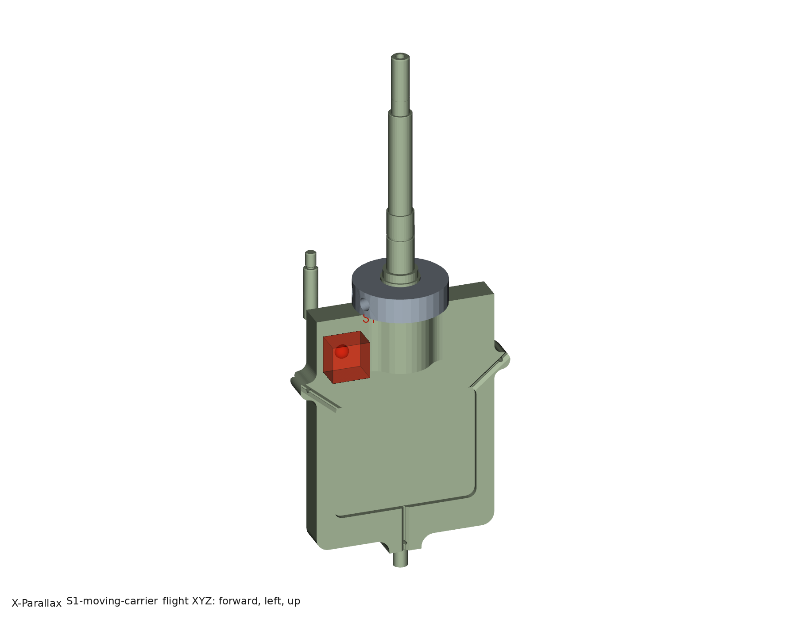
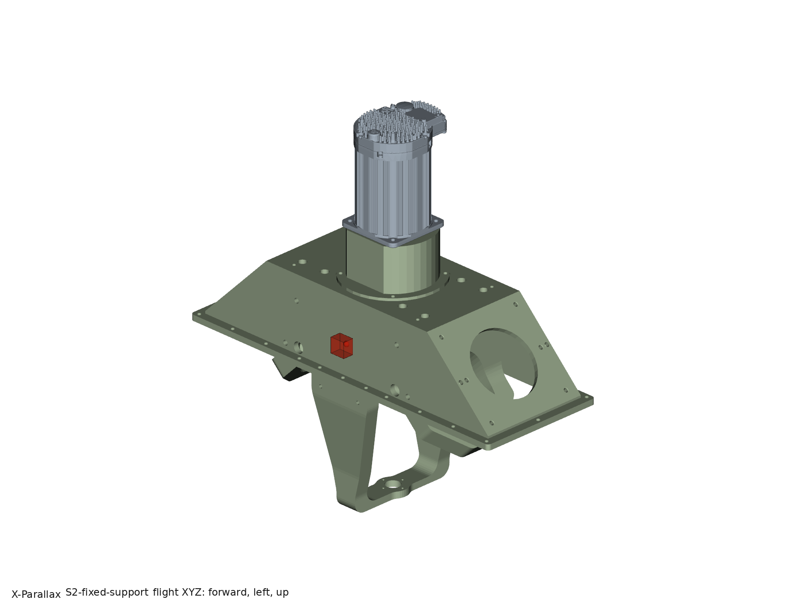
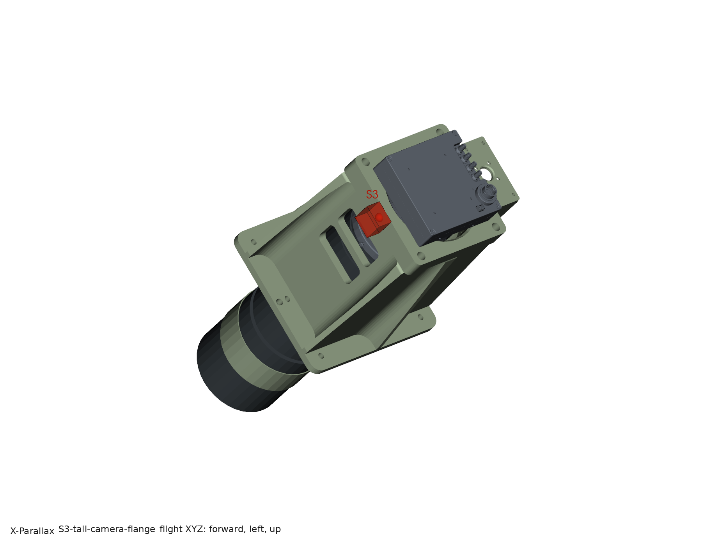
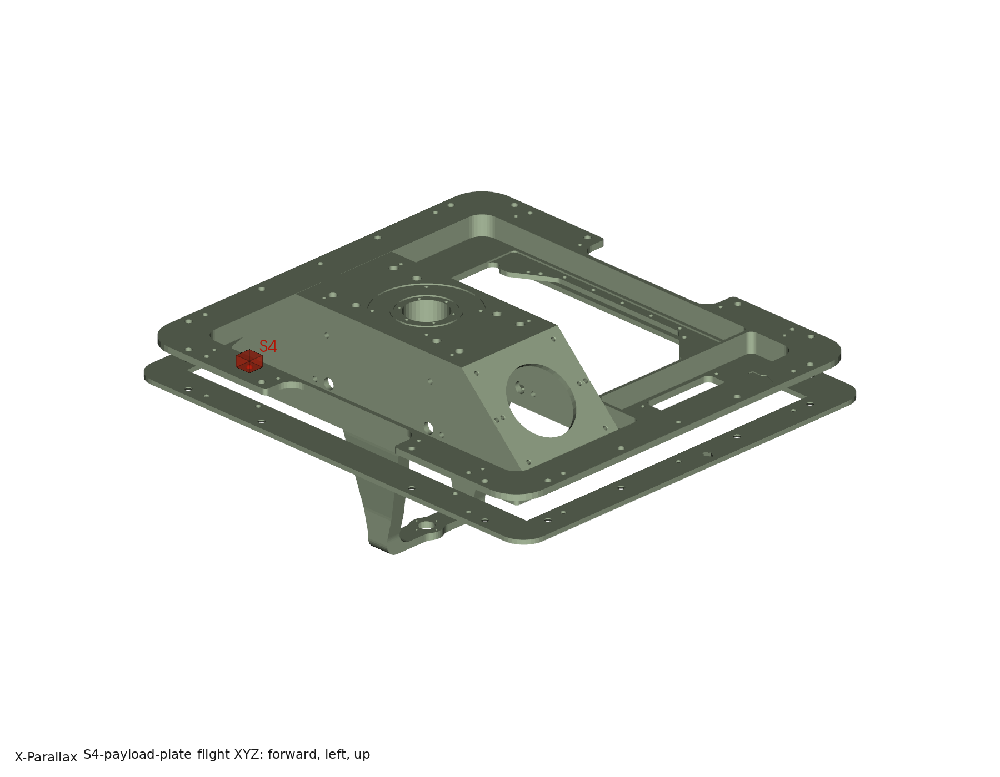

# X-Parallax: proposed IMU mounting datums from the supplied CAD

2026-11-16 — Codex mechanical review, for discussion with Cursor.

## Recommendation and status

Use the four channels for the **moving oblique mirror carrier, stationary common oblique support, tail-camera mounting flange, and payload plate above the isolators**, respectively. Cursor agreed to these four measurement bodies in principle in round 1. The exact faces below are new CAD-derived proposals; Cursor has not yet reviewed them. This document supersedes the earlier mounting-region proposal for physical locations.

These are specific placement datums, not released drilling or installation drawings. The mounting adapters, populated connector envelopes, cable routes and optical clearance remain to be checked on the assembled system. No original CAD, camera alignment or firmware was modified.

Source: `New parallax on DAX concept.STEP`, supplied in the CAD model folder; STEP header identifies SolidWorks 2021 / AP214 and an internal export date of 2026-10-06. The imported assembly contains 561 leaf instances. The model represents two 400 mm oblique lenses and one 300 mm nadir lens. Two back-to-back oblique mirrors share one carrier driven directly by a Teknic servo.

## How to use the coordinates and pictures

All coordinates below are **millimetres in the original CAD coordinate frame**, at the centre of the proposed PCB footprint projected onto the supporting structural face. They are not drill centres or the exact MEMS die location. Values rounded to 0.1 mm are placement references, not specified manufacturing tolerances.

Flight axes are forward, left, up. The recovered project transformation is `Xflight=-Zcad, Yflight=-Xcad, Zflight=Ycad`. `mount_points.json` includes unrounded coordinates, outward normals and in-plane basis vectors. Its face and instance numbers belong to this import and are not persistent SolidWorks IDs. Identify the part and geometric face first.

Red blocks show a **21 × 21 × 15 mm trial envelope**, not the actual populated board. Some surrounding parts are hidden for visibility. The real board, spacer, connector and cable bend must fit within the tested envelope or be checked again. The rendered sphere marks the placement region; it is not a fixing hole.

## S1 / J1 — moving mirror carrier

**Part XPL-P-102052: the flat vertical shoulder above the mirror glass, beside the central shaft boss**, on the side shown in red. Centre CAD **(146.0, 124.0, 16.0)**; flight **(-16.0, -146.0, 124.0)**.

The face normal is CAD `(0.422618, 0, -0.906308)`. Keep the board square aligned with the shoulder: one side parallel to CAD Y. The footprint spans CAD Y = 113.5…134.5 mm. It attaches to the moving metal carrier, not the glass, mirror retaining clips, fixed fork or shaft coupling.

This is the primary measurement of common-carrier angular motion. It does not measure deformation or slip of either individual mirror relative to the carrier. A short, rigid, lightweight mounting interface is needed; its fastening method has not been designed. Do not interpret the datum as permission to drill the optical assembly or disturb its clamps.

A previous candidate on the opposite face intersected a stop pin and was rejected. The revised location has approximately **8.9 mm static clearance to the moving ETP coupling** for the trial envelope. Sampled rotation checks from 0° to +50° about CAD Y, in 5° increments, found no contact against the selected surrounding structural components; the smallest sampled distance was approximately **4.3 mm to a lens**. This is not a continuous full-assembly sweep check, and the actual commanded travel limits have not been verified against that interval. Glass and the imaging ray bundle were not included in this clearance test: check vignetting at all acquisition angles.

Anchor the cable on the moving carrier shortly after its connector, then provide a gentle service loop near the rotation axis and a separate stationary anchor. Check the entire travel with the actual cable. A taut lead across the joint can change the motion being measured. Weigh the complete moving addition, including the supported cable portion.

## S2 / J2 — stationary common oblique support

**Part XPL-P-102047: the exterior flat side wall beneath the servo pedestal**, on the CAD X = 185 mm plane. Centre CAD **(185.0, 205.0, 8.0)**; flight **(-8.0, -185.0, 205.0)**. Outward normal CAD `(+1,0,0)`; board sides parallel to CAD Y and Z.

This measures the stationary structure carrying the oblique assembly. Comparing its aligned angular-rate history with S1 tests relative carrier/support motion. It is not directly on a bearing outer race, so that difference cannot uniquely identify bearing play or distinguish it from other compliance between the two measurement points.

The 21 mm footprint fits the selected planar face. No interference was found for the trial envelope against the exported structural components. This location supersedes the earlier lower-fork candidate.

## S3 / J3 — tail-camera mounting flange

**Part XPL-P-102037 belonging to the TAIL oblique camera, serial 2439006**, on its narrow external side face at CAD X = 55 mm, opposite the focus mechanism. Centre CAD **(55.0, 327.4, 298.7)**; flight **(-298.7, -55.0, 327.4)**. Outward normal CAD `(-1,0,0)`.

There are two instances of this part: choose the one on the positive-CAD-Z / negative-flight-X camera. Confirm the serial label on the physical camera; geometry alone does not encode that label.

This is a compromise: the camera body offers no obvious suitable 21 mm square mounting face in the model. The flange is directly associated with that camera, but **this sensor does not measure camera-body motion relative to the flange or internal lens motion**. A quiet S3 therefore cannot clear the camera/lens of responsibility for blur.

The flange side is only **19 mm wide**. An 18 × 18 mm support patch fits; a 21 mm PCB overhangs approximately 1 mm on each side across the thickness. Use a compact rigid interface supporting the mounting points, without contact to neighbouring parts. A 15 mm outward trial envelope leaves only **2.75 mm to XPL-P-102117**. Measure the actual IDC plug and cable exit before committing; a taller stack needs another clearance check. The trial block is not an adapter design.

## S4 / J4 — upper payload plate

**Part XPL-P-102069: the upward-facing outer rail near the oblique support foot**, on CAD Y = 184.64 mm. Centre CAD **(235.0, 184.6, 160.0)**; flight **(-160.0, -235.0, 184.6)**. Outward normal CAD `(0,+1,0)`; board sides parallel to CAD X and Z.

Use the upper, payload-side plate. **XPL-P-102081 is the lower aircraft-side plate and is not this location.** The 21 mm footprint fits solid material; no interference was found for the trial envelope against the exported structural components.

S4 supplies the local payload-base reference. S2 and S4 are separate parts joined structurally; similarity at some frequencies is a possible result, not a reason to omit the reference beforehand. These four locations do not measure isolator transmissibility. For a later isolator run, retain S4 above the isolators and relocate another sensor below them so both sides are measured simultaneously.

## What was checked, and what still needs fitting

- A 15 × 15 point grid on each proposed support patch lies inside its trimmed CAD face: 21 mm square for S1, S2 and S4; 18 mm square for S3. This is a surface-fit screening check, not a complete fixing design.
- Static envelope distances were calculated against 103 exported component instances, including the relevant XPL structure, cameras, lenses, shaft and couplings. Generic fasteners, mirror glass, isolators, aircraft installation and cable harnesses were not all included. No full-assembly clearance certification is implied.
- Four final images were inspected. The rejected S1 stop-pin collision was corrected before generating these locations.
- No existing M2 hole pattern at these exact points has been verified. Design or fit the smallest rigid interface needed; keep added mass and unsupported PCB flex low. Do not use a soft hot-glue blob as the measurement interface.
- The 20 cm sensor leads have not been routed. S1-to-S3 is about 343 mm in a straight line, so hub location, connector offsets and S1 service-loop allowance matter. Do not move a sensor onto the wrong structural body just to make a lead reach. A longer lead requires the corresponding SPI bench check.
- Record each board's actual MEMS-axis orientation, port number and camera/strobe mapping. The JSON basis describes the mounting plane, not the sensor chip axes. S1's transformation changes with mirror angle.

## Questions to Cursor before closing the joint recommendation

1. Does your matched 500 us / held-mirror analysis change the agreed four-body allocation? Please report the result, including focus/angle/exposure differences and the pixel convention of L.
2. Is the S3 flange compromise useful enough for the first run, given that it cannot exclude camera-to-flange or internal-lens modes? If you prefer a lens-barrel measurement, say which observation motivates replacing S3, rather than silently treating flange motion as optical motion.
3. Do you agree to retain S4 for the first run, then move a sensor to the second oblique camera or below an isolator only after the first synchronized measurements identify the useful comparison?

Analyse all three gyro axes in consistent frames. Compare synchronized histories and spectra; do not subtract RMS magnitudes as a substitute for differential motion. For blur prediction, reconstruct the image-plane trajectory throughout each measured exposure window, with timing/filter-delay calibration; endpoint angular displacement alone can miss reversal-induced blur. The CAD placement choice does not establish the excitation source.
